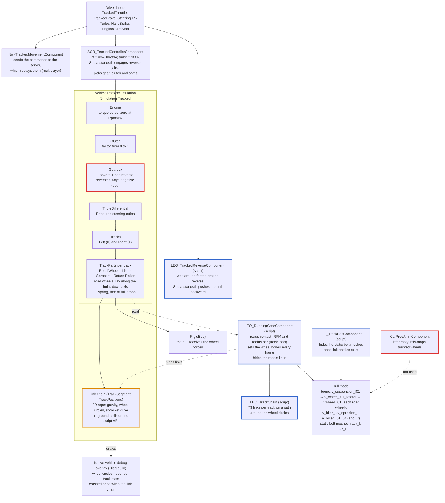

> [🇧🇷 Português](../pt-BR/02-architecture.md) · 🇬🇧 English

[← Overview](01-overview.md) · [Contents](../../README.md) · [3D model requirements →](03-model-requirements.md)

# Architecture

*Red border: native bugs (the reverse gearbox, the `CarProcAnimComponent` wheel mapping). Orange border: a native feature with limits (the rope chain). Blue border: the scripts from this guide. Dotted lines: reading, hiding or drawing only; they do not change the physics.*

The driver never talks to the simulation directly. The controller reads the keys and decides throttle, brake, gear and clutch. The simulation computes the engine, drivetrain, tracks, wheels and suspension, and applies the forces to the hull. Everything you see moving on the running gear is drawn on top of that: by the native rope chain, or by the scripts.

## What happens in one frame

1. **Controller.** `SCR_TrackedControllerComponent` turns the keys into throttle, brake, gear and clutch. Plain W gives 80% throttle; turbo gives 100% (measured: `engineThrust` 0.80 and 1.0).
2. **Drivetrain.** The simulation runs engine → clutch → gearbox → `TripleDifferential` → the two tracks. The sprocket radius sets the track speed: the chain speed in the debug overlay is the sprocket's angular velocity × 0.34 m on the Leopard (measured).
3. **Suspension.** Each road wheel casts a ray along the hull's down axis. The ray starts `RayStartOffsetUp` above the top of the wheel's travel (reverse-engineered from the attribute description). The wheel centre is the contact point plus `Radius` along the hull's up axis (measured: the script's value matched the engine's own suspension signal to 1.25 mm on average). The spring pushes from full droop; its force is zero there (measured). See [Suspension and ride height](13-suspension.md).
4. **Forces.** The wheel forces act on the `RigidBody`. `CenterOfMass` on the `RigidBody` is an offset from the model's own centre of mass, not an absolute position (reverse-engineered, then measured).
5. **Native link chain.** If the chain attributes are set, the simulation moves each track's chain as a 2D rope: fixed substeps of 0.0083 s, each with 25 passes of link-length and wheel-circle constraints, under gravity. Only the sprocket drives it, and nothing makes it collide with the ground. Each frame, in `EOnPostFrame`, one link entity is placed between each pair of neighbouring chain points (reverse-engineered). See [Track links](15-track-links.md).
6. **Scripts.** `LEO_RunningGearComponent` reads the simulation through `TrackedControllerComponent.GetSimulation()` in `EOnFrame`. It moves the suspension and wheel bones, spins the idler, sprocket and rollers, and lets `LEO_TrackChain` place its own links on a path around the wheels. It hides the rope's links. `LEO_TrackBeltComponent` hides the hull's static belt meshes once link entities exist. These scripts are visual and local: they do not feed back into the physics. See [Road wheels, idler, sprocket and return rollers](14-running-gear.md).
7. **Reverse.** `LEO_TrackedReverseComponent` is the only script that acts on the physics. While the driver reverses, it pushes the hull backwards with a force.

Open: the scripts update in `EOnFrame` and the native rope places its links in `EOnPostFrame`. A one-frame lag between the scripted bones and the physics is possible but has not been measured.

## How the simulation numbers the wheels

The simulation addresses every wheel as **(track, part)**. Track 0 is the first `Track` in the prefab (`Left` on the Leopard) and track 1 the second. The part is the position of the `TrackPart` in that track's `Wheels` list. These rules apply:

| Rule | How it is known |
| --- | --- |
| There must be exactly 2 tracks, each with at least 3 `TrackPart` entries | Reverse-engineered (loader error messages) |
| The sprocket and the idler must sit at the same index on both tracks | Reverse-engineered (loader error messages) |
| `TrackPart` types are `Road Wheel` (the default when no `Type` is given), `Sprocket`, `Idler` and `Return Roller` | Reverse-engineered; `Type "Return Roller"` tested on the Leopard |
| Parts 0 and 1 must be road wheels: the link chain takes its speed from part 0's radius and its angle from part 1 | Reverse-engineered |
| `WheelCount()` returns the parts of **one** track: 13 on the Leopard (7 road wheels, idler, sprocket, 4 return rollers) | Measured (log line `LEOGEAR simulation: 2 tracks, WheelCount 13`) |
| `TrackCount()` returns 0 until the simulation is loaded, then always 2 | Reverse-engineered; the simulation became valid 0.8–1.3 s after the vehicle spawned, before the engine started (measured) |

The Leopard lists each track as `Wheel_X01`..`Wheel_X07` (parts 0-6), `Idler_X` (7), `Sprocket_X` (8) and `Roller_X01`..`Roller_X04` (9-12).

*What the simulation sees, stopped on the runway (test video A, 2026-10-06, 1:49). The white circles are each `TrackPart` at its sim `Radius`: they reach the ground face of the links, so they are larger than the visible rims. The red line with cyan ticks is the native rope chain; it runs along the bottom of the scripted links. Blue vertical lines are the suspension. Model by buh-late, CC BY 4.0, modified.*

## Where each part lives in the prefab

| Component | Where it lives | Role |
| --- | --- | --- |
| `VehicleTrackedSimulation` | Hull `components` | Track physics: engine, drivetrain, tracks, wheels, suspension |
| Link chain attributes (`TrackSegments`, `TrackPositions`, `TrackLength`, `TrackThickness`, `TrackOffset1`, `TrackOffset2`, `TrackSegment`) | On `VehicleTrackedSimulation`, after the `Simulation` block (siblings of it, not inside it) | The native link chain. The number of links per track is the number of `TrackPositions` entries. `TrackThickness` is stored but never read in 1.8.0.13 (reverse-engineered) |
| `SCR_TrackedControllerComponent` | Inside `BaseVehicleNodeComponent` | Turns the keys into pedals, gear and clutch |
| `NwkTrackedMovementComponent` | Hull `components` | Replicates movement in multiplayer |
| `RigidBody` | Hull `components` | Mass, centre of mass and collision. `CenterOfMass` is an offset from the model's own centre of mass |
| `SCR_WheeledDamageManagerComponent` | Hull `components` | Damage: hull, engine, gearbox, wheels |
| `SignalsSourceAccess` | Inside `VehicleTrackedSimulation` (comes from the `.ct`) | Links the simulation to the `engineRPM`, `engineThrust`, etc. signals |
| `CarProcAnimComponent` `{5D6501223785D009}` | Hull `components` (inherited, empty in the base) | Leave it empty on tracked vehicles: in 1.8.0.13 it gives the wheel bones another wheel's signals |
| `LEO_RunningGearComponent` (script, uses the class `LEO_TrackChain`) | Hull `components` | Suspension and spin of the wheel bones; the scripted link chain; hides the rope's links |
| `LEO_TrackBeltComponent` (script) | Hull `components` | Hides the static belt meshes once at least 2 link entities exist; keeps them if no links appear within 5 s |
| `LEO_TrackedReverseComponent` (script) | Hull `components` | Reverse workaround; stops the engine when the driver seat becomes empty |
| `LEO_TelemetryComponent` (script) | Hull `components` | `LEOTEL` and `LEOSUSP` lines in `console.log` for tuning |

The engine components come ready-made in `TrackedVehicle_Base.et`. What is left is to fill in the simulation and the link chain attributes, as the [step-by-step guide](04-from-scratch.md) shows, and to add the scripts from [Ready-made scripts](11-scripts.md). The Leopard's blocks are in [examples/leopard2a6](../../examples/leopard2a6/README.md).

Notes on the scripts:

- Get the simulation with `TrackedControllerComponent.GetSimulation()`, and check `simulation.IsValid()` and `TrackCount() >= 2` before reading wheels. Never call `GetInputs()`: it crashes Workbench (reverse-engineered: it writes through a null pointer).
- The running gear and link scripts do nothing on a dedicated server, and they stop updating beyond 300 m from the camera. They have not been tested on other players' machines (proxies).
- The native debug overlay crashed Workbench on 2026-10-02, when the prefab had no link chain. With a chain it ran through a whole 5-minute test without a crash (measured). The disassembly shows the overlay reads the chain without checking that it exists (reverse-engineered), so the missing chain is the most likely cause of the crash. See [Vehicle debug diag and telemetry](16-debugging.md).

---

[← Overview](01-overview.md) · [Contents](../../README.md) · [3D model requirements →](03-model-requirements.md)
