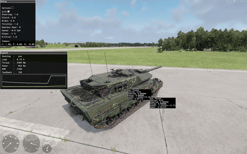
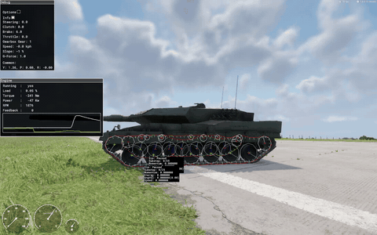
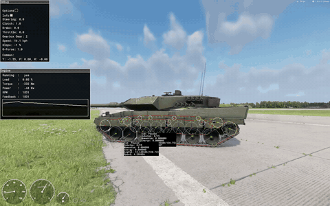
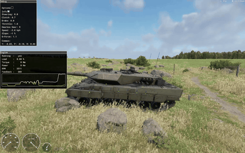

> [🇧🇷 Português](../pt-BR/05-video-examples.md) · 🇬🇧 English

[← Step by step from scratch](04-from-scratch.md) · [Contents](../../README.md) · [Converting an existing vehicle →](06-converting.md)

# Video examples

These examples come from two test videos of the **Leopard 2A6** example mod, recorded on 2026-10-06 in Workbench 1.8.0.13 (Diag exe, Play mode). In both, the native vehicle debug overlay is on, the road wheels, idler, sprocket and return rollers are driven by script, and the track links are the scripted link chain. A last section shows three diagnostic videos of 2026-10-05, recorded before those fixes.

Each example has a short GIF (or a still), the exact moment in the original video and the numbers read off the debug panels. Those numbers are observed in the video, read frame by frame. Relations such as "Feedback = sprocket rpm × gear ratio × 4.6" were checked on several frames. "Telemetry" means the `LEOTEL`/`LEOSUSP`/`LEOREV` lines in the Workbench log. "Reverse-engineered" means read from the 1.8.0.13 executable.

All media show the Leopard 2A6 example mod. The model is ["Leopard 2 A6"](https://sketchfab.com/3d-models/leopard-2-a6-7cb23d5322df4b409a880de635826067) by [buh-late](https://sketchfab.com/buh-late), licensed [CC BY 4.0](https://creativecommons.org/licenses/by/4.0/), published 2024-01-17. It was modified for Enfusion (split into parts, re-parented, bones and suspension rig, colliders, LODs, re-baked textures). The author does not endorse this project. Full credits: [CREDITS.md](../../CREDITS.md).

The previous edition of this chapter used a 2 min 13 s test of the Leopard 2A7 (model "Leopard 2 A7" by king_st0ne, CC BY-SA 4.0). Its text and GIFs are kept in the git history under the tag [`v1-leopard2a7`](https://github.com/Kiichiuwu/arma-reforger-tracked-vehicle-guide/blob/v1-leopard2a7/docs/en/05-video-examples.md).

## The videos

| Name | Recorded | Length | Content |
| --- | --- | --- | --- |
| Test video A | 2026-10-06 | 5:00 | Runway, then grass, rocks and a wire fence. Vehicle debug on; the "Draw tracks" overlay is off from 206.3 s |
| Test video B | 2026-10-06 | 1:17 | Trim of another recording of the same Play session (runway and grass), one continuous take with no cuts. It covers the same stretch as A 95.5–172.5 s: add about 95.5 s to a time in B to find the same moment in A (matched on the hard stops, pivots and reverse launches) |
| Diagnostic video 1 | 2026-10-05 22:35 | 4:30 | `CarProcAnimComponent` wheels and the native rope chain. Flip at 189–194 s |
| Diagnostic video 2 | 2026-10-05 22:56 | 1:10 | `CarProcAnimComponent` wheels with reordered params and the native rope chain |
| Diagnostic video 3 | 2026-10-05 23:21 | 0:40 | Scripted wheels and the native rope chain with extra slack. Mines at 22.75–24 s |

Setup of test videos A and B:

| Item | Value |
| --- | --- |
| World | Test sub-scene of the Arland Game Master world (`GM_Arland`): airfield runway, grass beside it, rocks and a wire fence |
| Prefab | `Leopard2A6_base.et`: `Mass` 62300, `MaxTravelDown` 0.10, 73 links with `TrackLength` 0.2110, empty `CarProcAnimComponent` ([prefab blocks](../../examples/leopard2a6/README.md)) |
| Road wheels, idler, sprocket, rollers | `LEO_RunningGearComponent` ([Road wheels, idler, sprocket and return rollers](14-running-gear.md)) |
| Track links | `LEO_TrackChain`. The native rope's links are hidden, but the rope keeps running, so the debug overlay still draws it ([Track links](15-track-links.md)) |
| Reverse | `LEO_TrackedReverseComponent` push. The log prints `LEOREV APPLY` at each reverse launch ([Ready-made scripts](11-scripts.md)) |
| Diag options | Show vehicle debug, Player vehicle only, Show engine, Show suspension, Wheel engine brake and MT simulation on; Show contacts on at 41 s ([full-size still of the menu](../images/diag-menu-tracked.jpg)) |
| Log alignment | Workbench log time = 00:14:14.8 + test video A time (checked against the HUD speed and gear) |
| Capture | 1152×720 at about 60 fps; the GIFs here are 480 px wide at 10 fps |

The third-person camera often turns with the hull. Turns and pivots then show mostly as the background rotating.

## Reading the HUD and the debug panels

*Still: test video A, 30.0 s. Everything the vehicle debug draws, over both tracks, with the tank at rest. Illustrates: [Vehicle debug diag and telemetry](16-debugging.md)*

The overlay exists only in the Diag exe. Open the diag menu in Play with left Win + Alt ([details](16-debugging.md)).

**HUD (bottom left).** Speedometer 0–120 km/h, tachometer in rpm × 1000 (0–3) and a fuel gauge. The speedometer has no negative side, so read reverse speed from the Debug panel. In reverse the tachometer sits at the top of its scale because of the native reverse bug ([Reverse launch](#reverse-launch)).

**Debug panel (top left).**

| Field | Meaning (how it is known) |
| --- | --- |
| Steering | -1 to +1. +1 turns right: in a pivot the left track runs forward and Y increases (observed) |
| Clutch | 0 = open, 1 = engaged. At idle it can read 1.0 while RPM and Feedback differ, so it is not always locked (observed) |
| Brake | 0 to 1 from the brake input. **6.0** is the handbrake value: `SetBreak(x, true)` stores 6.0 (reverse-engineered). It shows at every standstill hold, in every pivot, and in hard stops (0.0 → 6.0 at once, or 0.7 → 1.0 → 6.0 within 0.4 s) |
| Throttle | 0.8 in normal driving; 1.0 in pivots, in reverse and when blocked. Earlier telemetry ties 1.0 to throttle plus turbo (`ThrottleTurbo` 0.2); not checked in these clips |
| Gearbox Gear | R, N or 1–4. At standstill with the brake held the controller selects R (measured) |
| Speed | Hull speed in kph, negative in reverse |
| Slope | -1 % in every frame of both videos, even with P at 0.10–0.12: not a terrain readout (observed) |
| G-Force | Total acceleration in g: 1.0 at rest, 1.1–1.2 in hard braking |
| Common: Y, P, R | Yaw, pitch and roll, probably in radians (Y wraps at ±π). Y grows in right turns; P > 0 is nose down |
| Inertia | Shown only with Show inertia: 327602.7, 395692.4, 94730.0 (test video A, 46.5 s) |

**Engine panel (below it).**

| Field | Meaning (checked on the frames read) |
| --- | --- |
| Running | yes / no |
| Load | \|Torque\| / `MaxTorque` 4700 as a 0–1 fraction, despite the "%" sign (3409 Nm → 0.73, 4601 Nm → 0.98) |
| Torque | Engine torque in Nm. With throttle 0 it is negative (engine braking) and fits -470 × (RPM - 700) / (3000 - 700) within 2 Nm on all but two of the frames read, capped at -471 Nm (`Friction` 470, `RpmIdle` 700, `RpmMax` 3000) |
| Power | Torque × RPM × 2π/60, in kW (3409 Nm at 2700 rpm = 964 kW) |
| RPM | Engine rpm |
| Feedback | Drivetrain-side rpm = sprocket rpm × gear ratio × `Ratio` 4.6 (27.6 in gear 1, 15.18 in gear 2, 8.28 in gear 3, 10.58 in R). It equals RPM when the clutch is locked. In a neutral steer it is the mean \|track rpm\| × `NeutralSteeringRatio` 12 |
| Graph | A white RPM trace and a yellow trace |

**Per-track box (one per track).** In a side view the lower box belongs to the near track.

| Line | Meaning |
| --- | --- |
| `Sim: Paused` | Paused in every frame read, even at 27 km/h. The exe has three state strings next to this field: `Paused`, `Running` and `SubStepping`. Meaning open |
| `Substep: 0/25` | Always 0/25. The rope step runs 25 constraint iterations per substep (reverse-engineered); whether this field shows that count is not confirmed |
| `Momentum`, `Energy` | Always 0.000000. Meaning open |
| `AngVel` | Sprocket angular velocity in rad/s, with rpm in brackets |
| `Speed` | Chain speed in m/s. It equals AngVel × 0.34 (the sprocket `Radius`) in every frame read |

**Overlay on the running gear** (Tracked > Draw tracks on):

- A white 12-sided circle for each of the 13 TrackParts of a track, drawn at its **sim** `Radius`. The road-wheel circles (0.418) reach the ground face of the links, below the visible rims (0.345), so the circles of the front road wheels overlap. A white spoke turns with each wheel.
- The native rope as a red and green polyline with a cyan tick at each point. The meaning of the colours was not established; the near rope turned mostly green in the reverse hard stop of test video B (74.5 s).
- A number at each sprocket. It counts down when driving forward, up in reverse, and wraps between 72 and 0 (73 points). It is probably the index of the rope point gripped by the sprocket (not confirmed).
- Blue vertical lines and red/green crosses at the wheel centres, drawn with Show suspension on (the crosses also show with Show contacts off, for example at 62 s and 198 s). They stay when Draw tracks is off.
- The far track's overlay is drawn through the hull.

The Show … options sit in the vehicle diag list next to the Helicopter and Tracked submenus. The Tracked submenu holds only Steering mode, TrackSim, Draw tracks, Track dynamic, Track gravity and Reset tracks. Draw tracks switches the wheel circles, the rope polylines and the boxes on and off (test video A, 13.5–18 s and 206.3 s). Turning TrackSim or Track gravity off for a moment changed nothing visible. Reset tracks was not tried. A still of the overlay at rest in close-up: [debug-overlay-stationary.jpg](../images/debug-overlay-stationary.jpg) (test video A, 109.0 s). In that frame the red rope polyline runs exactly along the ground face of the scripted links.

## Summary

| Example | Video and time | Illustrates |
| --- | --- | --- |
| [Launch and automatic upshifts](#launch-upshifts) | Test video A, 94.5–99.0 s | [Tuning with real-world data](10-tuning.md) |
| [Steering while moving: the track speeds split](#steering-track-speeds) | Test video A, 31.0–33.2 s | [How it works inside](08-internals.md) |
| [Pivot turn: counter-rotating tracks](#pivot-counter-rotating) | Test video A, 177.0–181.5 s | [How it works inside](08-internals.md) |
| [Reverse launch](#reverse-launch) | Test video A, 134.0–137.6 s | [Bugs and limitations](09-bugs.md) |
| [Full reverse, then a hard stop](#reverse-hard-stop) | Test video B, 70.0–75.2 s | [Bugs and limitations](09-bugs.md) |
| [Hard braking and nose dive](#braking-dive) | Test video B, 8.4–12.6 s | [Suspension and ride height](13-suspension.md) |
| [Leaving the runway onto grass](#offroad-grass) | Test video A, 192.0–195.5 s | [Attribute reference](07-attribute-reference.md) |
| [Reversing out of the rocks, then brake-steer](#rough-ground) | Test video A, 284.5–288.5 s | [Track links: the native rope chain and the scripted chain](15-track-links.md) |
| [Scripted links wrapping the sprocket](#sprocket-wrap) | Test video A, 208.8–211.0 s | [Track links: the native rope chain and the scripted chain](15-track-links.md) |
| [Pull-away with the debug overlay](#debug-pullaway) | Test video A, 0.0–4.4 s | [Vehicle debug diag and telemetry](16-debugging.md) |
| [Side view at speed: the native rope under the scripted links](#hero-debug-side) | Test video A, 186.0–191.0 s | [Track links: the native rope chain and the scripted chain](15-track-links.md) |
| [Before the fixes](#before-the-fixes) | Diagnostic videos 1–3 | [Road wheels, idler, sprocket and return rollers](14-running-gear.md), [Track links](15-track-links.md) |

## Launch and automatic upshifts

A steady rear-right 3/4 view on the runway, with the overlay on both tracks. The tank pulls away in gear 1 with Throttle 0.8: 8.2 km/h at 94.5 s, 12.6 km/h at 95.0 s and 13.6 km/h at 95.5 s, about 2.1 m/s². At 13.6 km/h gear 1 is at its limit. The engine reaches 2926–2935 rpm, between `RpmRedline` 2700 and `RpmMax` 3000, and the governor cuts the torque to 139–196 Nm. The track boxes read 11.134745 rad/s (106.33 rpm) and 3.786 m/s, which is 13.6 km/h. The same speed follows from the engine: 2935 rpm / 27.6 (gear 6.0 × `Ratio` 4.6) = 106.3 sprocket rpm, and 106.3 rpm × 2π/60 × 0.34 m = 3.78 m/s.

The gearbox shifts to 2 at 96.5 s (14.3 km/h, 1941 rpm, 3489 Nm). In the still (97.0 s) it is in gear 2 at 15.9 km/h, with RPM = Feedback = 1969, 3462 Nm and 714 kW. Gear 2 pulls at about 1.2 m/s² (14.3 to 23.2 km/h in 2 s). At 99 s the boxes read 19.334555 rad/s (184.63 rpm) = 6.574 m/s = 23.7 km/h, the same as the hull speed, and Feedback 2803 = 184.63 × 15.18 (gear 3.3 × 4.6). The shift to gear 3 starts there. The link-index numbers at the sprockets count down quickly as the chain runs.

Earlier telemetry gives the same shift points: a median of 2924 rpm for 1 → 2 and 2812 rpm for 2 → 3. The test videos stay below 28 km/h (27.7 km/h at 100.5 s). The 2A6 top speed has not been re-measured: theory gives about 72–75 km/h with `Ratio` 4.6, and the earlier 2A7 build measured 74.3 km/h.

*Video: test video A 94.5–99.0 s · [full-size still](../images/launch-upshifts.jpg) (97.0 s) · Illustrates: [Tuning with real-world data](10-tuning.md)*

## Steering while moving: the track speeds split

The right side, with an almost static camera. The tank starts from rest in gear 1. At 32.0 s both tracks run at 2.934 rad/s (28.02 rpm, 0.998 m/s = 3.6 km/h) while the hull does 1.7 km/h: the tracks slip at take-off (Throttle 0.8, Clutch 0.9, 3684 Nm).

The driver then steers left. At 32.75 s (Steering -0.5, 9.3 km/h) the outer (right) track reads 9.678348 rad/s (92.42 rpm, 3.29 m/s) and the inner track 4.940294 rad/s (47.18 rpm), about 2:1. Their mean, 7.31 rad/s × 0.34 m = 2.49 m/s (9.0 km/h), matches the hull speed. At 33.0 s (Steering -0.8, 8.0 km/h) the split is 7.37 against 2.25 rad/s. The camera starts to orbit at about 33 s.

Just after the GIF (34.0 s, Steering -0.9, Throttle 0) the inner track almost stops: 1.42 rpm against 27.50 rpm. The tank turns about its inner track instead of counter-rotating, and the turn kills speed: 9.3 to 2.2 km/h in about 1.25 s. At full lock the inner track first runs at exactly 1/6 of the outer (99.08 against 16.51 rpm at 149 s), which matches `SteeringRatio` 6; later in the same turn the ratio is 6.2–6.9. The hull then turns on a radius of about 1.6–1.8 m (test video A 149–156 s, test video B 51–57 s).

*Video: test video A 31.0–33.2 s · [full-size still](../images/steering-track-speeds.jpg) (32.75 s) · Illustrates: [How it works inside](08-internals.md)*

## Pivot turn: counter-rotating tracks

A pivot on the runway with Steering 1.0, Throttle 1.0, Gear R, Clutch 0.0 and Brake 6.0. The engine sits at 2700 rpm (`RpmRedline`) with 3409 Nm and 964 kW, while Feedback stays low. At 177.0 s the hull stands still (-0.0 km/h) and the boxes read +1.595173 and -1.619690 rad/s (+0.542 and -0.551 m/s): a true neutral turn, with the tracks equal and opposite. The left track runs forward (Steering +1 turns right). As the hull turns, the backward-running track speeds up and the hull starts to back up:

| Time | Forward track | Backward track | Hull | Feedback |
| --- | --- | --- | --- | --- |
| 177.0 s | +0.542 m/s | -0.551 m/s | -0.0 km/h | 185 |
| 178.5 s | +0.698 m/s | -1.105 m/s | | |
| 180.0 s | +0.533 m/s | -1.890 m/s | -2.2 km/h | 408 |
| 181.0 s | +0.410 m/s | -2.361 m/s | -3.4 to -3.7 km/h | |

Feedback follows the neutral-steer rule: at 180.0 s the tracks turn at 14.97 and 53.07 rpm, and their mean, 34.02, × `NeutralSteeringRatio` 12 = 408. The tank turns about 200° between 175.5 and 182 s. At 180 s the track speeds predict 0.91 rad/s of yaw (speed difference / 2.658 m between the tracks), but Y changes by only 0.69–0.78 rad/s, so the tracks slip (inferred).

Two kinds of pivot appear in the videos. With Clutch 0.0 (this GIF) the engine runs at the 2700 rpm governor and Feedback stays low. With Clutch 1.0 (test video A 158–164 s, test video B 64.3–68 s) the engine is dragged down to 700 rpm with 4601 Nm (Load 0.98), yet the hull turns faster on the runway: up to 1.13 rad/s, against 0.83 rad/s in the 2700 rpm pivot of test video B. On grass (test video A 294–296 s) the same 700 rpm, 4601 Nm state barely turned the hull. Brake reads 6.0 in both kinds. In almost every pivot the backward track runs faster and the hull drifts backwards (-0.1 to -3.8 km/h). Which controller logic sets the handbrake here, and why the drift happens, is open.

*Video: test video A 177.0–181.5 s · [full-size still](../images/pivot-counter-rotating.jpg) (180.0 s) · Illustrates: [How it works inside](08-internals.md)*

## Reverse launch

A low, steady view of the left side. The tank pulls away backwards: 0 to -10.5 km/h in about 1.2 s (134.0–135.4 s), about 2.4 m/s². The wheels and the scripted links visibly turn backwards, and the link-index number at the sprocket counts up (40 → 48 in 0.7 s). The road-wheel circles reach the ground face of the links, not the rims, because they are drawn at the sim `Radius` 0.418. The rope polyline runs along the bottom of the scripted links and wraps the sprocket circle.

The Engine panel shows the native reverse bug. In R the RPM jumps 901 → 3146 → 3584 → 3766 within 0.4 s and stays at 3766–3768, above `RpmMax` 3000. Torque reads 0 Nm at full throttle and -471 Nm with throttle 0. 3766 rpm is the value the reverse-engineered bug formula predicts for the 2A6 (`RpmMax` + 766 rpm, see [Bugs and limitations](09-bugs.md)). With zero engine torque the tank moves only because `LEO_TrackedReverseComponent` pushes the hull: the log prints `LEOREV APPLY force=00159947 N v=-04.0 km/h` at 134.4 s. Feedback still follows the tracks. In the still (136.0 s, throttle released) the boxes read -8.213704 rad/s (-78.44 rpm), -2.79 m/s = -10.1 km/h, and Feedback 830 = 78.44 × 10.58 (`Reverse` 2.3 × 4.6).

The HUD tachometer sits at the top of its scale and the speedometer shows no reverse sign. Only the Debug panel shows the negative speed.

*Video: test video A 134.0–137.6 s · [full-size still](../images/reverse-launch.jpg) (136.0 s) · Illustrates: [Bugs and limitations](09-bugs.md), [Ready-made scripts](11-scripts.md)*

## Full reverse, then a hard stop

The same steady view of the left side, in test video B. The tank reverses from -1.9 km/h at 70.0 s to -16.6 km/h at 73.0 s. Both boxes keep reading `Sim: Paused`, `Substep: 0/25`, `Momentum` 0 and `Energy` 0; only AngVel and Speed climb. The engine stays at 3766–3768 rpm with Clutch 1.0 and Torque 0 Nm, while Feedback rises from 234 to 1366. At 73.0 s (throttle released) the near box reads -13.530499 rad/s (-129.21 rpm) and -4.600 m/s = -16.6 km/h, and Feedback 1366 = 129.21 × 10.58.

From 73.8 s the brake ramps 0.7 → 1.0 → 6.0 and the tank stops in about 1 s, peaking at about 5.7 m/s² once Brake reads 6.0, G-Force 1.2. P goes to -0.04 (the tail dips), then rebounds to +0.01. The tracks skid: at 74.4 s they read -1.656 m/s while the hull still does -10.6 km/h (-2.94 m/s). During the stop the RPM spikes to 4721–4804 with -471 Nm, and most of the near rope polyline turns green.

Short reverse pushes like this one end at -16 to -17 km/h because the throttle is released after about 3 s; the scripted push also fades with speed (0.3 g at standstill, zero at 31 km/h). A longer push reached -27.8 km/h after about 7.6 s (telemetry, 2026-10-05 23:19).

*Video: test video B 70.0–75.2 s · [full-size still](../images/reverse-hard-stop.jpg) (73.0 s) · Illustrates: [Bugs and limitations](09-bugs.md)*

## Hard braking and nose dive

The right side; the camera orbits slowly from side-on to front-right 3/4. The tank coasts in gear 3 at about 23 km/h with Throttle 0. At 9.0 s it does 23.5 km/h (6.53 m/s) with -161 Nm at 1485 rpm, and the tracks run at 6.398 m/s, about 2 % slower than the hull under engine braking.

At 10.83 s Brake jumps from 0.0 to 6.0. The speed falls from 19.8 km/h to 0.9 km/h at 11.83 s, about 5.3 m/s², with G-Force 1.1–1.2. P goes 0.01, 0.03, 0.05 (peak at 11.17 s), 0.04, 0.03, 0.02, then rebounds to -0.01 at about 12.3 s: a small nose dive. The gearbox drops from 3 to 2 at about 10.9 km/h and selects R at standstill.

The tracks lock and skid: at 11.2 s both boxes read 1.535 m/s while the hull still does 13.5–14.4 km/h (3.75–4.0 m/s). The same happens in every hard stop read in these videos (0.96–1.66 m/s of track against 2.6–4.0 m/s of hull). The measured 5–5.7 m/s² is a little below a rough estimate from the brake torques, computed with each part's full `BrakeTorque`: (14 × 6000 / 0.418 + 2 × 30000 / 0.34) N / 62300 kg ≈ 6.1 m/s².

The dive is hard to see on screen. On an earlier run the suspension telemetry measured 1.85° nose-down at -4.3 m/s² with Brake 6.0 (front wheels +72 mm, rear wheels -88 mm).

*Video: test video B 8.4–12.6 s · [full-size still](../images/braking-dive.jpg) (11.2 s) · Illustrates: [Suspension and ride height](13-suspension.md), [Tuning with real-world data](10-tuning.md)*

## Leaving the runway onto grass

A rear-left 3/4 view with the full overlay; both rope loops are drawn. The tank rolls off the runway with the left track on grass and the right track on concrete. It coasts down from about 15 km/h, shifts down to gear 1 at 194 s with a light brake (0.3, G-Force 1.1) and ends at 4.2 km/h.

At 194.5 s the boxes read 5.481618 rad/s (52.35 rpm, 1.864 m/s) and 5.436948 rad/s (51.92 rpm, 1.849 m/s). With Steering 0.0 the two tracks differ by only 0.8 %, one on grass and one on concrete. The hull does 6.8 km/h (1.89 m/s), about 1.5 % ahead of the tracks while coasting. The gear-1 ratio checks out: 1433 rpm / 52.35 = 27.4 (6.0 × 4.6 = 27.6).

The ground at the runway edge is flat, so the suspension hardly moves.

*Video: test video A 192.0–195.5 s · [full-size still](../images/offroad-grass.jpg) (194.5 s) · Illustrates: [Attribute reference](07-attribute-reference.md)*

## Reversing out of the rocks, then brake-steer

The left side on rough grass with rocks, with the camera following. Draw tracks is off from 206.3 s on, so only the suspension markers are drawn. Before this clip the tank was stuck against rocks for about 7 s (276–282 s). Full throttle in gear 1 held the engine at 700 rpm with 4601 Nm and Feedback 381 while the hull did 0.1–0.3 km/h. The tracks were probably slipping in place (inferred; grass hides the bottom run).

The driver reverses out: Gear R, -0.5, then -5.5, then -12.1 km/h. At 285 s the engine over-revs to 3745 rpm with Torque 0 (the reverse bug again), while Feedback 450 still matches the tracks (10.58 × hull speed / 0.34 m gives 454). The scripted push is doing the work: the log prints `LEOREV APPLY force=00149825 N v=-05.7 km/h` with `steer=-1.00` at 284.7 s.

Then comes a brake-steer while still rolling back: Steering -1.0, Brake 6.0 (later 1.0), RPM 700, 4601 Nm. Y swings from -0.98 (286 s) to -1.52 (287 s) and -1.80 (288 s), about 0.8 rad in 2 s, and the hull turns to face the camera between about 286.8 and 287.6 s. The clip ends with the front wrap of both tracks in view. The scripted links stay on the idlers and sprockets throughout.

The rocks in this part of the video lie beside the tracks, not under them, so the clip does not show the suspension working over a rock. Grass hides most of the bottom run.

*Video: test video A 284.5–288.5 s · [full-size still](../images/rough-ground.jpg) (287.0 s) · Illustrates: [Track links: the native rope chain and the scripted chain](15-track-links.md), [Bugs and limitations](09-bugs.md)*

## Scripted links wrapping the sprocket

A clear 3/4 view of the right side on grass. The tank turns gently (Steering 0.4, then -0.7) at about 8–10 km/h, with roll R at 0.12–0.15. In the still (209.5 s) it is in gear 1 at 7.8 km/h, with Throttle 0.8, RPM = Feedback = 2719 and 2458 Nm. The scripted links come up from the last road wheel, wrap the rear sprocket and run forward over the return rollers. On the bottom run they pass under all 7 road wheels. Only the small suspension markers are drawn (Draw tracks off).

The links are placed every frame on a path built from the wheel circles at their sim radii, so they cannot come off the sprocket by construction. They have not yet been driven through a flip or a mine blast.

*Video: test video A 208.8–211.0 s · [full-size still](../images/sprocket-wrap.jpg) (209.5 s) · Illustrates: [Track links: the native rope chain and the scripted chain](15-track-links.md)*

## Pull-away with the debug overlay

A full side view of the left running gear while the tank drives off and changes gear; the Debug and Engine panels are readable throughout. It starts with a neutral steer from rest at 0.0 s: Steering 1.0, Clutch 0.0, Brake 6.0, Throttle 1.0, gear 1. The engine runs at 2700 rpm with 3409 Nm, and the tracks counter-rotate unevenly: -1.405754 rad/s (-13.42 rpm, -0.478 m/s) and +2.175743 rad/s (20.78 rpm, +0.740 m/s). Feedback 206 is the mean \|track rpm\| × `NeutralSteeringRatio` 12 (17.1 × 12 = 205).

| Time | Inputs | Hull | RPM / Feedback | Tracks |
| --- | --- | --- | --- | --- |
| 0.5 s | Steering 0.7, Clutch 0.5, Throttle 0.8 | 1.0 km/h | 1003 / 431 | 3.306 rad/s (31.57 rpm) and 0: the inner track is held still |
| 1.0 s | Steering -0.1, Clutch 1.0, Throttle 0.8 | 6.0 km/h | 1589 / 1589 (3702 Nm) | about 2.04 m/s each, 20 % faster than the hull (slip) |
| 2.0 s | Clutch 1.0, Throttle 0.8, gear 1 | 13.2 km/h | 2803 / 2803 | 10.634644 rad/s (101.55 rpm), 3.615 m/s |
| 4.0 s | Throttle 0.0, gear 2 | 18.0 km/h | 2009 / 2009 (-268 Nm) | 13.856 rad/s (132.32 rpm), 4.71 m/s |

At 0.5 s Feedback 431 is about the mean track rpm × 27.6 (436). At 2.0 s, 101.55 rpm × 27.6 (gear 1) = 2803, and Speed / AngVel = 0.340 m, the sprocket `Radius`. At 4.0 s, 132.32 × 15.18 (gear 2) = 2009. With the clutch locked, RPM equals Feedback. From 4.0 to 7.0 s the tank coasts in gear 2 with throttle 0, from 17.5 to 12.9 km/h (about 0.43 m/s²), and the engine-braking torque falls from -265 to -159 Nm as the rpm drops.

*Video: test video A 0.0–4.4 s · [full-size still](../images/debug-pullaway.jpg) (2.0 s) · Illustrates: [Vehicle debug diag and telemetry](16-debugging.md)*

## Side view at speed: the native rope under the scripted links

A stable side view of the left side on the runway. The tank shifts to gear 2 at about 186.5 s (the speed dips from 13.0 to 10.3 km/h with Clutch 0.2), accelerates to 21.8 km/h by 189 s and then coasts. Every TrackPart of both tracks has its white sim circle with a turning spoke, and the scripted links run under the road-wheel circles and around the sprocket.

The native rope is still simulated under the scripted links; only its links are hidden. Its top run visibly whips at 17–21 km/h. A segment rises above the line of the return rollers near the sprocket (best at about 188.3 s), and at about 189.7–190.0 s it cuts diagonally down across the rear road wheels. The scripted links and the rope's bottom run stay tidy, and the boxes still read `Sim: Paused`, `Substep: 0/25`, `Momentum` 0, `Energy` 0. The rope's slack also shows at 25 km/h around 100 s in test video A, where it gathers in the top run just forward of the rear sprocket. This is the slack that `TrackLength` 0.2110 gives the rope. It is invisible in normal play because the native links are hidden.

| Time | State | Hull | Track box | Engine |
| --- | --- | --- | --- | --- |
| 187.0 s | gear 2, Throttle 0.8 | 10.7 km/h (2.97 m/s) | 9.571692 rad/s (91.40 rpm), 3.254 m/s: 9.5 % faster than the hull | 1467 rpm, 3722 Nm, 572 kW |
| 188.0 s (still) | gear 2, Throttle 0.8 | 16.2 km/h | 13.620472 rad/s (130.07 rpm), 4.631 m/s | 1995 rpm, 3442 Nm, 719 kW |
| 189.83 s | gear 2 | 21.3 km/h | 16.684423 rad/s (159.32 rpm), 5.673 m/s | 2417 rpm; 2417 / 159.32 = 15.17 = 3.3 × 4.6 |
| 190.0 s | gear 2, Throttle 0 (coasting) | 20.8 km/h | 16.363831 rad/s (156.26 rpm), 5.564 m/s = 20.0 km/h: 4 % slower than the hull | 2370 rpm, -342 Nm, -85 kW |

*Video: test video A 186.0–191.0 s · [full-size still](../images/hero-debug-side.jpg) (188.0 s) · Illustrates: [Track links: the native rope chain and the scripted chain](15-track-links.md), [Vehicle debug diag and telemetry](16-debugging.md)*

## Before the fixes

Three diagnostic videos of 2026-10-05, recorded while the running gear and the links were being fixed. They show the failures that led to the scripted wheels and the scripted link chain. They have no debug overlay, so speeds and rpm come from the HUD needles (about ±3 km/h and ±150 rpm).

| Video | Wheels | Link chain | Suspension in the sim |
| --- | --- | --- | --- |
| Diagnostic video 1 (22:35) | `CarProcAnimComponent` with `wheel_suspension.pap`, params in per-side order (run 1) | Native rope, 73 × `TrackLength` 0.2101 | `MaxTravelDown` 0.15: hull about 5 cm high at rest (rest travel -53 mm, measured) |
| Diagnostic video 2 (22:56) | `CarProcAnimComponent`, params interleaved L01, R01, L02, … (run 2) | Native rope | Still behaving like run 1 (rest travel -51 to -54 mm): the prefab edits had not reached the open world |
| Diagnostic video 3 (23:21) | `LEO_RunningGearComponent` (scripted) | Native rope, 73 × `TrackLength` 0.2110 | `MaxTravelDown` 0.10: hull at its modelled height |

Most likely mechanism of the rope failures (inferred from the reverse-engineered rope step): every rope point has gravity, and the rope never collides with the ground. A point is held at the bottom of a road wheel only while that wheel has ground contact and the point lies below the wheel centre, within 0.1 m of it along the hull. Slack therefore hangs between the wheels and around the sprocket and idler. When the wheels lose contact (flip, blast) the hold switches off and the wheels drop to full droop, which uses up all of the rope's slack or more. The constraint step then drags points across the wheel circles, and the collision step pushes each point out on the nearest side. A rope pulled past the sprocket centre ends up outside it and stays there.

### Road wheels floating above the chain (CarProcAnimComponent)

Diagnostic video 2, a low static view of the right side with the engine idling at 0 km/h. Road wheel 1 (front, at the right of the picture) sits on the links. Wheels 2–7 hover above the chain, with daylight and the link guide horns visible under them: about 5–8 cm, estimated from the 0.69 m rim. The camera does not move from 7.0 to 21.5 s, and the gap stays the same while driving at about 10 km/h (23.3–28.8 s). Diagnostic video 1 shows the same fault at about 22 km/h (15–19 s).

Telemetry of this run: bones R02–R07 sat 51–54 mm above their sim wheel, and R01 was within 4 mm of it. `CarProcAnimComponent` fed most wheel bones the signals of another wheel. In run 1, bones L01/L03/L05/L07 followed left wheels 0/1/2/3 to within 0.9–1.7 mm. In run 2 the even left bones L02/L04/L06 spun exactly like the right bone R01. Do not use `CarProcAnimComponent` for tracked running gear in 1.8.0.13. The bones are now driven by `LEO_RunningGearComponent`.

*Still: diagnostic video 2, 9.0 s · Illustrates: [Road wheels, idler, sprocket and return rollers](14-running-gear.md)*

### Rope sagging below the wheels

Diagnostic video 3, parked on the runway with the engine off. The scripted wheels sit at the right height, but the native rope's bottom run lies below them, about 5–10 cm (estimated) under wheels 2–6, and curls loosely at the rear. With `TrackLength` 0.2110 the chain is 73 × 0.2110 = 15.403 m long, about 12 cm more than the 15.284 m path around the wheel circles at rest. The rope has gravity but no ground collision, so the extra length most likely hangs down (inferred). The sag reads clearly in a 2× crop but is subtle at full frame.

*Still: diagnostic video 3, 8.0 s · Illustrates: [Track links: the native rope chain and the scripted chain](15-track-links.md)*

### Slack piling up behind the sprocket at speed

Diagnostic video 3, a tracking view of the right side at about 27 km/h and about 2000 rpm. The slack gathers between the sprocket and road wheel 7. The links zig-zag, stack and flap out below and behind the sprocket, with spikes at about 17.2–17.4 s and 18.8 s. The bottom run also hangs a little below the wheels.

*Video: diagnostic video 3 15.5–19.6 s · [full-size still](../images/before-rope-sag-sprocket.jpg) (17.4 s) · Illustrates: [Track links: the native rope chain and the scripted chain](15-track-links.md)*

### Upside down: the rope hangs under gravity

Diagnostic video 1. At 189–194 s the tank climbs a grass bank by the runway, rolls onto its side and lands on its roof. Telemetry of that moment: 33–41 km/h in gear 4 with the roll growing to -11° over about 3 s, then an impact from 34.3 to 13.5 km/h in 0.5 s and a roll to 177.5° within 2.5 s. The centre of mass in this build was 2.17 m above the ground, because `CenterOfMass` 0 1 0.46 is added to the model's own COM point. That gives a static stability factor of only about 0.61 g (computed, not a proven cause; see [Suspension and ride height](13-suspension.md)).

Lying inverted, the near side is the left one. The road wheels have no contact and hang at full droop, pointing up. The rope's ground run is stretched over them, and the former return run sags below the inverted hull like a catenary: the rope has gravity and no ground collision. With every wheel at 0.15 m droop, the path around the wheel circles is longer than the 73 × 0.2101 m chain: about 10–14 cm short, depending on whether the arc or the polygon of links is counted. A Game Master icon covers the hull from about 197.2 s; the tank was set upright at about 198–203 s.

*Video: diagnostic video 1 194.6–197.0 s · [full-size still](../images/before-flip-rope-hangs.jpg) (195.0 s) · Illustrates: [Track links: the native rope chain and the scripted chain](15-track-links.md), [Suspension and ride height](13-suspension.md)*

### Rope off the sprocket after the flip

Diagnostic video 1, after the tank was set upright, on the runway (static front-left 3/4 view, about 5–7 km/h). The left rope wraps the last road wheel (7) instead of the sprocket. The sprocket floats bare behind and above the end of the chain, with daylight under it. The fault stays the whole time on the runway (249–257 s): the rope does not re-seat by itself, and the script API has no call to reset it. Road wheels 2–4 sit visibly above the chain (the `CarProcAnimComponent` mis-mapping). At 261.5 s a rear view shows the left sprocket bare and the right one still wrapped: only the side that came off stays off.

*Still: diagnostic video 1, 255.0 s · Illustrates: [Track links: the native rope chain and the scripted chain](15-track-links.md)*

### Rope off after a mine blast

Diagnostic video 3. At 22.75–24 s the tank runs over a row of mines, and the hull is kicked up at 24.4–25.0 s. Telemetry of that run: pitch -5.5 to -10.1°, roll up to 10.8°, several wheels airborne, and contact travel up to +0.348 m, above `MaxTravelUp` 0.30. From 25.0 to 26.2 s the left rope bulges in a loose loop below and behind the sprocket, and a loop also hangs at the right rear. From 26.3 to 28.0 s the left rope runs as a thin diagonal strand from the sprocket down onto a rock, joined to the tank only at the rear, while the road wheels ride on the rock with no links under them (about 10 km/h, about 2700 rpm). A bush blocks the view from about 28.3 s.

*Video: diagnostic video 3 25.0–28.0 s · [full-size still](../images/before-rope-off-mines.jpg) (27.3 s) · Illustrates: [Track links: the native rope chain and the scripted chain](15-track-links.md)*

### Bare sprocket at the end

Diagnostic video 3, end of the clip: the right side, stopped among rocks and grass. The sprocket teeth are bare and no links show under the road wheels, so the right rope has come off as well (the sprocket already looks bare at about 33 s). After this run the native rope's links were hidden and the scripted link chain took their place.

*Still: diagnostic video 3, 38.0 s · Illustrates: [Track links: the native rope chain and the scripted chain](15-track-links.md)*

## What the videos reveal

Most of these behaviours apply to any tank built with this guide; the numbers are the Leopard's. Times are in seconds; "A" and "B" are the test videos.

| Behaviour | Where | Status |
| --- | --- | --- |
| Road wheels, idler, sprocket and return rollers turn and follow the suspension | A and B throughout (little suspension travel on this flat ground) | ✅ By script, `LEO_RunningGearComponent` ([details](14-running-gear.md)) |
| With `CarProcAnimComponent`, right road wheels 2–7 float about 5–8 cm above the chain (telemetry adds: most bones get another wheel's signals, for example the even left bones spin like the right bone R01) | Diagnostic video 2, 7–28.8 · diagnostic video 1, 15–19 | ❌ `CarProcAnimComponent` mis-maps tracked wheels in 1.8.0.13; replaced by the script ([details](14-running-gear.md)) |
| Scripted links wrap the sprocket and idler and stay on over grass, against rocks and through a wire fence, with no sag | A 208.8–211.0, 251–259.8, 284.5–292.2 · all of B | ✅ Scripted chain ([details](15-track-links.md)). Cannot derail by construction; not yet tested through a flip or a mine blast |
| The native rope with about 12 cm of slack hangs below the wheels and piles up behind the sprocket | Diagnostic video 3, 5.6–9.0, 15.5–19.6 | ⚠️ Native rope: gravity, no ground collision ([details](15-track-links.md)) |
| The native rope comes off the sprocket after a flip and stays off | Diagnostic video 1, 189–197, 249–262.8 | ⚠️ No script API to reset it; only the Diag menu has Reset tracks (not tried) |
| The native rope comes off after mines throw the tank | Diagnostic video 3, 22.75–28.0, 33–39.7 | ⚠️ Same mechanism (inferred) |
| The hidden native rope keeps running under the scripted links; its top run whips at 17–21 km/h and its slack gathers forward of the rear sprocket | A 100, 188.3, 189.7–190.0 | Cosmetic, because its links are hidden. Whether the wheel RPM depends on the rope is open |
| The vehicle debug works with a link chain present: Show vehicle debug stayed on for the whole session, with no crash while toggling Show inertia, Show forces, Show engine, Show contacts, Show raycast, Show wheels, Show Controller Diags, Draw tracks, TrackSim and Track gravity | A 0–89, 196–207 · all of B | ✅ It crashed on 2026-10-02, when the vehicle had no chain ([details](16-debugging.md)) |
| The rope boxes read `Sim: Paused`, `Substep: 0/25`, `Momentum` 0 and `Energy` 0 in every frame, even at 27 km/h | Both test videos | Open: meaning unknown |
| Chain speed = AngVel × 0.34 m (sprocket `Radius`); Feedback = sprocket rpm × gear ratio × 4.6 | Every frame read (Feedback: outside neutral steers), for example A 2.0, 99, 136 | Measured from the overlay ([details](08-internals.md)) |
| Track slip: the tracks run 3–20 % faster than the hull under power (about 110 % at take-off, A 32.0) and 2–6 % slower when coasting | A 1.0, 32.0, 187, 190, 205 · B 2, 9 | Measured from the overlay |
| Gear 1 tops out at 13.6 km/h at about 2935 rpm, where the governor cuts the torque; then the gearbox upshifts (not always: at A 117–120 it stayed in gear 1) | A 95.5–96.5, 127–129 · B 0–1 | Measured ([details](10-tuning.md)) |
| Engine-braking torque = -470 × (RPM - 700) / (3000 - 700), capped at -471 Nm | A 102–106, 263 · B 5 | Measured (fit within 2 Nm on all but two frames) |
| Brake 6.0 stops the tank at about 5–5.7 m/s² (G-Force 1.1–1.2); the tracks skid; P peaks at +0.05 forward and -0.04 in reverse | B 10.8–12.3, 35, 73.8–75 · A 106–107.5, 130.6–131.6, 169.2–170.4 | Measured from the overlay ([details](13-suspension.md)) |
| At full lock the inner track runs at 1/6 to 1/7 of the outer (exactly 1/6 at A 149, matching `SteeringRatio` 6); the hull turns on a radius of about 1.6–1.8 m | A 149–156 · B 51–57 | Measured from the overlay |
| Neutral steer: tracks counter-rotate with Brake 6.0. With Clutch 0 the engine sits at 2700 rpm; with Clutch 1 it is dragged to 700 rpm and the hull turns faster on the runway (on grass at A 294–296 it barely turned). The backward track runs faster and the hull drifts back up to 3.8 km/h | A 0, 109.5–115, 158–164, 177–182 · B 14–19.5, 64.3–68 | Observed in the video; cause open ([details](08-internals.md)) |
| Reverse: the engine is pinned at 3766–3768 rpm with Torque 0 (up to 4469–4804 rpm when the throttle is released or the brake applied); the tank moves only by the scripted push | A 115.5, 134–137.6, 165.8–170.4, 285 · B 38.5–41.9, 70–75.2 | ⚠️ Native bug, script workaround ([details](09-bugs.md)) |
| The HUD shows no reverse: the speedometer has no negative side and the tachometer sits at the top | Every reverse | Side effect of the reverse bug |
| Short reverse pushes peak at -16 to -17 km/h | A 168.2 · B 73 | Expected: the throttle is released after about 3 s, and the push fades with speed. A 7.6 s push reached -27.8 km/h (telemetry) |
| With throttle 0 in gear 1 the tank keeps rolling on flat concrete: 3.2 to 1.7 km/h over 31 s | A 60–91 | Observed in the video: almost no rolling resistance at walking pace |
| "Slope" reads -1 % everywhere, and "Load" is a 0–1 fraction despite its "%" sign | Both test videos | Observed in the video: panel quirks |
| Show inertia prints 327602.7, 395692.4, 94730.0, consistent with a solid box of 62.3 t about 3.96 m wide, 1.60 m high and 7.78 m long | A 45–47.5 | Observed; the box fit is inferred ([details](16-debugging.md)) |
| Show forces draws a line from each wheel that runs off the screen at 62 t | A 50–51.5 | Observed: not readable at this mass |

---

[← Step by step from scratch](04-from-scratch.md) · [Contents](../../README.md) · [Converting an existing vehicle →](06-converting.md)
