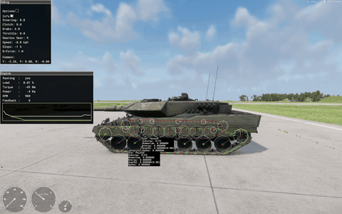

> [🇧🇷 Português](../pt-BR/09-bugs.md) · 🇬🇧 English

[← How it works inside](08-internals.md) · [Contents](../../README.md) · [Tuning with real-world data →](10-tuning.md)

# Bugs and limitations (1.8.0.13)

All items below were reproduced in Workbench 1.8.0.13 (Diag executable), base game only. Future versions may fix some of them; test again after each update.

The last column says how each item is known:

| Label | Meaning |
| --- | --- |
| Measured | Seen in telemetry or the log, with numbers |
| Measured (2A7) | Measured on the earlier Leopard 2A7 build of this guide; still the only evidence |
| Reverse-engineered | Read from the 1.8.0.13 executable, not tested in game |
| Observed in video | Seen frame by frame in the test videos |
| Not tested | Expected, but nobody has checked it yet |

### Summary

#### Simulation, drivetrain and controller

| Problem | Symptom | Workaround | Evidence |
| --- | --- | --- | --- |
| **Native reverse is broken** | The engine climbs above `RpmMax` and no torque reaches the tracks. On a downhill, only gravity moves the tank | Script that pushes the hull (`LEO_TrackedReverseComponent`, [Ready-made scripts](11-scripts.md)) + `ThrottleReverseTarget 1`. Details [below](#reverse-in-detail) | Measured + reverse-engineered |
| Driver leaves with the engine running | Without a driver, the controller pulls the handbrake (brake 6.0). At standstill it then selects reverse (gear 0, clutch 1), and the reverse bug pins the engine at about 4500 rpm while parked | `m_bStopEngineOnExit` (default 1) in `LEO_TrackedReverseComponent` stops the engine when the driver seat becomes empty. The log shows `LEOREV driver left: engine stopped` | Measured |
| `ThrottleReverseTarget` below 1 | When you hold S while stopped, the tank moves **forward** | Use `ThrottleReverseTarget 1` | Measured (2A7) |
| Incomplete vanilla `.ct` | `Tracked - failed to load!` | Add friction curves, wheel templates and tracks | Measured (2A7) |
| Default retarder | Top speed locked at \~51–54 km/h | `RetarderBaseTorque 0`, `RetarderThrottleSpeed 20` | Measured (2A7) |
| `ThrottleTurbo` 0.2 | W alone gives only 80% throttle (`thrust=0.80` in telemetry) | Use the turbo or lower `ThrottleTurbo` | Measured |
| `MaxClutchTorque` | Changing the value changes nothing | Ignore it | Measured (2A7) + reverse-engineered |
| Pivot turn (neutral steer) | The hull creeps backwards at 0.2–3.8 km/h, because the track running backwards turns faster. The controller holds brake 6.0. With the clutch engaged, the engine sits at `RpmIdle` (700 rpm, 4601 N·m); with the clutch open, at 2700 rpm | None known. The cause is open | Measured + observed in video |

#### Suspension, wheels and track links

| Problem | Symptom | Workaround | Evidence |
| --- | --- | --- | --- |
| Ride height depends on `MaxTravelDown` | The spring has zero force at full droop. If `MaxTravelDown` is larger than the static sag, the hull rides high. 2A6 with `MaxTravelDown 0.15`: 5.3 cm above its modelled height | Set `MaxTravelDown` ≈ m·g / (n·k). 2A6: 0.10 → the hull sits 3 mm above its modelled height. See [Suspension and ride height](13-suspension.md) | Measured |
| `CarProcAnimComponent` on tracked running gear | Most wheel bones get **another** wheel's signals. On the 2A6, only `v_wheel_l01` was right. Right wheels 2–7 floated about 5 cm above the chain at rest, and left even wheels spun with the right track. Reordering the parameters (L01, R01, L02, …) did not fix it in the one run that tried it (see [Open](#open)) | Leave `CarProcAnimComponent` empty. Drive the bones from the simulation with `LEO_RunningGearComponent`. See [Road wheels, idler, sprocket and return rollers](14-running-gear.md) | Measured + observed in video |
| Native link chain (the `TrackSegment` rope) | A 2D rope with gravity, wheel-circle contact and sprocket drive, but **no ground collision** and **no script API** to reset it. With 5 cm of slack (`TrackLength 0.2101`) and the hull riding 5 cm high, it came off the sprocket after a flip and stayed off. With 12 cm (`0.2110`) the slack hung below the road wheels and behind the sprocket, and a mine blast threw it off again | Hide its links and draw the links with the scripted chain (`LEO_TrackChain`). The scripted chain cannot derail by construction; it has **not** been tested through a flip or a mine blast yet. See [Track links](15-track-links.md) | Observed in video + reverse-engineered |
| `TrackPart` order | The chain speed is the angular velocity of part 1 times the `Radius` of part 0, and every part's visual angle derives from part 1. The loader also needs the sprocket and the idler at the same index on both tracks (`Wheels - %s mismatch between tracks`) | Road wheels first (index 0–6), then idler, sprocket and return rollers. Use the same order on both sides | Reverse-engineered |
| `TrackThickness` | Stored, never read | Put the link thickness into the wheel radii (sim radius = visual rim + link thickness) | Reverse-engineered |
| *Generate track positions* | The editor action exists in the executable, but it was not found in the Workbench UI | Generate `TrackPositions` offline with `tools/trackpositions.py` ([Track links](15-track-links.md)) | Reverse-engineered |

#### Script API

| Problem | Symptom | Workaround | Evidence |
| --- | --- | --- | --- |
| `VehicleTrackedSimulation.GetInputs()` | Workbench **crash** when called from script (writes through a null pointer) | Never call it. `GetFloorNormalAngles()` has the same defect | Measured (2A7) + reverse-engineered |
| `GetThrottle()`, `SetThrottle()`, `IsHandbrakeOn()` | Always 0, does nothing, always false | Read the `engineThrust` signal, or use `GetGear()`, `GetClutch()` and `GetBrake()`. `GetBrake()` reads 6.0 for the handbrake | Reverse-engineered |
| Wheel getters before the simulation is loaded | `TrackCount()` returns 0, and every getter returns 0, false or a zero vector. This lasts 0.8–1.3 s after the vehicle spawns in *Play*. `GetGear()` reads 0 (= R) in that time | Get the simulation with `TrackedControllerComponent.GetSimulation()` and use the guard [below](#script-api-rules) every frame | Measured + reverse-engineered |
| Wheel indices and contact data | Only `WheelGetPosition` checks the wheel index. No getter checks the track index, so out-of-range indices read foreign memory. `WheelGetContactPosition` returns the last stored point even without contact | Keep `track < TrackCount()` and `wheel < WheelCount()`. Check `WheelHasContact` before reading contact data | Reverse-engineered |
| `WheelGetPosition(track, wheel, displacement)` | Returns the wheel centre relative to the body's centre of mass (internal physics frame), not in hull space. With displacement 0 it is the full-droop position: with `MaxTravelDown 0.15`, all 7 left road wheels of the 2A6 read y = −1.899 m (the right track was not logged) (0.4186 − 0.15 − 2.168). The unit of the displacement argument is unknown | Add the effective centre of mass (model COM point + `CenterOfMass`) to get hull space. For the live wheel centre, use `WheelGetContactPosition` + `WheelGetRadius` along the hull's up axis | Measured |

#### Diag, Workbench and multiplayer

| Problem | Symptom | Workaround | Evidence |
| --- | --- | --- | --- |
| Vehicle debug diag **without** a link chain | Workbench **crash** (access violation in PostFrame) when *Show vehicle debug* or *Show Controller Diags* was opened on 2026-10-02, on the earlier 2A7 build, which had no chain. The diag draw reads the chain pointer without a null check | Configure the link chain first (`TrackPositions` + `TrackLength`). With the chain present (2A6, 2026-10-06), the vehicle debug ran for a whole 5-minute session, and its entries were switched on and off without a crash. See [Vehicle debug diag and telemetry](16-debugging.md) | Measured (2A7) + reverse-engineered + observed in video |
| Reloading scripts during *Play* | Workbench **crash** | Stop *Play* before reloading | Measured (2A7) |
| Reloading scripts with a world open | Diag assert `Resources are leaking! Check log!` during the reload, 1–9 s after it starts (77 vanilla resources, none from the mod). Seven times on 2026-10-05 | Press *Ignore*. Closing the world before reloading may avoid it; this is not confirmed | Measured |
| Prefab edits with the world open | The vehicle already in the world keeps its old simulation values. The 2A6 still rode 5 cm high, as with `MaxTravelDown 0.15`, after the prefab said 0.10 | Close the world, reload the scripts with no world open, then open the world again | Measured |
| Replacing a model (`.fbx`) with the world open | Workbench reimports a `.fbx` automatically when it changes. Replacing the hull model with the world open froze Workbench once (one core at 100%) | Close the World Editor before you replace models. If it freezes, end the process and reopen | Measured |
| `AICarMovementComponent` in the vanilla base | Warning that `CarControllerComponent` is missing | Harmless for manual driving | Measured |
| Reverse push by script | In multiplayer, it only runs on the driver's machine | Pending: run it on the server or send it by RPC | Not tested |
| Scripted running gear and link chain | Visual only, spawned locally. Nothing runs on a dedicated server. Behaviour on other players' machines (proxies) is unknown | Pending: test in multiplayer | Not tested |

<a id="script-api-rules"></a>

### Script API rules

Every script that reads the tracked simulation should start like this:

```c
VehicleTrackedSimulation sim = controller.GetSimulation(); // controller = TrackedControllerComponent
if (!sim || !sim.IsValid() || sim.TrackCount() < 2)
	return; // not loaded yet: the getters return 0, false or a zero vector
```

- `TrackCount()` returns the constant 2 once the simulation is loaded. It does not read the prefab, so `TrackCount() < 2` means "not loaded yet" (reverse-engineered).
- `WheelCount()` is the number of `TrackPart` entries of **one** track. The 2A6 logs `WheelCount 13`: 7 road wheels, idler, sprocket and 4 return rollers.
- Wheel indices are (track, `TrackPart` index in the prefab order). Track 0 is the first `Track` in the prefab.
- The getters work with the engine off once the simulation is valid. On the 2A6 it was valid 8–13 s before the engine started.

<a id="reverse-in-detail"></a>

### Reverse in detail

The controller works. It selects reverse (gear 0), engages the clutch and accelerates. The defect is in the simulation.

The load reaction is divided by the gear ratio. The reverse ratio is always negative, so the reaction **adds** RPM instead of removing it. The RPM goes past `RpmMax`, where the torque is zero. No torque reaches the tracks.

The RPM gets stuck at `RpmMax + Δ`, and you can calculate Δ:

```math
\Delta = \frac{\text{Mass} \cdot 9.81 \cdot \frac{1}{240} \cdot \frac{30}{\pi}}{|\text{Reverse}| \cdot \text{Ratio} \cdot \text{Inertia}}
```

The prediction matches the telemetry of both builds (`RpmMax` 3000 in all rows):

| Build | Mass | `Ratio` | `Inertia` | `Reverse` | Predicted | Observed |
| --- | --- | --- | --- | --- | --- | --- |
| 2A7 (earlier build) | 64500 kg | 4.9 | 6 | 4.0 | 3214.08 rpm | 3214.08–3214.10 rpm |
| 2A7 (earlier build) | 64500 kg | 4.9 | 3 | 2.3 | 3744.64 rpm | 3744.63–3744.73 rpm |
| **2A6** | 62300 kg | 4.6 | 3 | 2.3 | 3766.14 rpm | 3766–3768 rpm |

The 2A6 value comes from 57 `LEOTEL` samples in gear 0 (sessions of 2026-10-05 and 2026-10-06; 40 at full throttle, 17 with the throttle released) and from the diag's Engine panel in test videos A and B (2026-10-06). The 2A7 rows were measured on the earlier build.

**No prefab value fixes this.** The differential `Ratio` must be positive, and the reverse sign is forced. The clutch, `TransmissionRND` and `ClutchCouple*Rpm` change nothing.

With `ThrottleReverseTarget` below 1, the engine produces negative torque. Multiplied by the negative ratio, it pushes the tank forward.

**Other symptoms of the same bug:**

| Situation | What you see | Evidence |
| --- | --- | --- |
| Scripted reverse running | The Engine panel reads 3766–3768 rpm and 0 N·m with full throttle, while the script moves the tank. `LEOTEL` reads 3766–3768 in 40 of 107 such samples, and 3340–3890 in the others | Observed in video; measured |
| Throttle released in R, no brake | The rpm stays at 3766–3768, with −471 N·m on the Engine panel | Measured + observed in video |
| Brake applied in R with the clutch engaged: braking out of a reverse run, or the controller's brake 6.0 at standstill or at the end of a pivot | The rpm spikes to 3950–5074 (2A6, `LEOTEL`; 4469 and 4804 on the Engine panel). The 2A7 reached about 4445 | Measured; observed in video; measured (2A7) |
| Driver leaves with the engine on | The controller selects R at standstill, and the engine is pinned at about 4500 rpm | Measured |

The formula above predicts the 3766–3768 plateau of the first two rows. The higher values with the brake applied are not explained yet.

### The workaround used on the Leopard

`LEO_TrackedReverseComponent` applies a backward force to the hull when all of these hold:

- the local driver holds `TrackedBrake` without `TrackedThrottle`;
- the engine is running;
- the hull is stopped or already moving backward (forward speed ≤ 1.5 km/h);
- the native gear is reverse or neutral (index ≤ 1);
- the native brake is released (`GetBrake()` ≤ 0.05).

The force is `m_fLaunchForceG` × weight at standstill (0.3 g) and fades to zero at the script's top reverse speed. A yaw torque handles steering in reverse. A separate check stops the engine when the driver seat becomes empty (`m_bStopEngineOnExit`).

Measured on the 2A6 (`LEOTEL`, 2026-10-05): from 0 to −21 km/h in about 3.0 s, and −27.8 km/h after about 7.5 s. The force was 176 kN at −1.3 km/h. The earlier 2A7 build also reached −21 km/h in about 3 s.



*Reverse pull-away, left side. The scripted push takes the tank from 0 to −10.5 km/h in about 1.2 s, while the Engine panel stays pinned at 3766 rpm with 0 N·m: the native reverse bug. Test video A (2026-10-06), 134.0–137.6 s · [full-size still](../images/reverse-launch.jpg) at 136.0 s · Model: buh-late, CC BY 4.0, modified ([credits](../../CREDITS.md)).*

Keep the script's reverse speed below the native reverse cap:

```math
v_{\text{max,rev}}\,[\text{km/h}] = \frac{\text{RpmMax}}{|\text{Reverse}| \cdot \text{Ratio}} \cdot \frac{2\pi}{60} \cdot r_{\text{sprocket}} \cdot 3.6
```

On the 2A6: 3000 / (2.3 · 4.6) · 0.10472 · 0.34 · 3.6 ≈ 36.3 km/h. The script stops at 31 km/h (`m_fMaxReverseSpeedKmh`). The earlier 2A7 build (`Ratio` 4.9, sprocket 0.355 m) had a cap of 35.6 km/h.

### Another option: wheeled simulation

Published tank mods use `VehicleWheeledSimulation` with one axle per wheel pair. Turning comes from steering axles (+15° at the front, −15° at the rear), like on a car. Reverse works, but the behaviour is less faithful than the native tracked system with the reverse script. No published mod among those checked configures the native link chain.

### Open

- **Open:** why the rpm reaches 3950–5074 in R when the brake is applied with the clutch engaged, above the Δ prediction.
- **Open:** during a pivot turn, is brake 6.0 the controller's handbrake, or the brake applied when the wheels spin against the selected direction? Is that why the rpm drops to idle? Is the backward drift a property of the `TripleDifferential` and neutral-steer setup?
- **Open:** would `CarProcAnimComponent` map correctly with interleaved parameters (L01, R01, L02, …) in a freshly opened world? The run that tried this order may have used cached prefab data.
- **Open:** does the wheel RPM, or the drive, depend on the native rope? Can the rope be removed (empty `TrackPositions` or `TrackLength 0`) to save CPU? Not tested.
- **Open:** the diag's per-track rope stats read `Sim: Paused`, `Substep: 0/25`, `Momentum 0` and `Energy 0` even while driving. Their meaning is unknown. *Track dynamic* and *Reset tracks* were not tried.
- **Open:** the scripted chain takes its speed from road wheel 0. A wheel without contact can report a different RPM (−230.6 rpm in reverse while grounded wheels read 0–20), so the scripted links may spin wrongly while that wheel is airborne.
- **Open:** the scripted links may be mounted front-to-back reversed (180° about their Y axis) compared with the native frame. Not checked in close-up.
- **Open:** the per-frame cost of 146 hidden native links plus 146 scripted links was not measured.

---

[← How it works inside](08-internals.md) · [Contents](../../README.md) · [Tuning with real-world data →](10-tuning.md)
