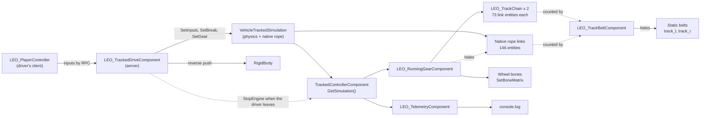

> [🇧🇷 Português](../pt-BR/11-scripts.md) · 🇬🇧 English

[← Tuning with real-world data](10-tuning.md) · [Contents](../../README.md) · [Troubleshooting →](12-troubleshooting.md)

# Ready-made scripts

The Leopard 2A6 uses seven script files and one offline tool for its tracked vehicle. They use only the vanilla API of Workbench 1.8.0.13, which 1.9.0.10 Experimental did not change. The code is in [`scripts/`](../../scripts) and [`tools/`](../../tools), under the MIT license.

| File | Type | What it does | When you need it |
| --- | --- | --- | --- |
| [`LEO_TrackedDriveComponent.c`](../../scripts/LEO_TrackedDriveComponent.c) | Component | Drives the **native** simulation from the server: driver inputs by RPC, the real handbrake, its own gear shifting, scripted reverse, server-owned vehicle | On a vehicle that keeps `VehicleTrackedSimulation` ([chapter 18](18-multiplayer.md)). Replaces `LEO_TrackedReverseComponent` v5 |
| [`LEO_TrackSimComponent.c`](../../scripts/LEO_TrackSimComponent.c) | Component | **Kiichi Tracked System**: the whole tracked simulation in script (suspension, engine, gearbox, belts, traction, clutch-brake steering) on a plain rigid body, server authoritative | Instead of the native simulation, on 1.8 and 1.9 ([chapter 19](19-kiichi-tracked-system.md)) |
| [`LEO_PlayerController.c`](../../scripts/LEO_PlayerController.c) | Modded `SCR_PlayerController` | Carries the driver's inputs and engine start/stop to the server | Always with either drive component: the server accepts RPCs only from the owner of the item, and a server-owned vehicle has no owner on the driver's machine |
| [`LEO_RunningGearComponent.c`](../../scripts/LEO_RunningGearComponent.c) | Component | Moves the road wheel bones with the suspension, spins every wheel, runs the scripted link chain and hides the native rope's links | When the wheels and links must move ([chapter 14](14-running-gear.md)) |
| [`LEO_TrackChain.c`](../../scripts/LEO_TrackChain.c) | Plain class | One track's scripted link chain: the belt path and the link entities | Always together with `LEO_RunningGearComponent` ([chapter 15](15-track-links.md)) |
| [`LEO_TrackBeltComponent.c`](../../scripts/LEO_TrackBeltComponent.c) | Component | Hides the hull's static belt meshes once link entities exist | When the model keeps a static belt as a fallback |
| [`LEO_TelemetryComponent.c`](../../scripts/LEO_TelemetryComponent.c) | Component | Writes `LEOTEL` and `LEOSUSP` lines to the log | For tuning only. Remove it for a release |
| [`tools/trackpositions.py`](../../tools/trackpositions.py) | Python 3 script | Computes the `TrackPositions` list offline | When you configure the native link chain |

The full code is in the files. This chapter explains what to install, which attributes to set and how the parts work together. [Chapter 14](14-running-gear.md) and [chapter 15](15-track-links.md) explain the maths behind the running gear and the chain.

### How the components work together



What happens in *Play*, in order:

1. **`OnPostInit`.** `LEO_RunningGearComponent` reads the rest position of every running-gear bone (the bind pose) and checks that the bones exist. The other components find the controller, the pilot slot and the signals.
2. **The simulation becomes valid** 0.78–1.26 s after the vehicle entity is created, 8–13 s before the engine was started in the logged sessions (measured). On that first frame, `LEO_RunningGearComponent` logs `LEOGEAR simulation: 2 tracks, WheelCount 13` and spawns 2 × 73 link entities. The engine's rope has already spawned its own 146 links.
3. **Same frame.** `LEO_TrackBeltComponent` counts 292 link children and hides the static belts (`LEOTRACK link chain found (292 links)`).
4. **Every frame.** `LEO_RunningGearComponent` reads each wheel from the simulation, writes the bone matrices, rebuilds both belt paths and places the links. It hides the native links 4 times a second for the first 10 s, then every 2 s.
5. **Every physics step, on the server.** `LEO_TrackedDriveComponent` applies the driver's last inputs to the simulation, shifts gears by rpm and pushes the hull in reverse. On the driver's client, `LEO_PlayerController` sends the inputs at 20 Hz and on every change.
6. **Every 0.5 s.** `LEO_TelemetryComponent` writes its lines.

The components that read the simulation get it through `TrackedControllerComponent.GetSimulation()`. Only `LEO_TrackedDriveComponent` writes to it, on the server. `LEO_TrackBeltComponent` does not use the simulation at all.

### How to install

1. Copy the seven `.c` files into `scripts/Game/Vehicle/` of your mod (`LEO_PlayerController.c` can go anywhere under `scripts/Game/`). `LEO_RunningGearComponent.c` refers to both drive components, so copy them even if you use only one.
2. Recompile the scripts with *Play* **stopped**. In the Diag exe, reload them with **no world open**; otherwise you get a `Resources are leaking` assert ([Troubleshooting](12-troubleshooting.md)).
3. Add the components to the `components { }` block of the hull prefab, with the empty `CarProcAnimComponent` override:

```
  CarProcAnimComponent "{5D6501223785D009}" {
  }
  LEO_RunningGearComponent "{5292A83C2D6FC873}" {
  }
  LEO_TrackedDriveComponent "{7A1D4C9E2B6F3086}" {
  }
  LEO_TelemetryComponent "{3C5E7A9B1D2F4608}" {
  }
  LEO_TrackBeltComponent "{8E3A61C04F2D9B57}" {
  }
```

4. Set the attributes for your vehicle (tables below). The defaults are the Leopard 2A6 values; that is why the Leopard's override blocks are empty.
5. Close the world and open it again. A vehicle in a world that is already open keeps the simulation built from the old prefab (measured).

Notes on the snippet:

- `{5D6501223785D009}` is the `CarProcAnimComponent` that `TrackedVehicle_Base.et` already has, empty. Keep it **without** `Parameters`. On a tracked vehicle it gives most wheel bones the signals of another wheel ([chapter 14](14-running-gear.md)). If your prefab added `ProcAnimParams` to it, delete them.
- This is the vanilla variant. For Kiichi Tracked System, leave out `VehicleTrackedSimulation` and `LEO_TrackedDriveComponent` and add `LEO_TrackSimComponent "{7A1D4C9E2B6F30A1}" { }` instead. The three Workshop prefabs are in [`examples/leopard2a6/Prefabs_Leopard2A6_variants.et.txt`](../../examples/leopard2a6/Prefabs_Leopard2A6_variants.et.txt).
- The `LEO_` IDs are the Leopard's. Any unique 16-digit hexadecimal ID works; Workbench creates one when you add a component in the editor.
- The complete Leopard block, with `RigidBody`, is in [`examples/leopard2a6/HullComponents_Leopard2A6.et.txt`](../../examples/leopard2a6/HullComponents_Leopard2A6.et.txt). `ThrottleReverseTarget 1` goes on the controller ([Appendix](17-appendix.md)).
- `LEO_TrackChain.c` holds no component. `LEO_RunningGearComponent` creates one chain per track.
- If you use the scripts in another mod, rename the `LEO_` prefix so the classes do not collide with the Leopard mod. The `category: "Leopard2A7"` in `ComponentEditorProps` only groups the components in the editor's list.

### LEO\_TrackedDriveComponent (native simulation, server-driven, v6)

The successor of `LEO_TrackedReverseComponent` v5 (the v5 file is in the tag [`v2.1-leopard2a6-mp`](https://github.com/Kiichiuwu/arma-reforger-tracked-vehicle-guide/tree/v2.1-leopard2a6-mp)). It keeps the native simulation and moves the driving to the server, because the native client path of a tracked vehicle is unfinished ([chapter 18](18-multiplayer.md)):

- **Server-owned vehicle.** When a driver sits in, the engine gives the vehicle to their client; the server takes it back (`RplComponent.GiveExt(RplIdentity.Local(), false)`), so the driver's client is a proxy like a passenger's and never predicts the vehicle.
- **Inputs by RPC.** The driver's client reads the keys every frame and sends throttle, brake, steer and handbrake through `LEO_PlayerController` at 20 Hz and on change; engine start/stop goes reliable.
- **Applied on the server.** `SetInputs(steer, throttle)`, `SetBreak(brake, handbrake)` (only `SetBreak(x, true)` stores the handbrake that pivots need), `SetClutch`, and `SetGear` by rpm (`m_fRpmShiftUp` / `m_fRpmShiftDown`): the native automatic gearbox and clutch only run for an owner-driven vehicle.
- **Pilot seat detached.** With a pilot seated, the native `TrackedControllerComponent` rewrites the inputs every step, even with `LockPilotControls(true)`. `SetPilotCompartmentSlot(null)` while a driver sits in silences it; the seat is restored when they leave.
- **Reverse** is still a push on the hull (the native reverse does not couple in 1.8.0.13), now applied on the server.
- **Clients** animate the running gear from a small replicated state (belt speeds, wheel contact heights), because a replicated vehicle gets no entity events on clients.
- The engine starts with the engine key, or by itself when the driver presses throttle or brake. It stops when the driver seat becomes empty (`m_bStopEngineOnExit`).

| Attribute | Default | Purpose |
| --- | --- | --- |
| `m_fLaunchForceG` | 0.3 | Reverse: force at a standstill, as a fraction of the weight |
| `m_fMaxReverseSpeedKmh` | 31 | Reverse: top speed in km/h. Keep it below the native track-speed cap (formula below) |
| `m_fSteerTorque` | 900000 N·m | Reverse: yaw torque at full steering. Scale it with the mass |
| `m_fMaxYawRate` | 0.45 rad/s | Reverse: maximum turn rate |
| `m_fRpmShiftUp` / `m_fRpmShiftDown` | 2500 / 1100 | Gear shifting thresholds |
| `m_bServerOwned` | 1 | Take the vehicle back to the server when a driver sits in |
| `m_bDetachPilotSlot` | 1 | Detach the pilot seat from the native controller while driving |
| `m_bLockPilotControls` | 1 | Also lock the native pilot controls (belt and braces) |
| `m_fNetSendInterval` / `m_fNetStateInterval` | 0.05 s | Input packets from the driver / running gear state to the clients |
| `m_fWheelRadius` | 0.418 m | Road wheel radius for the clients before the simulation reports it |
| `m_bStopEngineOnExit` | 1 | Stop the engine when the driver seat becomes empty |
| `m_bDebug` | 0 | `LEONET` line once per second on the server, heartbeat on clients |
| `m_bTestDriverSchedule`, `m_fTest*` | 0 | Scripted test inputs for automated runs (no player needed) |

Keep `m_fMaxReverseSpeedKmh` below the native track-speed cap in reverse:

```math
v_{\text{max,rev}}\,[\text{km/h}] = \frac{\text{RpmMax}}{|\text{Reverse}| \cdot \text{Ratio}} \cdot \frac{2\pi}{60} \cdot r_{\text{sprocket}} \cdot 3.6
```

On the 2A6: 3000 / (2.3 · 4.6) · 0.10472 · 0.34 · 3.6 ≈ 36.3 km/h. The script stops pushing at 31 km/h.

**Measured (1.8.0.13, Diag dedicated server + Diag client, driver on the client, 2026-10-20):** 0 to 40 km/h in 8 s, gears 2 to 5 (index 2 is first gear: 0 = R, 1 = N), full steer at speed 0.8–1.0 rad/s, the client follows the hull through the native movement replication, no crash. With the host seated (2026-10-21): the engine starts on throttle, same acceleration. **Not yet checked by a person driving on a client:** whether the driver's head and camera problem described in chapter 18 is gone.

Never call `GetInputs()` on the tracked simulation: its out-parameter binding writes through a null pointer. `GetThrottle`, `SetThrottle` and `IsHandbrakeOn` are empty stubs.

### LEO\_TrackSimComponent (Kiichi Tracked System)

Replaces `VehicleTrackedSimulation` completely: the prefab has no native simulation block, the hull is a plain dynamic rigid body, and this component applies every force in `EOnSimulate` on the server. [Chapter 19](19-kiichi-tracked-system.md) explains the model, the replication and the measurements. The defaults are the Leopard 2A6 values, taken from the native prefab.

| Group | Attributes (default) |
| --- | --- |
| Suspension | `m_iRoadWheels` 7, `m_fWheelRadius` 0.418 m, `m_fSpringRate` 450000 N/m, `m_fCompressionDamper` 25000 / `m_fRelaxationDamper` 35000 N·s/m, `m_fTravelUp` 0.30 / `m_fTravelDown` 0.10 m, `m_fPreload` 0.10 m |
| Engine | `m_fMaxTorque` 4700 N·m at `m_fRpmMaxTorque` 1600, `m_fMaxPowerKw` 1100 at `m_fRpmMaxPower` 2600, `m_fRpmIdle` 700, `m_fRpmMax` 3000, `m_fEngineInertia` 3, `m_fEngineFriction` 470 N·m |
| Transmission | `m_sForwardGears` "6.0 3.3 1.8 1.0", `m_fReverseGear` 2.3, `m_fFinalDrive` 4.6, `m_fEfficiency` 0.9, `m_fSprocketRadius` 0.34 m, `m_fRpmShiftUp` 2500 / `m_fRpmShiftDown` 1100 |
| Belts and ground | `m_fBeltMass` 400 kg, `m_fMaxBrakeForce` 900000 N, `m_fSlipStiffness` 800000 N/(m/s), `m_fFrictionLng` 0.9, `m_fFrictionLat` 0.5, `m_fLateralStiffness` 3, `m_fLateralFrictionHalfSpeed` 3 m/s, `m_fRollingResistance` 0.02 |
| Steering | `m_fSteerForce` 300000 N, `m_fSteerSpeedDiffMax` 2.6 m/s, `m_fSteerHalfSpeedKmh` 18, `m_fPivotBlendSpeed` 1.5 m/s, `m_fSteerDriveShare` 0.8, `m_fSteerBrakeForce` 300000 N, `m_fSteerBrakeWithThrottle` 150000 N, `m_fSteerBrakeHalfSpeedKmh` 54 |
| Network | `m_fNetSendInterval` 0.05 s, `m_fNetStateInterval` 0.05 s, `m_fProxySmoothing` 0.08 s |
| Debug and tests | `m_bDebug` 0 (`LEOSIM` line once per second), `m_bTestDriverSchedule`, `m_fTest*` |

### LEO\_TelemetryComponent (telemetry for tuning)

It writes log lines that you can grep from the session `console.log` (`Documents\My Games\ArmaReforgerWorkbench\logs\logs_<date>\console.log`). [Chapter 16](16-debugging.md) shows how to read them next to the native vehicle debug.

| Line | When | Content |
| --- | --- | --- |
| `LEOTEL init` | Once, at start | Whether the controller and the signals manager were found |
| `LEOTEL pose` | Every `m_fInterval`, engine on or off | Hull `pitch` and `roll` in degrees (pitch > 0 = nose up) |
| `LEOTEL v=` | Every `m_fInterval` with the engine on | `v`: forward speed in km/h (negative = backwards). `rpm`, `thrust`: the `engineRPM` and `engineThrust` signals. `gear`: 0 = R, 1 = N, 2.. = forward gears. `clutch`. `simBrk`: 6.00 = handbrake. `simRpm`: `EngineGetRPM()`. `wheelRpm`: `EngineGetRPMFeedback()`, the rpm fed back from the gearbox side |
| `LEOSUSP track=l` / `track=r` | Every 2 s with the engine on | `worst_mm`. `diff_mm` per road wheel: bone minus simulation wheel centre (`air` without ground contact). `travel_mm` per road wheel: simulation travel from the modelled height, + = up. `spin`: angle of each road wheel and of the sprocket about the axle, in degrees |

| Attribute | Default | Purpose |
| --- | --- | --- |
| `m_fInterval` | 0.5 s | Time between lines |
| `m_bReadSimulation` | 1 | Adds gear, clutch, brake and engine rpm from the simulation |
| `m_fWheelRestHeight` | 0.4186 m | Modelled road wheel centre height (bone `v_wheel_l01` at rest), for `travel_mm` |

What healthy values look like on the 2A6 (measured, sessions of 2026-10-05 and 2026-10-06):

- `diff_mm` has a median of 0 with `LEO_RunningGearComponent`, and 90–95% of samples are within 3 mm. Larger values appear only while a wheel eases back after it lost contact.
- The 7 `spin` values of a track are equal.
- At rest on flat ground, `travel_mm` reads −1 to −5 mm from front to rear (`MaxTravelDown` 0.10, `CenterOfMass 0 1 0.46`).
- At rest on flat ground, `LEOTEL pose` reads a pitch of about −0.05°.
- Several bit-identical lines in a row mean the body is asleep (`LinearSleepingThreashold` / `AngularSleepingThreashold`), not that the logger is broken.

`LEOSUSP` assumes 7 road wheels named `v_wheel_<s>0<k>` and a bone `v_sprocket_<s>`. Edit the loop for another layout. It reads the wheel getters only with the engine on; by then the simulation has been loaded for several seconds.

The header comment of the file says that calling the getters on `owner.FindComponent(VehicleTrackedSimulation)` crashed Workbench. Later reverse engineering traced that crash (crash 1) to `GetInputs()`, so the `FindComponent` route is probably safe. It was not tested again; `GetSimulation()` through the controller stays the recommended path.

### LEO\_RunningGearComponent (scripted running gear)

It replaces `CarProcAnimComponent` for the running gear, and the native rope for the visible links. Every frame, it reads the simulation per (track, part) and writes local bone matrices with `Animation.SetBoneMatrix`, the same call that vanilla `SCR_DestructionTireComponent` uses. It also owns one `LEO_TrackChain` per track. The user confirmed the result in game on 2026-10-06.


*Test video A (2026-10-06), 209.5 s: right side on grass at about 8–10 km/h. The scripted links wrap the rear sprocket, run under all seven road wheels and over the return rollers. Leopard 2A6 model by buh-late, CC BY 4.0, modified.*

**Requirements**

1. **`TrackPart` order**, the same on both tracks: road wheels at indices 0 to n−1, the idler at n, the sprocket at n+1, the return rollers after it. The idler must be at the front and the sprocket at the rear (the belt order of `LEO_TrackChain`). Track 0 (the first `Track`, `Track Left` on the Leopard) uses the `_l` bones; track 1 uses the `_r` bones.
2. **The `TrackPart` with index k** (0-based) must be the wheel whose bones are numbered k + 1. The script builds the names as `"v_wheel_" + side + "0" + k`, so it supports at most 9 road wheels and 9 rollers per side.
3. **The bones in the table below**, per side `<s>` = `l` / `r` and number `<k>` = 1..n. Each sits at the centre of its part with an **identity rest orientation**, because the script builds its matrices in hull axes.
4. **`CarProcAnimComponent` empty.**

| Bone | Parent | Moved by the script |
| --- | --- | --- |
| `v_suspension_<s>0<k>` | `v_body` | Translation along Y (the suspension travel) |
| `v_wheel_<s>0<k>_rotator` | `v_suspension_<s>0<k>` | Not moved. It is left over from the `wheel_suspension.pap` rig |
| `v_wheel_<s>0<k>` | `v_wheel_<s>0<k>_rotator` | Rotation about X. It is also the `TrackPart` pivot bone |
| `v_idler_<s>`, `v_sprocket_<s>`, `v_roller_<s>0<k>` | — | Rotation about X |

[Chapter 14](14-running-gear.md) shows how the Leopard's bones were added in Blender without moving a vertex, and how the suspension arms were re-weighted to swing with the wheel.

**Attributes.** The defaults are the Leopard 2A6 values.

| Attribute | Default | Purpose |
| --- | --- | --- |
| `m_iRoadWheels` | 7 | Road wheels per track (`TrackPart` 0 to n−1) |
| `m_iRollers` | 4 | Return rollers per track (the `TrackPart`s after the sprocket) |
| `m_fRoadWheelRadius` | 0.345 m | Visual road wheel rim radius, where the wheel rolls on the track's inner face |
| `m_fRollerRadius` | 0.0847 m | Visual return roller rim radius |
| `m_fRestHeight` | 0.4186 m | Modelled road wheel centre height. Used only if a wheel bone cannot be read |
| `m_fMaxTravelDown` | 0.10 m | Must equal `MaxTravelDown` of the `Suspension` block |
| `m_fMaxTravelUp` | 0.30 m | Must equal `MaxTravelUp` of the `Suspension` block |
| `m_fDropRate` | 8 /s | How fast a wheel drops to full droop when it loses ground contact, and comes back when it lands |
| `m_bScriptedChain` | 1 | Moves the links by script and hides the native rope's links |
| `m_sLinkModel` | `{B50AEDC702735F50}Assets/Vehicles/Tracked/Leopard2A6/Leopard2A6_track_link.xob` | Link model of the scripted chain |
| `m_iLinks` | 73 | Links per track |
| `m_sNativeLinkName` | `Leopard2A6_track_link` | Part of the native link model's file name, used to find and hide the rope's links among the hull's children |
| `m_fMaxDistance` | 300 m | Beyond this distance from the camera, bones and links are not updated |

**What it computes every frame**

Suspension travel of each road wheel, from the simulation's contact point (hull space) and the wheel's simulation radius:

```math
\text{travel} = \operatorname{clamp}\left(y_{\text{contact}} + r_{\text{sim}} - y_{\text{rest}},\ -\text{MaxTravelDown},\ +\text{MaxTravelUp}\right)
```

With contact, the bone follows the simulation exactly. Without contact, it eases to full droop with the factor 1 − e^(−rate·Δt), which does not depend on the frame rate. After landing, it eases back until it is within 5 mm, then follows exactly again. The clamp matters: in the logged sessions the contact-derived travel reached +0.382 m, above `MaxTravelUp` 0.30, because the suspension ray starts above the top of the travel (measured).

Track distance per frame, from road wheel 0 (the speed of the track's ground face):

```math
d = \text{RPM}_0 \cdot \frac{2\pi}{60} \cdot r_{\text{sim},0} \cdot \Delta t
```

- Road wheels and return rollers **roll** on the track's inner face: angle += d / visual rim radius (0.345 m and 0.0847 m).
- The idler and the sprocket are **wrapped** by the track and turn with the links: angle += d / their simulation radius (0.335 m and 0.34 m).
- A positive angle moves the top of the wheel forward (+Z). The bone matrix rows are (1, 0, 0), (0, c, s), (0, −s, c), with c = cos and s = sin of the angle.
- The suspension bone gets an identity matrix with the translation (0, travel, 0).

Then the chain of each track gets the new road wheel heights and moves its links by d.

**Accuracy (measured with `LEOSUSP`).** In the 2026-10-05 23:58 and 2026-10-06 00:12 sessions, the bone-minus-simulation difference had a median of 0 mm, with 95% and 90% of samples within 3 mm. Values up to 124 mm occurred only while a wheel eased back after losing contact. In the first run with the script (23:18), 70% of samples were within 3 mm, with transients up to 83 mm on obstacles.

**Limits and open points**

- It does nothing on a dedicated server (`System.IsConsoleApp()`). The links are local entities and are not replicated. Behaviour on other players' machines (proxies) is **not tested**.
- The track distance comes from road wheel 0. A wheel without contact can report a very different RPM (−230.6 rpm in reverse while the grounded wheels read 0–20, measured). So the wheels and links can spin wrongly while the front road wheel is in the air in reverse. Using a grounded wheel or the sprocket is untested (open).
- The script runs in `EOnFrame`. A one-frame lag against the physics is possible but not shown (open, low confidence).
- The native rope keeps running with its links hidden. Whether `WheelGetRPM` depends on it was not tested, and its CPU cost was not measured.
- If any running-gear bone is missing, or a wheel's rest height is outside 0.5–2 × `m_fRestHeight`, the scripted chain is switched off and a `LEOGEAR` warning is printed.

### LEO\_TrackChain (scripted link chain)

A plain class, created by `LEO_RunningGearComponent`, one per track. Every update it:

1. rebuilds the belt path in the track plane (hull z along, y up) from the circles in belt order: sprocket, return rollers rear to front, idler, road wheels front to rear. Each circle has the part's **simulation** radius, which is the links' ground face. Road wheel circles move with the suspension;
2. joins neighbouring circles by their outer common tangents and wraps each circle between them. Where the wrap is more than half a turn (a road wheel pushed above its neighbours), it uses a straight chord instead;
3. places N links at equal spacing L / N along the path length L, shifted by the track distance d.

Each link is a `GenericEntity` child of the hull, created with `GetGame().SpawnEntity`, attached with `AddChild(link, -1, EAddChildFlags.AUTO_TRANSFORM)`, given the model with `SetObject`, and cleared of the `TRACEABLE` and `ACTIVE` flags. The links are deleted in `OnDelete`. Because the links depend only on the wheel positions, they cannot sag through the ground or come off the sprocket. That follows from the construction; a flip or a mine blast was **not tested** with the scripted chain. [Chapter 15](15-track-links.md) has the geometry, the link frame and the comparison with the native rope.

### LEO\_TrackBeltComponent (static belt fallback)

The Leopard's hull model keeps its original static belts (meshes `track_l` and `track_r`). This component counts the hull's child entities whose model name contains `m_sLinkModelName`, native rope links and scripted links alike. Once there are at least 2, it hides the static belts with `Animation.ShowMesh`, prints `LEOTRACK link chain found (<n> links)` and stops. The logs showed 146 with the native rope only and 292 with both chains. If no link appears within `m_fTimeout`, it keeps the static belts and prints a warning, so a broken chain never leaves the tank without tracks. It runs on every machine, because mesh visibility is local.

| Attribute | Default | Purpose |
| --- | --- | --- |
| `m_sStaticBeltMeshes` | `track_l track_r` | Names of the static belt meshes, separated by spaces |
| `m_sLinkModelName` | `Leopard2A6_track_link` | Part of the link model's file name |
| `m_fTimeout` | 5 s | How long to wait for link entities |

### tools/trackpositions.py (offline TrackPositions)

The native rope needs a `TrackPositions` list: (z, y) points in hull model space around the wheels. Workbench has an editor action *Generate track positions* for it, but it was not found in the Workbench UI during this work. This script computes the list offline.

```
python trackpositions.py [N] [pitch]
```

- Edit the constants at the top for your tank: `WHEELS` (the z of each road wheel), the idler and sprocket entries of `C` (z, y, simulation radius), and the two lines that add the road wheels and the return rollers (their height, radius and z). Use the **simulation** radii: the chain points lie on the links' ground face.
- It samples every circle, takes the convex hull, orders it so that the index increases **forward along the top run** (the engine's own winding), and resamples it at equal arc length L / N.
- It prints a comment with the hull length, N, the arc step, the shortest and longest chord and N × pitch, a check line with the first two points, and the `TrackPositions { ... }` block.
- With the default Leopard values it reproduces the prefab list exactly: hull length 15.2841 m, arc step 0.2094 m for N = 73. The docstring says the list starts at the top point closest to z = 0, but with the Leopard's collinear return rollers it starts above the rearmost roller (z −2.0577).
- It needs Python 3.8 or newer (`math.dist`).

Choose N and `TrackLength` with the slack rules in [chapter 15](15-track-links.md).

### Rules for writing your own scripts

**Getting the simulation**

- Get it with `TrackedControllerComponent.GetSimulation()`.
- Guard every frame until it is loaded. The getters return 0, false or a zero vector until then, and `GetGear()` returns 0 (= R):

```c
VehicleTrackedSimulation simulation = m_Controller.GetSimulation();
// TrackCount() is 0 until the simulation is loaded (reverse-engineered: the getters test an internal state first)
if (!simulation || !simulation.IsValid() || simulation.TrackCount() < 2)
	return;
```

**Wheel getters** (full list in the [Appendix](17-appendix.md), behaviour in [chapter 14](14-running-gear.md))

- Indices are (track, `TrackPart` index in the prefab order). `WheelCount()` is the count **per track** (13 on the Leopard).
- Keep `track < TrackCount()` and `wheel < WheelCount()` yourself. Only `WheelGetPosition` checks its wheel index; the others read foreign memory with an index out of range (reverse-engineered).
- `WheelGetContactPosition` is in world space; convert it with `owner.CoordToLocal()`. It returns a stored value even without contact, so test `WheelHasContact` first.
- `WheelGetRPM` has the sign of the forward speed. A road wheel's RPM is the belt speed divided by its simulation radius (measured). For the idler and the sprocket this was not checked.
- `WheelGetPosition(track, wheel, 0)` returns the full-droop wheel centre relative to the physics centre of mass (the model's COM point plus the `CenterOfMass` offset), not relative to the hull origin. On the 2A6 with `MaxTravelDown` 0.15 it read y = −1.899 for every wheel. Only displacement 0 was tested.

**Moving bones**

- Use `owner.GetAnimation().SetBoneMatrix(owner, bone, mat)` every frame. The matrix is a local delta over the bind pose: identity means rest. Write it again every frame, as `SCR_DestructionTireComponent` does.
- Read the rest positions with `GetBoneMatrix` in `OnPostInit`, before anything moves the bones.

```c
// spin a bone about its X axis (identity rest orientation); positive = top of the wheel moves forward (+Z)
float c = Math.Cos(angle);
float s = Math.Sin(angle);
vector mat[4];
mat[0] = Vector(1, 0, 0);
mat[1] = Vector(0, c, s);
mat[2] = Vector(0, -s, c);
mat[3] = vector.Zero;
anim.SetBoneMatrix(owner, bone, mat);
```

**Visual-only entities and cost**

- Spawn them locally (`GetGame().SpawnEntity`), attach them with `AddChild(..., EAddChildFlags.AUTO_TRANSFORM)`, clear `TRACEABLE` and `ACTIVE`, and delete them in `OnDelete`.
- Skip the work far from the camera (`owner.GetWorld().GetCurrentCamera`) and on a dedicated server (`System.IsConsoleApp()`).

**Drivetrain calls**

- Use `GetGear()`, `GetClutch()`, `GetBrake()`, `EngineGetRPM()` and `EngineGetRPMFeedback()`.
- Gear index 0 is R, 1 is N, 2 and up are the forward gears (`EVehicleGearboxGear.REVERSE` / `NEUTRAL`).
- `GetBrake()` reads 6.0 for the handbrake: `SetBreak(x, true)` stores 6.0. The controller holds it at a standstill and in pivot turns.
- **Never** call `GetInputs()` or `GetFloorNormalAngles()`. Their bindings write through a null pointer (crash 1).
- `GetThrottle()` always returns 0, `SetThrottle()` does nothing and `IsHandbrakeOn()` always returns false on the tracked simulation. Read the `engineThrust` signal instead.
- Read the driver's inputs with `GetGame().GetInputManager().GetActionValue("TrackedBrake")` and similar calls.

**Language and workflow**

- `Physics` can only be a local variable. As a class member, the compiler rejects it.
- Recompile with *Play* stopped. Reload scripts with no world open in the Diag exe.
- After a prefab change, close the world and open it again before you test ([Troubleshooting](12-troubleshooting.md)).

---

[← Tuning with real-world data](10-tuning.md) · [Contents](../../README.md) · [Troubleshooting →](12-troubleshooting.md)
