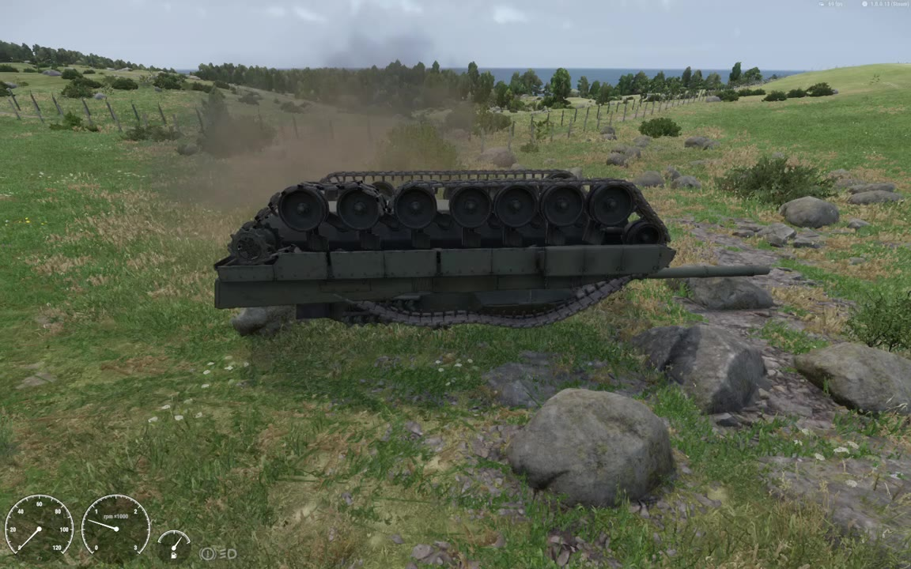

> [🇧🇷 Português](../pt-BR/13-suspension.md) · 🇬🇧 English

[← Troubleshooting](12-troubleshooting.md) · [Contents](../../README.md) · [Road wheels, idler, sprocket and return rollers →](14-running-gear.md)

# Suspension and ride height

This chapter explains how the tracked simulation holds the hull up: the wheel ray, the spring, the dampers and the centre of mass. It then shows how the hull moves while driving, and one Workbench trap that hides prefab changes.

All numbers are from the Leopard 2A6 example (`Mass` 62300 kg, 7 road wheels per side) in Workbench 1.8.0.13. They come from the `LEOSUSP` and `LEOTEL` telemetry ([chapter 16](16-debugging.md)), from strings in the 1.8.0.13 executable and from the test videos. Each statement says how it is known.

### The rules in short

| Rule | How it is known |
| --- | --- |
| `SpringRate` is in kN/m (= N/mm). 450 means 450 000 N/m | Executable description; two runs match it |
| The spring is free (zero force) at full droop, −`MaxTravelDown` | Fits the rest travel measured in two runs |
| Rest travel = m·g / (n·k) − `MaxTravelDown` | Measured: −53 mm with 0.15, −3 mm with 0.10 |
| Set `MaxTravelDown` ≈ m·g / (n·k) and the hull sits at its modelled height | Measured |
| `RoadWheel.Radius` is the distance from the wheel centre to the track's ground face | Measured (1.25 mm mean match) |
| `CenterOfMass` is an offset added to the model's own centre of mass | Executable description; measured |
| The `z` of `CenterOfMass` sets the static pitch: about 2.1° per metre on the 2A6 | Computed (2.06°/m) and measured (2.18°/m) |
| After a prefab edit, close the world, reload scripts, reopen the world | Observed (runs 2 and 3) |

### Test sessions used in this chapter

| Session (local time) | Setup | Used for |
| --- | --- | --- |
| Run 1, 2026-10-05 22:30 | `MaxTravelDown` 0.15, wheel bones driven by `CarProcAnimComponent` | Spring free point, signal range, contact loss, a flip |
| Run 2, 2026-10-05 22:55 | Prefab already at 0.10, world not reloaded | The prefab cache trap |
| Run 3, 2026-10-05 23:18 | `MaxTravelDown` 0.10, scripted wheels | Rest travel with 0.10 |
| Run 4, 2026-10-05 23:20 | Same, over mines | Contact above the travel cap |
| 2026-10-05 23:58 and 2026-10-06 00:12 | Same, scripted wheels and scripted link chain | Rest travel per wheel, squat and dive, rocks |

### How a road wheel finds the ground

In the 2A6 prefab only the `RoadWheel` template has a `Suspension` block. The idler, the drive sprocket and the return rollers stay at their modelled positions on the hull.

Each road wheel samples the ground with a raycast:

| Step | What happens | How it is known |
| --- | --- | --- |
| 1 | The ray starts `RayStartOffsetUp` above the top of the travel, the fully compressed position | Executable description: "Extension of raycast start above top position of suspension. Suspension total length is not affected." |
| 2 | It runs along the hull's down axis | Inferred: step 3 matched in hull axes |
| 3 | The wheel centre goes to the contact point plus `Radius`, along the hull's up axis | Measured: the engine's own suspension signal matched (contact local y + `WheelGetRadius` − modelled height) with a 1.25 mm mean difference (run 1, 106 frames with all wheels in contact) |
| 4 | The travel is the distance of that centre from the modelled position (the bone), in metres along the bone's Y axis. Compression is positive | Measured (run 1) |
| 5 | The travel signal is clamped to −`MaxTravelDown` … +`MaxTravelUp` | Measured: bones driven by the signal ranged exactly from −0.1500 to +0.3000 m in run 1 |

The heights for the 2A6 road wheels, in hull space (ground plane at y = 0):

```text
hull y (m)
  1.219        ray start = top of travel + RayStartOffsetUp 0.5    executable description, not measured
  0.719        top of travel = modelled + MaxTravelUp 0.30         signal clamps at +0.30
  0.419        modelled wheel centre = bone v_wheel_<s>0<k>        travel 0
  0.418-0.414  rest on flat ground, front to rear wheel            travel -1 ... -5 mm (measured)
  0.319        full droop = modelled - MaxTravelDown 0.10          spring force 0; wheel hangs here without contact
  0.001        track ground face = modelled centre - Radius 0.418
```

**`Radius` is not the rim radius.** The wheel centre sits `Radius` above the contact, so `Radius` is the distance from the wheel centre to the ground face of the track. On the 2A6 that is the 0.345 m rim plus about one link thickness (0.073 m here; the shoe is 0.076 m thick): `Radius` 0.418. The bone sits at 0.4186 m, so a wheel at its modelled height touches the ground plane. Rule: `Radius` = height of the road wheel bone above the bottom of the track. A `Radius` that does not match makes the hull float or sink by the difference. [Chapter 14](14-running-gear.md) lists the sim and visual radius of every part.


*The vehicle debug overlay on a stopped tank (Gear R, Brake 6.0, 700 rpm). The white 12-sided circles are drawn at the sim `Radius`: the road wheel circles (0.418 m) reach the ground face of the links, below the 0.345 m rims. The blue vertical lines mark the suspension at each wheel centre. Test video A (2026-10-06), still at 109.0 s · Model: buh-late, CC BY 4.0, modified ([credits](../../CREDITS.md)).*

**Travel limits.** The signal stays inside −`MaxTravelDown` … +`MaxTravelUp`. The contact itself can lie outside that range. The contact-derived travel (contact + `Radius` − modelled height) reached +0.367 m in run 1, +0.348 m over the mines in run 4 and +0.382 m in the 00:12 session, all above the +0.30 cap. Downward it went a few millimetres past the limit (−0.107 m with `MaxTravelDown` 0.10, −0.151 m with 0.15). The ray finds ground above the top of the travel because it starts 0.5 m higher. Ground above the ray start would be missed (inferred, not tested). The force the simulation applies past +`MaxTravelUp` was not measured. A script that moves bones from the contact point must clamp the travel, as `LEO_RunningGearComponent` does ([chapter 14](14-running-gear.md)).

**No contact.** When the ray finds nothing (airborne, flipped, over a gap), `WheelHasContact` returns false and the signal is exactly −`MaxTravelDown`: the wheel hangs at full droop. Measured in run 1: every signal read −0.150 while the tank lay on its roof.



*Upside down after the run 1 flip (`MaxTravelDown` was 0.15 then). No road wheel touches the ground, so every wheel hangs at full droop. All wheel signals read exactly −0.150 in the log, so the `CarProcAnimComponent` mis-mapping of that build does not change this picture. The track sagging under the hull is the native rope chain ([chapter 15](15-track-links.md)). Diagnostic video 1 (2026-10-05, 22:35 clip), still at 195.0 s (3:15) · Model: buh-late, CC BY 4.0, modified ([credits](../../CREDITS.md)).*

### The suspension attributes

The `Suspension` block sits inside the `RoadWheel` template of `Simulation Tracked`. The descriptions are the strings stored next to each attribute in the 1.8.0.13 executable.

| Attribute | Unit | Executable description | Leopard 2A6 |
| --- | --- | --- | --- |
| `SpringRate` | N/mm = kN/m | "Spring force per mm. Tells how much force is needed to compress the spring by one mm" | 450 |
| `CompressionDamper` | N·s/m | "Compression damper force per 1 m/s. Used when suspension is compressing." | 25000 |
| `RelaxationDamper` | N·s/m | "Relaxation damper force per 1 m/s. Used when suspension is decompressing." | 35000 |
| `MaxTravelUp` | m | "It's the distance that the suspension can be compressed from modeled position." | 0.30 |
| `MaxTravelDown` | m | "It's the distance that the suspension can be expanded from modeled position." | 0.10 |
| `RayStartOffsetUp` | m | "Extension of raycast start above top position of suspension. Suspension total length is not affected." | 0.5 |
| `MaxSteeringAngle` | degrees | "Maximum wheel rotation angle (positive number). For non steering wheels just leave it at 0." | 0 |

Two more values belong to the ride height: `RoadWheel.Radius` (0.418, see above) and `RigidBody.Mass` (62300).

### The spring model

The spring has no preload. It pushes with zero force at full droop and grows by `SpringRate` per millimetre of compression from there (linear: it fits both runs; it was not tested point by point):

```math
F_{\text{spring}} = k \cdot (x + \text{MaxTravelDown}), \qquad -\text{MaxTravelDown} \le x \le \text{MaxTravelUp}
```

Here *x* is the travel from the modelled position (positive up) and *k* = `SpringRate` · 1000 N/m. At rest on flat ground the *n* springs carry the hull:

```math
x_{\text{rest}} = \frac{m \cdot g}{n \cdot k} - \text{MaxTravelDown}
```

On the 2A6: 62300 · 9.81 / (14 · 450 000) = **0.097 m** of compression, counted from full droop.

Two runs confirm it:

| `MaxTravelDown` | Predicted rest travel | Measured rest travel | Session |
| --- | --- | --- | --- |
| 0.15 | −53.0 mm (hull 5.3 cm high) | −52.4 … −53.4 mm, mean of the 7 wheels, in 13 of 14 stationary frames (9 of them one sleeping pose at −53.0; the 14th, a momentary stop between reversing and pulling away, read −42.4) | Run 1 |
| 0.10 | −3.0 mm | −3.0 mm, median of the per-sample mean | Run 3 and the 23:58 and 00:12 sessions |

So the rule is:

```math
\text{MaxTravelDown} \approx \frac{m \cdot g}{n \cdot k}
```

With it, the hull sits at the height you modelled. A larger `MaxTravelDown` lifts the hull, a smaller one lowers it, by the difference.

**Per wheel.** With `MaxTravelDown` 0.10 and `CenterOfMass 0 1 0.46`, the rest travel of the road wheels on flat ground is (256 samples, identical on both tracks):

| Road wheel | 1 (front) | 2 | 3 | 4 | 5 | 6 | 7 (rear) |
| --- | --- | --- | --- | --- | --- | --- | --- |
| Measured (median) | −1 mm | −2 mm | −2 mm | −3 mm | −4 mm | −4 mm | −5 mm |
| Spring model | −1.0 mm | −1.7 mm | −2.3 mm | −2.9 mm | −3.6 mm | −4.3 mm | −5.1 mm |

The 4 mm difference between front and rear is the −0.049° pitch left by the centre of mass (see below).

**The `RigidBody` mass alone fits.** Both predictions use 62300 kg alone. Adding the 14 road wheel masses (14 × 110 kg) would predict 2.4 mm more compression, which was not seen. So the wheel template masses do not seem to load the springs (inferred from the match).

**On uneven ground the mean holds.** Standing on sloped ground in run 1, single wheels ranged from −26.7 to −88.1 mm while the mean of a track's 7 wheels stayed at −52.4 … −53.4 mm. To check the ride height, always average all road wheels of a track.

**If you copied the first edition.** The first edition's Leopard 2A7 values (`Mass` 64500, `SpringRate` 450, `MaxTravelDown` 0.15) give 64500 · 9.81 / (14 · 450 000) = 0.100 m of compression against 0.15 m of droop: the hull sits about 5 cm high (computed; the 2A7 ride height was not measured). Set `MaxTravelDown` 0.10.

### Sizing the suspension

1. Choose `MaxTravelUp` from the room above the wheel in your model. The 2A6 uses 0.30 m.
2. Choose either the spring or the droop travel. The other one follows:

   ```math
   k = \frac{m \cdot g}{n \cdot \text{MaxTravelDown}}, \qquad \text{SpringRate} = \frac{k}{1000}
   ```

   2A6: 62300 · 9.81 / (14 · 0.10) = 436 545 N/m, so `SpringRate` 437 would sit within 0.1 mm of the modelled height. The prefab keeps 450 and sits 3 mm high (rest travel −3 mm).
3. Choose the dampers as a fraction ζ of critical damping, taking the load of one wheel (m / n):

   ```math
   c_{\text{crit}} = 2\sqrt{k \cdot \frac{m}{n}}, \qquad c = \zeta \cdot c_{\text{crit}}
   ```

   2A6: c\_crit = 2 · √(450 000 · 4450) = 89 500 N·s/m. `CompressionDamper` 25000 gives ζ = 0.28 and `RelaxationDamper` 35000 gives ζ = 0.39. The undamped heave frequency is √(k / (m/n)) / 2π = 1.60 Hz. These are computed values; the 2 s telemetry interval cannot confirm them.
4. Copy `MaxTravelDown` and `MaxTravelUp` into the `LEO_RunningGearComponent` attributes `m_fMaxTravelDown` and `m_fMaxTravelUp`, and the modelled wheel centre height into `m_fRestHeight` (used if a wheel bone cannot be read; the script takes the bone heights) and the telemetry's `m_fWheelRestHeight` ([chapter 11](11-scripts.md), [chapter 14](14-running-gear.md)).
5. Close the world, reload and reopen it (see [the prefab cache](#prefab-edits-and-the-open-world)), drive, then check that the mean `travel_mm` at rest is near 0.
6. If you use the native link chain, re-check its slack: the chain length is fixed, and the path around the wheels grows when the wheels droop ([chapter 15](15-track-links.md)).

**`MaxTravelDown` does not add droop below the rest position.** Because the spring is free at full droop, the travel left below the rest position is always m·g / (n·k), whatever `MaxTravelDown` is: 97 mm on the 2A6. With 0.15 the hull only rode higher; the wheels could still drop just 97 mm below their rest position. Only a softer spring gives the wheels more room to drop (computed from the spring model). The room left above the rest position is `MaxTravelUp` − x\_rest: 0.303 m on the 2A6.

### Centre of mass

**`CenterOfMass` is an offset, not a position.** The executable describes the `RigidBody` attribute as "Offset of center of mass. Relative to one defined in model (if applicable)." The model import option `COMAutocenter` is described as "Auto center of center of mass".

**The 2A6 model defines its own centre of mass.** The hull `.fbx` contains an empty object named `COM_hull`, placed by the build script at the solid centroid of the hull collider `UCX_hull_01`. In hull space (ground plane at y = 0) it sits at x 0.0002, y 1.168, z −0.381.

**Measured physics centre of mass = `COM_hull` + `CenterOfMass`.** `WheelGetPosition(track, wheel, 0)` returns the full-droop wheel centre relative to the physics centre of mass ([chapter 14](14-running-gear.md)). In run 1 it returned (−1.32898, −1.89918, z\_bone − 0.07906) for every wheel. The full-droop centre is at y = 0.41858 − 0.15 = 0.26858, so the centre of mass is at y = 2.16776 and z = 0.07906. `COM_hull` + (0, 1, 0.46) = (0.0002, 2.1678, 0.0791) matches to 0.01 mm.

So `CenterOfMass 0 1 0.46` puts the 2A6's centre of mass **2.17 m above the ground**, about 0.47 m above the hull roof (about 1.70 m). The `1` in Y raises it 1 m above the collider centroid. The first values tried on the 2A6 (`0 1.206 -0.478`) and the first edition's advice ("low, near the hull floor: `0 1 -0.3`") treated the attribute as a position. It is not.

What this means for your vehicle:

- If your model has a `COM_` object, `CenterOfMass` moves the centre of mass away from it. Start from `0 0 0`.
- Without a `COM_` object, the reference point the engine uses is not known (open question).
- In the spring model the `Y` of the offset does not change the static pitch on flat ground. It changes squat, dive and roll-over (computed, not tested; see below).
- The `z` sets the static pitch. Use it to level the hull.

#### Levelling the pitch

On flat ground the springs balance the weight and its moment. With *z* forward, the static pitch (positive nose up, in radians) is:

```math
\theta = -\frac{M \cdot g \cdot (z_{\text{COM}} - \bar z)}{\sum_i k \cdot (z_i - \bar z)^2}
```

The sum runs over all road wheels of both tracks; *z\_i* are the wheel positions and *z̄* their mean. The sensitivity is:

```math
\left|\frac{d\theta}{dz_{\text{COM}}}\right| = \frac{M \cdot g}{\sum_i k \cdot (z_i - \bar z)^2}
```

2A6: road wheel z = 2.478, 1.662, 0.889, 0.160, −0.722, −1.596, −2.478 m, so *z̄* = 0.0563 m and Σ k·(z\_i − z̄)² = 1.701 · 10⁷ N·m/rad. That gives **2.06° per metre** of centre-of-mass shift (computed). The two measured points below give 2.18°/m.

| `CenterOfMass` | Centre of mass z | Pitch from the formula | Pitch measured |
| --- | --- | --- | --- |
| `0 1 0` | −0.381 m | +0.900° (nose up) | +0.954° |
| `0 1 0.46` (current) | +0.079 m | −0.047° | −0.049° (median of 256 flat, stationary samples) |
| `0 1 0.437` | +0.056 m | 0.000° | not tested |

To level your own hull:

1. Add `LEO_TelemetryComponent` ([chapter 11](11-scripts.md)). It logs `LEOTEL pose pitch=… roll=…` every 0.5 s, even with the engine off. Pitch is positive nose up.
2. Park on flat ground and read the pitch.
3. Turn the tank 180° and read it again. The 2A6 read +0.954° both ways, which rules out the terrain.
4. Move `CenterOfMass` z by pitch / sensitivity: forward (+z) to lower the nose. Use your own Σ k·(z\_i − z̄)², or start with 2°/m for a vehicle of similar mass and wheel spacing.
5. Close the world, reload, reopen, and read the pitch again.

The vehicle debug diag has a *Show CoM* entry (Vehicles > Tracked). It was not used in these tests ([chapter 16](16-debugging.md)).

#### Height and roll-over

A high centre of mass makes the hull pitch more under acceleration and braking, and makes it easier to roll. A simple static measure is half the distance between the left and right road wheels over the centre of mass height. On the 2A6: 1.3288 / 2.168 = 0.61 g. With a Y offset of 0 (centre of mass at 1.168 m) it would be 1.14 g (computed). Run 1 rolled over at 33–41 km/h in 4th gear: the roll grew to −11° over about 3 s, an impact took the speed from 34.3 to 13.5 km/h in 0.5 s, and the hull reached 177.5° within 2.5 s. The high centre of mass is a computed risk factor in that flip, not a proven cause.

**Open.** The Y offset has not been retuned. `CenterOfMass 0 0 0.437` (centre of mass at 1.17 m, level hull) is the obvious next test.

### Squat, dive and airborne behaviour

#### Squat and dive (measured)

Method: in the sessions 23:18, 23:58 and 00:12, the pitch relative to the ground was taken from the front-to-rear slope of the 7 road wheel travels (`LEOSUSP`), which removes the terrain slope. The longitudinal acceleration came from the speed difference over ±0.5 s (`LEOTEL`). 395 samples, `CenterOfMass 0 1 0.46`, `MaxTravelDown` 0.10.

| Acceleration | Samples | Pitch (nose up +) |
| --- | --- | --- |
| +2.66 m/s² | 9 | +0.94° |
| +1.40 m/s² | 24 | +0.42° |
| +0.58 m/s² | 52 | +0.21° |
| 0 | 262 | −0.05° |
| −0.51 m/s² | 32 | −0.08° |
| −1.53 m/s² | 6 | −0.35° |
| −2.93 m/s² | 9 | −0.44° |

The overall slope is 0.20° per m/s² (r = 0.56). The strongest single events:

| Event | Pitch | Front wheels | Rear wheels |
| --- | --- | --- | --- |
| Pulling away in 1st gear | +1.27 … +1.43° | −57 … −64 mm | +53 … +61 mm |
| Brake 6.0 at −4.3 m/s² (00:01:45) | −1.85° | +72 mm | −88 mm |

In the hard stop the rear wheels reached −88 mm, 12 mm from full droop (−100 mm), where the spring gives no force. A harder stop would leave the rear wheels hanging (computed from the spring model).

**What to expect (computed).** If the drive and brake forces act at the ground, a steady acceleration *a* pitches the hull by about:

```math
\theta \approx \frac{M \cdot a \cdot h}{\sum_i k \cdot (z_i - \bar z)^2}
```

where *h* is the height of the centre of mass. With h = 2.17 m that is 0.45° per m/s²; with h = 1.17 m (Y offset 0) it would be 0.25° per m/s². The hard stop above (1.85° at 4.3 m/s², so 0.43° per m/s²) is of the same size as the 2.17 m estimate. The averaged slope is lower. Where the engine applies the track forces, and why the averaged slope is lower, was not checked (open).

The vehicle debug diag shows the pitch live in its Debug panel as `P`. `P` is positive nose down, the opposite of `LEOTEL pose` (observed in the videos: negative at launch, positive when braking). Its unit looks like radians (the `Y` heading wraps at ±π), but this is not confirmed.


*Dive under braking. Coasting in 3rd at about 22 km/h, then Brake 6.0 at 10.83 s: 22.0 to 0.4 km/h in about 1.2 s (about 5 m/s², G-Force 1.1–1.2). The diag `P` rises to 0.04–0.05 (nose down) at 11.2–11.3 s and rebounds to −0.01 after the stop (12.5 s). In the still the tracks run at 1.535 m/s while the hull does 14.4 km/h: the tracks skid. Test video B (2026-10-06), 8.4–12.6 s · [full-size still](../images/braking-dive.jpg) at 11.2 s · Model: buh-late, CC BY 4.0, modified ([credits](../../CREDITS.md)).*


*Squat at launch. The tank pulls away in 1st gear, then shifts to 2nd (rear-right 3/4 view). At 94.5 s it accelerates at about 3 m/s² (5.4 to 11.0 km/h in 0.5 s, read off the panel) and the diag `P` reads −0.03 (nose up). `P` returns to 0.00 at 95.5 s, as 1st gear tops out at 13.6 km/h (2926 rpm, torque cut to 196 Nm). The squat is small on screen; read it in the Debug panel. Test video A (2026-10-06), 94.5–99.0 s · [full-size still](../images/launch-upshifts.jpg) at 97.0 s · Model: buh-late, CC BY 4.0, modified ([credits](../../CREDITS.md)).*

#### Airborne and rough ground (measured)

| Event | What the telemetry showed |
| --- | --- |
| Flip, run 1 (22:33) | After the roll-over the tank lay on its roof (roll 168.8°) for about 8.5 s, asleep, with no wheel in contact and the engine at 700 rpm, until it was righted |
| Mines, run 4 (23:20:54–58) | Pitch −5.5 … −10.1°, roll up to 10.8°, several wheels in the air, contact travel +0.348 m (above the +0.30 cap) and +0.273 m |
| Rocks, 23:59 | At 38 km/h the tank ran onto rocks and was high-centred for about 28 s: pitch −7 … −13°, roll 10 … 18°, only 1–5 road wheels per side in contact, about 0 km/h under throttle. It drove off at 5–12 km/h |

The road wheels only feel the ground under their rays. A rock between two rays meets only the hull colliders; the 23:59 high-centring fits this (inferred).

### Reading the suspension telemetry

`LEO_TelemetryComponent` ([chapter 11](11-scripts.md)) writes two lines that matter here. The log is `Documents\My Games\ArmaReforgerWorkbench\logs\logs_<date>\console.log`.

| Line | When | Fields |
| --- | --- | --- |
| `LEOTEL pose pitch=… roll=…` | Every 0.5 s, engine on or off | Hull pitch and roll in degrees; pitch positive nose up |
| `LEOSUSP track=l\|r worst_mm=… diff_mm=… travel_mm=… spin=…` | Every 2 s with the engine on | `travel_mm`: per road wheel, contact + `Radius` − `m_fWheelRestHeight`, positive up, not clamped, `air` without contact. `diff_mm`: animated bone minus simulation. `spin`: bone angles |

What good values look like on flat ground at rest:

- The mean `travel_mm` of a track is close to 0 (2A6: −3 mm).
- The front-to-rear spread of `travel_mm` is a few millimetres (2A6: −1 to −5 mm), and the pitch is close to 0.
- With `LEO_RunningGearComponent`, `diff_mm` is 0–3 mm ([chapter 14](14-running-gear.md)).

**Repeated identical lines mean the body is asleep.** A stationary tank goes to sleep (`RigidBody` `LinearSleepingThreashold` 0.4, `AngularSleepingThreashold` 0.5). In run 1, 9 consecutive `LEOSUSP` samples and the pose lines were bit-identical. Count such a series as one sample.

`travel_mm` uses one modelled height for all road wheels (`m_fWheelRestHeight` 0.4186 on the 2A6). If your road wheels sit at different heights, the values are offset per wheel.

### Prefab edits and the open world

A vehicle in a world that is already open keeps the simulation values it was loaded with. In run 2 (22:55) the prefab already said `MaxTravelDown` 0.10, but the tank still rested at −51 … −54 mm, the 0.15 behaviour. Only after the world was closed and reloaded (run 3, 23:18) did the rest travel become −3 mm.

After every change to the `Simulation` or `RigidBody` values:

1. Save the prefab.
2. Close the world in the World Editor.
3. Reload scripts with no world open. Reloading with a world open fires the Diag assert "Resources are leaking! Check log!".
4. Reopen the world: double-click it in the Resource Browser.
5. Enter Play and check the new value in the telemetry (for example the mean `travel_mm` at rest).

### Symptoms and fixes

| Symptom | Cause | Fix |
| --- | --- | --- |
| Hull rides high at rest | `MaxTravelDown` larger than m·g / (n·k) | Set `MaxTravelDown` ≈ m·g / (n·k) (2A6: 0.15 → 0.10) |
| Hull sits low, wheels close to the top of their travel | `MaxTravelDown` smaller than m·g / (n·k), or `SpringRate` too soft (it is kN/m) | Same rule; check the unit |
| Hull floats or sinks by a constant amount; debug wheel circles do not reach the bottom of the track | `RoadWheel.Radius` is not the distance from the bone to the track's ground face | `Radius` = bone height above the bottom of the track |
| Hull pitched at rest | `CenterOfMass` z | Shift z by pitch / sensitivity (2A6: about 2.1°/m) |
| Strong squat and dive; the tank rolls over easily | Likely a high centre of mass: the `CenterOfMass` Y is added to the model's centre of mass | Lower the Y offset (not yet tested on the 2A6) |
| Prefab change has no effect in Play | World still open with the old simulation | Close the world, reload scripts, reopen |
| Wheels hang down in the air | No ground contact: full droop | Expected |
| Telemetry repeats the same values | The rigid body is asleep | Expected; drive to wake it |

### Open questions

- What force does the simulation apply when the contact lies above +`MaxTravelUp`?
- What centre of mass does the engine use when a model has no `COM_` object: the collider centroid or the model origin? Is the turret's mass included? (`WheelGetPosition` matched `COM_hull` + offset exactly.)
- How do squat, dive and roll-over change with a lower `CenterOfMass` Y (for example `0 0 0.437`)?
- Where does the simulation apply the track forces, and why is the averaged squat slope (0.20° per m/s²) below the estimate?
- Are the damping ratios (0.28 and 0.39, computed) what the simulation shows? A faster telemetry would tell.
- What unit does the `displacement` parameter of `WheelGetPosition` use? Only 0 was tested.

---

[← Troubleshooting](12-troubleshooting.md) · [Contents](../../README.md) · [Road wheels, idler, sprocket and return rollers →](14-running-gear.md)
