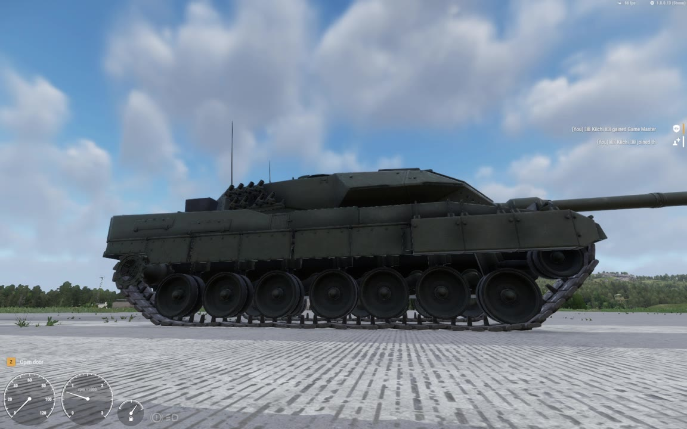
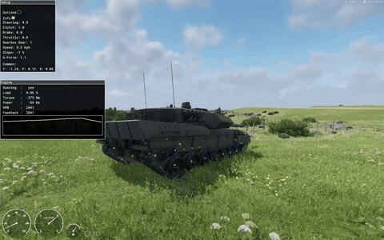

> [🇧🇷 Português](../pt-BR/14-running-gear.md) · 🇬🇧 English

[← Suspension and ride height](13-suspension.md) · [Contents](../../README.md) · [Track links: the native rope chain and the scripted chain →](15-track-links.md)

# Road wheels, idler, sprocket and return rollers

This chapter covers the parts the track runs on. It explains how the simulation defines them, how big each one is for the simulation and for the eye, how they are numbered, how to read them from script and how to make them move on the model. The suspension physics is in [Suspension and ride height](13-suspension.md). The links are in [Track links](15-track-links.md).

**In short.** The simulation computes every road wheel, idler, sprocket and return roller, but it does not animate the model correctly. `CarProcAnimComponent`, the vanilla way to animate wheels, gives most tracked wheel bones the signals of another wheel in 1.8.0.13. What works is a script that reads the simulation wheel by wheel and moves the bones itself: `LEO_RunningGearComponent`.

| Item | Status | How we know |
| --- | --- | --- |
| Road wheels, idler, sprocket and return rollers in the simulation | ✅ Load and run: 13 parts per track on the Leopard | Measured (`WheelCount`, telemetry) |
| Return rollers (`Type "Return Roller"`) | ✅ Load, count in `WheelCount` and shape the native link chain. Effect on driving not measured | Measured (`WheelCount`); the chain part is reverse-engineered and seen in the debug overlay |
| Reading each wheel from script | ✅ Getters indexed by (track, part) | Measured |
| `CarProcAnimComponent` on tracked wheels | ❌ Most bones get another wheel's spin and travel | Measured in two runs |
| Wheel bones moved by script (`LEO_RunningGearComponent`) | ✅ Bone within 3 mm of the physics in 90–95% of samples | Measured |
| The same script on other players' machines (proxies) | ⚠️ Not tested | — |

All values are the Leopard 2A6's (`Leopard2A6_base.et`, full block in [examples/leopard2a6](../../examples/leopard2a6/VehicleTrackedSimulation_Leopard2A6.et.txt)). Everything was tested in Workbench 1.8.0.13. The pictures come from the test videos listed in [Video examples](05-video-examples.md).

### Part types and templates

Each part of a track is a `TrackPart` in `Tracks { Track Left { Wheels { ... } } }`. Its `Type` selects one of four templates, which sit inside `Simulation Tracked`. Every template has `Mass`, `Radius` and `BrakeTorque`. Only `RoadWheel` has a `Suspension` block.

| `TrackPart` `Type` | Template block | Enum value | Leopard: `Mass` / `Radius` / `BrakeTorque` | Notes |
| --- | --- | --- | --- | --- |
| `Road Wheel` (the default: write no `Type`) | `RoadWheel RoadWheel "{id}"` | 0 | 110 kg / 0.418 m / 6000 N·m | Has the suspension and the ground ray ([chapter 13](13-suspension.md)) |
| `Sprocket` | `Sprocket Sprocket "{id}"` | 1 | 250 kg / 0.34 m / 30000 N·m | Its radius sets the track speed |
| `Idler` | `Idler Idler "{id}"` | 2 | 150 kg / 0.335 m / 0 | — |
| `Return Roller` | `Roller Roller "{id}"` | 3 | 20 kg / 0.152 m / 0 | Write `Type "Return Roller"` with the quotes: the text value is accepted |

The type names and enum values are reverse-engineered from the 1.8.0.13 executable. The effect of `Mass` and `BrakeTorque` on each part type was not isolated.

The return roller template and one roller part look like this:

```
Roller Roller "{EC9CBBD192126CCB}" {
 Mass 20
 Radius 0.152
 BrakeTorque 0
}
```

```
TrackPart Roller_L01 {
 Type "Return Roller"
 Pivot Pivot "{495CE3DBFC7DD5D5}" {
  Bone "v_roller_l01"
 }
}
```

The engine rejects a template with a bad value. The messages (strings in the executable) are:

- `TrackWheel's mass is incorrect! (must be greater than zero)`
- `TrackWheel's radius is incorrect! (must be greater than zero)`
- `TrackWheel's brake torque is incorrect! (must be greater than or equal to zero)`

**The pivot bone is the part's centre**, on its axle. It is not the contact point. A road wheel's centre sits `Radius` above its ground contact ([chapter 13](13-suspension.md)).

**What each `Radius` does:**

| Part | Effect of `Radius` | How we know |
| --- | --- | --- |
| Road wheel | Ride height: wheel centre = contact point + `Radius` along the hull's up axis. The road wheel's `WheelGetRPM` is the belt speed ÷ this `Radius` | Measured: the engine's suspension signal matched (contact height + `WheelGetRadius`) within 1.25 mm on average |
| Sprocket | Track speed: speed = sprocket angular velocity × `Radius` | Measured: effective radius 0.344 m in 1st gear and 0.346 m in 3rd from telemetry; the debug overlay's Speed ÷ AngVel is exactly 0.3400 |
| Idler, return roller | No effect on driving was measured | Not tested |
| All parts | The circle of that part in the native link chain and in the debug overlay | Reverse-engineered (chain), observed in video (overlay) |

### Simulation radius versus visual radius

**Rule: the simulation `Radius` is the distance from the part's centre to the ground face of the track** (the outer face of the links). It is not the rim you see. For a part the track runs on or around, that is the visual rim radius plus about one link thickness.

The reason is the road wheel geometry. The track lies between the rim and the ground, and the simulation has no track thickness of its own. `TrackThickness` exists, but the engine stores it and never reads it (reverse-engineered). So the wheel `Radius` must include the track for the hull to sit at its modelled height.

| Part | Simulation `Radius` (m) | Visual radius (m) | Difference (m) | Where the simulation radius reaches |
| --- | --- | --- | --- | --- |
| Road wheel | 0.418 | 0.345 (rim) | +0.073 | Ground face of the links under the wheel |
| Idler | 0.335 | 0.264 (rim) | +0.071 | Outer face of the links that wrap it (their inner face is at 0.256) |
| Sprocket | 0.34 | about 0.29–0.32 (teeth, not measured precisely) | — | Outer face of the links that wrap it (their inner face is at 0.262) |
| Return roller | 0.152 | 0.0847 (rim) | +0.067 | Outer face of the top run above it (0.144–0.159 above the roller centre) |

The link shoe of the 2A6 is 0.0757–0.076 m thick. The rim radii and the inner and outer faces were measured on the model. The sprocket's tooth radius appears in our notes as 0.29, 0.305 and 0.3189. No script uses it.

Two checks confirm the rule on the 2A6:

- The road wheel bones sit at y = 0.4186 m. With `Radius` 0.418, a wheel at its modelled height touches y = 0.0006, 0.6 mm above the model's ground plane (y = 0).
- The vehicle debug overlay draws every part as a circle of its simulation radius. Around the road wheels these circles reach the bottom of the links, well outside the rims (picture below).


*Test video A (2026-10-06), 109.0 s: tank stopped, `Show vehicle debug` on. The white 12-sided circles are drawn at each part's simulation `Radius`. Around the road wheels they reach the ground face of the links, outside the visible rims. The small circles are the return rollers. The red line with cyan ticks is the native rope chain; it runs along the bottom of the scripted links. Leopard 2A6 model by buh-late, CC BY 4.0, modified ([credits](../../CREDITS.md)).*

**How to measure your own model:**

1. Road wheel: the height of the wheel centre above the model's ground plane, with the model standing on its tracks. This is about the rim radius plus the link thickness.
2. Idler and sprocket: the distance from the centre to the outer face of the links wrapped around it.
3. Return roller: the distance from the centre to the outer face of the top run above it.

A road wheel `Radius` that does not match makes the hull float or sink by the difference ([chapter 13](13-suspension.md)). The idler, sprocket and roller radii also define the path of the native link chain ([chapter 15](15-track-links.md)).

**Bone rest positions on the 2A6** (hull model space, metres; x to the right, y up, z forward; left bones at −x):

| Bones (left / right) | x | y | z |
| --- | --- | --- | --- |
| `v_wheel_l01` / `v_wheel_r01` | ∓1.3288 | 0.4186 | 2.478 |
| `v_wheel_l02` / `r02` | ∓1.3288 | 0.4186 | 1.662 |
| `v_wheel_l03` / `r03` | ∓1.3288 | 0.4186 | 0.889 |
| `v_wheel_l04` / `r04` | ∓1.3288 | 0.4186 | 0.160 |
| `v_wheel_l05` / `r05` | ∓1.3288 | 0.4186 | −0.722 |
| `v_wheel_l06` / `r06` | ∓1.3288 | 0.4186 | −1.596 |
| `v_wheel_l07` / `r07` | ∓1.3288 | 0.4186 | −2.478 |
| `v_idler_l` / `v_idler_r` | ∓1.3298 | 0.840 | 3.128 |
| `v_sprocket_l` / `v_sprocket_r` | ∓1.3307 | 0.824 | −3.297 |
| `v_roller_l01` / `r01` | ∓1.4193 | 1.078 | 2.131 |
| `v_roller_l02` / `r02` | ∓1.1593 | 1.078 | 1.341 |
| `v_roller_l03` / `r03` | ∓1.4193 | 1.078 | −0.400 |
| `v_roller_l04` / `r04` | ∓1.1593 | 1.078 | −2.058 |

The return rollers are staggered sideways on the 2A6 model. The `v_suspension_*` and `v_wheel_*_rotator` bones of the rig below share the position of their `v_wheel_*` bone.

### TrackPart order and indices

**List each track in this order:** road wheels from front to rear, then the idler, then the sprocket, then the return rollers. Use the same order on both sides.

| Index | Left track | Right track | `Type` | Template | Pivot bone |
| --- | --- | --- | --- | --- | --- |
| 0–6 | `Wheel_L01` … `Wheel_L07` | `Wheel_R01` … `Wheel_R07` | none (Road Wheel) | `RoadWheel` | `v_wheel_l01` … `l07` |
| 7 | `Idler_L` | `Idler_R` | `Idler` | `Idler` | `v_idler_l` |
| 8 | `Sprocket_L` | `Sprocket_R` | `Sprocket` | `Sprocket` | `v_sprocket_l` |
| 9–12 | `Roller_L01` … `Roller_L04` | `Roller_R01` … `Roller_R04` | `"Return Roller"` | `Roller` | `v_roller_l01` … `l04` |

**What the loader checks** (reverse-engineered, with the error strings of the executable):

- Exactly 2 tracks: `Invalid number of tracks! Must be %d!` (the number is 2)
- At least 3 parts per track: `Wheels - configuration is missing! Every track should have at least 3 wheels!`
- The sprocket and the idler at the same index on both tracks: `Wheels - %s mismatch between tracks`

**Why road wheels come first.** The engine gives indices 0 and 1 special roles (reverse-engineered from the 1.8.0.13 executable):

- Every simulation step it takes the angle change of part **1** as the reference angular velocity ω. Every other part's visual angle advances by ω·r₁/rⱼ.
- It drives the native link chain with the radius of part **0**: chain speed = r₀·ω.

Both must therefore be road wheels. The earlier order put the idler first, on the 2A7 build and on the first 2A6 prefab. With that order and the first 2A6 idler `Radius` of 0.2641, the chain would have run at 0.2641 / 0.418 ≈ 63% of the road wheel surface speed. The 2A7 build drove normally with the idler first, so the order matters for the chain and for scripts, not for driving, as far as we tested.

**Indices in the script API.** Every wheel getter takes `(track, part)`. `track` 0 is the first `Track` block in `Tracks` (`Track Left` on the Leopard). `part` is the position of the `TrackPart` in that track's list, from 0. `WheelCount()` is the number of parts **per track**: 13 on the 2A6. The log line `LEOGEAR simulation: 2 tracks, WheelCount 13` confirms it, and so does the reverse engineering.

If you reorder the parts, every index stored elsewhere changes with them: your scripts, and anything that refers to a wheel by number ([chapter 6](06-converting.md) covers `m_iWheelId`).

### Reading the wheels from script

Get the simulation through the controller and check that it is loaded before you read anything:

```c
TrackedControllerComponent controller = TrackedControllerComponent.Cast(owner.FindComponent(TrackedControllerComponent));
if (!controller)
	return;

VehicleTrackedSimulation simulation = controller.GetSimulation();
if (!simulation || !simulation.IsValid() || simulation.TrackCount() < 2)
	return; // not loaded yet: every wheel getter returns 0, false or a zero vector

if (simulation.WheelCount() < 7) // parts per track: 13 on the 2A6
	return; // fewer parts than the 7 road wheels read below

for (int track = 0; track < 2; track++)
{
	for (int k = 0; k < 7; k++) // the road wheels are parts 0..6
	{
		float rpm = simulation.WheelGetRPM(track, k);
		if (!simulation.WheelHasContact(track, k))
			continue; // the contact position is stale without contact

		vector contact = owner.CoordToLocal(simulation.WheelGetContactPosition(track, k));
		float centreY = contact[1] + simulation.WheelGetRadius(track, k); // wheel centre height, hull space
	}
}
```

**The readiness guard.** Every getter checked in the executable (`TrackCount`, `WheelCount` and the wheel getters used in this chapter) first tests an internal "simulation loaded" state. Until then it returns 0, `false` or the zero vector. `TrackCount()` returns the constant 2 once the simulation is loaded; it does not read the prefab. So `TrackCount() < 2` means "not loaded yet" (reverse-engineered). In Play, the simulation became valid 0.78–1.26 s after the vehicle entity was created, well before the engine was started (measured in two sessions). The getters work with the engine off.

**The getters** (`VehicleTrackedSimulation`, 1.8.0.13):

| Method | Returns | Notes |
| --- | --- | --- |
| `TrackCount()` | 2 when loaded, 0 before | Use it as the readiness test |
| `WheelCount()` | Parts per track (13) | Per track, not for both tracks |
| `WheelHasContact(track, part)` | `bool` | `false` while airborne or flipped |
| `WheelGetContactPosition(track, part)` | World position of the ground contact | Returns a stored value without checking contact (reverse-engineered): test `WheelHasContact` first. Convert with `owner.CoordToLocal` |
| `WheelGetContactNormal` / `WheelGetContactMaterial` / `WheelGetContactEntity` | Normal, `GameMaterial`, entity | Not used here |
| `WheelGetContactLiquidState` / `...LiquidMaterial` / `...LiquidPosition` | Water contact | Not used here |
| `WheelGetRPM(track, part)` | Revolutions per minute, signed | The internal angular velocity (rad/s) × 9.549296 (reverse-engineered). See [Wheel RPM](#wheel-rpm) |
| `WheelGetRadius(track, part)` | The template's `Radius` | The vanilla doc calls it the "initial" radius |
| `WheelGetRollingDrag` / `WheelSetRollingDrag` | Rolling drag percentage | Not tested |
| `WheelGetPosition(track, part, displacement)` | Wheel centre in the physics frame | See below |

**Rules:**

- Get the simulation with `TrackedControllerComponent.GetSimulation()`. An old comment in `LEO_TelemetryComponent.c` says the getters crashed when the simulation came from `FindComponent`. That crash was later traced to `GetInputs()`, so `FindComponent` is probably safe, but it was not tested again.
- **Never call `GetInputs(out, out)`.** Its binding writes to address 0 and crashes Workbench. `GetFloorNormalAngles` has the same defect (reverse-engineered; see [Bugs and limitations](09-bugs.md)).
- **Check the indices yourself.** Only `WheelGetPosition` checks its part index. No getter checks the track index. An out-of-range index reads foreign memory (reverse-engineered). Keep `track < TrackCount()` and `part < WheelCount()`.

**`WheelGetPosition` and the centre of mass.** It returns the wheel centre relative to the vehicle's physics centre of mass, with the hull's axes. `displacement` 0 is the fully extended suspension (full droop). The physics centre of mass is the model's centre-of-mass point plus the `RigidBody` `CenterOfMass` offset ([chapter 13](13-suspension.md)). To get hull space, add both:

```math
\vec p_{\text{hull}} = \text{WheelGetPosition}(t, w, 0) + \vec c_{\text{model COM point}} + \vec c_{\text{CenterOfMass}}
```

On the 2A6 that sum is (0.0002, 2.1678, 0.0791): the empty `COM_hull` at (0.0002, 1.1678, −0.3809) plus `CenterOfMass 0 1 0.46`. In run 1 (`MaxTravelDown` 0.15), `WheelGetPosition(0, wheel, 0)` returned (−1.32898, −1.89918, z − 0.07906) for every left road wheel, z being the bone's z. Adding the centre of mass gives y = 0.26858 = 0.41858 − 0.15, the full-droop centre, to 0.01 mm (measured). The value changes whenever you change `CenterOfMass`, so do not hard-code it. `LEO_RunningGearComponent` does not use this getter; it works from the contact point. The unit of `displacement` is unknown: only 0 was tested.

The same run shows that the simulation uses the **bind pose** of the pivot bones. `WheelGetPosition` stayed identical in all 131 samples while `CarProcAnimComponent` moved the wheel bones by up to 0.30 m. Animating the bones does not feed back into the physics (inferred from that measurement).

### Wheel RPM

All values below were measured with `LEOSUSP` and `LEOTEL` telemetry and the vehicle debug overlay ([chapter 16](16-debugging.md)).

**Sign.** `WheelGetRPM` has the sign of the hull's forward speed. This held in 87 of 87 run-1 frames with all left wheels in contact and more than 2 km/h. With 1 km/h as the threshold and lost contact included, it held in 103 of 106; the exceptions had lost contact or were near standstill.

**The sprocket radius sets the speed.** In steady straight driving with the clutch engaged, speed ÷ sprocket angular velocity (engine feedback rpm ÷ (gear × 4.6)) gave an effective radius of 0.344 m in 1st gear (median, 162 samples) and 0.346 m in 3rd, against `Radius` 0.34. The debug overlay's per-track Speed ÷ AngVel is 0.3400 in every frame read. Example at 23 km/h: AngVel 18.413 rad/s, Speed 6.2605 m/s.

**The road wheel RPM follows the same belt.** Road wheel RPM = sprocket rpm × 0.34 / 0.418. The ratio was 0.9999 (median of 42 run-1 frames, clutch engaged, all wheels in contact). Every part of a track shares one belt speed, and the road wheel RPM is that speed divided by the road wheel `Radius`. Whether `WheelGetRPM` of the idler, sprocket and rollers also equals belt speed ÷ own `Radius` was not checked.

| Conversion (current prefab) | Value | How we know |
| --- | --- | --- |
| Road wheel `WheelGetRPM` per km/h of belt speed | 6.346 rpm | Computed from `Radius` 0.418 |
| Sprocket rpm per km/h of belt speed | 7.802 rpm | Computed from `Radius` 0.34 |
| Hull speed ÷ road wheel angular velocity | 0.38–0.42 m in steady straight driving; median 0.398 m over all moving frames | Measured. Below 0.418, which fits track slip: under power the overlay showed the tracks 3–6% faster than the hull (observed in video) |

**Small differences between wheels.** The 7 road wheels of a track do not always report exactly the same RPM. In run 1 they were identical in 90 of 131 frames. Otherwise they showed a smooth front-to-rear gradient under 2% (for example 172.2 to 173.6 rpm). A wheel without contact can report something very different: airborne wheels in reverse read −230.6 rpm while the grounded ones read 0 to 20. That value is the reverse belt speed at `RpmMax`: 3000 / (2.3 × 4.6) × 0.34 / 0.418 = 230.6.

### Why CarProcAnimComponent fails on tracked vehicles

`TrackedVehicle_Base.et` carries an empty `CarProcAnimComponent "{5D6501223785D009}"`. On wheeled vehicles this component feeds each wheel's simulation signals into procedural animations (`.pap`) on its bones. We filled it for the tracked Leopard and measured what each bone received.

#### What the vanilla wheel animations expect

| File | Bone slots | Signals |
| --- | --- | --- |
| `{CCE4D4889B1BB408}anims/proc/wheel_rotation.pap` | `wheel` | `rotation` → rotates `wheel` about X (degrees; editor range −360…360) |
| `{FEFBB47B33FB500F}anims/proc/wheel_suspension.pap` | `wheel`, `suspension`, `rotator` | `rotation` → rotates `wheel` about X; `suspension` → moves `suspension` along Y; `steering` → rotates `rotator` |

Each wheel gets one `ProcAnimParams` entry. `BoneNames` fills the bone slots in order. This is the block used in run 1 for the first road wheel:

```
CarProcAnimComponent "{5D6501223785D009}" {
 Parameters {
  ProcAnimParams "{F43F56CC537A1C10}" {
   ResourceName "{FEFBB47B33FB500F}anims/proc/wheel_suspension.pap"
   BoneNames {
    "v_wheel_l01" "v_suspension_l01" "v_wheel_l01_rotator"
   }
  }
  ...
```

The `.pap` editor range of the suspension input is −1…1, but that is only the preview range. On the tracked simulation the suspension signal is in metres along the bone's Y, from −`MaxTravelDown` to +`MaxTravelUp`. In run 1 the bones moved exactly between −0.150 and +0.300 (measured). Without ground contact the signal is exactly −`MaxTravelDown`. When the contact lies higher than full compression, it stays at +`MaxTravelUp`.

#### The two runs

| | Run 1 (2026-10-05, 22:30) | Run 2 (22:55) |
| --- | --- | --- |
| Setup | `wheel_suspension.pap` on the 14 road wheels, `wheel_rotation.pap` on idlers, sprockets and rollers | Same |
| Order of the 26 entries | Per side: L01…L07, idler, sprocket, rollers, then the right side | Interleaved: L01, R01, L02, R02 … then idlers, sprockets, rollers |
| Data | 131 telemetry frames comparing each bone with the simulated wheels | Telemetry at rest and 22 moving samples; video reviewed frame by frame |
| Travel | Bones L01, L03, L05, L07 matched **left** road wheels 1, 2, 3, 4 (mean errors 1.7, 1.3, 1.0, 0.9 mm over 106 frames with full contact). Matching each bone to its own wheel gave a 16.1 mm mean error. L02, L04, L06 were 15 mm or more from every left wheel | At rest, right bones R02–R07 sat +51 to +54 mm above their simulated wheels; R01 sat −4 mm from its own |
| Spin | L01 = L03 = L05 = L07 in 123 of 131 frames; L02 = L04 = L06 in 107 of 131 | In all 22 moving samples: L02 = L04 = L06 = R01; R07 = `Sprocket_R`; `Sprocket_L` = L01 |
| Seen in game | Reported: wheels not following the chain, only the front one right, some moving up and down and others not | Right road wheels 2–7 float above the chain (picture below) |



*Diagnostic video 2 (2026-10-05, 22:56), 9.0 s: engine idling on the runway, wheels animated by `CarProcAnimComponent` (run 2). Only road wheel 1 (at the right, the front) rests on the links. Wheels 2–7 float above them because their bones read the signals of an idler, a sprocket or a roller, which have no suspension travel. They stay at the modelled height while the simulated wheels and the native links rest lower (this run still had `MaxTravelDown` 0.15). Telemetry: +51 to +54 mm. Leopard 2A6 model by buh-late, CC BY 4.0, modified ([credits](../../CREDITS.md)).*

The first install used only `wheel_rotation.pap` (spin) on all 26 bones. The only complaint then was the missing vertical motion. Spin alone hides the problem in straight driving, because every road wheel on both sides turns at nearly the same rate. The error showed once suspension travel was mapped (our reading of the two installs).

#### The model that explains both runs

One lookup rule predicts every equality we observed. The component finds the wheel by the name of its pivot bone and turns it into a global index g = 13 · track + part. It then reads the signals from a table laid out per axle (left 0, right 0, left 1, right 1, …):

```math
g = 13 \cdot \text{track} + \text{part} \quad\Rightarrow\quad \text{reads track } (g \bmod 2),\ \text{part } \lfloor g/2 \rfloor
```

| Left part | g | Reads the signals of | Right part | g | Reads the signals of |
| --- | --- | --- | --- | --- | --- |
| L01 | 0 | left road wheel 1 (its own) | R01 | 13 | right road wheel 7 |
| L02 | 1 | right road wheel 1 | R02 | 14 | left idler |
| L03 | 2 | left road wheel 2 | R03 | 15 | right idler |
| L04 | 3 | right road wheel 2 | R04 | 16 | left sprocket |
| L05 | 4 | left road wheel 3 | R05 | 17 | right sprocket |
| L06 | 5 | right road wheel 3 | R06 | 18 | left roller 1 |
| L07 | 6 | left road wheel 4 | R07 | 19 | right roller 1 |
| `Idler_L` | 7 | right road wheel 4 | `Idler_R` | 20 | left roller 2 |
| `Sprocket_L` | 8 | left road wheel 5 | `Sprocket_R` | 21 | right roller 2 |
| `Roller_L01` | 9 | right road wheel 5 | `Roller_R01` | 22 | left roller 3 |
| `Roller_L02` | 10 | left road wheel 6 | `Roller_R02` | 23 | right roller 3 |
| `Roller_L03` | 11 | right road wheel 6 | `Roller_R03` | 24 | left roller 4 |
| `Roller_L04` | 12 | left road wheel 7 | `Roller_R04` | 25 | right roller 4 |

Only `v_wheel_l01` gets its own signals. The predictions match the measurements: L01, L03, L05, L07 read left road wheels 1–4. L02, L04, L06 read right road wheels, so they spin with R01. R02–R07 read parts without suspension, so they never move vertically. R07 and `Sprocket_R` read two rollers of the same radius, so they spin together. `Sprocket_L` and L01 read two left road wheels.

**Caveat.** This model is inferred. Run 1 cannot tell it apart from another rule: "entry *i* reads interleaved slot *i*". With the per-side order both rules give the same mapping. Run 2 should have decided between them, but its simulation still used the old prefab data: it rested about 5 cm low, the `MaxTravelDown` 0.15 behaviour, although the prefab already said 0.10 ([chapter 13](13-suspension.md) explains the open-world cache). So run 2 may not have used the interleaved order either. The interleaved order in a freshly opened world was never tested.

**Even a correct mapping would turn some parts at the wrong rate.** The engine derives every part's visual angle from part 1, scaled by the simulation radii (reverse-engineered). If that angle is what the `rotation` signal carries, road wheels would turn at belt speed ÷ 0.418 instead of ÷ 0.345 (17% too slow for their rims), and rollers at ÷ 0.152 instead of ÷ 0.0847 (44% too slow). The idler and sprocket would be right. This was computed, not seen, since the mapping never worked.

**Verdict: do not use `CarProcAnimComponent` for tracked running gear in 1.8.0.13.** Leave `{5D6501223785D009}` empty, as `TrackedVehicle_Base.et` has it. If you convert a wheeled vehicle, delete its wheel `ProcAnimParams`. Move the bones by script instead.

### The scripted solution: LEO_RunningGearComponent

[`LEO_RunningGearComponent`](../../scripts/LEO_RunningGearComponent.c) reads the simulation by (track, part) every frame and moves the bones itself. It animates road wheel travel and spin and the spin of idlers, sprockets and return rollers. It also drives the scripted link chain ([chapter 15](15-track-links.md)). It uses only the vanilla API.

**Every frame it:**

1. Gets the simulation and returns until it is loaded (`TrackCount() < 2`).
2. Once, checks that `WheelCount()` ≥ road wheels + idler + sprocket + rollers, and logs `LEOGEAR`.
3. Computes the distance each track ran this frame.
4. For each road wheel: computes the suspension travel, moves `v_suspension_<s>0<k>` and spins `v_wheel_<s>0<k>`.
5. Spins the idler, the sprocket and the return rollers.
6. Moves the scripted links, if `m_bScriptedChain` is on.

#### Install

1. Copy [`LEO_RunningGearComponent.c`](../../scripts/LEO_RunningGearComponent.c) **and** [`LEO_TrackChain.c`](../../scripts/LEO_TrackChain.c) to `scripts/Game/Vehicle/` in your mod. The component refers to `LEO_TrackChain` even with the scripted chain off.
2. Recompile the scripts with no world open ([chapter 16](16-debugging.md) explains the reload traps).
3. In the hull prefab, leave `CarProcAnimComponent` empty and add the component:

   ```
   CarProcAnimComponent "{5D6501223785D009}" {
   }
   LEO_RunningGearComponent "{5292A83C2D6FC873}" {
   }
   ```

4. Give the hull the bone rig below, list the `TrackPart`s in the order above, and set the attributes to your model's values.

The full list of hull components of the 2A6 is in [examples/leopard2a6/HullComponents_Leopard2A6.et.txt](../../examples/leopard2a6/HullComponents_Leopard2A6.et.txt). [Ready-made scripts](11-scripts.md) covers installation in general.

#### Attributes

| Attribute | Default (Leopard) | Purpose |
| --- | --- | --- |
| `m_iRoadWheels` | 7 | Road wheels per track: `TrackPart`s 0 … n−1, bones `v_suspension_<s>0<k>` and `v_wheel_<s>0<k>` |
| `m_iRollers` | 4 | Return rollers per track (the parts after the sprocket), bones `v_roller_<s>0<k>` |
| `m_fRoadWheelRadius` | 0.345 | Visual rim radius of the road wheels, where they roll on the track's inner face [m] |
| `m_fRollerRadius` | 0.0847 | Visual rim radius of the return rollers [m] |
| `m_fRestHeight` | 0.4186 | Modelled wheel centre height [m], used if a wheel bone cannot be read |
| `m_fMaxTravelDown` | 0.10 | Same value as `Suspension` `MaxTravelDown` |
| `m_fMaxTravelUp` | 0.30 | Same value as `Suspension` `MaxTravelUp` |
| `m_fDropRate` | 8 | How fast a wheel drops to full droop when it loses contact, and comes back when it lands [1/s] |
| `m_bScriptedChain` | 1 | Move the track links by script and hide the native rope's links ([chapter 15](15-track-links.md)) |
| `m_sLinkModel` | `{B50AEDC702735F50}…/Leopard2A6_track_link.xob` | Link model of the scripted chain |
| `m_iLinks` | 73 | Links per track |
| `m_sNativeLinkName` | `Leopard2A6_track_link` | Part of the native link model's name, used to find and hide the native links |
| `m_fMaxDistance` | 300 | Beyond this distance from the camera, bones and links are not updated [m] |

The idler and sprocket radii are not attributes. The script reads them from the simulation (`WheelGetRadius`), because the track wraps those parts (see [Spin](#spin)). Keep `m_fMaxTravelDown` and `m_fMaxTravelUp` equal to the `Suspension` block, or the script clamps the travel to different limits than the physics.

#### The bone rig (Blender)

Each road wheel needs a bone that moves up and down and a bone that spins. The 2A6 uses the same chain of bones as the vanilla `wheel_suspension.pap`:

| Bone | Parent | Position | Moved by the script | Skinned to it |
| --- | --- | --- | --- | --- |
| `v_body` | (root) | — | No | Hull; suspension arms with weight 1 − t |
| `v_suspension_l01` | `v_body` | Wheel centre | Moves along Y by the travel | Suspension arm with weight t |
| `v_wheel_l01_rotator` | `v_suspension_l01` | Wheel centre | No (steering slot of the vanilla `.pap`) | Nothing |
| `v_wheel_l01` | `v_wheel_l01_rotator` | Wheel centre | Spins about X. It is also the simulation's `Pivot` bone | Wheel mesh, 100% |
| `v_idler_l`, `v_sprocket_l`, `v_roller_l01` … `l04` | `v_body` | Part centre | Spin about X | Part mesh, 100% |

Same for the right side (`_r`). All these bones have an identity rest orientation, so bone space has the hull's axes: Y is up and X is the axle. In Blender, point each bone forward (+Y) with roll 0, as on the 2A6. The script's matrices assume this orientation. The script does not use the rotator bone; you can leave it out if you never use `CarProcAnimComponent`.

**Steps** (the 2A6 rig was added by a Blender script, `add_suspension.py`, which is not part of this repository):

1. For each road wheel, add `v_suspension_<s>0<k>` and `v_wheel_<s>0<k>_rotator`. Copy head, tail and roll from `v_wheel_<s>0<k>`, so the rest pose does not change.
2. Parent them: suspension bone under `v_body`, rotator under the suspension bone, and the existing wheel bone under the rotator.
3. Keep the wheel mesh weighted 100% to `v_wheel_<s>0<k>`. It inherits the travel from the suspension bone.
4. Re-weight each suspension arm so it follows the wheel. Find the arm's pivot on the hull: the cluster of vertices furthest from the hub (within 8 cm of the furthest one). Project each vertex onto the pivot → hub axis to get t, clamped to 0…1. Give it weight t on `v_suspension_<s>0<k>` and 1 − t on `v_body`. On the 2A6 the arms are 0.87 m long; on the front wheel the pivot sits 0.61 m inboard, 0.51 m ahead of and 0.36 m above the hub. This linear blend shears the arm rather than rotating it about the pivot: it moves the hub end with the wheel and keeps the pivot end fixed.
5. Check that no vertex moved and that only the arm weights changed. Then pose a few suspension bones up and down and render a test picture. The 2A6 script moved alternate wheels by +0.15 and −0.12 m and measured the wheel bottoms.
6. Export as usual (Add Leaf Bones off, Only Deform Bones off) and reimport the `.xob` with *Export Skinning* and *Export Scene Hierarchy* on ([chapter 3](03-model-requirements.md)). Close the World Editor first: replacing the hull model with a world open froze Workbench once.

On the 2A6 this adds 28 bones (14 suspension bones and 14 rotators); the hull skeleton has 56.

#### Moving bones with SetBoneMatrix

`Animation.SetBoneMatrix(owner, bone, mat)` takes a **local delta over the bind pose**: the identity matrix leaves the bone at rest. Vanilla `SCR_DestructionTireComponent` uses it the same way (identity plus a small offset per tyre bone). The script writes every bone again every frame.

```c
vector mat[4];
Math3D.MatrixIdentity4(mat);
mat[3] = Vector(0, travel, 0);                  // suspension bone: up by the travel
anim.SetBoneMatrix(owner, suspensionBone, mat);
```

The rest positions are read once in `OnPostInit` with `anim.GetBoneMatrix`, before the component moves anything.

#### Suspension travel

With ground contact the bone follows the simulation exactly:

```math
\text{travel} = \operatorname{clamp}\left(y_{\text{contact}} + R_{\text{sim}} - y_{\text{rest}},\ -\text{MaxTravelDown},\ +\text{MaxTravelUp}\right)
```

Here *y*<sub>contact</sub> is the height of `WheelGetContactPosition` in hull space (`owner.CoordToLocal`), *R*<sub>sim</sub> is `WheelGetRadius` and *y*<sub>rest</sub> is the bind-pose height of the wheel bone (0.4186). This is the same geometry as the simulation's: wheel centre = contact + `Radius` along the hull's up axis ([chapter 13](13-suspension.md)).

**Why clamp.** The contact-derived travel can leave the travel range, because the ray starts 0.5 m above full compression. It reached +0.382 m (session 00:12), +0.367 m (run 1) and +0.348 m (over mines in run 4), against the +0.30 limit. It also went a few millimetres past −`MaxTravelDown` (−0.107 m with 0.10). The engine's own signal stays inside the limits (measured).

**Contact loss.** Without contact there is no contact point, and the simulation hangs the wheel at full droop. Jumping straight there would look like a pop. So the script eases the bone towards −`MaxTravelDown`. When the wheel lands it eases back to the contact height, until the gap is under 5 mm; from then on it follows the simulation exactly again:

```math
\text{travel} \leftarrow \text{travel} + (\text{target} - \text{travel}) \cdot \left(1 - e^{-k\,\Delta t}\right), \qquad k = 8\ \text{s}^{-1}
```

Here *k* is `m_fDropRate`. The factor does not depend on the frame rate. With *k* = 8 the bone covers 63% of the gap in 0.125 s and 95% in 0.37 s (computed).

<a id="spin"></a>

#### Spin: parts that roll and parts that are wrapped

The script first computes how far the track ran this frame, relative to the hull. It uses the belt speed at the track's ground face, read from road wheel 0:

```math
d = \text{WheelGetRPM}(t, 0) \cdot \frac{2\pi}{60} \cdot \text{WheelGetRadius}(t, 0) \cdot \Delta t
```

Positive *d* means the top run moves forward. Then each part turns by *d* divided by the radius at which it meets the track:

- **Road wheels and return rollers roll** on the inner face of the track. They turn by *d* ÷ their **visual rim radius** (0.345 and 0.0847).
- **The idler and the sprocket are wrapped** by the track. They turn with the links around them, at the radius of the chain path: their **simulation radius** (0.335 and 0.34). The scripted links run on that path ([chapter 15](15-track-links.md)), so the sprocket teeth and the links stay in step.

```math
\Delta\theta_{\text{road wheel, roller}} = \frac{d}{r_{\text{rim}}} \qquad\qquad \Delta\theta_{\text{idler, sprocket}} = \frac{d}{R_{\text{sim}}}
```

| Part | Radius used | rpm per km/h of belt speed |
| --- | --- | --- |
| Road wheel (`WheelGetRPM`, simulation) | 0.418 | 6.35 |
| Road wheel (script, rolling on the rim) | 0.345 | 7.69 |
| Idler (script, wrapped) | 0.335 | 7.92 |
| Sprocket (script, wrapped; same as the simulation) | 0.34 | 7.80 |
| Return roller (script, rolling on the rim) | 0.0847 | 31.3 |

The rates are computed as 1 / (3.6 · r) · 60 / 2π. The visible road wheels turn 21% faster than the simulation's road wheel RPM, because their rims are smaller than the simulation radius.

**Sign and matrix.** A positive angle moves the top of the part forward (+Z). That is how every part turns when the track runs forward, whether it rolls or is wrapped. The script keeps one angle per part type and track and writes this matrix:

```c
float c = Math.Cos(angle);
float s = Math.Sin(angle);
mat[0] = Vector(1, 0, 0);
mat[1] = Vector(0, c, s);
mat[2] = Vector(0, -s, c);
mat[3] = vector.Zero;
anim.SetBoneMatrix(owner, wheelBone, mat);     // rotation about the axle (X)
```



*Test video A (2026-10-06), 208.8–211.0 s · [full-size still](../images/sprocket-wrap.jpg) (209.5 s): right side on grass at about 8 km/h in 1st gear. Wheels and links are moved by `LEO_RunningGearComponent` and `LEO_TrackChain`. The road wheels and rollers roll on the inner face of the links; the sprocket turns with the links that wrap it. Only the suspension markers of the debug overlay are on. Leopard 2A6 model by buh-late, CC BY 4.0, modified ([credits](../../CREDITS.md)).*

#### Distance, servers and multiplayer

- **Distance.** Beyond `m_fMaxDistance` (300 m) from the current camera (`GetWorld().GetCurrentCamera`), the script skips the bone and link writes. It still updates the travel and the angles, so nothing jumps when the camera comes closer. Hiding the native links still runs.
- **Dedicated server.** The component returns in `OnPostInit` when `System.IsConsoleApp()` is true, so it does nothing on a dedicated server.
- **Multiplayer.** The script is visual only and needs no replication: each machine reads its own simulation and moves local bones. Whether the wheel getters are valid on proxies (vehicles driven by another player) and whether the script animates them there is **not tested**.

#### Log messages

| Message | Meaning |
| --- | --- |
| `LEOGEAR simulation: 2 tracks, WheelCount 13` | Normal: logged once when the simulation is loaded |
| `LEOGEAR the simulation has N wheels, expected ...` | `WheelCount()` is smaller than `m_iRoadWheels` + 2 + `m_iRollers`. The component stops |
| `LEOGEAR N running gear bones missing or unreadable: the scripted chain is off` | A bone name does not exist, or a wheel bone reads outside 0.5–2 × `m_fRestHeight`. The bones that exist still move; the scripted chain is turned off |
| `LEOGEAR no TrackedControllerComponent or no skeleton: running gear not animated` | The hull has no tracked controller or no skeleton |
| `LEOGEAR link model not found: ...` / `LEOGEAR could not spawn all track links` | Scripted chain problems ([chapter 15](15-track-links.md)) |

#### Limits

- **Bone names are fixed:** `v_suspension_<s>0<k>`, `v_wheel_<s>0<k>`, `v_idler_<s>`, `v_sprocket_<s>`, `v_roller_<s>0<k>`, with `<s>` = `l` or `r`. The index is written as `0` + k, so more than 9 road wheels or rollers per side need a small code change.
- **The part order is fixed:** road wheels 0 … n−1, idler n, sprocket n+1, then the rollers.
- **The idler must be at the front and the sprocket at the rear.** The scripted chain builds the belt in that order. For a front-drive hull, swap the sprocket and idler circles in `CreateChains` (not tested).
- **The belt speed comes from road wheel 0.** When that wheel is airborne its RPM can differ from the rest of the track (−230.6 rpm in reverse in the example above). Wheels and links can then spin at the wrong rate until it lands. A grounded wheel or the sprocket may be a better source; this is untested.
- **Frame cost** was not measured.

#### Results

| Session | Script version | Bone − physics (`LEOSUSP` `diff_mm`) |
| --- | --- | --- |
| Run 3, 2026-10-05 23:18 | First version, smoothing every frame | 70% of samples within 3 mm; transients up to 83 mm on obstacles |
| 2026-10-05 23:58 and 2026-10-06 00:12 | After the review below | Median 0; 95% and 90% of samples within 3 mm. Larger values (up to 124 mm) only while a wheel eases back after losing contact |

All 7 road wheels of a track show the same spin, by construction. The results were also checked by eye in both sessions and in test video A, on runway, grass and rocks. Read `LEOSUSP` and the other telemetry lines as described in [chapter 16](16-debugging.md).

The few millimetres that remain usually change steadily from front to rear. In the 23:58 and 00:12 sessions, 83 of the 112 full-contact samples with more than 1 mm of difference did so (measured). A small difference in hull pitch between the moment the script reads the contacts and the moment the telemetry reads them would give that pattern; this is not proven.

**Review.** An adversarial review of the component looked at three areas: the API, the maths and the runtime. Its findings and what happened to them:

| Finding | Status |
| --- | --- |
| Smoothing every frame made the wheels lag the physics | Fixed: smoothing only on contact loss and landing |
| Idler and sprocket turned 17–27% too fast with their visual radii (0.264, about 0.29) | Fixed: they turn at their simulation radius |
| The getters return nothing useful before the simulation loads | Fixed: `TrackCount() < 2` guard |
| A wheel bone that cannot be read breaks the rest height | Fixed: fallback `m_fRestHeight` |
| Indices out of range read foreign memory | Fixed: `WheelCount()` checked once and logged |
| `EOnFrame` may run before the final hull pose of the frame, so the bones could lag one frame. The native link chain places its links in `EOnPostFrame` (reverse-engineered) | Open, low confidence |
| Proxies in multiplayer | Open, not tested |

### Open items

- **One-frame lag.** Would `EOnPostFrame` remove the few millimetres that remain while the hull pitches?
- **Belt speed source.** Which RPM should drive the wheels and links when road wheel 0 is airborne: another grounded wheel, the sprocket, or the mean of the grounded wheels?
- **RPM of the other parts.** Does `WheelGetRPM` of the idler, sprocket and rollers equal belt speed ÷ their own `Radius`?
- **Dependence on the native chain.** A research note says the native rotation signal stays 0 until the link chain exists. Whether the wheel RPM or the drive depend on the native chain was never tested by removing it. The 2A6 keeps it running, hidden ([chapter 15](15-track-links.md)).
- **`CarProcAnimComponent` with interleaved entries** in a freshly opened world: not tested.
- **`WheelGetPosition` `displacement`:** only 0 was tested; its unit is unknown.
- **Proxies:** are the wheel getters valid on other players' vehicles, and does the script animate them?
- **Idler and return rollers:** their effect on driving was not measured.
- **Sprocket tooth radius:** not measured precisely (0.29–0.32 m in our notes). No script uses it.

---

[← Suspension and ride height](13-suspension.md) · [Contents](../../README.md) · [Track links: the native rope chain and the scripted chain →](15-track-links.md)
