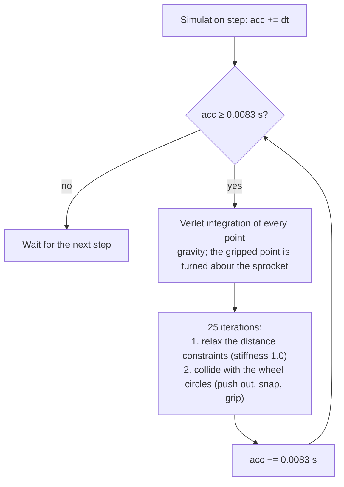
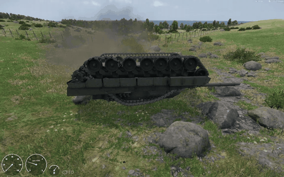
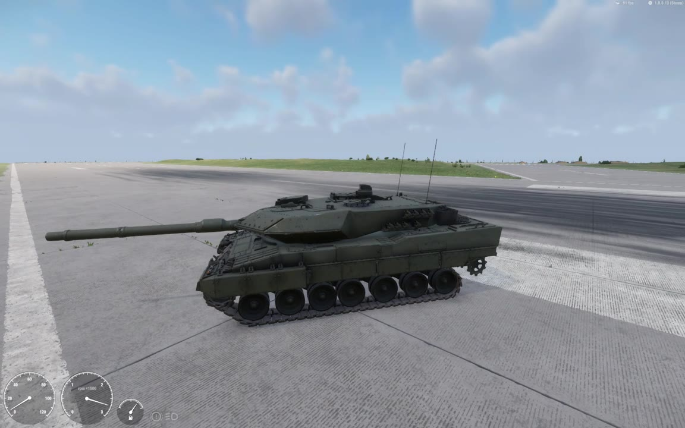
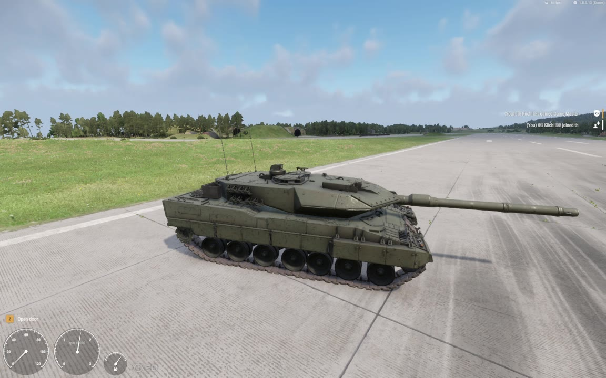
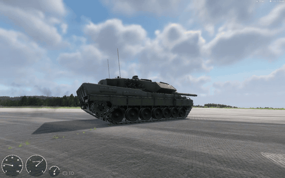
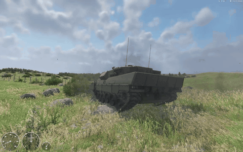
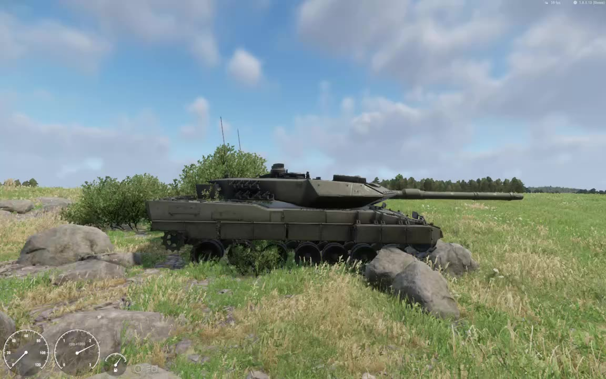

> [🇧🇷 Português](../pt-BR/15-track-links.md) · 🇬🇧 English

[← Road wheels, idler, sprocket and return rollers](14-running-gear.md) · [Contents](../../README.md) · [Vehicle debug diag and telemetry →](16-debugging.md)

# Track links: the native rope chain and the scripted chain

`VehicleTrackedSimulation` can move a chain of track links by itself. You give it a link model and a few attributes, and the engine spawns one child entity per link and moves them as a **2D rope**. The rope works in ordinary driving, but it has gravity and no ground collision, so it sags and can come off the sprocket for good. This chapter covers both the native rope and the scripted chain (`LEO_TrackChain`) that replaces it visually on the Leopard 2A6.

Each fact says how it is known: **measured** (logs, files), **reverse-engineered** (static disassembly of the 1.8.0.13 Workbench Diag executable, `ArmaReforgerWorkbenchSteamDiag.exe`), **observed in the video**, **computed** (arithmetic on measured geometry) or **not tested**.

### Summary

| | Native rope chain | Scripted chain (`LEO_TrackChain`) |
| --- | --- | --- |
| Status | ⚠️ Runs, but sags and derails | ✅ Works in normal driving (confirmed by the user). Not yet tested through a flip or a mine blast |
| What moves the links | The engine: a 2D rope simulation per track | A script, every frame, from the current wheel positions |
| Gravity | Yes | No: the links sit on a computed path |
| Ground collision | **None** | Not needed: the path follows the wheel circles |
| Can come off the sprocket | Yes (seen twice) | No, by construction |
| Reset | No script API. Only the Diag-build menu entry *Reset tracks* (not tried) | Nothing to reset |
| Link entities | 2 × N children of the hull, spawned by the engine | 2 × N children of the hull, spawned by script; the native ones are hidden |
| Multiplayer | Unknown on other players' machines (proxies) | Local and visual only. Does not run on a dedicated server. Proxies not tested |

Related chapters: the TrackPart order and the wheel bones are in [Road wheels, idler, sprocket and return rollers](14-running-gear.md). The ride height, which sets how much chain you need, is in [Suspension and ride height](13-suspension.md). The debug overlay that draws the rope is in [Vehicle debug diag and telemetry](16-debugging.md).

### The link model

The engine needs one link as its own model (`.xob`). Vanilla 1.8 ships no tracked vehicle and no track link. `TrackSegment` has no default value. The M113 link that an engine test routine refers to (`{32FF46BA61EE0DCA}`) is in neither the resource database nor any game data pak (checked). So you must make your own.

**Requirements:**

| Item | Rule | Why |
| --- | --- | --- |
| Origin | Centre of the link (laterally centred, midway along the shoe), on the **ground (outer) face**: ground face at y = 0 | The chain points lie on the ground face of the belt (see `TrackPositions`) |
| Axes | Length along +Z, +Y towards the wheels (the inner face), authored as a **bottom-run** link | On the bottom run the native link frame is the identity (reverse-engineered) |
| LODs | As many as you like; the Leopard link has LOD0 and LOD1 | Plain mesh LODs |
| Colliders | None | The engine spawns the links without physics, so colliders would not be used (inferred) |
| Bones | None | Each link is a separate entity |
| Material | Assign it in the `.xob.meta`, as for any model | — |

**How the Leopard 2A6 link was made** (measured). The hull model's own belt (meshes `track_l` / `track_r`) is 71 identical links per side, skinned only to `v_body`. Each link is 6 mesh islands: 2 shoes of 20 vertices, 2 end connectors of 24, a centre guide of 22 and a guide horn of 8. That is 118 vertices / 180 faces at LOD0 and 47 vertices / 60 faces at LOD1. LOD2 and LOD3 of the belt are continuous bands, so the link has only two LODs.

A Blender script (`extract_link.py`, run headless on a copy of the `.blend`) did the cut:

1. Group the mesh islands into links, each around its nearest 22-vertex centre guide.
2. Take the bottom-run link under road wheel 3, and the LOD1 islands nearest to it.
3. Move the origin to the centre of the shoe pair: mean shoe x, middle of the shoe length, lowest shoe point (the ground face).
4. Export `track_link_LOD0` and `track_link_LOD1` to FBX with the default axes (Blender +Y forward becomes Enfusion +Z, Blender +Z up becomes Enfusion +Y).

| Leopard 2A6 link | Value |
| --- | --- |
| Resource | `{B50AEDC702735F50}Assets/Vehicles/Tracked/Leopard2A6/Leopard2A6_track_link.xob` |
| Pitch (spacing of the link centres) | 0.2101 m mean (0.2032–0.2127 in the model) |
| Shoe thickness | 0.076 m |
| Belt width | 0.6355 m, centred at x ±1.3281 |
| Extent along Z | −0.097 to +0.186 m (not symmetric front to back) |
| `.xob.meta` | Source material `Leopard2A6_track` → `Leopard2A6_track.emat`, one `MeshParam track_link`, no colliders |

The same `.xob` serves the native rope and the scripted chain.

Two more points about the hull model:

- **Keep the static belts as named meshes** (`track_l`, `track_r` on the Leopard). A script can hide them once link entities exist and keep them as a fallback if the chain never appears (see [Hiding the static belts](#hiding-the-static-belts)).
- **A scrolling texture cannot fake the motion** on this model. Every link of the belt maps the same full UV atlas (u 0.019–0.966, v 0.013–0.988), so a UV shift moves nothing along the belt (measured).

### The chain attributes

The seven chain attributes sit on `VehicleTrackedSimulation` itself, **after** the `Simulation Tracked` object closes, not inside it. None has a description or a UI range (reverse-engineered: registration order and types).

| Attribute | Type | What it does | Leopard 2A6 | How known |
| --- | --- | --- | --- | --- |
| `TrackSegments` | int, default 0 | Number of points the *Generate track positions* action creates. Nothing else reads it. **At runtime the number of links per track is the number of `TrackPositions` entries.** Keep both equal | `73` | reverse-engineered |
| `TrackPositions` | Vector2 array | The chain points as `z y` pairs in hull model space (z forward, y up). One list serves **both** tracks | 73 pairs from an offline generator | reverse-engineered; the flat list form was tested |
| `TrackLength` | float, m | Rest length of the distance constraint between neighbouring points i and (i+1) mod N, i.e. the link pitch. Chain length = N × `TrackLength` | `0.2110` (model pitch 0.2101) | reverse-engineered |
| `TrackThickness` | float, m | Stored, never read in 1.8.0.13 (two writes, no reads) | `0.076` (shoe thickness, for the record) | reverse-engineered |
| `TrackOffset1` | Vector3 | Offset of `Tracks[0]`, the first `Track` in the list (Left on the Leopard). x = lateral position of the belt centre; y and z are added to every link position | `-1.3281 0 0` | reverse-engineered |
| `TrackOffset2` | Vector3 | The same for `Tracks[1]` (Right) | `1.3281 0 0` | reverse-engineered |
| `TrackSegment` | ResourceName, no default | The link model | the link `.xob` above | tested |

The engine builds the chain only when `TrackPositions` has **at least 2 entries** and **`TrackLength` > 0** (reverse-engineered). Both tracks use the same 2D loop, shifted sideways by their offsets. The Leopard's offsets (±1.3281) are the centre of the modelled belt; the road wheel bones are at ±1.3288.

The Leopard block (full version in [`examples/leopard2a6/VehicleTrackedSimulation_Leopard2A6.et.txt`](../../examples/leopard2a6/VehicleTrackedSimulation_Leopard2A6.et.txt) and the [Appendix](17-appendix.md)):

```
VehicleTrackedSimulation "{6160DE6434513C4D}" {
 Simulation Tracked "{6160DE65F2933990}" {
  ...
 }
 TrackSegments 73
 TrackPositions {
  -2.0577 1.2299 -1.8483 1.2299 -1.6390 1.2299 ... -2.2668 1.2191
 }
 TrackLength 0.2110
 TrackThickness 0.076
 TrackOffset1 -1.3281 0 0
 TrackOffset2 1.3281 0 0
 TrackSegment "{B50AEDC702735F50}Assets/Vehicles/Tracked/Leopard2A6/Leopard2A6_track_link.xob"
}
```

Replace `TrackSegment` with your own link. The GUID above belongs to the Leopard mod.

**The TrackPart order matters for the chain.** The engine takes the chain's angular reference from TrackPart index 1 and its speed radius from index 0 (reverse-engineered). Both must be road wheels. With the idler first, as in the Leopard's earlier order (idler `Radius` 0.2641 at the time), the chain would have run at 0.2641 / 0.418 ≈ 63% of the road wheel surface speed. List each track as road wheels front to rear, then idler, sprocket and return rollers, with the same sequence on both sides ([details](14-running-gear.md#trackpart-order-and-indices)).

#### TrackPositions: format and winding

- **Format.** A flat whitespace list is accepted: `TrackPositions { z y z y ... }`. The Leopard's 146 numbers load as 73 entries, and the engine spawned exactly 146 links (measured, `LEOTRACK link chain found (146 links)`). The engine's own generator builds its text as `z y, z y, ...` with 3 decimals and passes it through an editor setter. How Workbench saves generated positions in the `.et` is still unknown.
- **Coordinates.** Hull model space: z forward, y up, ground at y = 0. The points lie on the **ground face** of the belt, i.e. on the circle of each TrackPart's simulation `Radius` (road wheel 0.418, idler 0.335, sprocket 0.34, return roller 0.152 on the Leopard). That is where the engine's rope runs. Each sim radius is about the visual rim radius plus one link thickness (road wheel 0.345 + 0.073, idler 0.264 + 0.071, roller 0.0847 + 0.067).
- **Winding.** Index 0 is on the **top run**, and the index increases **forward** along the top run. Then it goes down around the idler, back along the bottom run and up around the sprocket. This is the engine generator's winding (reverse-engineered), and it puts the native link's +Y towards the wheels.

On the Leopard the list starts at p0 = (−2.0577, 1.2299), above the rearmost return roller, and p1 = (−1.8483, 1.2299) is forward of it. The top run is at y 1.2299, the top of the roller circles (1.0779 + 0.152). The bottom run is at y 0.0006, the bottom of the road wheel circles (0.4186 − 0.418). The 73 chords are 0.2059–0.2095 m long (mean 0.2090), and the closed polygon is 15.254 m (measured from the prefab list).

A quick check in Play with the debug overlay: a small number drawn next to each sprocket counts **down** while you drive forward, by about one per 0.21 m, and **up** in reverse. It wraps from 0 to 72. It is most likely the index of the point the sprocket holds (observed in the video; meaning inferred). With the list in the opposite order, the native links would face outward (guide horns out) and the number would count the other way (inferred).

#### Generating TrackPositions offline

The Leopard positions came from [`tools/trackpositions.py`](../../tools/trackpositions.py) (MIT, plain Python 3, no dependencies). It does the following:

1. Samples every TrackPart circle at its **simulation radius** (3600 points per circle).
2. Takes the convex hull of all the samples.
3. Orders the hull clockwise in the (z, y) plane, so that the top run moves +z.
4. Rotates the list so that it starts on the top run.
5. Resamples it at equal arc length L / N.

Edit the lists at the top for your vehicle, for one side: `WHEELS` holds the road wheel z values, and the `C` lines hold the (z, y) of each bone and the sim `Radius` of each part (road wheel and return roller y and radius are written in the two `C +=` lines). The values are hull model space. From Blender with the default exporter, Blender y is Enfusion z and Blender z is Enfusion y. Then run:

```
python tools/trackpositions.py 73 0.2101
```

The first argument is N. The second is the link pitch, used only for the printed comparison `N*pitch`; the spacing is always L / N. For the Leopard it prints:

```
# hull length 15.2841 m, N 73, arc step 0.2094, chord min 0.2060 max 0.2094, N*pitch 15.3373
# second point should be forward of the first: p0=(-2.0577, 1.2299) p1=(-1.848328632093053, 1.2299)
TrackPositions {
 -2.0577 1.2299 -1.8483 1.2299 ...
}
```

Paste only the `TrackPositions { ... }` block into the prefab. The output is identical to the list in the Leopard prefab.

Notes:

- The comment in the script says it starts at "the top point closest to z = 0". The Leopard's list actually starts at z −2.0577. The four return rollers are collinear, so the convex hull has top vertices only at the rearmost and frontmost rollers. Any start on the top run gives the same winding.
- The convex hull is the rest shape. It assumes no road wheel sits above the line of its neighbours, which is true at the modelled height.
- **Choose N from the hull length.** N = ⌈rest path / pitch⌉. The Leopard path is 15.284 m, and 15.284 / 0.2101 = 72.7, so N = 73, although the model has 71 links. The model's links follow the pin line (14.973 m, 71.3 links). The chain runs on the ground face, which is longer.

```math
N = \left\lceil \frac{P_{\text{rest}}}{p} \right\rceil = \left\lceil \frac{15.284}{0.2101} \right\rceil = 73
```

#### The "Generate track positions" action

The executable has a component editor action *Generate track positions* (action id 1 on `VehicleTrackedSimulation`; id 2 is *Compute local inertia*). Reverse-engineered, it works like this:

1. It reads the **live** simulation's wheel circles of track 0. So it needs a placed, initialised instance, with `TrackSegments` and `TrackLength` already set.
2. It seeds N = `TrackSegments` points on an ellipse centred on the model origin: z = sin θ · R, y = cos θ · R / 2, with R = 0.75 × the diagonal of the bounding box of the circle centres.
3. It runs 1000 rope steps of 1/60 s (16.7 s of simulated time) with world gravity and the wheel circles.
4. It writes the points into `TrackPositions`, index 0 at the top, increasing forward.

Because it settles the same rope under gravity, its result probably includes the sag (inferred, not tried). **The action was not found in the Workbench UI during this work**, so the Leopard uses the offline list. The strings *Generate track positions* and the chain attribute names are also in the retail game executable.

### How the native rope works

Everything in this section is **reverse-engineered** from the 1.8.0.13 Workbench Diag executable, unless it says otherwise.

#### Building the chain

When the component is created, and only if `TrackPositions` has 2 or more entries and `TrackLength` > 0:

- It allocates two ropes, one per track, each with N = number of `TrackPositions` points copied from the list.
- It adds a distance constraint between each point i and (i+1) mod N, with rest length `TrackLength`.
- It spawns 2 × N plain `IEntity` children with the `TrackSegment` mesh and no physics, attached to the hull with `AddChild`.
- It enables the `EntityEvent.POSTFRAME` event.

On the Leopard (73 positions), the log counted 146 such children in every session before the scripted chain was added (measured). They already exist on the first *Play* frame, which is also the first frame with a valid simulation, about 1 s after the vehicle is created and before the engine starts (measured).

#### The rope step

Each simulation step adds its time step to an accumulator. The rope then runs as many fixed **substeps** of 0.0083 s (the constant in the code, about 1/120 s) as fit:



The step returns early unless both ropes exist. Gravity is the world gravity, projected into the hull's frame.

**Wheel circles.** The rope collides with one circle per TrackPart: centre = the part's current simulated position in model space, radius = its simulation `Radius`. The road wheel circles move with the suspension. A point inside a circle is pushed radially out to the radius. There is **no collision with the terrain, objects or the hull**. The rope also has no idea which side of a wheel it belongs on.

**Snap to grounded wheels.** For every circle that is **not** a sprocket or idler **and** whose wheel has ground contact (`WheelHasContact`), each point with |z − c.z| ≤ 0.1 m and y ≤ c.y is set to y = c.y − r, the bottom of the circle. This holds the bottom run under the road wheels while they touch the ground. It would also apply to a return roller that reports contact. Without contact (airborne, flipped) nothing snaps.

**Sprocket drive.** Only the sprocket drives the rope, and it grips one point at a time. The first point found inside the sprocket circle becomes the gripped point. The integrator turns it about the sprocket centre by −dt·ω<sub>j</sub>, with ω<sub>j</sub> the sprocket's angular velocity from the formula below. The grip is released as soon as that point lies behind or below the sprocket centre, and the next point that touches the circle is gripped.

**Chain speed.** The engine takes ω as the change of TrackPart **index 1**'s physical angle per step. It drives the chain at

```math
\omega_j = \frac{r_0\,\omega}{r_j}, \qquad v_{\text{chain}} = r_0\,\omega
```

where r<sub>0</sub> is the `Radius` of TrackPart **index 0** and r<sub>j</sub> the `Radius` of part j. The per-track signal `trackSpeed` is r0·ω·3.6 km/h. The same step advances the per-wheel rotation signal that `CarProcAnimComponent` reads, so that signal stays at 0 when no chain exists.

In the debug overlay, each rope's stats box shows `AngVel` (rad/s, rpm in brackets) and `Speed` (m/s). `Speed / AngVel` = 0.34000 in every frame read, the Leopard's `Sprocket.Radius`, so `AngVel` is the sprocket's angular velocity (observed in the video). The chain speed matches the hull speed in steady driving, plus track slip: a few percent ahead under power (3–10%, much more when pulling away), 2–6% behind under engine braking, and far behind when the tracks skid under hard braking (observed in the video).

#### Placing the links

Every frame (`EOnPostFrame`), each link entity is placed between two neighbouring chain points:

- **Position:** the midpoint of points i and i+1, plus the track offset: (`Offset.x`, mid.y + `Offset.y`, mid.z + `Offset.z`).
- **Basis:** X = (1, 0, 0); Y = the belt normal towards the wheels; Z = −(p<sub>i+1</sub> − p<sub>i</sub>) / |p<sub>i+1</sub> − p<sub>i</sub>|.
- Both sides use the same, unmirrored frame. Only the offset changes.

With the forward winding, a bottom-run link gets the identity frame. That is why the link model is authored as a bottom-run link.

Because a link sits at a **chord** midpoint, where the chain wraps a circle its ground face lies inside the circle by the sagitta (computed):

```math
h = r - \sqrt{r^2 - \left(\tfrac{p}{2}\right)^2}
```

For p = 0.2101 that is 13 mm on a road wheel (r 0.418), 17 mm on the idler or sprocket (0.335 / 0.34) and 42 mm on a return roller (0.152).

#### No ground collision, no reset

- **No ground collision.** The rope only knows the wheel circles and gravity.
- **No script API.** Besides its input, engine and gearbox calls, `VehicleTrackedSimulation` exposes only wheel functions (`TrackCount`, `WheelCount`, `WheelGetPosition`, `WheelHasContact`, `WheelGetContact*`, `WheelGetRPM`, `WheelGetRadius`, `WheelGet/SetRollingDrag`). Nothing reads, moves or resets the rope (measured, vanilla script API).
- **The only reset is a Diag menu entry.** In the Diag executables, the *Tracked* submenu under *Vehicles* has *Steering mode*, *TrackSim*, *Draw tracks*, *Track dynamic*, *Track gravity* and *Reset tracks*. The strings *Draw tracks*, *Track dynamic*, *Track gravity* and *Reset tracks* are not in the retail game executable. In the 2026-10-06 session, *Draw tracks* switched the rope overlay on and off. Switching *TrackSim* or *Track gravity* off briefly (*TrackSim* for about 1 s at a time) changed nothing visible, seen from behind at about 2 km/h with the native links hidden. *Reset tracks* was listed as disabled and was not tried (observed in the video).

A rope that has come off a wheel therefore stays off.

For anyone re-checking after a game update, the functions in `ArmaReforgerWorkbenchSteamDiag.exe` 1.8.0.13:

| Address | Function |
| --- | --- |
| `0x140fc18d0` | Registration of the chain attributes |
| `0x140fbc1f0` | Constructor: ropes, constraints, link entities |
| `0x140fc4090` | Per-step update (primary vtable slot 29) |
| `0x140fc4430` | Wheel angles from TrackPart index 1 |
| `0x140a478c0` | Rope step: accumulator and substeps |
| `0x140a41760` | Collision: push-out, snap, sprocket grip |
| `0x140fbe7f0` | Link placement (`EOnPostFrame`) |
| `0x140fc0520` | *Generate track positions* |
| `0x140fbdf30` | Diag draw of the rope (no null check: see [chapter 16](16-debugging.md)) |

### Chain length, path length and slack

The chain's nominal length is N × `TrackLength`. The path it must wrap is the loop around the wheel circles at their sim radii, joined by their outer tangents. The difference is the slack:

```math
\text{slack} = N \cdot \text{TrackLength} - P
```

P grows when the road wheels droop, because the bottom of the loop moves down. Computed for the Leopard (bone positions from the model, sim radii from the prefab, outer tangents plus arcs, the same construction as `LEO_TrackChain`):

| All 7 road wheels of a side | Path P | Change |
| --- | --- | --- |
| At the modelled height (rest) | 15.284 m | — |
| 3 cm down | 15.319 m | +0.035 m |
| 5 cm down | 15.344 m | +0.059 m |
| 10 cm down | 15.407 m | +0.122 m |
| 15 cm down (full droop with `MaxTravelDown` 0.15) | 15.473 m | +0.189 m |

| `TrackLength` | Chain (73 links) | Slack at rest (arc) |
| --- | --- | --- |
| 0.2101 (the model's pitch) | 15.337 m | +5.3 cm |
| 0.2110 | 15.403 m | +11.9 cm (about the path with all wheels 10 cm down) |

Raising `TrackLength` by 0.9 mm adds 73 × 0.0009 = 6.6 cm of chain.

**The arc-versus-polygon caveat.** The figures above measure the path along arcs. The rope is a polygon of straight segments, and a polygon cuts the corners. 73 equal chords that close around the rest path need only 15.252 m (chord 0.2089 m). If the distance constraints act as rigid links, the slack is (computed):

| All road wheels | 73 × 0.2101 | 73 × 0.2110 |
| --- | --- | --- |
| At rest | +8.5 cm | +15.1 cm |
| 5 cm down | +2.5 cm | +9.0 cm |
| 10 cm down | −3.8 cm (too short) | +2.8 cm |
| 15 cm down | −10.3 cm (too short) | −3.7 cm (too short) |

Whether the constraints really behave as rigid links, or only resist stretching, is open. Both models show the same pattern: slack at rest, at or past the limit at full droop. With the Leopard's current `MaxTravelDown` 0.10, full droop is the 10 cm row, and 73 × 0.2110 is right at its limit there (−0.4 cm along the arcs, +2.8 cm as a polygon).

**The trade-off has no good answer.** Little slack keeps the rope tight in normal driving, but the rope is at its length limit as soon as the wheels droop (a jump, a flip, a blast) and gets pulled across the circles. More slack hangs under gravity, because nothing holds it up from below. Fix the ride height first ([chapter 13](13-suspension.md)): with the hull riding high, the wheels sit drooped at rest and eat the slack.

The Leopard's history (diary, log and prefab backups, 2026-10-05):

| Time | `TrackLength` | `MaxTravelDown` | Result |
| --- | --- | --- | --- |
| ~05:00 | 0.2101 | 0.15 (hull about 5 cm high, wheels drooped at rest) | Links animated fine in normal driving (user report). After a flip at 22:33 the left rope came off the sprocket |
| ~22:50 | 0.2110 | 0.10 (hull at its modelled height) | The extra slack hung below the wheels and behind the sprocket. After driving over mines both ropes came off |
| Late evening | 0.2110 (kept) | 0.10 | Native links hidden; the scripted chain shows the track |

### Observed failures of the native rope

All clips are listed in [Video examples](05-video-examples.md). Speeds and rpm in the diagnostic videos are read from the HUD gauges.

| # | Clip | Setup | What happens |
| --- | --- | --- | --- |
| 1 | Diagnostic video 1 (2026-10-05 22:35) | `TrackLength` 0.2101, `MaxTravelDown` 0.15, wheels by `CarProcAnimComponent` | Flip at 189–194 s. Upside down, the former return run sags below the hull. After the tank is righted, the left rope wraps road wheel 7 instead of the sprocket and stays off |
| 2 | Diagnostic video 3 (2026-10-05 23:21) | `TrackLength` 0.2110, `MaxTravelDown` 0.10, wheels by script | Parked: the bottom run lies below the road wheels |
| 3 | Same | Same | At about 27 km/h the slack piles up and flaps below and behind the sprocket |
| 4 | Same | Same | Mines throw the tank (22.75–24 s). The left rope ends up on a rock, attached only at the rear. Later the right sprocket is bare too |
| 5 | Test video A (2026-10-06) | `TrackLength` 0.2110, native links hidden | The hidden rope's top run whips above the return rollers at 17–21 km/h |

**1. Upside down after the flip.**



*Upside down, left side. With no ground contact the wheels hang at full droop and the snap is off (inferred); the rope's former return run sags below the inverted hull like a catenary. Diagnostic video 1 (2026-10-05 22:35), 194.6–197.0 s · [full-size still](../images/before-flip-rope-hangs.jpg) at 195.0 s · Model: buh-late, CC BY 4.0, modified ([credits](../../CREDITS.md)).*



*Back on the runway, left side, almost stopped. The rope wraps road wheel 7 instead of the sprocket, and the sprocket floats bare with daylight under it. It does not re-seat by itself; a rear view at 261.5 s shows the left sprocket bare and the right one still wrapped. Road wheels 2–4 sit above the chain because of the `CarProcAnimComponent` mis-mapping ([chapter 14](14-running-gear.md)). Diagnostic video 1 (2026-10-05 22:35), still at 255.0 s · Model: buh-late, CC BY 4.0, modified ([credits](../../CREDITS.md)).*

**2. Slack at rest.**



*Right side, parked, engine off. The wheels are at their correct height, but the rope's bottom run lies below them (a gap of roughly 5–10 cm, estimated from the image) and curls loosely at the rear. Diagnostic video 3 (2026-10-05 23:21), still at 8.0 s · Model: buh-late, CC BY 4.0, modified ([credits](../../CREDITS.md)).*

**3. Slack at speed.**



*Right side, about 27 km/h. The extra slack gathers between the sprocket and road wheel 7; the links stack and jump out below and behind the sprocket (spikes at about 17.2–17.4 s and 18.8 s). Diagnostic video 3 (2026-10-05 23:21), 15.5–19.6 s · [full-size still](../images/before-rope-sag-sprocket.jpg) at 17.4 s · Model: buh-late, CC BY 4.0, modified ([credits](../../CREDITS.md)).*

**4. Off after the mines.**



*Rear-left view, about 10 km/h over rocks, just after the mines. The left rope bulges in a loop behind the sprocket, then runs as a thin strand down onto a rock, joined to the tank only at the rear; the road wheels ride on the rock with no links under them. Diagnostic video 3 (2026-10-05 23:21), 25.0–28.0 s · [full-size still](../images/before-rope-off-mines.jpg) at 27.3 s · Model: buh-late, CC BY 4.0, modified ([credits](../../CREDITS.md)).*



*Right side, stopped among rocks and grass. The sprocket teeth are bare and no links are visible under the road wheels: the right rope has come off too (the sprocket already looks bare at about 33 s). Diagnostic video 3 (2026-10-05 23:21), still at 38.0 s · Model: buh-late, CC BY 4.0, modified ([credits](../../CREDITS.md)).*

**5. The hidden rope still misbehaves.** It is shown in [The hidden rope keeps running](#the-hidden-rope-keeps-running) below.

**Why it happens** (inferred from the rules above and the arithmetic):

- Gravity acts on every point, and nothing holds the rope up from below.
- The snap holds points only within ±0.1 m of a road wheel centre while that wheel has contact. The gaps between the snap zones are 0.53–0.68 m on the Leopard. The idler and sprocket never snap. Slack therefore hangs in the gaps and around the sprocket.
- When the wheels lose contact (thrown by a blast, flipped), the snap switches off and the wheels drop to full droop. The path then needs about as much length as the rope has, or more (see the slack tables above).
- The constraint relaxation then drags points across the circles, and the collision pushes each point out on the nearest side. A rope pulled past the sprocket's centre ends up outside it, and nothing puts it back.

### The scripted chain (LEO_TrackChain)

The scripted chain replaces the rope **visually**. It spreads N link entities along a path built from the wheel circles, every frame. The links depend only on the wheel positions, so they cannot sag below the wheels or leave the sprocket.

- [`scripts/LEO_TrackChain.c`](../../scripts/LEO_TrackChain.c): one track's chain, a plain class.
- [`scripts/LEO_RunningGearComponent.c`](../../scripts/LEO_RunningGearComponent.c): owns the two chains, feeds them the wheel travel and the track distance, and hides the native links. It also animates the wheel bones ([chapter 14](14-running-gear.md)).
- [`scripts/LEO_TrackBeltComponent.c`](../../scripts/LEO_TrackBeltComponent.c): hides the hull's static belts once link entities exist.

Installation and attributes are in [Ready-made scripts](11-scripts.md).

#### What it does each frame

For each track, `LEO_RunningGearComponent` does the following:

1. Computes the distance the track ran this frame, from road wheel index 0 (the front wheel):

   ```math
   d = \mathrm{WheelGetRPM}(t, 0) \cdot \frac{2\pi}{60} \cdot \mathrm{WheelGetRadius}(t, 0) \cdot \Delta t
   ```

   That is the front road wheel's speed at the link ground face, with + meaning the top run moves forward. It is the same quantity, r0·ω, that the engine uses to drive its own chain (the engine takes ω from the angle of road wheel index 1, the script from the RPM of index 0), so the scripted links run at about the native chain speed.
2. Sets each road wheel circle's height to its bind-pose height plus the current suspension travel (the same travel it applies to the wheel bones).
3. Calls `LEO_TrackChain.Update(d)`, which rebuilds the path and places the links.

The idler, sprocket and return roller circles stay at their bind-pose positions.

#### The belt path

The chain works in the track's plane: hull z along the vehicle, y up. The circles are added once, in **belt order**:

1. the sprocket,
2. the return rollers from rear to front (sorted by z),
3. the idler,
4. the road wheels from front to rear.

Each circle's centre is its bone's bind-pose position. Its radius is the **simulation radius** from `WheelGetRadius`, which is the ground face of the links, where the native rope ran. The chain's lateral position is the x of the front road wheel's bone (−1.3288 on the left).

**Outer tangents.** Consecutive circles i and i+1 (wrapping around) are joined by their outer common tangent. Its outward normal makes the same angle φ at both circles:

```math
\varphi_i = \mathrm{atan2}(\Delta y,\ \Delta z) + \arccos\!\left(\frac{r_i - r_{i+1}}{D}\right)
```

Here Δz and Δy run from circle i to circle i+1, and D is the distance between the centres. The cosine argument is clamped to [−1, 1]. The tangent points are c + r·(cos φ, sin φ) on each circle.

**Wraps.** On each circle the belt runs clockwise in the (z, y) plane (z to the right, y up) from the incoming tangent to the outgoing one:

```math
\theta_i = (\varphi_{i-1} - \varphi_i) \bmod 2\pi
```

- If θ ≤ π, the circle gets an arc of length r·θ.
- If θ > π, the corner is **concave**: a road wheel pushed up above its neighbours. The belt then takes a straight chord between that wheel's own two tangent points.

The belt still climbs to the lifted wheel (an inverted V with a chord across its bottom). So lifting a middle road wheel **lengthens** the path (computed):

| Case | Path | Link spacing L / 73 |
| --- | --- | --- |
| Rest | 15.284 m | 0.2094 m |
| All road wheels 10 cm down | 15.407 m | 0.2110 m |
| Road wheel index 3 up 0.10 m | 15.505 m (+0.221) | 0.2124 m |
| Road wheel index 3 up 0.30 m (full bump) | 15.987 m (+0.703) | 0.2190 m |
| Front road wheel up 0.30 m | 15.227 m (−0.057) | 0.2086 m |

#### Spreading the links along the path

The links are spread **evenly** along the current path length L, shifted by an offset o that advances with the track:

```math
s_k = \left(o + k\,\frac{L}{N}\right) \bmod L, \qquad o \leftarrow (o + d) \bmod L
```

- The spacing stretches with L, so there are never gaps. The cost is up to about 4% stretch over the real 0.2101 m pitch when a middle wheel is at full bump (table above).
- When L changes, link k moves by k·ΔL / N along the path, up to ΔL for the last link.
- Each link gets `SetLocalTransform` in hull space every frame.

#### The link transform

| Link axis | Native rope link | Scripted link (`LinkTransform`) |
| --- | --- | --- |
| Origin | Midpoint of chain points i and i+1 (inside a wrapped circle by the sagitta) | On the path itself (exactly on the circle where it wraps) |
| X | (1, 0, 0) | (−1, 0, 0) |
| Y | Belt normal towards the wheels | Belt normal towards the wheels: (0, −t<sub>z</sub>, t<sub>y</sub>) |
| Z | −(p<sub>i+1</sub> − p<sub>i</sub>): backward on the top run, forward on the bottom run | The path tangent t in the direction of increasing s: forward on the top run, backward on the bottom run |
| Bottom-run link | Identity (as modelled) | Rotated 180° about Y |

Both are proper rotations, and both sides use the same orientation. The scripted links are rotated **180° about their own Y axis** relative to the native ones, so their front and back are swapped. The Leopard link is not symmetric front to back (−0.097 to +0.186 m along Z), so the scripted belt probably shows the links reversed compared with the original model. Nobody has checked this in a close-up.

To get the native orientation, change two rows in `LinkTransform` (not tested):

```c
mat[0] = Vector(1, 0, 0);
mat[2] = Vector(0, -ty, -tz);
```

#### Spawning the links

On the first frame where the simulation is loaded (`TrackCount()` ≥ 2) and `WheelCount()` ≥ road wheels + 2 + rollers (13 on the Leopard), the component loads the link model and spawns N links per track:

```c
IEntity link = GetGame().SpawnEntity(GenericEntity, owner.GetWorld());
owner.AddChild(link, -1, EAddChildFlags.AUTO_TRANSFORM);
link.SetObject(model, string.Empty);
link.ClearFlags(EntityFlags.TRACEABLE | EntityFlags.ACTIVE, false);
```

The links are local: they are not replicated, and `OnDelete` deletes them. In both logged sessions this happened on the first Play frame: `LEOTRACK` counted 292 link children (146 native plus 146 scripted) within 2 ms of the `LEOGEAR` check (measured).

#### The hidden rope keeps running

With `m_bScriptedChain` on (the default), the component hides the native links. It clears `EntityFlags.VISIBLE` on every hull child whose model name contains `m_sNativeLinkName` (`Leopard2A6_track_link`) and that is not one of its own links. It checks 4 times a second for the first 10 s, then every 2 s.

The rope itself keeps existing and simulating; the prefab keeps all the chain attributes. Reasons to keep it:

- The vehicle debug overlay probably needs a chain. It crashed Workbench on 2026-10-02, when no chain existed, most likely because its draw code reads the rope without a null check ([chapter 16](16-debugging.md)).
- The overlay draws the rope, which makes a good reference for the scripted path.
- Whether `WheelGetRPM` or the drive depend on the rope was not tested. The `CarProcAnimComponent` rotation signal does depend on it (reverse-engineered), but the scripted running gear does not use that signal.


*Left side, gear 2, about 11 to 21 km/h. The white circles are the simulation's wheels at their sim radius. The red and green polyline is the hidden native rope: its top run whips above the return rollers (best at about 188.3 s and 189.7–190.0 s), while the visible scripted links stay on the wheels. The stats boxes read `Sim: Paused`, `Substep: 0/25` even here. Test video A (2026-10-06), 186.0–191.0 s · [full-size still](../images/hero-debug-side.jpg) at 188.0 s · Model: buh-late, CC BY 4.0, modified ([credits](../../CREDITS.md)).*


*Right side, stopped. At rest the rope polyline runs exactly along the ground face of the scripted links, under every road wheel and around the sprocket and idler: both follow the same sim-radius circles. Test video A (2026-10-06), still at 109.0 s · Model: buh-late, CC BY 4.0, modified ([credits](../../CREDITS.md)).*

#### Hiding the static belts

`LEO_TrackBeltComponent` counts the hull's children whose model name contains `Leopard2A6_track_link`, native and scripted alike (146 in the sessions with the native chain only, 292 with both, in the logs). Once there are at least 2, it hides the meshes `track_l` and `track_r` with `Animation.ShowMesh(GetNamedMeshIndex(name), false)`, prints a `LEOTRACK` line and stops. If no link appears within 5 s, it keeps the static belts and logs a warning. A chain that never spawns therefore never leaves the tank without tracks. A chain that spawns and then derails does not bring the static belts back.

The component's `description` string still speaks of the native chain only. Its header comment in the repository describes both cases.

#### Limits and requirements

- **Sprocket at the rear, idler at the front.** The belt order in `CreateChains` assumes it. For a front-drive hull, add the idler first (rear), then the rollers rear to front, then the sprocket (front), then the road wheels (not tested).
- **TrackPart order:** road wheels, idler, sprocket, return rollers. `LEO_RunningGearComponent` reads the idler at index n and the sprocket at n + 1, with n road wheels ([chapter 14](14-running-gear.md#trackpart-order-and-indices)).
- **Bones:** `v_suspension_<s>0<k>`, `v_wheel_<s>0<k>`, `v_idler_<s>`, `v_sprocket_<s>`, `v_roller_<s>0<k>` with s = `l` / `r`. If any is missing, the component logs `LEOGEAR ... running gear bones missing or unreadable: the scripted chain is off` and keeps the native links visible.
- **Fixed idler and rollers.** Their circles stay at the bind pose. A moving idler (tensioner) is not modelled.
- **Belt speed from the front road wheel.** If that wheel (index 0) is airborne, its RPM can differ from the rest of the track. In reverse, an airborne wheel reported −230.6 rpm while grounded ones read 0–20 (measured). The links and wheels may then spin wrongly for a moment (inferred, not tested).
- **Distance cut-off.** Beyond `m_fMaxDistance` (300 m) from the current camera, the links and bones are not updated. The hiding of native links still runs.
- **Dedicated server.** The component returns in `OnPostInit` when `System.IsConsoleApp()` is true. No link entities exist there.
- **Child walking.** Scripts that walk the hull's children see the 2 × 2 × N link entities (292 on the Leopard).

#### Performance

Each frame on a client: 2 × 73 hidden native links are still simulated by the rope and placed in `EOnPostFrame`, and 2 × 73 scripted links get a rebuilt path and a `SetLocalTransform`. The cost was **not measured**. The Workbench FPS counter read 48–62 fps with the debug overlay on in test video B, but nobody compared it with the chains off.

#### Status

- ✅ The user confirmed it works ("funcionou certinho", 2026-10-06). Test video A shows the links wrapping the sprocket and idler and following the road wheels on the runway and on grass with scattered rocks, with no sag, gap or derail (observed in the video).
- The logged sessions with the scripted chain reached at most 13.2° of pitch and 21.7° of roll. In one, the tank was high-centred on rocks for about 28 s (measured).
- ⚠️ **Not yet tested through a flip or a mine blast.** It cannot derail by construction, because the links depend only on the wheel positions, but that has not been demonstrated in game.

### Setting it up on your vehicle

1. Make the link model: origin on the ground face, length along +Z, +Y towards the wheels, no colliders.
2. Order the TrackParts: road wheels first, then idler, sprocket and return rollers ([chapter 14](14-running-gear.md#trackpart-order-and-indices)).
3. Set the sim radii to the link ground face, about the visual rim radius plus the link thickness ([chapter 14](14-running-gear.md#simulation-radius-versus-visual-radius)). Set the ride height with `MaxTravelDown` ([chapter 13](13-suspension.md)).
4. Run `tools/trackpositions.py` with your bone positions and radii. Set N = ⌈path / pitch⌉ and `TrackSegments` = N.
5. Add the seven attributes after the `Simulation Tracked` object. Start with `TrackLength` = your pitch; raise it only if the rope is too tight at rest.
6. Close the world, reload, reopen. A vehicle in an already open world keeps its old simulation values ([chapter 13](13-suspension.md#prefab-edits-and-the-open-world)).
7. Check in Play with the vehicle debug overlay: the rope polyline should lie on the ground face of your links ([chapter 16](16-debugging.md)).
8. For links that cannot sag or derail, add `LEO_RunningGearComponent` (with `m_bScriptedChain` 1) and `LEO_TrackBeltComponent` ([Ready-made scripts](11-scripts.md)).

### Open questions

- What do the rope stats `Sim: Paused` / `SubStepping`, `Substep: 0/25`, `Momentum` and `Energy` report? They read Paused, 0/25, 0 and 0 in every frame, even while the rope visibly whips.
- What do *Track dynamic*, *Track gravity* and *TrackSim* change? Does *Reset tracks* re-seed the rope from `TrackPositions`?
- Are the rope's distance constraints rigid (two-sided) or rope-like (stretch only)? This decides which slack table applies.
- How does Workbench save `TrackPositions` after *Generate track positions*, and where is the action in the UI?
- Can the native chain be removed (empty `TrackPositions` or `TrackLength` 0) without changing `WheelGetRPM` or the drive? That would save the rope's CPU time.
- What do 146 hidden native links plus 146 scripted links cost per frame?
- Do the scripted links look reversed front to back (180° about Y)? A close-up check is needed.
- Does the scripted chain survive a real flip and a mine blast?
- Do other players' machines (proxies) step the native rope and run the scripted chain?
- Is the number next to each sprocket in the overlay really the gripped point's index?
- Is a grounded wheel or the sprocket's `WheelGetRPM` a better belt speed source than the front road wheel (index 0)?

---

[← Road wheels, idler, sprocket and return rollers](14-running-gear.md) · [Contents](../../README.md) · [Vehicle debug diag and telemetry →](16-debugging.md)
