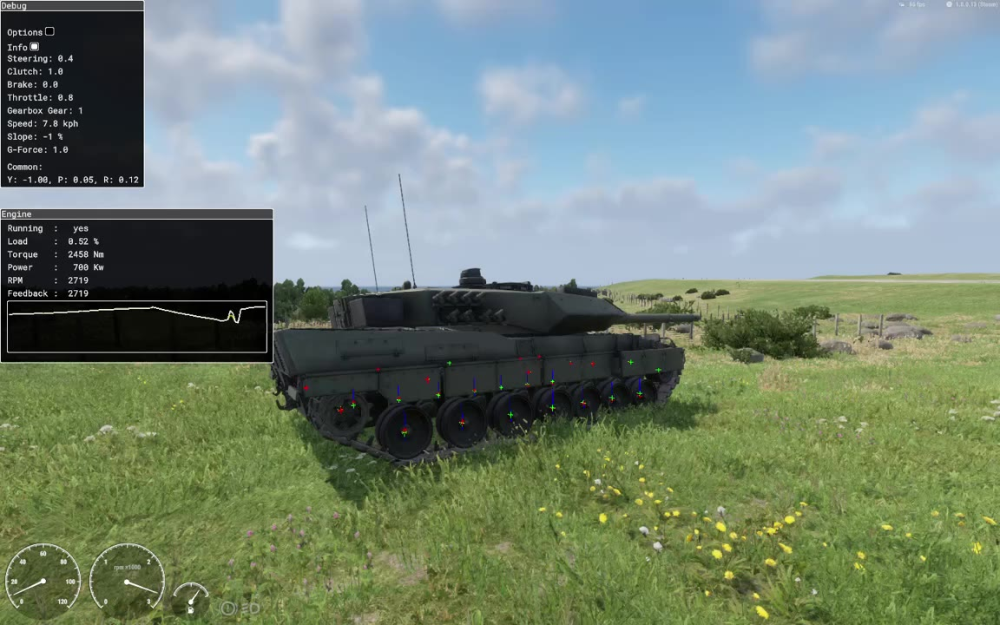

> 🇧🇷 Português · [🇬🇧 English](../en/01-overview.md)

[← Sobre este guia](00-about.md) · [Índice](../../README.pt-BR.md) · [Arquitetura →](02-architecture.md)

# Visão geral

O Arma Reforger 1.8.0.13 (engine 192142) já traz uma simulação de esteira de verdade, a `VehicleTrackedSimulation`. Andar para a frente, virar, girar no lugar e a suspensão por roda funcionam. A ré tem um bug que a bloqueia, e um script contorna. A simulação também consegue mover sozinha uma corrente de elos, mas essa corrente se comporta como uma corda frouxa, então este guia move os elos por script.

Nenhum veículo vanilla usa esse sistema ainda: ele existe só como um prefab base escondido, `Prefabs/Vehicles/Core/TrackedVehicle_Base.et`. O vanilla 1.8 não tem nenhum veículo de esteira nem modelo de elo.

Este guia saiu de um mod de Leopard 2: o trabalho na transmissão e na ré começou numa versão anterior, um Leopard 2A7, e todo o resto foi feito no Leopard 2A6 atual. Tudo aqui foi testado no jogo com telemetria, observado em testes gravados ou obtido por engenharia reversa do executável do Workbench, e o texto diz qual ([Sobre este guia](00-about.md)).

*O resultado: o Leopard 2A6 a 7,8 km/h na grama, lado direito (vídeo de teste A, 06/10/2026, 3:29,5). Os elos envolvem a roda motriz traseira, passam sob as sete rodas de apoio e sobre os roletes de retorno. As rodas e os elos são movidos por script a partir dos dados de roda da própria simulação. Modelo de buh-late, CC BY 4.0, modificado.*

|  | Esteira nativa (`VehicleTrackedSimulation`) | Método antigo dos mods (7 eixos de rodas) |
| --- | --- | --- |
| Física | Duas lagartas; cada uma tem rodas de apoio, uma roda-guia, uma roda motriz e roletes de retorno opcionais | Um carro com 7 eixos; os eixos da frente e de trás esterçam em sentidos opostos |
| Giro no lugar (pivô) | Sim, nativo | Não; só uma aproximação |
| Ré | Bug na 1.8.0.13: precisa de script ([seção de bugs](09-bugs.md)) | Funciona |
| Suspensão | Nativa, por roda de apoio: um raio ao longo do eixo para baixo do casco e uma mola livre no curso todo para baixo. `MaxTravelDown` define a altura do casco ([capítulo 13](13-suspension.md)) | A suspensão da simulação de rodas, por eixo |
| Animação das rodas de apoio, roda-guia, roda motriz e roletes | Script. O `CarProcAnimComponent` entrega às rodas de esteira os sinais de outra roda na 1.8.0.13, então o `LEO_RunningGearComponent` lê a simulação por (lagarta, peça) e move os ossos ([capítulo 14](14-running-gear.md)) | Animação procedural por eixo, ou script |
| Elos da esteira | Corrente de elos nativa (`TrackSegment`): uma corda 2D com gravidade, contato com as rodas e tração pela roda motriz, mas sem colisão com o chão e sem como reiniciá-la por script, então ela pende e pode sair da roda motriz. Uma corrente por script (`LEO_TrackChain`) segue as rodas no lugar dela ([capítulo 15](15-track-links.md)) | Sempre script (entidades de esteira próprias ou ossos animados) |
| Quem usa | Ninguém no vanilla; nenhum dos 243 mods da Workshop instalados e verificados usa | M113, WCS M1A1/M2A2/BMP-3, CIE T-72, Zagoria T-80U |
| Documentação oficial | Nenhuma | Herda dos veículos de rodas vanilla |

Na prática:

- Dá para fazer um tanque com esteira nativa só com o jogo base, sem dependências.
- Você precisa configurar o bloco de simulação à mão: o modelo vanilla não carrega. Defina as duas curvas de atrito obrigatórias, liste primeiro as rodas de apoio de cada lagarta, ajuste o controlador e adicione um script de ré ([passo a passo](04-from-scratch.md)).
- A suspensão funciona de forma nativa. Dimensione-a pelo peso: `MaxTravelDown ≈ m·g/(n·k)` deixa o casco na altura do modelo. O `CenterOfMass` do `RigidBody` é um deslocamento a partir do centro de massa do próprio modelo, não uma posição absoluta ([capítulo 13](13-suspension.md)).
- Deixe o `CarProcAnimComponent` vazio e mova os ossos das rodas por script a partir da simulação ([capítulo 14](14-running-gear.md)).
- Mostre aos jogadores a corrente de elos por script. Mesmo assim, mantenha os atributos da corrente nativa na simulação: a sobreposição de depuração nativa provavelmente precisa de uma corrente (ela travou sem uma), e o script do trem de rolamento só foi testado com uma corrente presente ([capítulo 15](15-track-links.md)).
- Use a sobreposição de depuração nativa (versão Diag) e o script de telemetria para conferir o que a simulação faz ([capítulo 16](16-debugging.md)).
- Depois de editar o prefab, recarregue o mundo. Um veículo num mundo que já está aberto mantém os valores antigos da simulação ([capítulo 13](13-suspension.md#edições-do-prefab-e-o-mundo-aberto)).

Ainda em aberto: multiplayer (as máquinas dos outros jogadores), a velocidade máxima do Leopard 2A6 e a corrente por script capotando ou passando por uma mina. [Bugs e limitações](09-bugs.md) lista o que se sabe que está quebrado.

---

[← Sobre este guia](00-about.md) · [Índice](../../README.pt-BR.md) · [Arquitetura →](02-architecture.md)
