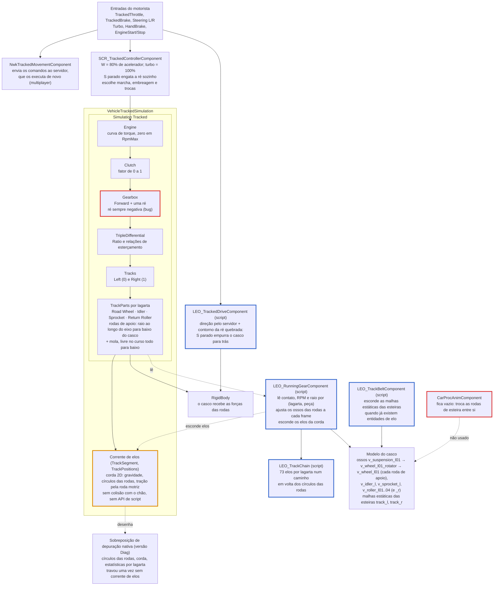
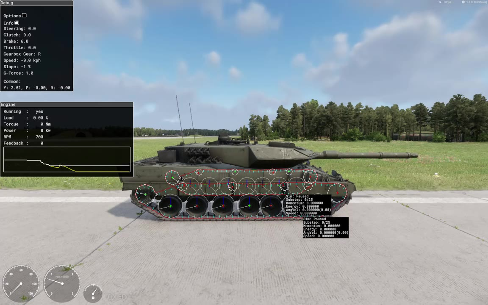

> 🇧🇷 Português · [🇬🇧 English](../en/02-architecture.md)

[← Visão geral](01-overview.md) · [Índice](../../README.pt-BR.md) · [Requisitos do modelo 3D →](03-model-requirements.md)

# Arquitetura

*Borda vermelha: bugs nativos (o câmbio da ré, o mapeamento de rodas do `CarProcAnimComponent`). Borda laranja: um recurso nativo com limites (a corda da corrente). Borda azul: os scripts deste guia. Linhas pontilhadas: só leitura, ocultação ou desenho; não mudam a física.*

O motorista nunca fala direto com a simulação. O controlador lê as teclas e decide acelerador, freio, marcha e embreagem. A simulação calcula o motor, a transmissão, as lagartas, as rodas e a suspensão, e aplica as forças no casco. Tudo o que você vê se mexendo no trem de rolamento é desenhado por cima disso: pela corda da corrente nativa ou pelos scripts.

## O que acontece em um frame

1. **Controlador.** O `SCR_TrackedControllerComponent` transforma as teclas em acelerador, freio, marcha e embreagem. W sozinho dá 80% de acelerador; o turbo dá 100% (medido: `engineThrust` 0,80 e 1,0).
2. **Transmissão.** A simulação roda motor → embreagem → câmbio → `TripleDifferential` → as duas lagartas. O raio da roda motriz define a velocidade da esteira: a velocidade da corrente na sobreposição de depuração é a velocidade angular da roda motriz × 0,34 m no Leopard (medido).
3. **Suspensão.** Cada roda de apoio lança um raio ao longo do eixo para baixo do casco. O raio começa `RayStartOffsetUp` acima do topo do curso da roda (engenharia reversa, pela descrição do atributo). O centro da roda é o ponto de contato mais `Radius` ao longo do eixo para cima do casco (medido: o valor do script bateu com o sinal de suspensão do próprio motor com 1,25 mm de diferença média). A mola empurra a partir do curso todo para baixo; ali a força dela é zero (medido). Veja [Suspensão e altura do casco](13-suspension.md).
4. **Forças.** As forças das rodas agem no `RigidBody`. O `CenterOfMass` do `RigidBody` é um deslocamento a partir do centro de massa do próprio modelo, não uma posição absoluta (engenharia reversa, depois medido).
5. **Corrente de elos nativa.** Se os atributos da corrente estiverem definidos, a simulação move a corrente de cada lagarta como uma corda 2D: subpassos fixos de 0,0083 s, cada um com 25 passadas de restrições de comprimento do elo e de círculo das rodas, sob gravidade. Só a roda motriz a traciona, e nada a faz colidir com o chão. A cada frame, no `EOnPostFrame`, uma entidade de elo é colocada entre cada par de pontos vizinhos da corrente (engenharia reversa). Veja [Elos da esteira](15-track-links.md).
6. **Scripts.** O `LEO_RunningGearComponent` lê a simulação por `TrackedControllerComponent.GetSimulation()` no `EOnFrame`. Ele move os ossos da suspensão e das rodas, gira a roda-guia, a roda motriz e os roletes, e deixa o `LEO_TrackChain` colocar os próprios elos num caminho em volta das rodas. Ele esconde os elos da corda. O `LEO_TrackBeltComponent` esconde as malhas estáticas das esteiras do casco quando já existem entidades de elo. Esses scripts são visuais e locais: não interferem na física. Veja [Rodas de apoio, roda-guia, roda motriz e roletes](14-running-gear.md).
7. **Ré e multiplayer.** O `LEO_TrackedDriveComponent` é o único script que age na física. Enquanto o motorista dá ré, ele empurra o casco para trás com uma força; no multiplayer ele aplica os inputs do motorista na simulação, no servidor ([capítulo 18](18-multiplayer.md)). O Kiichi Tracked System troca este diagrama inteiro por um único componente de script ([capítulo 19](19-kiichi-tracked-system.md)).

Em aberto: os scripts atualizam no `EOnFrame` e a corda nativa posiciona seus elos no `EOnPostFrame`. Um atraso de um frame entre os ossos movidos por script e a física é possível, mas não foi medido.

## Como a simulação numera as rodas

A simulação endereça cada roda como **(lagarta, peça)**. A lagarta 0 é o primeiro `Track` do prefab (`Left` no Leopard) e a lagarta 1, o segundo. A peça é a posição do `TrackPart` na lista `Wheels` daquela lagarta. Valem estas regras:

| Regra | Como se sabe |
| --- | --- |
| Precisa haver exatamente 2 lagartas, cada uma com pelo menos 3 entradas `TrackPart` | Engenharia reversa (mensagens de erro do carregador) |
| A roda motriz e a roda-guia precisam estar no mesmo índice nas duas lagartas | Engenharia reversa (mensagens de erro do carregador) |
| Os tipos de `TrackPart` são `Road Wheel` (o padrão quando não há `Type`), `Sprocket`, `Idler` e `Return Roller` | Engenharia reversa; `Type "Return Roller"` testado no Leopard |
| As peças 0 e 1 precisam ser rodas de apoio: a corrente de elos tira a velocidade do raio da peça 0 e o ângulo da peça 1 | Engenharia reversa |
| `WheelCount()` devolve as peças de **uma** lagarta: 13 no Leopard (7 rodas de apoio, roda-guia, roda motriz, 4 roletes de retorno) | Medido (linha de log `LEOGEAR simulation: 2 tracks, WheelCount 13`) |
| `TrackCount()` devolve 0 até a simulação carregar, depois sempre 2 | Engenharia reversa; a simulação ficou válida 0,8–1,3 s depois do surgimento do veículo, antes de ligar o motor (medido) |

O Leopard lista cada lagarta como `Wheel_X01`..`Wheel_X07` (peças 0-6), `Idler_X` (7), `Sprocket_X` (8) e `Roller_X01`..`Roller_X04` (9-12).

*O que a simulação vê, parada na pista (vídeo de teste A, 06/10/2026, 1:49). Os círculos brancos são cada `TrackPart` no seu `Radius` da simulação: chegam à face de contato dos elos, por isso são maiores que os aros visíveis. A linha vermelha com marcas ciano é a corda da corrente nativa; ela corre pela parte de baixo dos elos movidos por script. As linhas verticais azuis são a suspensão. Modelo de buh-late, CC BY 4.0, modificado.*

## Onde cada parte fica no prefab

| Componente | Onde fica | Papel |
| --- | --- | --- |
| `VehicleTrackedSimulation` | `components` do casco | Física da esteira: motor, transmissão, lagartas, rodas, suspensão |
| Atributos da corrente de elos (`TrackSegments`, `TrackPositions`, `TrackLength`, `TrackThickness`, `TrackOffset1`, `TrackOffset2`, `TrackSegment`) | Na `VehicleTrackedSimulation`, depois do bloco `Simulation` (irmãos dele, não dentro dele) | A corrente de elos nativa. O número de elos por lagarta é o número de entradas de `TrackPositions`. `TrackThickness` é guardado, mas nunca lido na 1.8.0.13 (engenharia reversa) |
| `SCR_TrackedControllerComponent` | Dentro do `BaseVehicleNodeComponent` | Transforma as teclas em pedais, marcha e embreagem |
| `NwkTrackedMovementComponent` | `components` do casco | Replica o movimento no multiplayer |
| `RigidBody` | `components` do casco | Massa, centro de massa e colisão. `CenterOfMass` é um deslocamento a partir do centro de massa do próprio modelo |
| `SCR_WheeledDamageManagerComponent` | `components` do casco | Dano: casco, motor, câmbio, rodas |
| `SignalsSourceAccess` | Dentro da `VehicleTrackedSimulation` (vem do `.ct`) | Liga a simulação aos sinais `engineRPM`, `engineThrust` etc. |
| `CarProcAnimComponent` `{5D6501223785D009}` | `components` do casco (herdado, vazio na base) | Deixe vazio em veículos de esteira: na 1.8.0.13 ele entrega aos ossos das rodas os sinais de outra roda |
| `LEO_RunningGearComponent` (script, usa a classe `LEO_TrackChain`) | `components` do casco | Suspensão e giro dos ossos das rodas; a corrente de elos por script; esconde os elos da corda |
| `LEO_TrackBeltComponent` (script) | `components` do casco | Esconde as malhas estáticas das esteiras quando existem pelo menos 2 entidades de elo; mantém as malhas se nenhum elo aparecer em 5 s |
| `LEO_TrackedDriveComponent` (script) | `components` do casco | Contorno da ré e direção pelo servidor; desliga o motor quando o banco do motorista fica vazio |
| `LEO_TelemetryComponent` (script) | `components` do casco | Linhas `LEOTEL` e `LEOSUSP` no `console.log` para o ajuste |

Os componentes da engine já vêm prontos no `TrackedVehicle_Base.et`. Falta preencher a simulação e os atributos da corrente de elos, como mostra o [passo a passo](04-from-scratch.md), e adicionar os scripts de [Scripts prontos](11-scripts.md). Os blocos do Leopard estão em [examples/leopard2a6](../../examples/leopard2a6/README.md).

Observações sobre os scripts:

- Pegue a simulação com `TrackedControllerComponent.GetSimulation()` e confira `simulation.IsValid()` e `TrackCount() >= 2` antes de ler as rodas. Nunca chame `GetInputs()`: derruba o Workbench (engenharia reversa: escreve através de um ponteiro nulo).
- Os scripts do trem de rolamento e dos elos não fazem nada num servidor dedicado e param de atualizar a mais de 300 m da câmera. Não foram testados nas máquinas dos outros jogadores (proxies).
- A sobreposição de depuração nativa derrubou o Workbench em 02/10/2026, quando o prefab não tinha corrente de elos. Com corrente, ela rodou um teste inteiro de 5 minutos sem travar (medido). A desmontagem mostra que a sobreposição lê a corrente sem conferir se ela existe (engenharia reversa), então a falta da corrente é a causa mais provável do travamento. Veja [Diagnóstico do veículo e telemetria](16-debugging.md).

---

[← Visão geral](01-overview.md) · [Índice](../../README.pt-BR.md) · [Requisitos do modelo 3D →](03-model-requirements.md)
