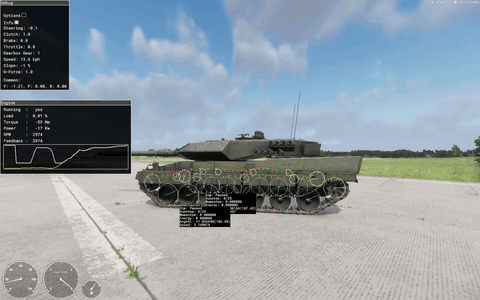

> 🇧🇷 Português · [🇬🇧 English](../en/08-internals.md)

[← Referência de atributos](07-attribute-reference.md) · [Índice](../../README.pt-BR.md) · [Bugs e limitações (1.8.0.13) →](09-bugs.md)

# Como funciona por dentro

Este capítulo resume a engenharia reversa do executável 1.8.0.13 e a confere com medidas no Leopard 2A6: telemetria do log e a sobreposição de depuração nativa do veículo nos vídeos de teste. Cada parte diz como se sabe. Conhecer o caminho do sinal ajuda a entender por que cada valor importa.

### Entradas do motorista

A esteira tem um conjunto próprio de ações de entrada, separado do carro:

| Ação | Função |
| --- | --- |
| `TrackedThrottle` | Acelerar |
| `TrackedBrake` | Frear; parado, vira ré |
| `TrackedSteeringLeft` / `TrackedSteeringRight` | Virar |
| `TurboToggle` / `TurboHold` | Turbo (100% do acelerador) |
| `HandBrake` / `HandBrakePersistent` | Freio de mão |
| `EngineStart` / `EngineStop` | Ligar e desligar o motor |

**Não existe** ação de trocar marcha, de ré ou de embreagem. O carro tem `CarShift` e `CarShiftReverse`; a esteira, não.

As entradas só passam se o motorista estiver vivo, sem usar item e sem estar entrando, saindo ou trocando de banco.

### O controlador (SCR\_TrackedControllerComponent)

O controlador transforma as entradas em acelerador, freio, marcha e embreagem.

**Acelerador.** W entrega `1 − ThrottleTurbo`. Com o padrão 0.2, isso dá 80%. O turbo libera os 20% restantes.

**Escolha do sentido (automática):**

- De **neutro** para **ré**: freio acima de 1/32 e velocidade abaixo de 1,5 m/s. A troca é imediata.
- De **frente** para **ré**: freio acima de 1/32, acelerador abaixo de 1/32 e velocidade abaixo de 1,5 m/s por 0,5 s.
- Em ré, os pedais são trocados a cada frame. O `TrackedBrake` vira o acelerador, com o valor `ThrottleReverseTarget`.

**Marchas.** O índice 0 é a ré, o índice 1 é o neutro, e as marchas para a frente começam no índice 2. O primeiro valor de `Forward { }` é o índice 2. O painel de depuração as mostra como R, N e 1, 2, 3… (confirmado com a telemetria no 2A6).

**Embreagem.** É um multiplicador de 0 a 1, controlado por tempo (`ClutchCoupleTime`, `ClutchUncoupleTime`). `ClutchCouple*Rpm` só vale na saída. `MaxClutchTorque` não é usado.

**Trocas.** As trocas automáticas usam o RPM filtrado (`RpmSmoothing`), a inclinação (`SlopeSmoothing`) e os fatores de subida e de redução.

O que o controlador fez no 2A6 (telemetria e painel de depuração, 05/10 e 06/10/2026; a última linha é de um teste de 04/10/2026):

| Situação | Observado |
| --- | --- |
| Parado depois de uma parada | Marcha R (índice 0), freio 6,0, embreagem 0, motor em `RpmIdle` 700 rpm |
| Saindo | O freio 6,0 continua enquanto a embreagem acopla e cai para 0 quando a embreagem chega a cerca de 0,8 |
| Subidas de marcha com acelerador 0,8 | O acelerador é aliviado e a embreagem patina por cerca de 0,4–0,6 s. Medianas: 1→2 a 2924 rpm (12,9 km/h), 2→3 a 2812 rpm (23,2 km/h), 3→4 a 2860 rpm (39,1 km/h) |
| Fim da 1ª | Segura a 1ª no limitador a 13,6 km/h (cerca de 2935 rpm) até subir a marcha |
| Reduções | Medianas 1318 rpm (8,4 km/h), 1758 rpm (21,4 km/h) e 1626 rpm (34,2 km/h) |
| Giro no lugar (esterçamento total, quase parado) | Ou embreagem 0 com freio 6,0 e motor no limitador a 2700 rpm (3409 N·m), ou embreagem 1 com o motor arrastado para 700 rpm (4601 N·m). A lagarta que andava para trás costumava ser mais rápida, e o casco recuava a 0,1–3,8 km/h (causa em aberto) |
| Motorista sai do banco | O controlador puxa o freio de mão e, parado, seleciona a ré. O bug da ré então prende o motor bem acima de `RpmMax`. O [`LEO_TrackedReverseComponent`](../../scripts/LEO_TrackedReverseComponent.c) desliga o motor quando o banco fica vazio (`m_bStopEngineOnExit`) |

### A simulação (VehicleTrackedSimulation)

A cada subpasso, a simulação calcula motor → embreagem → câmbio → diferencial → lagartas → rodas. Depois aplica as forças no `RigidBody`. A corrente de elos tem o seu próprio passo fixo (veja [abaixo](#a-corrente-de-elos-o-passo-da-corda)).

**Passo de tempo:**

```math
\Delta t = \frac{1}{60 \cdot \text{SolverSubsteps}} \quad (\text{4 substeps} \Rightarrow 1/240\ \text{s})
```

**Tabela do câmbio.** Por dentro, a lista vira `[−|Reverse|, 0, Forward...]`. A relação de ré é **sempre negativa**, mesmo que você escreva um valor negativo.

**Velocidade da esteira.** Usa o raio da **roda motriz** (`Sprocket.Radius`), não o da roda de apoio:

```math
v\,[\text{km/h}] = \frac{\text{rpm}}{g \cdot R_d} \cdot \frac{2\pi}{60} \cdot r_{\text{sprocket}} \cdot 3.6
```

Aqui, *g* é a relação da marcha e *R\_d* é o `Ratio` do `TripleDifferential`. Esta é a velocidade da esteira (da corrente de elos). A velocidade do casco em relação ao chão difere dela por alguns por cento de patinação; veja [Conferência das velocidades](#conferência-das-velocidades).

**Reação da carga no motor.** A carga das rodas volta ao motor pela mesma cadeia de relações:

```math
\text{reaction} = \frac{\sum \text{load}_{\text{wheels}}}{g \cdot R_d}
```

```math
\text{rpm} \mathrel{-}= \frac{\text{clutch} \cdot \text{reaction}}{\text{Inertia} + \text{clutch} \cdot \text{InertiaCoupled}} \cdot \Delta t \cdot 9.5493
```

A carga é sempre positiva; parado, ela é igual ao peso do veículo. Então o sinal de *g* decide se a carga freia ou acelera o motor. Em ré, *g* é negativo, e a carga **acelera** o motor. O [próximo capítulo](09-bugs.md) explica o efeito. No 2A6 (62300 kg, `Reverse` 2.3, `Ratio` 4.6, `Inertia` 3) a fórmula prevê o motor preso em 3766,1 rpm na ré; a telemetria e o painel de depuração mostraram 3766–3768 rpm.

**Torque do motor.** A curva vai de `RpmIdle` a `RpmMax`, com pico em `RpmMaxTorque`. Em `RpmMax`, o torque é zero. Observado no 2A6 (painel de depuração):

- Com `HasGovernor 1`, o torque despenca acima de `RpmRedline`: 2462 N·m a 2719 rpm, 229 N·m a 2922 rpm, 86 N·m a 2935 rpm.
- Com acelerador em 0, o motor freia com um torque que bateu com −`Friction` · (rpm − `RpmIdle`) / (`RpmMax` − `RpmIdle`) com até 2 N·m de diferença em dez leituras, e fica em −471 N·m acima de `RpmMax`.
- O *Feedback* do painel Engine é a rotação do lado da transmissão: rpm da roda motriz × relação da marcha × `Ratio`. Com a embreagem travada, o rpm do motor é igual a ele. A API de script tem `EngineGetRPMFeedback()`, "RPM that is feeded back from rest of the powertrain"; na telemetria ele foi igual ao rpm do motor com a embreagem travada.

**Esterçamento.** Andando, o diferencial interpola até `SteeringRatio` conforme a entrada de esterçamento. Parado, usa `NeutralSteeringRatio`. `PivotSteering` trava a lagarta de dentro; `NeutralSteering` a faz girar para trás. Observado no 2A6: com esterçamento total em 1ª a lagarta de dentro girou a 1/6 da de fora (99,08 contra 16,51 rpm, `SteeringRatio` 6), e o casco virou a cerca de 44°/s em volta de um ponto a cerca de 1,6 m do centro dele. Num giro no lugar, o *Feedback* foi a média dos rpm absolutos das duas lagartas × `NeutralSteeringRatio` 12.

**Atrito.** O atrito de contato usa as curvas `FrictionCurve*` e os valores `V2Friction*`.

### Rodas e suspensão

Cada `TrackPart` é uma roda da simulação, com o modelo do seu `Type` ([atributos](07-attribute-reference.md#rodas-e-suspensão)). Só as rodas de apoio têm suspensão. Os valores abaixo foram medidos no 2A6 com a telemetria `LEOSUSP` e `LEOTEL` ([Diagnóstico do veículo e telemetria](16-debugging.md)), salvo indicação.


*Vídeo de teste A, 1:49, tanque parado, depuração do veículo ligada. Os círculos brancos são desenhados no `Radius` da simulação de cada peça: chegam à face de contato dos elos, abaixo dos aros de borracha. A linha vermelha com marcas ciano é a corda nativa, deitada na parte de baixo dos elos por script. Modelo "Leopard 2 A6" de buh-late, CC BY 4.0, modificado.*

**Uma velocidade de esteira por lagarta.** Todas as peças de uma lagarta compartilham uma velocidade de esteira. O `WheelGetRPM` de uma roda de apoio é essa velocidade dividida pelo seu `Radius`: rpm da roda de apoio = rpm da roda motriz × 0,34 / 0,418 (razão 0,9999 em 42 quadros). Se a roda-guia, a roda motriz e os roletes de retorno informam velocidade da esteira / o próprio `Radius` não foi testado. As rodas de apoio de uma lagarta informaram valores idênticos em 90 de 131 quadros e, nos outros, um gradiente suave da frente para trás abaixo de 2%. Uma roda sem contato com o chão pode informar um valor bem diferente.

**O raio e o centro da roda.** Cada roda de apoio lança um raio ao longo do eixo para baixo do casco. O raio começa `RayStartOffsetUp` acima da posição mais alta da suspensão (texto de ajuda no executável). O centro da roda fica `Radius` acima do ponto de contato, ao longo do eixo para cima do casco: o valor do script (altura do contato + `WheelGetRadius`) bateu com o sinal de suspensão do próprio motor com 1,25 mm de diferença média. O curso a partir da posição do modelo (+ = para cima, coordenadas do casco, osso = o osso do `Pivot` em repouso) é:

```math
x = y_{\text{contact}} + \text{Radius} - y_{\text{bone}}, \qquad -\text{MaxTravelDown} \le x \le \text{MaxTravelUp}
```

O motor limita o próprio sinal a essa faixa: de exatamente −0,150 a +0,300 com `MaxTravelDown` 0.15 e `MaxTravelUp` 0.30. Como o raio começa acima do batente, o próprio contato pode ficar mais alto: até +0,382 m em pedras e minas. Um script que calcula o curso pelo contato precisa limitá-lo.

**Mola e amortecedores.** `SpringRate` está em N/mm (texto de ajuda), então k = 1000 · `SpringRate` N/m. A mola fica livre no curso todo para baixo:

```math
F_{\text{spring}} = k \cdot (x + \text{MaxTravelDown})
```

O ponto zero no curso todo para baixo foi medido com dois valores de `MaxTravelDown`; a forma linear vem do texto de ajuda. Parada, cada roda de apoio leva m·g/n, então o curso parado é m·g/(n·k) − `MaxTravelDown` (2A6: 0,097 m − 0,10 = −3 mm; tabela na [referência de atributos](07-attribute-reference.md#suspensão-só-dentro-do-roadwheel)). O curso parado por roda, da frente para trás, foi −1, −2, −2, −3, −4, −4, −5 mm nas duas lagartas; o mesmo modelo com o centro de massa do 2A6 prevê −1,0 a −5,1 mm. Os amortecedores aplicam o `CompressionDamper` ao comprimir e o `RelaxationDamper` ao descomprimir, em N·s/m. Com m/14 por roda, a frequência natural fica perto de 1,6 Hz e as taxas de amortecimento perto de 0,28 e 0,39 (calculado, não medido).

**Perda de contato.** Quando o raio de uma roda não acha nada, `WheelHasContact` é false e a roda fica pendurada no curso todo para baixo: o sinal do motor é exatamente −`MaxTravelDown`. No tanque capotado, toda roda registrada ficou sem contato pelos 8,5 s em que ele ficou de teto para baixo.

**Caimento do casco parado.** O casco inclina até os momentos das molas equilibrarem o centro de massa:

```math
\theta \approx \frac{M g\,(\bar z - z_{\text{COM}})}{k \sum_i (z_i - \bar z)^2}
```

θ em radianos, + = nariz para cima, z para a frente. A soma passa por todas as rodas de apoio; z̄ é a média de z delas (0,056 m no 2A6). Com k = 450 kN/m isso dá 2,06° por metro de deslocamento do centro de massa (modelo). Dois pontos medidos dão 2,18°/m: +0,954° com `CenterOfMass 0 1 0`, −0,049° com `0 1 0.46`. O deslocamento z que nivela o casco exatamente é 0,437 (previsto). Acelerando, o casco arfou cerca de 0,2° por m/s², nariz para cima ao acelerar ([Suspensão e altura do casco](13-suspension.md)).

**Centro de massa e o referencial da física.** O centro de massa é o do próprio modelo (o ponto `COM_` dele) mais o deslocamento `CenterOfMass` do `RigidBody`. O `WheelGetPosition` usa o referencial interno da física, cuja origem é esse centro de massa. O `GetWorldTransform` é documentado como "internal physics space", provavelmente o mesmo referencial (não testado). Com displacement 0 (curso todo para baixo), toda roda do 2A6 devolveu y = −1,899 = (0,4186 − 0,15) − 2,1678. Foi assim que o centro de massa do 2A6 foi localizado: (0, 2,168, 0,079) em coordenadas do casco, 2,17 m acima do chão.

**Animação das rodas.** A simulação também alimenta o `CarProcAnimComponent` com uma entrada de rotação e uma de suspensão por roda, mas na 1.8.0.13 a maioria dos ossos das rodas de esteira recebeu os valores de outra roda. O modelo que melhor se ajusta (deduzido): o componente acha a roda pelo índice do pivô g = 13 · lagarta + peça, mas lê os valores de uma tabela organizada por eixo (lagarta g mod 2, peça g div 2). Uma ordem alternativa dos parâmetros nunca foi testada num mundo recém-aberto. O 2A6 move os ossos pelos getters das rodas ([Rodas de apoio, roda-guia, roda motriz e roletes](14-running-gear.md)).

### A corrente de elos: o passo da corda

Tudo nesta seção foi obtido por engenharia reversa do executável 1.8.0.13, a não ser que diga "observado". A corrente é opcional: a simulação anda sem ela.

**Montada uma vez.** Quando `TrackPositions` tem pelo menos 2 entradas e `TrackLength` é maior que 0, o componente cria duas cordas, uma por lagarta. Ele cria 2 × N entidades simples com o modelo `TrackSegment` como filhas do casco, sem física; N é o número de entradas de `TrackPositions`. O 2A6 tem 146 (contadas no log). As duas cordas começam do mesmo laço de `TrackPositions`.

**Um passo da corda.** Cada passo da simulação soma o seu dt num acumulador. Enquanto o acumulador tiver pelo menos h = 0,0083 s (um passo fixo, cerca de 1/120,5 s), a corda roda um subpasso e subtrai h:

1. Integração de Verlet de cada ponto com passo h e gravidade (a gravidade do mundo levada para o referencial do casco).
2. 25 iterações de:
   - relaxar a restrição de distância entre cada ponto e o seguinte (fechando o laço) em direção a `TrackLength`, com rigidez 1,0;
   - colidir os pontos com os círculos das rodas.

**Círculos das rodas.** Há um círculo por `TrackPart`. O raio dele é o `Radius` da simulação da peça, e o centro é a posição simulada atual da peça, então os círculos das rodas de apoio se movem com a suspensão. Um ponto dentro de um círculo é empurrado radialmente para fora até o círculo. Nada mais colide: nem terreno, nem objetos, nem o casco. A corda não sabe de que lado de uma roda ela deveria ficar.

**Encaixe nas rodas no chão.** Para todo círculo que não é roda motriz nem roda-guia e cuja roda tem contato com o chão, cada ponto a até ±0,1 m (em z) do centro e não acima dele vai para o fundo do círculo. Isso segura o ramo de baixo sob as rodas de apoio que estão no chão. Sem contato (no ar, capotado) não há encaixe.

**Tração pela roda motriz.** Só a roda motriz puxa a corda, e ela prende um ponto por vez: o primeiro ponto achado dentro do seu círculo. O ponto preso é girado em volta do centro da roda motriz em −dt · ω a cada passo. Ele é solto assim que fica atrás ou abaixo do centro da roda motriz, e o próximo ponto que toca o círculo é preso. Observado: a sobreposição de depuração imprime em cada roda motriz um número que diminui cerca de um a cada 0,21 m andando para a frente, aumenta em ré e dá a volta em 73; provavelmente é o índice do ponto preso.

**Referência de velocidade.** O ω vem da variação do ângulo do `TrackPart` 1 por passo. A tração da corrente numa peça de raio *r* é r₀ · ω / *r*, e a velocidade da esteira que a engine calcula é r₀ · ω · 3,6 km/h, onde r₀ é o `Radius` do `TrackPart` 0. Por isso as peças 0 e 1 precisam ser rodas de apoio ([referência de atributos](07-attribute-reference.md#lagartas-e-trackparts)).

**Posicionamento dos elos.** A cada frame, no evento de pós-frame do componente, cada elo é colocado no ponto médio entre um ponto *p* e o ponto seguinte *q*. Com Δ = *q* − *p*:

- posição = (`TrackOffset.x`, meio.y + `TrackOffset.y`, meio.z + `TrackOffset.z`);
- eixos X = (1, 0, 0), Y = (0, −Δz, Δy) / |Δ|, Z = −Δ / |Δ|, depois multiplicados pela matriz de mundo do veículo.

No ramo de baixo esse referencial é a identidade, e é por isso que o modelo do elo é feito como um elo do ramo de baixo. Os dois lados usam o mesmo referencial, sem espelhar. Como um elo fica numa corda do círculo, onde a corrente envolve um círculo a face de contato dele fica dentro do círculo por r − √(r² − (p/2)²): 13 mm numa roda de apoio, 17 mm na roda-guia ou na roda motriz, 42 mm num rolete de retorno (calculado para p = 0,2101 m).

**O que ela não tem.**

- Nenhuma colisão com o chão.
- Nenhuma API de script: os getters nunca tocam a corrente, e nada consegue movê-la ou reiniciá-la por script.
- O único reinício é o *Reset tracks*, uma entrada do menu da versão Diag (não testada). O mesmo menu tem *Draw tracks*, que liga e desliga a sobreposição da corrente (círculos das rodas, linha da corda e caixas de estatística) (observado), *TrackSim* e *Track gravity* (desligados por um instante no vídeo, sem mudança visível) e *Track dynamic* (não testado). Veja [Diagnóstico do veículo e telemetria](16-debugging.md).

A caixa por lagarta da sobreposição de depuração mostra *Sim*, *Substep*, *Momentum*, *Energy*, *AngVel* e *Speed*. Em todo quadro lido nos vídeos ela dizia "Sim: Paused", "Substep: 0/25", Momentum 0 e Energy 0, mesmo a 27 km/h, enquanto a linha da corda se mexia visivelmente. Só *AngVel* e *Speed* mudavam. O que os quatro primeiros campos informam está em aberto.

**Por que ela pende e sai do lugar (deduzido das regras acima e das falhas observadas).** A gravidade puxa cada ponto, o chão nunca empurra de volta, e o encaixe só segura pontos perto de rodas de apoio no chão. Por isso a folga pende nos vãos entre as rodas de apoio e em volta da roda motriz e da roda-guia. Quando as rodas perdem o contato (capotamento, explosão de mina), o encaixe desliga e as rodas caem até o curso todo para baixo, o que pede mais corrente do que existe. O relaxamento das restrições então arrasta pontos através dos círculos, e a colisão empurra cada ponto para fora pelo lado mais próximo. Uma corrente puxada além do centro da roda motriz fica do lado de fora, e nada a põe de volta.

As contas do 2A6 (comprimento de arco em volta dos círculos da simulação, calculado): o caminho em repouso tem 15,284 m. Ele cresce 0,035 m quando todas as rodas de apoio caem 3 cm, 0,059 m com 5 cm, 0,122 m com 10 cm e 0,189 m com 15 cm. Uma corrente de 73 × 0,2101 = 15,337 m tinha 5 cm de sobra em repouso e ficou 13,5 cm curta com os 15 cm de queda total do capotamento; 73 × 0,2110 = 15,403 m tem 12 cm de sobra e pende visivelmente. Como um polígono de segmentos retos, a corda precisa de um pouco menos de comprimento, se as restrições dela agem como elos rígidos; se elas são rígidas ou só resistem a esticar está em aberto. Tabelas e quadros de vídeo: [Elos da esteira](15-track-links.md).

Falhas observadas:

| Configuração | O que aconteceu | Onde |
| --- | --- | --- |
| 5 cm de folga, casco 5 cm alto | Depois de um capotamento, a corda esquerda saiu da roda motriz e ficou fora | Vídeo de diagnóstico 1, capotamento em 3:09–3:14, roda motriz nua a partir de cerca de 3:48 |
| 12 cm de folga, casco na altura do modelo | A folga pendeu abaixo das rodas de apoio e se acumulou atrás da roda motriz a cerca de 27 km/h | Vídeo de diagnóstico 3, 0:06 e 0:15–0:19 |
| 12 cm de folga, minas | O tanque foi jogado; a corda esquerda saiu e ficou sobre uma pedra, presa só atrás | Vídeo de diagnóstico 3, 0:23–0:28 |

O Leopard mantém a corda nativa rodando mas esconde os elos dela, e desenha os próprios elos com uma corrente por script refeita a partir das posições das rodas a cada frame. Essa corrente por construção não sai do lugar; ainda não foi testada capotando nem com mina ([Elos da esteira](15-track-links.md)). Em aberto: se o RPM das rodas ou a tração dependem da corda nativa (ela nunca foi removida para testar), e o custo por frame dos 146 elos escondidos da corda mais os 146 por script.



*Vídeo de teste A, 3:06–3:11, de 11 a 21 km/h. A corda nativa escondida (linha vermelha e verde) continua rodando sob os elos por script, e o ramo de cima dela chicoteia acima dos roletes de retorno. Modelo "Leopard 2 A6" de buh-late, CC BY 4.0, modificado.*

### Conferência das velocidades

**A corrente anda a ω da roda motriz × 0,34.** Em todo quadro lido nos vídeos de teste, o *Speed* da caixa da corda dividido pelo *AngVel* deu 0,34000, o `Radius` da roda motriz (medido). Exemplo do vídeo de teste A em 1:45, em 3ª: AngVel 18,413 rad/s (175,83 rpm) e Speed 6,2605 m/s; o motor girava a 1456 rpm, e 1456 / (1,8 × 4,6) = 175,8 rpm. Então *AngVel* é a velocidade angular da roda motriz e *Speed* é a velocidade da corrente em m/s. Nesse quadro a corrente andava a 22,5 km/h e o HUD mostrava 23,0 km/h, com o motor freando (veja a tabela de patinação abaixo).

**A fórmula vale para a corrente.** *Feedback* = rpm da roda motriz × relação da marcha × `Ratio` foi conferido em 1ª (27,6), 2ª (15,18), 3ª (8,28) e ré (10,58). No fim da 1ª o motor girava a 2935 rpm: 2935 / 27,6 × 2π/60 × 0,34 × 3,6 = 13,63 km/h, e o HUD mostrava 13,6 km/h. As rodas de apoio dão a mesma velocidade de esteira: `WheelGetRPM` × 2π/60 × 0,418.

Constantes de conversão do 2A6, todas para a velocidade da esteira:

| Grandeza | Por km/h |
| --- | --- |
| Roda de apoio (r 0,418) | 6,346 rpm |
| Roda motriz (r 0,34) | 7,802 rpm |
| Motor em 1ª / 2ª / 3ª / 4ª | 215,3 / 118,4 / 64,6 / 35,9 rpm |
| Motor em ré | 82,5 rpm |

**Conferência anterior na versão do 2A7.** Na versão anterior, do Leopard 2A7 (roda motriz 0,355, `Ratio` 6.0 na época), uma única leitura mostrou 45 km/h a cerca de 2000 rpm em 4ª, e a fórmula dá 44,6 km/h.

**O casco não anda na velocidade da corrente (em aberto).** No 2A6, a velocidade do casco difere da velocidade da corrente por alguns por cento, e o sinal depende de o motor estar puxando ou freando:

| Situação | Velocidade do casco contra a da corrente | Fonte |
| --- | --- | --- |
| Saindo em 1ª | As lagartas andam 20–100% mais rápido que o casco | Painel de depuração, vídeo de teste A |
| Acelerando, 2ª–4ª marcha | O casco fica cerca de 6% mais lento (raio efetivo 0,320 m, mediana de 519 amostras; metade central 0,303–0,328) | Telemetria `LEOTEL` |
| Deslizando no freio-motor | O casco fica cerca de 2% mais rápido (raio efetivo 0,347 m, mediana de 114 amostras) | Telemetria `LEOTEL`; vídeos de teste A e B |
| Freada forte (freio 6,0) | As lagartas derrapam: 1,5 m/s contra 3,75 m/s | Painel de depuração, vídeo de teste B, 0:11 |

O raio efetivo é a velocidade do casco dividida pelo ω da roda motriz calculado pelo rpm do motor, a marcha e o `Ratio` (embreagem 1, sem freio, acima de 8 km/h). A telemetria não tem a entrada de esterçamento, então estas amostras incluem curvas e rampas. A troca de sinal combina com patinação longitudinal das lagartas, mas o modelo de patinação da simulação não foi obtido por engenharia reversa. Essa diferença está em aberto: meça de novo em linha reta e chão plano, onde a sobreposição de depuração mostra as duas velocidades ao mesmo tempo.

**Velocidade máxima.** A fórmula dá uma velocidade da corrente em 4ª de 72,4 km/h a 2600 rpm (`RpmMaxPower`) e 75,2 km/h a 2700 rpm (`RpmRedline`). A velocidade máxima do 2A6 não foi medida; a maior velocidade registrada foi 47,6 km/h. A versão anterior, do 2A7, mediu 74,3 km/h ([Ajuste](10-tuning.md)).


*Vídeo de teste A, 1:34–1:39: arrancada em 1ª e subidas até a 3ª. Na caixa de cada lagarta, Speed = AngVel × 0,34. Acelerando, a corrente anda à frente do casco: em 1:37, 4,77 e 4,56 m/s contra 15,9 km/h (4,42 m/s). Modelo "Leopard 2 A6" de buh-late, CC BY 4.0, modificado.*

### Rede (multiplayer)

O `NwkTrackedMovementComponent` envia os comandos do motorista ao servidor, que os executa de novo. Uma força aplicada por script só na máquina do motorista **não** faz parte desses comandos. No multiplayer, ela também precisa rodar no servidor. Isso vale para a ré por script, que hoje só roda na máquina do motorista.

Os scripts visuais são diferentes. O `LEO_RunningGearComponent` (rodas e elos por script) e o `LEO_TrackBeltComponent` (esteiras estáticas) não precisam de replicação: cada máquina lê a própria simulação e move os próprios ossos e as próprias entidades de elo, que são criadas localmente e nunca replicadas. O componente do trem de rolamento pula a atualização dos ossos e dos elos quando o casco está a mais de 300 m da câmera, e não faz nada num servidor dedicado: lá não há atualização de ossos nem elos por script.

Não testado: o multiplayer como um todo. Em especial, se os getters das rodas devolvem contatos e RPM válidos nos proxies (os clientes dos outros jogadores), se a corrente por script se anima lá e se os proxies rodam o passo da corda nativa.

---

[← Referência de atributos](07-attribute-reference.md) · [Índice](../../README.pt-BR.md) · [Bugs e limitações (1.8.0.13) →](09-bugs.md)
