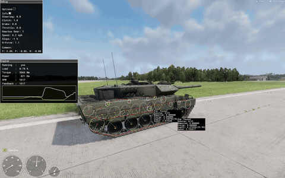
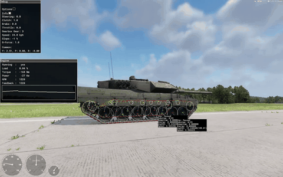

> 🇧🇷 Português · [🇬🇧 English](../en/10-tuning.md)

[← Bugs e limitações (1.8.0.13)](09-bugs.md) · [Índice](../../README.pt-BR.md) · [Scripts prontos →](11-scripts.md)

# Ajuste com dados reais

A meta é partir da ficha técnica do veículo real e chegar a valores que dirijam certo no jogo. Siga a ordem abaixo; cada passo depende do anterior. O exemplo é o Leopard 2A6 deste guia.

**Recarregue do jeito certo depois de cada mudança no prefab.** Um veículo que já está num mundo aberto mantém os valores antigos da simulação. Feche o mundo, recarregue os scripts sem mundo aberto e abra o mundo de novo. Senão você mede os valores antigos (veja [Bugs e limitações](09-bugs.md)).

### Dados a coletar

| Dado | Leopard 2A6 | Vai para | Prefab do 2A6 |
| --- | --- | --- | --- |
| Peso em combate | 62,3 t | `RigidBody.Mass` | 62300 |
| Potência e rpm | 1100 kW a 2600 rpm (MTU MB 873 Ka-501) | `MaxPower`, `RpmMaxPower` | 1100, 2600 |
| Torque máximo | \~4700 N·m a \~1600 rpm | `MaxTorque`, `RpmMaxTorque` | 4700, 1600 |
| Lenta, corte, limite | 700 / 2700 / 3000 rpm | `RpmIdle`, `RpmRedline`, `RpmMax` | 700, 2700, 3000 |
| Marchas | Renk HSWL 354: 4 à frente, 2 à ré | `Forward`, `Reverse` (a simulação aceita só uma ré) | 6.0 3.3 1.8 1.0, 2.3 |
| Velocidade máxima | \~70 km/h à frente, \~31 km/h em ré | Cálculo do `Ratio`, limite do script de ré | 4.6, 31 km/h |
| Raio da roda motriz | 0,34 m na face de contato do elo com o chão: a face interna da esteira envolve a roda motriz a \~0,26 m, mais o elo de 0,076 m | `Sprocket.Radius` | 0.34 |
| Rodas de apoio | 7 por lado, raio do aro 0,345 m + cerca de uma espessura de elo | `RoadWheel.Radius` | 0.418 |
| Roda-guia | Raio do aro 0,264 m + cerca de uma espessura de elo | `Idler.Radius` | 0.335 |
| Roletes de retorno | 4 por lado, raio do aro 0,0847 m + cerca de uma espessura de elo | `Roller.Radius` | 0.152 |
| Posições das rodas de apoio | z = 2,478, 1,662, 0,889, 0,160, −0,722, −1,596, −2,478 m (frente → trás); altura do centro 0,4186 m | Nivelamento pelo centro de massa, suspensão | Dos ossos |
| Elos da esteira | 71 por lado no modelo, passo 0,2101 m, 0,076 m de espessura | `TrackLength`, `TrackThickness` | 0.2110, 0.076 |
| Bitola | 2,656 m entre os centros das esteiras | `TrackOffset1`, `TrackOffset2` | ∓1.3281 0 0 |
| Afundamento estático | 0,097 m (resulta do `SpringRate 450`) | `SpringRate`, `MaxTravelDown` | 450, 0.10 |
| Curso da suspensão para cima | \~350 mm | `MaxTravelUp` | 0.30 |
| Área frontal | \~3,75 m × 2,5 m | `ReferenceArea` | 9.5 |

O **raio da simulação** de cada roda é a distância do centro dela até a **face de contato com o chão** da esteira (a face externa dos elos), não até o aro de borracha. O motor põe o centro da roda no ponto de contato com o chão + `Radius`, e a corrente de elos corre sobre esses círculos. Veja [Rodas de apoio, roda-guia, roda motriz e roletes](14-running-gear.md).

### 1. Massa e centro de massa

Use a massa real em kg. O 2A6 usa `Mass 62300`.

O `CenterOfMass` é um **deslocamento**, não uma posição. O executável o descreve como um deslocamento em relação ao centro de massa definido no modelo (engenharia reversa). Se o modelo do casco tem um ponto `COM_`, o centro de massa da física é esse ponto mais o deslocamento.

O modelo do casco do 2A6 tem `COM_hull` no centroide do colisor do casco `UCX_hull_01`: (0; 1,168; −0,381) m no espaço do casco, com o chão em y = 0. Com `CenterOfMass 0 1 0.46`, o centro de massa da física fica em (0; 2,168; 0,079). Isso foi medido: o `WheelGetPosition` devolve os centros das rodas em relação a esse ponto, e os números bateram em 0,01 mm.

> A edição anterior mandava pôr o `CenterOfMass` "baixo, perto do piso do casco" e dava `0 1 -0.3`. Esse conselho está errado quando o modelo tem um ponto COM: Y = 1 **sobe** o centro de massa 1 m acima dele.

#### Nivele o casco parado

Um casco que fica de nariz para cima ou para baixo em chão plano tem o centro de massa à frente ou atrás do meio das rodas de apoio. Corrija com o deslocamento em z:

1. Estacione em chão plano. Espere o casco parar de se mexer. O corpo então dorme, e as linhas da telemetria se repetem idênticas bit a bit.
2. Leia a inclinação: `LEOTEL pose pitch=` em graus (nariz para cima > 0), ou o P no painel Debug do diagnóstico (radianos; positivo = nariz para baixo, observado no vídeo).
3. Calcule a sensibilidade de inclinação *S* a partir da rigidez da mola e das posições das rodas de apoio (dos dois lados):

```math
\theta = \frac{M \cdot g \cdot (\bar{z} - z_{\text{COM}})}{\sum_i k \,(z_i - \bar{z})^2}, \qquad S = \frac{M \cdot g}{\sum_i k \,(z_i - \bar{z})^2}\ \ [\text{rad/m}]
```

Aqui, *z<sub>i</sub>* são as posições das rodas de apoio ao longo do casco, *z̄* é a média delas, e *k* = `SpringRate` × 1000 N/m. Multiplique *S* por 57,3 para ter graus por metro.

4. Mova o deslocamento em z do `CenterOfMass` para a frente em θ / *S* se o nariz estiver para cima, ou para trás se estiver para baixo.
5. Recarregue do jeito certo (feche o mundo, recarregue, abra de novo) e meça outra vez.

A inclinação parada não depende do `MaxTravelDown`: o mesmo valor apareceu antes e depois da mudança de altura do casco.

No 2A6: *z̄* = 0,056 m e Σ *k* (*z<sub>i</sub>* − *z̄*)² = 1,70 × 10⁷ N·m/rad, então *S* = 2,06°/m.

| `CenterOfMass` | z do centro de massa | Inclinação prevista | Inclinação medida |
| --- | --- | --- | --- |
| `0 1 0` | −0,381 m | +0,90° | +0,954° (nariz para cima) |
| `0 1 0.46` | +0,079 m | −0,047° | −0,049° (mediana de 256 amostras) |

As duas medições dão 2,18°/m. O modelo põe o nível exato num deslocamento em z de 0,437; o prefab mantém 0,46.

**Em aberto:** o deslocamento Y de 1 veio de versões anteriores e não foi reajustado. Ele põe o centro de massa do 2A6 2,17 m acima do chão, cerca de 0,47 m acima do teto do casco. Meia bitola dividida por essa altura dá um fator de estabilidade estática de 0,61 g; com deslocamento Y de 0 (1,17 m) daria 1,14 g (calculado). Numa rodada de teste o tanque capotou a 33–41 km/h. Não está provado que o centro de massa alto foi a causa. A entrada *Show CoM* do diagnóstico deve desenhar o ponto (não testado).

**Atualização (17/10/2026).** O deslocamento Y foi baixado para 0.2 (`CenterOfMass 0 0.2 0.46`), o que põe o centro de massa a cerca de 1,37 m do chão e sobe o fator de estabilidade estática para cerca de 0,97 g. O gatilho foi a reforma da aderência na seção 9b: quando as rodas de apoio traseiras passaram a ter aderência lateral, o 2A6 capotou numa curva forte em velocidade com o centro de massa antigo de 2,17 m. A inclinação parado não mudou (ela depende só do z).

**Em aberto:** qual ponto o motor usa quando o modelo não tem ponto `COM_` (centroide do colisor ou origem do modelo) não se sabe.

### 2. Motor

Copie os valores de potência, torque e rpm da ficha técnica. Depois ajuste os três valores que não estão na ficha:

| Atributo | Regra | Leopard 2A6 |
| --- | --- | --- |
| `Friction` | Cerca de 10% do `MaxTorque`. Define o freio-motor | 470 |
| `Steepness` | 50 (os motores vanilla usam de 4 a 50) | 50 |
| `Inertia` | Comece em 3; valores maiores fazem o rpm subir devagar. Também entra no Δ do bug da ré | 3 |

Com `Friction` 1400 (30% do torque), a versão anterior, do 2A7, acelerava devagar. A ré nem conseguia vencer o atrito do próprio motor.

**O que o `Friction` faz.** Com o acelerador solto, o torque do painel Engine segue esta reta com erro de até 2 N·m em dez leituras (observado em vídeo):

```math
T_{\text{engine braking}} = -\text{Friction} \cdot \frac{\text{rpm} - \text{RpmIdle}}{\text{RpmMax} - \text{RpmIdle}}
```

Acima do `RpmMax` ele fica em −471 N·m. Rodando engrenado sem freio acima de 15 km/h, o 2A6 desacelerou com mediana de 0,33 m/s² (0,65 em 2ª, 0,28 em 3ª; medido).

**Governador.** Com `HasGovernor 1`, o torque é cortado entre `RpmRedline` e `RpmMax`. Em 1ª o rpm parou em cerca de 2930, com o torque caindo para 130–200 N·m (observado em vídeo).

**Conferência.** Numa arrancada limpa com thrust 0,8 (sem turbo), o 2A6 chegou a 20 km/h em 4,1 s e a 30 km/h em 9,7 s (medido).

### 3. Câmbio

Transmissões de tanques reais têm conversor de torque. Ele multiplica o torque de saída por cerca de 2 a 2,5 vezes. A simulação não tem conversor. Compense encurtando as primeiras marchas.

Leopard 2A6: `Forward { 6.0 3.3 1.8 1.0 }`, `Reverse 2.3`. A relação da ré só define o limite da ré nativa e o Δ do bug da ré; quem faz o trabalho é o empurrão por script ([Bugs e limitações](09-bugs.md)).

### 4. Relação do diferencial pela velocidade máxima

Escolha o `Ratio` para que a última marcha alcance a velocidade real no rpm de potência máxima:

```math
R_d = \frac{\text{RpmMaxPower} \cdot \frac{2\pi}{60} \cdot r_{\text{sprocket}} \cdot 3.6}{g_{\text{top}} \cdot v_{\text{max}}}
```

Leopard 2A6 para 70 km/h: 2600 · 0,10472 · 0,34 · 3,6 / (1,0 · 70) ≈ 4,76. O prefab usa **4.6**. Ele foi escolhido quando o raio da roda motriz era 0,3189 m (67,95 km/h a 2600 rpm) e não foi reajustado quando o raio passou para 0,34 m por causa da corrente de elos. Com 0,34 m ele dá 72,4 km/h a 2600 rpm.

Confira a tabela de velocidade de cada marcha (`Ratio` 4.6, roda motriz 0,34 m):

| Marcha | Relação | A 2600 rpm | A 2700 rpm (`RpmRedline`) | Medido no 2A6 |
| --- | --- | --- | --- | --- |
| 1ª | 6.0 | 12,1 km/h | 12,5 km/h | Para em 13,6 km/h, \~2930 rpm (governador) |
| 2ª | 3.3 | 22,0 km/h | 22,8 km/h | — |
| 3ª | 1.8 | 40,2 km/h | 41,8 km/h | 44,3 km/h a 2860 rpm (fórmula: 44,3) |
| 4ª | 1.0 | 72,4 km/h | 75,2 km/h | Não medido |

As trocas automáticas para cima com thrust 0,8 aconteceram em medianas de 2924 rpm (1ª → 2ª), 2812 rpm (2ª → 3ª) e 2860 rpm (3ª → 4ª), acima do `RpmRedline` (medido).

**Velocidade máxima.** A velocidade máxima do 2A6 **não** foi medida de novo; a maior velocidade registrada é 47,6 km/h. A teoria dá cerca de 72–75 km/h (2600–2700 rpm), e o deslizamento da esteira tira alguns por cento. A versão anterior, do 2A7 (`Ratio` 4.9, roda motriz 0,355 m), mediu 74,3 km/h em chão plano, com o rpm passando um pouco de 2600.

**Deslizamento da esteira.** A velocidade da esteira é exatamente a velocidade angular da roda motriz × 0,34 m: o *Speed* / *AngVel* da corda no diagnóstico leu 0,340 em todos os quadros conferidos. A velocidade do casco difere pelo deslizamento. Com tração, as esteiras correm 3–6% mais rápido que o casco, cerca de 10% acelerando forte a 11 km/h, e cerca de 20–110% numa arrancada abaixo de uns 7 km/h; rodando solto, cerca de 2–6% mais devagar (observado em vídeo). No `LEOTEL` acima de 10 km/h, o raio efetivo (velocidade do casco / velocidade angular da roda motriz) foi de cerca de 0,32–0,33 m com thrust 0,8 em todas as marchas, e de cerca de 0,35 m rodando solto (medido).



*Arrancada com trocas automáticas (vista 3/4 traseira direita). A 1ª para em 13,6 km/h e 2926 rpm, onde o governador corta o torque; o câmbio então passa para a 2ª e a 3ª. Nas duas caixas da corda, Speed = AngVel × 0,34. Vídeo de teste A (06/10/2026), 94,5–99,0 s · [foto em tamanho cheio](../images/launch-upshifts.jpg) em 97,0 s · Modelo: buh-late, CC BY 4.0, modificado ([créditos](../../CREDITS.md)).*

Constantes de conversão para ler a telemetria (2A6, `Ratio` 4.6, sem deslizamento):

| Grandeza | Por km/h |
| --- | --- |
| Rpm do motor em 1ª / 2ª / 3ª / 4ª | 215,3 / 118,4 / 64,6 / 35,9 rpm |
| Rpm do motor em ré | 82,5 rpm |
| Roda motriz (raio 0,34 m) | 7,802 rpm |
| Roda de apoio (`WheelGetRPM`, raio 0,418 m) | 6,346 rpm |

Todas as peças de uma lagarta compartilham uma única velocidade de esteira, então o `WheelGetRPM` de uma roda de apoio é a velocidade da esteira dividida pelo `Radius` dela: rpm da roda de apoio / (rpm da roda motriz pelo feedback do motor × 0,34 / 0,418) = 0,9999 (medido). Os valores da roda-guia, da roda motriz e dos roletes não foram conferidos.

### 5. Molas da suspensão e altura do casco

O `SpringRate` está em **N/mm**, que é o mesmo que kN/m. O texto de ajuda do executável diz isso, e as medições confirmam. A mola tem **força zero no curso todo para baixo** (`−MaxTravelDown`). Então a compressão estática, medida a partir do curso todo para baixo, é:

```math
s = \frac{M \cdot g}{n \cdot k}
```

Aqui, *n* é o número de rodas de apoio dos dois lados e *k* = `SpringRate` × 1000 N/m. A roda-guia, a roda motriz e os roletes de retorno não têm suspensão.

Dimensione a suspensão nesta ordem:

1. **Escolha o afundamento estático** *s*. Ele também fixa a frequência vertical: *f* = (1/2π) · √(*g*/*s*). 2A6: *s* = 0,097 m → 1,60 Hz.
2. **Calcule a rigidez da mola:** *k* = *M* · *g* / (*n* · *s*). 2A6: 62300 · 9,81 / (14 · 0,097) ≈ 450 000 N/m → `SpringRate 450`.
3. **Ponha `MaxTravelDown` ≈ *s*.** O casco então fica na altura do modelo. Um valor maior levanta o casco pela diferença, porque a mola continua empurrando nesse curso extra.
4. **Ponha o `MaxTravelUp`** igual ao espaço acima da posição modelada da roda (2A6: 0,30 m).
5. **Confira de novo a folga da corrente de elos** (seção 9). Qualquer mudança de altura muda o caminho que a corrente precisa cobrir.

O curso da suspensão parado, a partir da posição modelada (+ = para cima), é:

```math
\text{travel}_{\text{rest}} = -\text{MaxTravelDown} + \frac{M \cdot g}{n \cdot k}
```

Medido no 2A6 (`LEOSUSP`, média do curso das rodas de apoio registradas em cada quadro, parado; com 0.15 só a lagarta esquerda foi registrada):

| `MaxTravelDown` | Curso parado previsto | Medido | Casco |
| --- | --- | --- | --- |
| 0,15 m | −53,0 mm | −53,0 mm (13 de 14 quadros) | 5,3 cm acima da altura do modelo |
| 0,10 m | −3,0 mm | −3,0 mm (mediana) | Na altura do modelo |

Com `CenterOfMass 0 1 0.46`, o curso parado de cada roda vai de −1 mm na frente a −5 mm atrás, igual nas duas lagartas. O modelo prevê −1,0 a −5,1 mm.

Mais fatos que importam para o ajuste (detalhes em [Suspensão e altura do casco](13-suspension.md)):

- Cada roda de apoio lança um raio ao longo do eixo para baixo do casco. Ele começa `RayStartOffsetUp` (0,5 m) acima da posição de compressão total.
- O sinal de suspensão do motor está em metros, de −`MaxTravelDown` a +`MaxTravelUp`. Sem contato com o chão, a roda fica pendurada no curso todo para baixo.
- O ponto de contato pode ficar acima da compressão total: o curso calculado pelo contato chegou a +0,382 m com `MaxTravelUp 0.30`. O motor limita o próprio sinal; os scripts também precisam limitar.
- Em chão inclinado ou irregular, o curso médio das rodas de uma lagarta fica no valor estático enquanto rodas isoladas se espalham (−27 a −88 mm com o casco inclinado +0,35° e `MaxTravelDown 0.15`).

### 6. Amortecedores

A unidade do amortecedor é N·s/m (força por 1 m/s). O `CompressionDamper` age enquanto a suspensão comprime, o `RelaxationDamper` enquanto ela estende. Use uma fração ζ do amortecimento crítico:

```math
c = \zeta \cdot 2\sqrt{k \cdot m_{\text{wheel}}}, \qquad m_{\text{wheel}} = \frac{\text{Mass}}{n_{\text{wheels}}}
```

No 2A6, cada roda de apoio carrega 4450 kg, então o amortecimento crítico é cerca de 89 500 N·s/m. Com ζ = 0,3: *c* ≈ 27 000 N·s/m. O 2A6 usa 25 000 na compressão (ζ ≈ 0,28) e 35 000 no retorno (ζ ≈ 0,39). Essas razões são calculadas; a amostragem de 2 s da telemetria é grossa demais para confirmá-las.

**Confira a atitude do casco.** Acelerando e freando, o casco inclina cerca de 0,20° por m/s² (medido, 395 amostras): +0,94° de nariz para cima a +2,66 m/s², −0,44° a −2,93 m/s², e uma vez 1,85° de nariz para baixo a −4,3 m/s² com freio 6,0. Numa parada brusca a inclinação chega ao pico e depois volta uma vez, pouco (observado em vídeo, figura na seção 7).

### 7. Freios

O `BrakeTorque` de cada roda vira uma força no raio dela. Regra prática para uma desaceleração alvo *a*:

```math
\sum_i \frac{\text{BrakeTorque}_i}{\text{Radius}_i} \approx M \cdot a
```

No 2A6: 14 · 6000 / 0,418 + 2 · 30 000 / 0,34 ≈ 201 kN + 176 kN = 377 kN, então cerca de 6,1 m/s² (0,62 g). Isso é uma estimativa: supõe que cada `TrackPart` freia com o próprio torque no próprio raio, o que não foi verificado. A soma do prefab é 14 · 6000 + 2 · 30 000 = 144 000 N·m.

Medido no 2A6:

| Entrada de freio (`GetBrake()`) | Desaceleração | Fonte |
| --- | --- | --- |
| 6,0 (valor do freio de mão, a partir de 10–22 km/h) | 5,1–5,5 m/s² | `LEOTEL`, 7 amostras |
| 6,0 (paradas bruscas) | 5,0–5,7 m/s², G-Force 1,1–1,2 | Observado em vídeo |
| 1,0 | 0,2–3,6 m/s² | `LEOTEL` |
| 0 (rodando engrenado) | 0,33 m/s² (mediana) | `LEOTEL` |

Numa parada brusca as esteiras derrapam: a velocidade da corda cai bem abaixo da velocidade do casco.



*Parada brusca, lado direito. O freio 6,0 em 10,83 s leva o tanque de 19,8 a 0,9 km/h em 1,0 s. O P chega a 0,05 rad de nariz para baixo e volta um pouco. Em 11,2 s a corda lê 1,535 m/s enquanto o casco faz 3,75 m/s: as esteiras derrapam. Vídeo de teste B (06/10/2026), 8,4–12,6 s · [foto em tamanho cheio](../images/braking-dive.jpg) em 11,2 s · Modelo: buh-late, CC BY 4.0, modificado ([créditos](../../CREDITS.md)).*

**Em aberto:** como a entrada de freio 6,0 escala o `BrakeTorque`. O controlador segura 6,0 parado, nos giros no lugar e nas paradas bruscas.

### 8. Aerodinâmica, retardador e controlador

- `ReferenceArea` = largura × altura. 2A6: 9,5 m². `DragCoefficient` em torno de 0,9 para um casco em forma de caixa.
- `RetarderBaseTorque 0` e `RetarderThrottleSpeed 20`, senão o retardador limita a velocidade (\~51–54 km/h na versão anterior, do 2A7).
- `ThrottleReverseTarget 1`.

Em passo de caminhada quase não há resistência ao rolamento: em lenta na 1ª com o acelerador solto, o 2A6 só caiu de 2,2 para 1,6 km/h em 17 s (observado em vídeo). A API de script tem `WheelGetRollingDrag` e `WheelSetRollingDrag`; mudar esse valor não foi testado.

### 9. Comprimento e folga da corrente de elos

A corrente de elos nativa é uma corda com gravidade e sem colisão com o chão ([Elos da esteira](15-track-links.md)). O comprimento dela precisa cobrir o caminho em volta dos círculos das rodas em qualquer posição da suspensão, e qualquer comprimento a mais fica pendurado como folga.

- O comprimento da corrente é *N* × `TrackLength`. Em execução, *N* é o número de entradas do `TrackPositions`; o `TrackSegments` só é lido pelo gerador do editor.
- O caminho passa em volta de cada círculo de `TrackPart` no **raio da simulação**, ligado por tangentes externas.

Dimensione assim:

1. Meça o passo do elo no modelo. 2A6: 0,2101 m (média de 71 elos).
2. Ponha os círculos das suas rodas na `tools/trackpositions.py` e rode `python tools/trackpositions.py 73 0.2101`. Ela imprime o comprimento do caminho (`hull length`) e *N* × passo. 2A6: 15,284 m.
3. *N* = arredondar(caminho / passo). 2A6: 15,284 / 0,2101 = 72,7 → 73.
4. Escolha o `TrackLength` com a tabela abaixo. Rodas de apoio caídas deixam o caminho mais longo.

2A6, as 7 rodas de apoio de um lado caídas na mesma medida (comprimento de arco, calculado com uma versão em Python do código de caminho da corrente por script):

| Queda das rodas de apoio | Comprimento do caminho | Folga com 0.2101 (15,337 m) | Folga com 0.2110 (15,403 m) |
| --- | --- | --- | --- |
| 0 (parado) | 15,284 m | +5,3 cm | +11,9 cm |
| 3 cm | 15,319 m | +1,8 cm | +8,4 cm |
| 5 cm | 15,344 m | −0,6 cm | +6,0 cm |
| 10 cm | 15,407 m | −6,9 cm | −0,4 cm |
| 15 cm | 15,473 m | −13,5 cm | −7,0 cm |

Cada 0,9 mm a mais no `TrackLength` acrescenta 73 · 0,0009 = 6,6 cm de corrente. A corda é um polígono de segmentos retos, então precisa de um pouco menos que o comprimento de arco: 73 cordas iguais em volta do caminho parado medem 0,20894 m cada (15,252 m). Por essa conta, 0.2101 tinha cerca de +8,5 cm parado e −10,3 cm com 15 cm de queda, e 0.2110 tinha +15,1 cm e −3,7 cm (calculado, supondo elos rígidos). As conclusões são as mesmas.

O que aconteceu no 2A6:

| `TrackLength` | Queda parado | Resultado |
| --- | --- | --- |
| 0.2101 | 5 cm (`MaxTravelDown 0.15`) | Quase no limite do comprimento parado (calculado: −0,6 cm como arco, +2,5 cm como polígono). Depois de um capotamento (todas as rodas com 15 cm de queda) saiu da roda motriz e ficou fora |
| 0.2110 | \~0 (`MaxTravelDown 0.10`) | 12 cm de folga penderam abaixo das rodas de apoio e atrás da roda motriz. Depois de uma explosão de mina saiu de novo |

Nenhum `TrackLength` sozinho mantém a corda nativa esticada parada e comprida o bastante no curso todo para baixo. O 2A6 mantém `TrackLength 0.2110`, esconde os elos nativos e desenha a corrente por script (`LEO_TrackChain`). A corrente por script espaça os elos em comprimento do caminho / *N*, então o espaçamento acompanha o caminho: 0,2094 m parado, 0,2110 m com todas as rodas caídas 10 cm, e até cerca de 0,219 m com uma roda do meio no batente de cima (cerca de 4% de esticamento).

### 9b. Aderência: os atributos de atrito V2

`FrictionCurveLongitudinal` e `FrictionCurveLateral` nunca são lidas no 1.8.0.13 (engenharia reversa: o caminho antigo de atrito está desligado por uma constante; só a existência da curva lateral é conferida no carregamento). A aderência que roda é o modelo "V2":

- cada contato de roda de apoio avalia uma **fórmula fixa de pneu de carro** (Magic Formula 5.2, carga nominal 5 kN) com a carga da roda, a razão de deslizamento e o ângulo de deriva (`0x140a448a0`, função do pneu `0x140a410a0`);
- a força longitudinal é multiplicada por 2 × o `FrictionTread` da superfície × `V2FrictionBaseLng`, a lateral por 2 × `FrictionNonTread` × `V2FrictionBaseLat`;
- a força lateral ainda é multiplicada por `V2FrictionSteerFactorCurve(|direção|)` e por `V2FrictionSteerFactorLngCurve(índice / (n − 1))`, n = 13 `TrackPart` por lagarta.

Com os 43,7 kN por roda de apoio do Leopard, o pneu de carro está muito fora da faixa dele: a aderência lateral despenca para cerca de 0,15–0,27 × carga enquanto a longitudinal ainda chega a 0,92 × carga (calculado pela fórmula transcrita). A curva de posição vanilla (1 / 0 / 1 em 0 / 0,5 / 1) mapeia as 7 rodas de apoio em 0–0,5, então a roda de apoio traseira fica **sem nenhuma** aderência lateral. Esse era o "dirigir no gelo" dos primeiros testes do Workshop: a traseira escorregava.

O 2A6 agora usa:

| Atributo | Vanilla | Leopard 2A6 | Por quê |
| --- | --- | --- | --- |
| `V2FrictionSteerFactorLngCurve` | 1 / 0 / 1 em 0 / 0,5 / 1 | 1 / 0,5 / 1 / 1 em 0 / 0,25 / 0,5 / 1 | Simétrica nas rodas de apoio: a traseira segura tanto quanto a frente |
| `V2FrictionBaseLat` | 2 | 1.6 | 3 capotou o tanque em curvas fortes (aderência lateral até cerca de 1,06 × peso no asfalto contra um fator de estabilidade de 0,97 g); 2.5 ainda capotava; 1.6 o mantém de pé com cerca de 26% mais aderência lateral média que o vanilla |
| `V2FrictionSteerFactorCurve` | 1 → 0,2 | 1 / 0,35 / 0,08 em 0 / 0,5 / 1 | Menos aderência com a direção aplicada, então o giro continua tão fácil quanto antes e as curvas com meia direção ficam mais ágeis |

Ordem de ajuste: primeiro a curva de posição (ela corrige a assimetria), depois o `V2FrictionBaseLat` para a sustentação lateral, depois o último valor da curva de direção se o giro ficar lento na grama (baixe). Teste uma curva forte a 35–40 km/h, uma troca de faixa rápida, uma rampa lateral e um giro depois de cada mudança. Nenhum desses valores foi medido contra a tabela de depuração por roda; eles vêm do modelo e dos testes de capotamento.

### 10. Meça com a telemetria

1. Acrescente o `LEO_TelemetryComponent` ao prefab. Acrescente o `LEO_RunningGearComponent` e o `LEO_TrackBeltComponent` se você usa o trem de rolamento por script ([Scripts prontos](11-scripts.md)).
2. Dirija este programa: estacione em chão plano (motor desligado, depois ligado), uma arrancada até a velocidade máxima, uma parada brusca a partir de uns 20 km/h, ré, um giro no lugar e terreno irregular.
3. Abra o log da sessão: `Documents\My Games\ArmaReforgerWorkbench\logs\logs_<data>\console.log`.
4. Filtre as linhas pela tag:

| Tag | Quando | Campos | Valores bons |
| --- | --- | --- | --- |
| `LEOTEL pose` | A cada 0,5 s, mesmo com o motor desligado | `pitch`, `roll` em graus (nariz para cima > 0) | Nivelado dentro de \~0,1° em chão plano (seção 1) |
| `LEOTEL v=` | A cada 0,5 s com o motor ligado | `v` (km/h, para a frente > 0), `rpm`, `thrust`, `gear` (0 = R, 1 = N, 2… = 1ª…), `clutch`, `simBrk` (6.00 = freio de mão), `simRpm`, `wheelRpm` (rpm do lado do câmbio) | Velocidade por marcha como na seção 4 |
| `LEOSUSP` | A cada 2 s com o motor ligado, uma linha por lagarta | `worst_mm`; `diff_mm` por roda de apoio (osso − simulação, `air` sem contato); `travel_mm` (curso da simulação a partir da altura do modelo, + = para cima); `spin` das 7 rodas de apoio e da roda motriz (graus) | `diff_mm` 0–3 mm; `travel_mm` ≈ 0 parado (2A6: −1 a −5 mm); giros iguais dentro de uma lagarta |
| `LEOGEAR` | Uma vez, quando a simulação fica válida | `simulation: 2 tracks, WheelCount 13` | `WheelCount` = peças por lagarta |
| `LEOTRACK` | Uma vez | `link chain found (N links)` ou `static belts kept` | 2A6: 146 elos (só nativos) ou 292 (nativos + por script) |
| `LEOREV` | Cerca de uma vez por segundo enquanto a tecla de ré está apertada, e quando o motorista sai | `APPLY force=… v=… gear=… clutch=… steer=…`, ou o motivo de não empurrar; `driver left: engine stopped` | `APPLY` só em R ou N com o freio solto |

5. Compare com as fórmulas:

| O que conferir | Se estiver errado |
| --- | --- |
| Velocidade máxima menor que a calculada | Retardador ligado, `Friction` alto ou motor fraco. Alguns por cento são deslizamento da esteira |
| Velocidade sempre travada no mesmo valor | `RetarderThrottleSpeed` baixo demais |
| RPM acima do `RpmMax` com `gear=0` | O bug da ré: 3766–3768 rpm no 2A6, até cerca de 5100 com o freio aplicado. Normal com a ré por script |
| `thrust=0.80` com W | `ThrottleTurbo` 0.2. Normal |
| Velocidade por marcha diferente da tabela | Raio da roda motriz ou `Ratio` errado. Com tração o casco anda \~4% abaixo da tabela (deslizamento); rodando solto, \~2–5% acima |
| Casco inclinado parado | Deslocamento em z do centro de massa (seção 1) |
| `travel_mm` parado bem abaixo de 0 | `MaxTravelDown` maior que o afundamento estático; o casco fica alto (seção 5) |
| `diff_mm` grande com todas as rodas no chão | Os ossos não seguem a simulação (por exemplo, o mapeamento errado do `CarProcAnimComponent`), ou a altura parada no script está errada |
| `spin` diferente dentro de uma lagarta | Com o `LEO_RunningGearComponent` todas as rodas de apoio de uma lagarta recebem o mesmo giro por construção, então outro componente está movendo os ossos. (O `WheelGetRPM` da própria simulação por roda pode variar num gradiente suave da frente para trás, abaixo de 2%, e uma roda sem contato pode informar um RPM bem diferente) |
| Várias linhas idênticas seguidas | O corpo está dormindo (`LinearSleepingThreashold` 0.4, `AngularSleepingThreashold` 0.5). Não é falha do logger |
| Uma mudança no prefab não aparece | O mundo não foi recarregado (veja o topo desta página) |
| RPM cai para 700 com `simBrk=6.00` num giro no lugar | Observado com a embreagem acoplada; a causa está em aberto ([Bugs e limitações](09-bugs.md)) |

6. Confira também com a depuração nativa do veículo ([Diagnóstico do veículo e telemetria](16-debugging.md)): o *Speed* / *AngVel* da corda precisa ser igual ao raio da roda motriz (0,340 no 2A6), e o *Feedback* do painel Engine é igual ao rpm da roda motriz × relação da marcha × `Ratio`.

---

[← Bugs e limitações (1.8.0.13)](09-bugs.md) · [Índice](../../README.pt-BR.md) · [Scripts prontos →](11-scripts.md)
