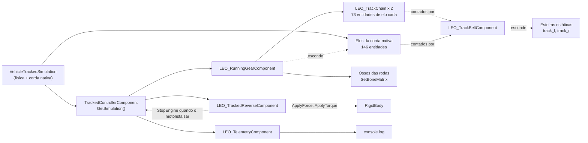

> 🇧🇷 Português · [🇬🇧 English](../en/11-scripts.md)

[← Ajuste com dados reais](10-tuning.md) · [Índice](../../README.pt-BR.md) · [Solução de problemas →](12-troubleshooting.md)

# Scripts prontos

O Leopard 2A6 usa cinco arquivos de script e uma ferramenta offline no veículo de esteira. Eles usam só a API vanilla do Workbench 1.8.0.13. O código está em [`scripts/`](../../scripts) e [`tools/`](../../tools), sob a licença MIT.

| Arquivo | Tipo | O que faz | Quando você precisa |
| --- | --- | --- | --- |
| [`LEO_TrackedReverseComponent.c`](../../scripts/LEO_TrackedReverseComponent.c) | Componente | Empurra o casco para trás enquanto o motorista segura a ré. Desliga o motor quando o motorista sai | Sempre: a ré nativa não anda ([por quê](09-bugs.md)) |
| [`LEO_RunningGearComponent.c`](../../scripts/LEO_RunningGearComponent.c) | Componente | Move os ossos das rodas de apoio com a suspensão, gira todas as rodas, roda a corrente de elos por script e esconde os elos da corda nativa | Quando as rodas e os elos precisam se mexer ([capítulo 14](14-running-gear.md)) |
| [`LEO_TrackChain.c`](../../scripts/LEO_TrackChain.c) | Classe simples | A corrente de elos por script de uma lagarta: o caminho da esteira e as entidades dos elos | Sempre junto com o `LEO_RunningGearComponent` ([capítulo 15](15-track-links.md)) |
| [`LEO_TrackBeltComponent.c`](../../scripts/LEO_TrackBeltComponent.c) | Componente | Esconde as malhas estáticas da esteira do casco quando existem entidades de elo | Quando o modelo mantém uma esteira estática como reserva |
| [`LEO_TelemetryComponent.c`](../../scripts/LEO_TelemetryComponent.c) | Componente | Escreve linhas `LEOTEL` e `LEOSUSP` no log | Só para ajuste. Tire numa versão publicada |
| [`tools/trackpositions.py`](../../tools/trackpositions.py) | Script Python 3 | Calcula a lista `TrackPositions` offline | Quando você configura a corrente de elos nativa |

O código completo está nos arquivos. Este capítulo explica o que instalar, quais atributos ajustar e como as partes trabalham juntas. O [capítulo 14](14-running-gear.md) e o [capítulo 15](15-track-links.md) explicam a matemática por trás do trem de rolamento e da corrente.

### Como os componentes trabalham juntos



O que acontece no *Play*, em ordem:

1. **`OnPostInit`.** O `LEO_RunningGearComponent` lê a posição de repouso de cada osso do trem de rolamento (a pose de bind) e confere se os ossos existem. Os outros componentes acham o controlador, o assento do motorista e os sinais.
2. **A simulação fica válida** 0,78–1,26 s depois de a entidade do veículo ser criada, 8–13 s antes de ligar o motor nas sessões registradas (medido). Nesse primeiro quadro, o `LEO_RunningGearComponent` registra `LEOGEAR simulation: 2 tracks, WheelCount 13` e cria 2 × 73 entidades de elo. A corda do motor já criou os 146 elos dela.
3. **Mesmo quadro.** O `LEO_TrackBeltComponent` conta 292 elos filhos e esconde as esteiras estáticas (`LEOTRACK link chain found (292 links)`).
4. **A cada quadro.** O `LEO_RunningGearComponent` lê cada roda da simulação, escreve as matrizes dos ossos, reconstrói os dois caminhos da esteira e posiciona os elos. Ele esconde os elos nativos 4 vezes por segundo nos primeiros 10 s, depois a cada 2 s.
5. **A cada passo da física.** O `LEO_TrackedReverseComponent` confere as condições da ré e empurra o casco. A cada quadro, ele também confere se o banco do motorista ficou vazio.
6. **A cada 0,5 s.** O `LEO_TelemetryComponent` escreve as linhas dele.

Os componentes que leem a simulação a pegam pelo `TrackedControllerComponent.GetSimulation()`. Nenhum deles escreve nela, exceto o `SetGear` opcional do `m_bHoldNeutral`. O `LEO_TrackBeltComponent` nem usa a simulação.

### Como instalar

1. Copie os cinco arquivos `.c` para `scripts/Game/Vehicle/` do seu mod.
2. Recompile os scripts com o *Play* **parado**. No executável Diag, recarregue **sem mundo aberto**; senão aparece o assert `Resources are leaking` ([Solução de problemas](12-troubleshooting.md)).
3. Acrescente os componentes ao bloco `components { }` do prefab do casco, com o override vazio do `CarProcAnimComponent`:

```
  CarProcAnimComponent "{5D6501223785D009}" {
  }
  LEO_RunningGearComponent "{5292A83C2D6FC873}" {
  }
  LEO_TrackedReverseComponent "{7A1D4C9E2B6F3085}" {
  }
  LEO_TelemetryComponent "{3C5E7A9B1D2F4608}" {
  }
  LEO_TrackBeltComponent "{8E3A61C04F2D9B57}" {
  }
```

4. Ajuste os atributos para o seu veículo (tabelas abaixo). Os padrões são os valores do Leopard 2A6; por isso os blocos de override do Leopard estão vazios.
5. Feche o mundo e abra de novo. Um veículo num mundo que já está aberto mantém a simulação montada com o prefab antigo (medido).

Notas sobre o trecho:

- `{5D6501223785D009}` é o `CarProcAnimComponent` que o `TrackedVehicle_Base.et` já tem, vazio. Mantenha-o **sem** `Parameters`. Num veículo de esteira ele dá à maioria dos ossos das rodas os sinais de outra roda ([capítulo 14](14-running-gear.md)). Se o seu prefab acrescentou `ProcAnimParams` a ele, apague-os.
- Os quatro IDs `LEO_` são os do Leopard. Qualquer ID hexadecimal único de 16 dígitos serve; o Workbench cria um quando você acrescenta um componente no editor.
- O bloco completo do Leopard, com o `RigidBody`, está em [`examples/leopard2a6/HullComponents_Leopard2A6.et.txt`](../../examples/leopard2a6/HullComponents_Leopard2A6.et.txt). O `ThrottleReverseTarget 1` vai no controlador ([Apêndice](17-appendix.md)).
- O `LEO_TrackChain.c` não tem componente. O `LEO_RunningGearComponent` cria uma corrente por lagarta.
- Se você usar os scripts em outro mod, troque o prefixo `LEO_` para que as classes não colidam com o mod do Leopard. O `category: "Leopard2A7"` no `ComponentEditorProps` só agrupa os componentes na lista do editor.

### LEO\_TrackedReverseComponent (ré por script, v5)

A ré nativa prende o motor acima do `RpmMax`, então nenhum torque chega às lagartas ([Bugs e limitações](09-bugs.md)). Este componente aplica uma força para trás no casco enquanto tudo isto vale:

- o motorista local segura `TrackedBrake` e não `TrackedThrottle`;
- o motor está ligado;
- o casco está parado ou já andando para trás (velocidade para a frente abaixo de `m_fForwardCutoffKmh`);
- a marcha nativa é ré ou neutro (índice 0 ou 1);
- o sinal de freio nativo (`GetBrake()`) está abaixo de 0,05.

A força é `m_fLaunchForceG` vezes o peso parado. Ela cai linearmente até zero em `m_fMaxReverseSpeedKmh`. As teclas de direção acrescentam um torque de guinada, limitado a `m_fMaxYawRate`.

O componente também desliga o motor quando o banco do motorista fica vazio (`m_bStopEngineOnExit`). Sem motorista, o controlador puxa o freio de mão; parado, ele então seleciona a ré, e o bug da ré prendeu o motor em cerca de 4500 rpm (observado no 2A6, 04/10/2026). A conferência roda no `EOnFrame`, porque o corpo da física pode dormir quando ninguém dirige. O log mostra `LEOREV driver left: engine stopped` quando ela age.

| Atributo | Padrão | Função |
| --- | --- | --- |
| `m_fLaunchForceG` | 0.3 | Força parado, como fração do peso |
| `m_fMaxReverseSpeedKmh` | 31 | Velocidade máxima de ré em km/h. A força cai a zero ali |
| `m_fForwardCutoffKmh` | 1.5 | Acima desta velocidade para a frente em km/h, o script não empurra |
| `m_fSteerTorque` | 900000 N·m | Torque de curva em ré com a direção toda |
| `m_fMaxYawRate` | 0.45 rad/s | Taxa máxima de curva em ré |
| `m_bHoldNeutral` | 0 | Força o câmbio nativo de R para N durante a ré. O controlador volta para R, então fica desligado |
| `m_bDebug` | 1 | Escreve linhas `LEOREV` no log enquanto a tecla de ré está apertada |
| `m_bStopEngineOnExit` | 1 | Desliga o motor quando o banco do motorista fica vazio. Sem isso, o tanque estacionado seleciona a ré e o motor fica preso acima do `RpmMax` |

Mantenha o `m_fMaxReverseSpeedKmh` abaixo do limite nativo de velocidade da esteira em ré:

```math
v_{\text{max,rev}}\,[\text{km/h}] = \frac{\text{RpmMax}}{|\text{Reverse}| \cdot \text{Ratio}} \cdot \frac{2\pi}{60} \cdot r_{\text{sprocket}} \cdot 3.6
```

No 2A6: 3000 / (2,3 · 4,6) · 0,10472 · 0,34 · 3,6 ≈ 36,3 km/h. O script para de empurrar em 31 km/h.

O `m_fSteerTorque` de 900 000 N·m é o valor do 2A6 de 62,3 t. A versão anterior, do 2A7 de 64,5 t, usava o mesmo valor. Escale com a massa.

**Medido no 2A6** (LEOTEL, 05/10/2026 23:19, ré a fundo): de 0 a −20,9 km/h em cerca de 3 s, e −27,8 km/h depois de cerca de 7,6 s. O motor nativo ainda ficou em 3767 rpm em R durante o empurrão. A fórmula do [capítulo 9](09-bugs.md) prevê 3766,1 rpm para 62 300 kg, `Reverse` 2.3, `Ratio` 4.6 e `Inertia` 3.

**Multiplayer (v5).** O cliente do motorista manda `{ré, direção, freio de mão}` para o servidor por RPC; o servidor aplica o mesmo empurrão, repõe o freio de mão que o move de rede descarta (`m_bMirrorHandbrake`), afrouxa as tolerâncias de reconciliação durante giro ou ré (`m_bRelaxAllowance`) e desliga o motor só na autoridade. `m_bClientPrediction 0` desliga a ressimulação do cliente (uma chave de experimento). Verificado no Peer Tool do Workbench; ainda não com latência real. O problema de câmera e comandos do motorista em clientes é uma limitação do motor que este componente não corrige. Veja [Multiplayer](18-multiplayer.md).

As mensagens `LEOREV` estão listadas em [Solução de problemas](12-troubleshooting.md).

### LEO\_TelemetryComponent (telemetria para ajuste)

Escreve linhas de log que você pode filtrar no `console.log` da sessão (`Documents\My Games\ArmaReforgerWorkbench\logs\logs_<data>\console.log`). O [capítulo 16](16-debugging.md) mostra como lê-las junto com a depuração nativa do veículo.

| Linha | Quando | Conteúdo |
| --- | --- | --- |
| `LEOTEL init` | Uma vez, no começo | Se o controlador e o gerenciador de sinais foram achados |
| `LEOTEL pose` | A cada `m_fInterval`, motor ligado ou desligado | `pitch` e `roll` do casco em graus (pitch > 0 = nariz para cima) |
| `LEOTEL v=` | A cada `m_fInterval` com o motor ligado | `v`: velocidade para a frente em km/h (negativa = para trás). `rpm`, `thrust`: os sinais `engineRPM` e `engineThrust`. `gear`: 0 = R, 1 = N, 2.. = marchas à frente. `clutch`. `simBrk`: 6.00 = freio de mão. `simRpm`: `EngineGetRPM()`. `wheelRpm`: `EngineGetRPMFeedback()`, o rpm devolvido pelo lado do câmbio |
| `LEOSUSP track=l` / `track=r` | A cada 2 s com o motor ligado | `worst_mm`. `diff_mm` por roda de apoio: osso menos centro da roda na simulação (`air` sem contato com o chão). `travel_mm` por roda de apoio: curso da simulação a partir da altura do modelo, + = para cima. `spin`: ângulo de cada roda de apoio e da roda motriz em volta do eixo, em graus |

| Atributo | Padrão | Função |
| --- | --- | --- |
| `m_fInterval` | 0.5 s | Tempo entre as linhas |
| `m_bReadSimulation` | 1 | Acrescenta marcha, embreagem, freio e rpm do motor lidos da simulação |
| `m_fWheelRestHeight` | 0.4186 m | Altura modelada do centro da roda de apoio (osso `v_wheel_l01` em repouso), para o `travel_mm` |

Como são os valores saudáveis no 2A6 (medido, sessões de 05/10/2026 e 06/10/2026):

- O `diff_mm` tem mediana 0 com o `LEO_RunningGearComponent`, e 90–95% das amostras ficam dentro de 3 mm. Valores maiores só aparecem enquanto uma roda volta devagar depois de perder contato.
- Os 7 valores de `spin` de uma lagarta são iguais.
- Parado em chão plano, o `travel_mm` lê −1 a −5 mm da frente para trás (`MaxTravelDown` 0.10, `CenterOfMass 0 1 0.46`).
- Parado em chão plano, o `LEOTEL pose` lê uma inclinação de cerca de −0,05°.
- Várias linhas idênticas bit a bit seguidas querem dizer que o corpo está dormindo (`LinearSleepingThreashold` / `AngularSleepingThreashold`), não que o logger quebrou.

O `LEOSUSP` supõe 7 rodas de apoio chamadas `v_wheel_<s>0<k>` e um osso `v_sprocket_<s>`. Edite o laço para outro arranjo. Ele só lê os getters das rodas com o motor ligado; a essa altura a simulação já carregou faz vários segundos.

O comentário no topo do arquivo diz que chamar os getters no `owner.FindComponent(VehicleTrackedSimulation)` derrubou o Workbench. A engenharia reversa feita depois ligou esse travamento (travamento 1) ao `GetInputs()`, então o caminho pelo `FindComponent` provavelmente é seguro. Não foi testado de novo; o `GetSimulation()` pelo controlador continua sendo o caminho recomendado.

### LEO\_RunningGearComponent (trem de rolamento por script)

Ele substitui o `CarProcAnimComponent` no trem de rolamento, e a corda nativa nos elos visíveis. A cada quadro, lê a simulação por (lagarta, peça) e escreve matrizes locais dos ossos com `Animation.SetBoneMatrix`, a mesma chamada que o `SCR_DestructionTireComponent` vanilla usa. Ele também cuida de um `LEO_TrackChain` por lagarta. O usuário confirmou o resultado no jogo em 06/10/2026.


*Vídeo de teste A (06/10/2026), 209,5 s: lado direito na grama a cerca de 8–10 km/h. Os elos por script envolvem a roda motriz traseira, passam por baixo das sete rodas de apoio e por cima dos roletes de retorno. Modelo do Leopard 2A6 por buh-late, CC BY 4.0, modificado.*

**Requisitos**

1. **Ordem dos `TrackPart`**, a mesma nas duas lagartas: rodas de apoio nos índices 0 a n−1, a roda-guia em n, a roda motriz em n+1, os roletes de retorno depois. A roda-guia precisa estar na frente e a roda motriz atrás (a ordem da esteira no `LEO_TrackChain`). A lagarta 0 (o primeiro `Track`, `Track Left` no Leopard) usa os ossos `_l`; a lagarta 1 usa os ossos `_r`.
2. **O `TrackPart` de índice k** (contando de 0) precisa ser a roda cujos ossos têm o número k + 1. O script monta os nomes como `"v_wheel_" + side + "0" + k`, então aceita no máximo 9 rodas de apoio e 9 roletes por lado.
3. **Os ossos da tabela abaixo**, por lado `<s>` = `l` / `r` e número `<k>` = 1..n. Cada um fica no centro da sua peça com **orientação de repouso identidade**, porque o script monta as matrizes nos eixos do casco.
4. **`CarProcAnimComponent` vazio.**

| Osso | Pai | Movido pelo script |
| --- | --- | --- |
| `v_suspension_<s>0<k>` | `v_body` | Translação em Y (o curso da suspensão) |
| `v_wheel_<s>0<k>_rotator` | `v_suspension_<s>0<k>` | Não é movido. Sobrou do rig `wheel_suspension.pap` |
| `v_wheel_<s>0<k>` | `v_wheel_<s>0<k>_rotator` | Rotação em X. Também é o osso pivô do `TrackPart` |
| `v_idler_<s>`, `v_sprocket_<s>`, `v_roller_<s>0<k>` | — | Rotação em X |

O [capítulo 14](14-running-gear.md) mostra como os ossos do Leopard foram acrescentados no Blender sem mover nenhum vértice, e como os braços da suspensão receberam novos pesos para balançar com a roda.

**Atributos.** Os padrões são os valores do Leopard 2A6.

| Atributo | Padrão | Função |
| --- | --- | --- |
| `m_iRoadWheels` | 7 | Rodas de apoio por lagarta (`TrackPart` 0 a n−1) |
| `m_iRollers` | 4 | Roletes de retorno por lagarta (os `TrackPart` depois da roda motriz) |
| `m_fRoadWheelRadius` | 0.345 m | Raio visual do aro da roda de apoio, onde a roda rola sobre a face interna da esteira |
| `m_fRollerRadius` | 0.0847 m | Raio visual do aro do rolete de retorno |
| `m_fRestHeight` | 0.4186 m | Altura modelada do centro da roda de apoio. Só é usada se um osso de roda não puder ser lido |
| `m_fMaxTravelDown` | 0.10 m | Precisa ser igual ao `MaxTravelDown` do bloco `Suspension` |
| `m_fMaxTravelUp` | 0.30 m | Precisa ser igual ao `MaxTravelUp` do bloco `Suspension` |
| `m_fDropRate` | 8 /s | Quão rápido uma roda cai até o curso todo para baixo quando perde o contato com o chão, e volta quando pousa |
| `m_bScriptedChain` | 1 | Move os elos por script e esconde os elos da corda nativa |
| `m_sLinkModel` | `{B50AEDC702735F50}Assets/Vehicles/Tracked/Leopard2A6/Leopard2A6_track_link.xob` | Modelo do elo da corrente por script |
| `m_iLinks` | 73 | Elos por lagarta |
| `m_sNativeLinkName` | `Leopard2A6_track_link` | Parte do nome do arquivo do modelo do elo nativo, usada para achar e esconder os elos da corda entre os filhos do casco |
| `m_fMaxDistance` | 300 m | Além desta distância da câmera, ossos e elos não são atualizados |

**O que ele calcula a cada quadro**

Curso da suspensão de cada roda de apoio, a partir do ponto de contato da simulação (espaço do casco) e do raio da roda na simulação:

```math
\text{travel} = \operatorname{clamp}\left(y_{\text{contact}} + r_{\text{sim}} - y_{\text{rest}},\ -\text{MaxTravelDown},\ +\text{MaxTravelUp}\right)
```

Com contato, o osso segue a simulação exatamente. Sem contato, ele desce suavemente até o curso todo para baixo com o fator 1 − e^(−taxa·Δt), que não depende da taxa de quadros. Depois de pousar, ele volta suavemente até ficar a menos de 5 mm, e então segue exatamente de novo. O limite importa: nas sessões registradas o curso calculado pelo contato chegou a +0,382 m, acima do `MaxTravelUp` 0.30, porque o raio da suspensão começa acima do topo do curso (medido).

Distância da esteira por quadro, a partir da roda de apoio 0 (a velocidade da face da esteira em contato com o chão):

```math
d = \text{RPM}_0 \cdot \frac{2\pi}{60} \cdot r_{\text{sim},0} \cdot \Delta t
```

- As rodas de apoio e os roletes de retorno **rolam** sobre a face interna da esteira: ângulo += d / raio visual do aro (0,345 m e 0,0847 m).
- A roda-guia e a roda motriz são **envolvidas** pela esteira e giram com os elos: ângulo += d / raio da simulação delas (0,335 m e 0,34 m).
- Um ângulo positivo move o topo da roda para a frente (+Z). As linhas da matriz do osso são (1, 0, 0), (0, c, s), (0, −s, c), com c = cos e s = sen do ângulo.
- O osso da suspensão recebe uma matriz identidade com a translação (0, curso, 0).

Depois, a corrente de cada lagarta recebe as novas alturas das rodas de apoio e move seus elos em d.

**Precisão (medida com o `LEOSUSP`).** Nas sessões de 05/10/2026 23:58 e 06/10/2026 00:12, a diferença osso menos simulação teve mediana de 0 mm, com 95% e 90% das amostras dentro de 3 mm. Valores até 124 mm só ocorreram enquanto uma roda voltava depois de perder contato. Na primeira rodada com o script (23:18), 70% das amostras ficaram dentro de 3 mm, com transientes até 83 mm em obstáculos.

**Limites e pontos em aberto**

- Não faz nada num servidor dedicado (`System.IsConsoleApp()`). Os elos são entidades locais e não são replicados. O comportamento nas máquinas dos outros jogadores (proxies) **não foi testado**.
- A distância da esteira vem da roda de apoio 0. Uma roda sem contato pode informar um RPM bem diferente (−230,6 rpm em ré enquanto as rodas no chão liam 0–20, medido). Então as rodas e os elos podem girar errado enquanto a roda de apoio da frente está no ar em ré. Usar uma roda no chão ou a roda motriz não foi testado (em aberto).
- O script roda no `EOnFrame`. Um atraso de um quadro em relação à física é possível, mas não foi mostrado (em aberto, pouca confiança).
- A corda nativa continua rodando com os elos escondidos. Se o `WheelGetRPM` depende dela não foi testado, e o custo de CPU dela não foi medido.
- Se faltar algum osso do trem de rolamento, ou a altura de repouso de uma roda estiver fora de 0,5–2 × `m_fRestHeight`, a corrente por script é desligada e aparece um aviso `LEOGEAR`.

### LEO\_TrackChain (corrente de elos por script)

Uma classe simples, criada pelo `LEO_RunningGearComponent`, uma por lagarta. A cada atualização ela:

1. reconstrói o caminho da esteira no plano da lagarta (z do casco ao longo, y para cima) a partir dos círculos na ordem da esteira: roda motriz, roletes de retorno de trás para a frente, roda-guia, rodas de apoio da frente para trás. Cada círculo tem o raio **da simulação** da peça, que é a face dos elos em contato com o chão. Os círculos das rodas de apoio se movem com a suspensão;
2. liga os círculos vizinhos pelas tangentes externas comuns e envolve cada círculo entre elas. Onde o envolvimento passa de meia volta (uma roda de apoio empurrada acima das vizinhas), usa uma corda reta no lugar;
3. põe N elos com espaçamento igual L / N ao longo do comprimento do caminho L, deslocados pela distância da esteira d.

Cada elo é uma `GenericEntity` filha do casco, criada com `GetGame().SpawnEntity`, presa com `AddChild(link, -1, EAddChildFlags.AUTO_TRANSFORM)`, recebe o modelo com `SetObject` e tem as flags `TRACEABLE` e `ACTIVE` limpas. Os elos são apagados no `OnDelete`. Como os elos dependem só das posições das rodas, eles não podem pender através do chão nem sair da roda motriz. Isso decorre da construção; um capotamento ou uma explosão de mina **não foi testado** com a corrente por script. O [capítulo 15](15-track-links.md) tem a geometria, o referencial do elo e a comparação com a corda nativa.

### LEO\_TrackBeltComponent (esteira estática de reserva)

O modelo do casco do Leopard mantém as esteiras estáticas originais (malhas `track_l` e `track_r`). Este componente conta as entidades filhas do casco cujo nome do modelo contém `m_sLinkModelName`, sejam elos da corda nativa ou elos por script. Quando há pelo menos 2, esconde as esteiras estáticas com `Animation.ShowMesh`, imprime `LEOTRACK link chain found (<n> links)` e para. Os logs mostraram 146 só com a corda nativa e 292 com as duas correntes. Se nenhum elo aparecer dentro de `m_fTimeout`, ele mantém as esteiras estáticas e imprime um aviso, para que uma corrente quebrada nunca deixe o tanque sem esteira. Roda em todas as máquinas, porque a visibilidade das malhas é local.

| Atributo | Padrão | Função |
| --- | --- | --- |
| `m_sStaticBeltMeshes` | `track_l track_r` | Nomes das malhas estáticas da esteira, separados por espaço |
| `m_sLinkModelName` | `Leopard2A6_track_link` | Parte do nome do arquivo do modelo do elo |
| `m_fTimeout` | 5 s | Quanto tempo esperar pelas entidades de elo |

### tools/trackpositions.py (TrackPositions offline)

A corda nativa precisa de uma lista `TrackPositions`: pontos (z, y) no espaço do modelo do casco em volta das rodas. O Workbench tem uma ação de editor *Generate track positions* para isso, mas ela não foi achada na interface do Workbench durante este trabalho. Este script calcula a lista offline.

```
python trackpositions.py [N] [pitch]
```

- Edite as constantes no topo para o seu tanque: `WHEELS` (o z de cada roda de apoio), as entradas da roda-guia e da roda motriz em `C` (z, y, raio da simulação), e as duas linhas que acrescentam as rodas de apoio e os roletes de retorno (altura, raio e z). Use os raios **da simulação**: os pontos da corrente ficam na face dos elos em contato com o chão.
- Ele amostra cada círculo, tira o fecho convexo, ordena de modo que o índice cresça **para a frente ao longo do trecho de cima** (o mesmo sentido do motor), e reamostra em comprimentos de arco iguais L / N.
- Ele imprime um comentário com o comprimento do fecho, N, o passo do arco, a menor e a maior corda e N × passo, uma linha de conferência com os dois primeiros pontos, e o bloco `TrackPositions { ... }`.
- Com os valores padrão do Leopard ele reproduz a lista do prefab exatamente: comprimento do fecho 15,2841 m, passo do arco 0,2094 m para N = 73. A docstring diz que a lista começa no ponto de cima mais perto de z = 0, mas com os roletes de retorno colineares do Leopard ela começa acima do rolete mais de trás (z −2,0577).
- Precisa do Python 3.8 ou mais novo (`math.dist`).

Escolha N e `TrackLength` com as regras de folga do [capítulo 15](15-track-links.md).

### Regras para escrever seus próprios scripts

**Pegando a simulação**

- Pegue-a com `TrackedControllerComponent.GetSimulation()`.
- Proteja a cada quadro até ela carregar. Até lá os getters devolvem 0, false ou um vetor zero, e o `GetGear()` devolve 0 (= R):

```c
VehicleTrackedSimulation simulation = m_Controller.GetSimulation();
// TrackCount() is 0 until the simulation is loaded (reverse-engineered: the getters test an internal state first)
if (!simulation || !simulation.IsValid() || simulation.TrackCount() < 2)
	return;
```

**Getters das rodas** (lista completa no [Apêndice](17-appendix.md), comportamento no [capítulo 14](14-running-gear.md))

- Os índices são (lagarta, índice do `TrackPart` na ordem do prefab). O `WheelCount()` é a contagem **por lagarta** (13 no Leopard).
- Mantenha `track < TrackCount()` e `wheel < WheelCount()` por conta própria. Só o `WheelGetPosition` confere o índice da roda; os outros leem memória alheia com um índice fora da faixa (engenharia reversa).
- O `WheelGetContactPosition` está no espaço do mundo; converta com `owner.CoordToLocal()`. Ele devolve um valor guardado mesmo sem contato, então teste o `WheelHasContact` antes.
- O `WheelGetRPM` tem o sinal da velocidade para a frente. O RPM de uma roda de apoio é a velocidade da esteira dividida pelo raio dela na simulação (medido). Para a roda-guia e a roda motriz isso não foi conferido.
- O `WheelGetPosition(track, wheel, 0)` devolve o centro da roda no curso todo para baixo em relação ao centro de massa da física (o ponto COM do modelo mais o deslocamento `CenterOfMass`), não em relação à origem do casco. No 2A6 com `MaxTravelDown` 0.15 ele leu y = −1,899 em todas as rodas. Só o displacement 0 foi testado.

**Movendo ossos**

- Use `owner.GetAnimation().SetBoneMatrix(owner, bone, mat)` a cada quadro. A matriz é um delta local sobre a pose de bind: identidade quer dizer repouso. Escreva de novo a cada quadro, como faz o `SCR_DestructionTireComponent`.
- Leia as posições de repouso com `GetBoneMatrix` no `OnPostInit`, antes que qualquer coisa mova os ossos.

```c
// spin a bone about its X axis (identity rest orientation); positive = top of the wheel moves forward (+Z)
float c = Math.Cos(angle);
float s = Math.Sin(angle);
vector mat[4];
mat[0] = Vector(1, 0, 0);
mat[1] = Vector(0, c, s);
mat[2] = Vector(0, -s, c);
mat[3] = vector.Zero;
anim.SetBoneMatrix(owner, bone, mat);
```

**Entidades só visuais e custo**

- Crie-as localmente (`GetGame().SpawnEntity`), prenda com `AddChild(..., EAddChildFlags.AUTO_TRANSFORM)`, limpe `TRACEABLE` e `ACTIVE`, e apague no `OnDelete`.
- Pule o trabalho longe da câmera (`owner.GetWorld().GetCurrentCamera`) e num servidor dedicado (`System.IsConsoleApp()`).

**Chamadas da transmissão**

- Use `GetGear()`, `GetClutch()`, `GetBrake()`, `EngineGetRPM()` e `EngineGetRPMFeedback()`.
- O índice de marcha 0 é R, 1 é N, 2 em diante são as marchas à frente (`EVehicleGearboxGear.REVERSE` / `NEUTRAL`).
- O `GetBrake()` lê 6,0 para o freio de mão: `SetBreak(x, true)` guarda 6,0. O controlador o segura parado e nos giros no lugar.
- **Nunca** chame `GetInputs()` nem `GetFloorNormalAngles()`. As ligações deles escrevem através de um ponteiro nulo (travamento 1).
- Na simulação de esteira, o `GetThrottle()` sempre devolve 0, o `SetThrottle()` não faz nada e o `IsHandbrakeOn()` sempre devolve false. Leia o sinal `engineThrust` no lugar.
- Leia os comandos do motorista com `GetGame().GetInputManager().GetActionValue("TrackedBrake")` e chamadas parecidas.

**Linguagem e fluxo de trabalho**

- `Physics` só pode ser variável local. Como membro de classe, o compilador recusa.
- Recompile com o *Play* parado. No executável Diag, recarregue os scripts sem mundo aberto.
- Depois de mudar o prefab, feche o mundo e abra de novo antes de testar ([Solução de problemas](12-troubleshooting.md)).

---

[← Ajuste com dados reais](10-tuning.md) · [Índice](../../README.pt-BR.md) · [Solução de problemas →](12-troubleshooting.md)
