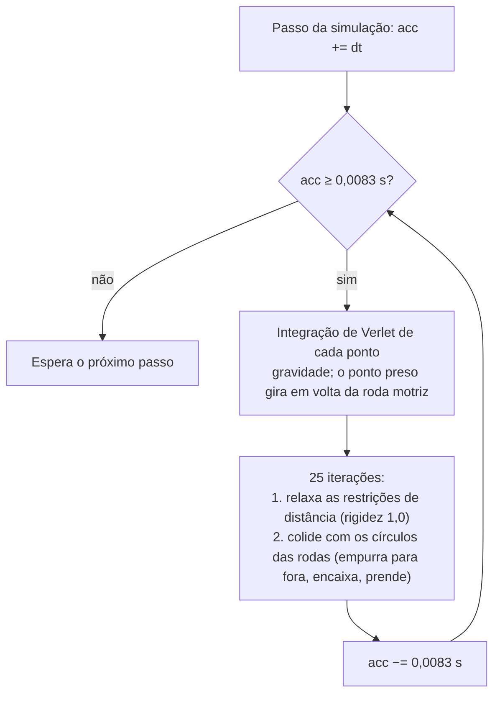

> 🇧🇷 Português · [🇬🇧 English](../en/15-track-links.md)

[← Rodas de apoio, roda-guia, roda motriz e roletes](14-running-gear.md) · [Índice](../../README.pt-BR.md) · [Diagnóstico do veículo e telemetria →](16-debugging.md)

# Elos da esteira: a corda nativa e a corrente por script

A `VehicleTrackedSimulation` consegue mover sozinha uma corrente de elos. Você dá a ela um modelo de elo e alguns atributos, e o motor cria uma entidade filha por elo e as move como uma **corda 2D**. A corda funciona na direção comum, mas tem gravidade e não tem colisão com o chão, então pende e pode sair da roda motriz de vez. Este capítulo trata da corda nativa e da corrente por script (`LEO_TrackChain`) que a substitui visualmente no Leopard 2A6.

Cada fato diz como é conhecido: **medido** (logs, arquivos), **engenharia reversa** (desmontagem estática do executável Diag do Workbench 1.8.0.13, `ArmaReforgerWorkbenchSteamDiag.exe`), **observado no vídeo**, **calculado** (contas sobre geometria medida) ou **não testado**.

### Resumo

| | Corda nativa | Corrente por script (`LEO_TrackChain`) |
| --- | --- | --- |
| Situação | ⚠️ Roda, mas pende e sai do lugar | ✅ Funciona na direção comum (confirmado pelo usuário). Ainda não testada capotando nem com explosão de mina |
| O que move os elos | O motor: uma simulação de corda 2D por lagarta | Um script, a cada quadro, a partir das posições atuais das rodas |
| Gravidade | Sim | Não: os elos ficam num caminho calculado |
| Colisão com o chão | **Nenhuma** | Não precisa: o caminho segue os círculos das rodas |
| Pode sair da roda motriz | Sim (visto duas vezes) | Não, por construção |
| Reiniciar | Sem API de script. Só a entrada de menu *Reset tracks* da versão Diag (não testada) | Nada a reiniciar |
| Entidades de elo | 2 × N filhas do casco, criadas pelo motor | 2 × N filhas do casco, criadas por script; as nativas ficam escondidas |
| Multiplayer | Desconhecido nas máquinas dos outros jogadores (proxies) | Local e só visual. Não roda num servidor dedicado. Proxies não testados |

Capítulos relacionados: a ordem dos TrackPart e os ossos das rodas estão em [Rodas de apoio, roda-guia, roda motriz e roletes](14-running-gear.md). A altura do casco, que define quanta corrente você precisa, está em [Suspensão e altura do casco](13-suspension.md). A sobreposição da depuração que desenha a corda está em [Diagnóstico do veículo e telemetria](16-debugging.md).

### O modelo do elo

O motor precisa de um elo como modelo próprio (`.xob`). O vanilla 1.8 não traz nenhum veículo de esteira nem elo de esteira. O `TrackSegment` não tem valor padrão. O elo do M113 que uma rotina de teste do motor cita (`{32FF46BA61EE0DCA}`) não está no banco de recursos nem em nenhum pak de dados do jogo (conferido). Então você precisa fazer o seu.

**Requisitos:**

| Item | Regra | Por quê |
| --- | --- | --- |
| Origem | Centro do elo (centrado na lateral, no meio do comprimento da sapata), na **face em contato com o chão (externa)**: face do chão em y = 0 | Os pontos da corrente ficam na face da esteira em contato com o chão (veja `TrackPositions`) |
| Eixos | Comprimento ao longo de +Z, +Y para as rodas (a face interna), modelado como um elo do **trecho de baixo** | No trecho de baixo o referencial do elo nativo é a identidade (engenharia reversa) |
| LODs | Quantos quiser; o elo do Leopard tem LOD0 e LOD1 | LODs comuns de malha |
| Colisores | Nenhum | O motor cria os elos sem física, então colisores não seriam usados (deduzido) |
| Ossos | Nenhum | Cada elo é uma entidade separada |
| Material | Atribua no `.xob.meta`, como em qualquer modelo | — |

**Como o elo do Leopard 2A6 foi feito** (medido). A esteira do próprio modelo do casco (malhas `track_l` / `track_r`) tem 71 elos idênticos por lado, com pele presa só ao `v_body`. Cada elo tem 6 ilhas de malha: 2 sapatas de 20 vértices, 2 conectores de ponta de 24, uma guia central de 22 e um dente-guia de 8. Isso dá 118 vértices / 180 faces no LOD0 e 47 vértices / 60 faces no LOD1. O LOD2 e o LOD3 da esteira são faixas contínuas, então o elo só tem dois LODs.

Um script do Blender (`extract_link.py`, rodado sem interface numa cópia do `.blend`) fez o corte:

1. Agrupar as ilhas de malha em elos, cada um em volta da guia central de 22 vértices mais próxima.
2. Pegar o elo do trecho de baixo sob a roda de apoio 3, e as ilhas do LOD1 mais perto dele.
3. Mover a origem para o centro do par de sapatas: x médio das sapatas, meio do comprimento da sapata, ponto mais baixo da sapata (a face do chão).
4. Exportar `track_link_LOD0` e `track_link_LOD1` para FBX com os eixos padrão (o +Y do Blender para a frente vira o +Z do Enfusion, o +Z do Blender para cima vira o +Y do Enfusion).

| Elo do Leopard 2A6 | Valor |
| --- | --- |
| Recurso | `{B50AEDC702735F50}Assets/Vehicles/Tracked/Leopard2A6/Leopard2A6_track_link.xob` |
| Passo (espaçamento entre os centros dos elos) | 0,2101 m em média (0,2032–0,2127 no modelo) |
| Espessura da sapata | 0,076 m |
| Largura da esteira | 0,6355 m, centrada em x ±1,3281 |
| Extensão ao longo de Z | −0,097 a +0,186 m (não é simétrica da frente para trás) |
| `.xob.meta` | Material de origem `Leopard2A6_track` → `Leopard2A6_track.emat`, um `MeshParam track_link`, sem colisores |

O mesmo `.xob` serve à corda nativa e à corrente por script.

Mais dois pontos sobre o modelo do casco:

- **Mantenha as esteiras estáticas como malhas com nome** (`track_l`, `track_r` no Leopard). Um script pode escondê-las quando existirem entidades de elo e mantê-las como reserva se a corrente nunca aparecer (veja [Escondendo as esteiras estáticas](#escondendo-as-esteiras-estáticas)).
- **Uma textura rolando não consegue imitar o movimento** neste modelo. Todos os elos da esteira mapeiam o mesmo atlas UV inteiro (u 0,019–0,966, v 0,013–0,988), então deslocar o UV não move nada ao longo da esteira (medido).

### Os atributos da corrente

Os sete atributos da corrente ficam na própria `VehicleTrackedSimulation`, **depois** que o objeto `Simulation Tracked` fecha, não dentro dele. Nenhum tem descrição nem faixa na interface (engenharia reversa: ordem de registro e tipos).

| Atributo | Tipo | O que faz | Leopard 2A6 | Como se sabe |
| --- | --- | --- | --- | --- |
| `TrackSegments` | int, padrão 0 | Número de pontos que a ação *Generate track positions* cria. Nada mais o lê. **Em execução, o número de elos por lagarta é o número de entradas do `TrackPositions`.** Mantenha os dois iguais | `73` | engenharia reversa |
| `TrackPositions` | array de Vector2 | Os pontos da corrente como pares `z y` no espaço do modelo do casco (z para a frente, y para cima). Uma lista serve às **duas** lagartas | 73 pares de um gerador offline | engenharia reversa; a forma de lista plana foi testada |
| `TrackLength` | float, m | Comprimento de repouso da restrição de distância entre os pontos vizinhos i e (i+1) mod N, ou seja, o passo do elo. Comprimento da corrente = N × `TrackLength` | `0.2110` (passo do modelo 0,2101) | engenharia reversa |
| `TrackThickness` | float, m | Guardado, nunca lido no 1.8.0.13 (duas escritas, nenhuma leitura) | `0.076` (espessura da sapata, para registro) | engenharia reversa |
| `TrackOffset1` | Vector3 | Deslocamento do `Tracks[0]`, o primeiro `Track` da lista (Left no Leopard). x = posição lateral do centro da esteira; y e z são somados à posição de cada elo | `-1.3281 0 0` | engenharia reversa |
| `TrackOffset2` | Vector3 | O mesmo para o `Tracks[1]` (Right) | `1.3281 0 0` | engenharia reversa |
| `TrackSegment` | ResourceName, sem padrão | O modelo do elo | o `.xob` do elo acima | testado |

O motor monta a corrente só quando o `TrackPositions` tem **pelo menos 2 entradas** e o **`TrackLength` > 0** (engenharia reversa). As duas lagartas usam o mesmo laço 2D, deslocado para os lados pelos deslocamentos. Os deslocamentos do Leopard (±1,3281) são o centro da esteira modelada; os ossos das rodas de apoio ficam em ±1,3288.

O bloco do Leopard (versão completa em [`examples/leopard2a6/VehicleTrackedSimulation_Leopard2A6.et.txt`](../../examples/leopard2a6/VehicleTrackedSimulation_Leopard2A6.et.txt) e no [Apêndice](17-appendix.md)):

```
VehicleTrackedSimulation "{6160DE6434513C4D}" {
 Simulation Tracked "{6160DE65F2933990}" {
  ...
 }
 TrackSegments 73
 TrackPositions {
  -2.0577 1.2299 -1.8483 1.2299 -1.6390 1.2299 ... -2.2668 1.2191
 }
 TrackLength 0.2110
 TrackThickness 0.076
 TrackOffset1 -1.3281 0 0
 TrackOffset2 1.3281 0 0
 TrackSegment "{B50AEDC702735F50}Assets/Vehicles/Tracked/Leopard2A6/Leopard2A6_track_link.xob"
}
```

Troque o `TrackSegment` pelo seu elo. O GUID acima é do mod do Leopard.

**A ordem dos TrackPart importa para a corrente.** O motor tira a referência angular da corrente do TrackPart de índice 1 e o raio de velocidade do índice 0 (engenharia reversa). Os dois precisam ser rodas de apoio. Com a roda-guia primeiro, como na ordem anterior do Leopard (`Radius` da roda-guia 0.2641 na época), a corrente teria andado a 0,2641 / 0,418 ≈ 63% da velocidade da superfície das rodas de apoio. Liste cada lagarta com as rodas de apoio da frente para trás, depois roda-guia, roda motriz e roletes de retorno, na mesma sequência nos dois lados ([detalhes](14-running-gear.md#ordem-e-índices-dos-trackpart)).

#### TrackPositions: formato e sentido

- **Formato.** Uma lista plana separada por espaços é aceita: `TrackPositions { z y z y ... }`. Os 146 números do Leopard carregam como 73 entradas, e o motor criou exatamente 146 elos (medido, `LEOTRACK link chain found (146 links)`). O gerador do próprio motor monta o texto como `z y, z y, ...` com 3 casas decimais e passa por um setter do editor. Como o Workbench salva as posições geradas no `.et` ainda não se sabe.
- **Coordenadas.** Espaço do modelo do casco: z para a frente, y para cima, chão em y = 0. Os pontos ficam na **face da esteira em contato com o chão**, ou seja, no círculo do `Radius` da simulação de cada TrackPart (roda de apoio 0,418, roda-guia 0,335, roda motriz 0,34, rolete de retorno 0,152 no Leopard). É ali que a corda do motor corre. Cada raio da simulação é mais ou menos o raio visual do aro mais uma espessura de elo (roda de apoio 0,345 + 0,073, roda-guia 0,264 + 0,071, rolete 0,0847 + 0,067).
- **Sentido.** O índice 0 fica no **trecho de cima**, e o índice cresce **para a frente** ao longo do trecho de cima. Depois desce em volta da roda-guia, volta pelo trecho de baixo e sobe em volta da roda motriz. Esse é o sentido do gerador do motor (engenharia reversa), e ele põe o +Y do elo nativo para as rodas.

No Leopard a lista começa em p0 = (−2,0577; 1,2299), acima do rolete de retorno mais de trás, e p1 = (−1,8483; 1,2299) fica à frente dele. O trecho de cima está em y 1,2299, o topo dos círculos dos roletes (1,0779 + 0,152). O trecho de baixo está em y 0,0006, o fundo dos círculos das rodas de apoio (0,4186 − 0,418). As 73 cordas têm 0,2059–0,2095 m (média 0,2090), e o polígono fechado tem 15,254 m (medido na lista do prefab).

Uma conferência rápida no *Play* com a sobreposição da depuração: um número pequeno desenhado ao lado de cada roda motriz conta **para baixo** enquanto você anda para a frente, cerca de um a cada 0,21 m, e **para cima** em ré. Ele dá a volta de 0 para 72. Provavelmente é o índice do ponto que a roda motriz segura (observado no vídeo; significado deduzido). Com a lista na ordem oposta, os elos nativos ficariam virados para fora (dentes-guia para fora) e o número contaria ao contrário (deduzido).

#### Gerando o TrackPositions offline

As posições do Leopard vieram da [`tools/trackpositions.py`](../../tools/trackpositions.py) (MIT, Python 3 puro, sem dependências). Ela faz o seguinte:

1. Amostra cada círculo de TrackPart no **raio da simulação** (3600 pontos por círculo).
2. Tira o fecho convexo de todas as amostras.
3. Ordena o fecho no sentido horário no plano (z, y), para que o trecho de cima ande em +z.
4. Gira a lista para que ela comece no trecho de cima.
5. Reamostra em comprimentos de arco iguais L / N.

Edite as listas no topo para o seu veículo, para um lado: `WHEELS` guarda os z das rodas de apoio, e as linhas `C` guardam o (z, y) de cada osso e o `Radius` da simulação de cada peça (o y e o raio das rodas de apoio e dos roletes de retorno estão nas duas linhas `C +=`). Os valores são do espaço do modelo do casco. Vindo do Blender com o exportador padrão, o y do Blender é o z do Enfusion e o z do Blender é o y do Enfusion. Depois rode:

```
python tools/trackpositions.py 73 0.2101
```

O primeiro argumento é N. O segundo é o passo do elo, usado só na comparação impressa `N*pitch`; o espaçamento é sempre L / N. Para o Leopard ela imprime:

```
# hull length 15.2841 m, N 73, arc step 0.2094, chord min 0.2060 max 0.2094, N*pitch 15.3373
# second point should be forward of the first: p0=(-2.0577, 1.2299) p1=(-1.848328632093053, 1.2299)
TrackPositions {
 -2.0577 1.2299 -1.8483 1.2299 ...
}
```

Cole só o bloco `TrackPositions { ... }` no prefab. A saída é idêntica à lista do prefab do Leopard.

Notas:

- O comentário no script diz que ele começa "no ponto de cima mais perto de z = 0". A lista do Leopard na verdade começa em z −2,0577. Os quatro roletes de retorno são colineares, então o fecho convexo só tem vértices de cima no rolete mais de trás e no mais da frente. Qualquer começo no trecho de cima dá o mesmo sentido.
- O fecho convexo é a forma em repouso. Ele supõe que nenhuma roda de apoio fica acima da linha das vizinhas, o que é verdade na altura do modelo.
- **Escolha N pelo comprimento do fecho.** N = ⌈caminho em repouso / passo⌉. O caminho do Leopard tem 15,284 m, e 15,284 / 0,2101 = 72,7, então N = 73, embora o modelo tenha 71 elos. Os elos do modelo seguem a linha dos pinos (14,973 m, 71,3 elos). A corrente corre na face em contato com o chão, que é mais longa.

```math
N = \left\lceil \frac{P_{\text{rest}}}{p} \right\rceil = \left\lceil \frac{15.284}{0.2101} \right\rceil = 73
```

#### A ação "Generate track positions"

O executável tem uma ação de editor de componente *Generate track positions* (ação id 1 na `VehicleTrackedSimulation`; o id 2 é *Compute local inertia*). Pela engenharia reversa, ela funciona assim:

1. Lê os círculos das rodas da lagarta 0 da simulação **ao vivo**. Então precisa de uma instância posicionada e inicializada, com `TrackSegments` e `TrackLength` já definidos.
2. Semeia N = `TrackSegments` pontos numa elipse centrada na origem do modelo: z = sen θ · R, y = cos θ · R / 2, com R = 0,75 × a diagonal da caixa que envolve os centros dos círculos.
3. Roda 1000 passos de corda de 1/60 s (16,7 s de tempo simulado) com a gravidade do mundo e os círculos das rodas.
4. Escreve os pontos no `TrackPositions`, índice 0 no topo, crescendo para a frente.

Como ela assenta a mesma corda sob gravidade, o resultado provavelmente já inclui a barriga (deduzido, não testado). **A ação não foi achada na interface do Workbench durante este trabalho**, então o Leopard usa a lista offline. Os textos *Generate track positions* e os nomes dos atributos da corrente também estão no executável do jogo de varejo.

### Como a corda nativa funciona

Tudo nesta seção é **engenharia reversa** do executável Diag do Workbench 1.8.0.13, a não ser que diga outra coisa.

#### Montando a corrente

Quando o componente é criado, e só se o `TrackPositions` tem 2 ou mais entradas e o `TrackLength` > 0:

- Ele aloca duas cordas, uma por lagarta, cada uma com N = número de pontos do `TrackPositions` copiados da lista.
- Acrescenta uma restrição de distância entre cada ponto i e (i+1) mod N, com comprimento de repouso `TrackLength`.
- Cria 2 × N filhas `IEntity` simples com a malha do `TrackSegment` e sem física, presas ao casco com `AddChild`.
- Liga o evento `EntityEvent.POSTFRAME`.

No Leopard (73 posições), o log contou 146 dessas filhas em todas as sessões antes de a corrente por script ser acrescentada (medido). Elas já existem no primeiro quadro do *Play*, que também é o primeiro quadro com simulação válida, cerca de 1 s depois de o veículo ser criado e antes de o motor ligar (medido).

#### O passo da corda

Cada passo da simulação soma o seu intervalo de tempo num acumulador. A corda então roda tantos **subpassos** fixos de 0,0083 s (a constante no código, cerca de 1/120 s) quantos couberem:



O passo sai cedo a menos que as duas cordas existam. A gravidade é a gravidade do mundo, projetada no referencial do casco.

**Círculos das rodas.** A corda colide com um círculo por TrackPart: centro = a posição simulada atual da peça no espaço do modelo, raio = o `Radius` da simulação. Os círculos das rodas de apoio se movem com a suspensão. Um ponto dentro de um círculo é empurrado radialmente para fora até o raio. **Não há colisão com o terreno, com objetos nem com o casco**. A corda também não faz ideia de que lado de uma roda deveria estar.

**Encaixe nas rodas no chão.** Para cada círculo que **não** é roda motriz nem roda-guia **e** cuja roda tem contato com o chão (`WheelHasContact`), cada ponto com |z − c.z| ≤ 0,1 m e y ≤ c.y é posto em y = c.y − r, o fundo do círculo. Isso segura o trecho de baixo sob as rodas de apoio enquanto elas tocam o chão. Também valeria para um rolete de retorno que informasse contato. Sem contato (no ar, capotado) nada encaixa.

**Tração da roda motriz.** Só a roda motriz move a corda, e ela prende um ponto de cada vez. O primeiro ponto achado dentro do círculo da roda motriz vira o ponto preso. O integrador o gira em volta do centro da roda motriz em −dt·ω<sub>j</sub>, com ω<sub>j</sub> a velocidade angular da roda motriz pela fórmula abaixo. O ponto é solto assim que fica atrás ou abaixo do centro da roda motriz, e o próximo ponto que toca o círculo é preso.

**Velocidade da corrente.** O motor toma ω como a variação, por passo, do ângulo físico do TrackPart de **índice 1**. Ele move a corrente a

```math
\omega_j = \frac{r_0\,\omega}{r_j}, \qquad v_{\text{chain}} = r_0\,\omega
```

em que r<sub>0</sub> é o `Radius` do TrackPart de **índice 0** e r<sub>j</sub> o `Radius` da peça j. O sinal por lagarta `trackSpeed` é r0·ω·3,6 km/h. O mesmo passo avança o sinal de rotação por roda que o `CarProcAnimComponent` lê, então esse sinal fica em 0 quando não existe corrente.

Na sobreposição da depuração, a caixa de estatísticas de cada corda mostra `AngVel` (rad/s, rpm entre colchetes) e `Speed` (m/s). `Speed / AngVel` = 0,34000 em todos os quadros lidos, o `Sprocket.Radius` do Leopard, então o `AngVel` é a velocidade angular da roda motriz (observado no vídeo). A velocidade da corrente bate com a velocidade do casco andando constante, mais o deslizamento da esteira: alguns por cento à frente com tração (3–10%, muito mais na arrancada), 2–6% atrás com freio-motor, e muito atrás quando as esteiras derrapam numa frenagem forte (observado no vídeo).

#### Posicionando os elos

A cada quadro (`EOnPostFrame`), cada entidade de elo é posta entre dois pontos vizinhos da corrente:

- **Posição:** o ponto médio entre os pontos i e i+1, mais o deslocamento da lagarta: (`Offset.x`, mid.y + `Offset.y`, mid.z + `Offset.z`).
- **Base:** X = (1, 0, 0); Y = a normal da esteira apontando para as rodas; Z = −(p<sub>i+1</sub> − p<sub>i</sub>) / |p<sub>i+1</sub> − p<sub>i</sub>|.
- Os dois lados usam o mesmo referencial, sem espelhar. Só o deslocamento muda.

Com o sentido para a frente, um elo do trecho de baixo recebe o referencial identidade. Por isso o modelo do elo é feito como um elo do trecho de baixo.

Como o elo fica no ponto médio de uma **corda**, onde a corrente envolve um círculo a face do elo em contato com o chão fica dentro do círculo pela flecha (calculado):

```math
h = r - \sqrt{r^2 - \left(\tfrac{p}{2}\right)^2}
```

Para p = 0,2101 isso dá 13 mm numa roda de apoio (r 0,418), 17 mm na roda-guia ou na roda motriz (0,335 / 0,34) e 42 mm num rolete de retorno (0,152).

#### Sem colisão com o chão, sem reinício

- **Sem colisão com o chão.** A corda só conhece os círculos das rodas e a gravidade.
- **Sem API de script.** Além das chamadas de entradas, motor e câmbio, a `VehicleTrackedSimulation` só expõe funções de roda (`TrackCount`, `WheelCount`, `WheelGetPosition`, `WheelHasContact`, `WheelGetContact*`, `WheelGetRPM`, `WheelGetRadius`, `WheelGet/SetRollingDrag`). Nada lê, move ou reinicia a corda (medido, API de script vanilla).
- **O único reinício é uma entrada de menu do Diag.** Nos executáveis Diag, o submenu *Tracked* em *Vehicles* tem *Steering mode*, *TrackSim*, *Draw tracks*, *Track dynamic*, *Track gravity* e *Reset tracks*. Os textos *Draw tracks*, *Track dynamic*, *Track gravity* e *Reset tracks* não estão no executável do jogo de varejo. Na sessão de 06/10/2026, o *Draw tracks* ligou e desligou o desenho da corda. Desligar o *TrackSim* ou o *Track gravity* por pouco tempo (o *TrackSim* por cerca de 1 s de cada vez) não mudou nada visível, visto de trás a cerca de 2 km/h com os elos nativos escondidos. O *Reset tracks* aparecia desabilitado e não foi testado (observado no vídeo).

Uma corda que saiu de uma roda, portanto, fica fora.

Para quem for conferir de novo depois de uma atualização do jogo, as funções no `ArmaReforgerWorkbenchSteamDiag.exe` 1.8.0.13:

| Endereço | Função |
| --- | --- |
| `0x140fc18d0` | Registro dos atributos da corrente |
| `0x140fbc1f0` | Construtor: cordas, restrições, entidades de elo |
| `0x140fc4090` | Atualização por passo (vaga 29 da vtable primária) |
| `0x140fc4430` | Ângulos das rodas a partir do TrackPart de índice 1 |
| `0x140a478c0` | Passo da corda: acumulador e subpassos |
| `0x140a41760` | Colisão: empurrar para fora, encaixe, roda motriz prendendo |
| `0x140fbe7f0` | Posicionamento dos elos (`EOnPostFrame`) |
| `0x140fc0520` | *Generate track positions* |
| `0x140fbdf30` | Desenho da corda no diagnóstico (sem conferir nulo: veja o [capítulo 16](16-debugging.md)) |

### Comprimento da corrente, comprimento do caminho e folga

O comprimento nominal da corrente é N × `TrackLength`. O caminho que ela precisa envolver é o laço em volta dos círculos das rodas nos raios da simulação, ligados pelas tangentes externas. A diferença é a folga:

```math
\text{slack} = N \cdot \text{TrackLength} - P
```

O P cresce quando as rodas de apoio caem, porque o fundo do laço desce. Calculado para o Leopard (posições dos ossos do modelo, raios da simulação do prefab, tangentes externas mais arcos, a mesma construção do `LEO_TrackChain`):

| As 7 rodas de apoio de um lado | Caminho P | Variação |
| --- | --- | --- |
| Na altura do modelo (repouso) | 15,284 m | — |
| 3 cm para baixo | 15,319 m | +0,035 m |
| 5 cm para baixo | 15,344 m | +0,059 m |
| 10 cm para baixo | 15,407 m | +0,122 m |
| 15 cm para baixo (curso todo para baixo com `MaxTravelDown` 0.15) | 15,473 m | +0,189 m |

| `TrackLength` | Corrente (73 elos) | Folga em repouso (arco) |
| --- | --- | --- |
| 0.2101 (o passo do modelo) | 15,337 m | +5,3 cm |
| 0.2110 | 15,403 m | +11,9 cm (mais ou menos o caminho com todas as rodas 10 cm para baixo) |

Subir o `TrackLength` em 0,9 mm acrescenta 73 × 0,0009 = 6,6 cm de corrente.

**A ressalva arco contra polígono.** Os números acima medem o caminho ao longo de arcos. A corda é um polígono de segmentos retos, e um polígono corta os cantos. 73 cordas iguais que fecham em volta do caminho em repouso só precisam de 15,252 m (corda de 0,2089 m). Se as restrições de distância agem como elos rígidos, a folga é (calculado):

| Todas as rodas de apoio | 73 × 0,2101 | 73 × 0,2110 |
| --- | --- | --- |
| Em repouso | +8,5 cm | +15,1 cm |
| 5 cm para baixo | +2,5 cm | +9,0 cm |
| 10 cm para baixo | −3,8 cm (curta demais) | +2,8 cm |
| 15 cm para baixo | −10,3 cm (curta demais) | −3,7 cm (curta demais) |

Se as restrições se comportam mesmo como elos rígidos, ou só resistem a esticar, está em aberto. Os dois modelos mostram o mesmo padrão: folga em repouso, no limite ou além dele no curso todo para baixo. Com o `MaxTravelDown` 0.10 atual do Leopard, o curso todo para baixo é a linha de 10 cm, e 73 × 0,2110 fica bem no limite ali (−0,4 cm pelos arcos, +2,8 cm como polígono).

**O meio-termo não tem uma boa resposta.** Pouca folga mantém a corda esticada na direção comum, mas a corda fica no limite do comprimento assim que as rodas caem (um salto, um capotamento, uma explosão) e é puxada por cima dos círculos. Mais folga pende sob a gravidade, porque nada a segura por baixo. Acerte a altura do casco primeiro ([capítulo 13](13-suspension.md)): com o casco alto, as rodas ficam caídas em repouso e comem a folga.

O histórico do Leopard (diário, log e backups do prefab, 05/10/2026):

| Hora | `TrackLength` | `MaxTravelDown` | Resultado |
| --- | --- | --- | --- |
| ~05:00 | 0.2101 | 0.15 (casco cerca de 5 cm alto, rodas caídas em repouso) | Elos animados bem na direção comum (relato do usuário). Depois de um capotamento às 22:33 a corda esquerda saiu da roda motriz |
| ~22:50 | 0.2110 | 0.10 (casco na altura do modelo) | A folga extra pendeu abaixo das rodas e atrás da roda motriz. Depois de passar por minas as duas cordas saíram |
| Fim da noite | 0.2110 (mantido) | 0.10 | Elos nativos escondidos; a corrente por script mostra a esteira |

### Falhas observadas da corda nativa

Todos os clipes estão listados em [Exemplos em vídeo](05-video-examples.md). As velocidades e o rpm nos vídeos de diagnóstico são lidos dos mostradores do HUD.

| # | Clipe | Configuração | O que acontece |
| --- | --- | --- | --- |
| 1 | Vídeo de diagnóstico 1 (05/10/2026 22:35) | `TrackLength` 0.2101, `MaxTravelDown` 0.15, rodas pelo `CarProcAnimComponent` | Capotamento em 189–194 s. De cabeça para baixo, o antigo trecho de retorno pende abaixo do casco. Depois de o tanque ser desvirado, a corda esquerda envolve a roda de apoio 7 em vez da roda motriz e fica fora |
| 2 | Vídeo de diagnóstico 3 (05/10/2026 23:21) | `TrackLength` 0.2110, `MaxTravelDown` 0.10, rodas por script | Estacionado: o trecho de baixo fica abaixo das rodas de apoio |
| 3 | Igual | Igual | A cerca de 27 km/h a folga se acumula e bate abaixo e atrás da roda motriz |
| 4 | Igual | Igual | Minas jogam o tanque (22,75–24 s). A corda esquerda acaba numa pedra, presa só atrás. Depois a roda motriz direita também fica vazia |
| 5 | Vídeo de teste A (06/10/2026) | `TrackLength` 0.2110, elos nativos escondidos | O trecho de cima da corda escondida chicoteia acima dos roletes de retorno a 17–21 km/h |

**1. De cabeça para baixo depois do capotamento.**


*De cabeça para baixo, lado esquerdo. Sem contato com o chão as rodas pendem no curso todo para baixo e o encaixe fica desligado (deduzido); o antigo trecho de retorno da corda pende sob o casco virado como uma catenária. Vídeo de diagnóstico 1 (05/10/2026 22:35), 194,6–197,0 s · [foto em tamanho cheio](../images/before-flip-rope-hangs.jpg) em 195,0 s · Modelo: buh-late, CC BY 4.0, modificado ([créditos](../../CREDITS.md)).*


*De volta na pista, lado esquerdo, quase parado. A corda envolve a roda de apoio 7 em vez da roda motriz, e a roda motriz flutua vazia com luz por baixo. Ela não volta para o lugar sozinha; uma vista de trás em 261,5 s mostra a roda motriz esquerda vazia e a direita ainda envolvida. As rodas de apoio 2–4 ficam acima da corrente por causa do mapeamento errado do `CarProcAnimComponent` ([capítulo 14](14-running-gear.md)). Vídeo de diagnóstico 1 (05/10/2026 22:35), foto em 255,0 s · Modelo: buh-late, CC BY 4.0, modificado ([créditos](../../CREDITS.md)).*

**2. Folga em repouso.**


*Lado direito, estacionado, motor desligado. As rodas estão na altura certa, mas o trecho de baixo da corda fica abaixo delas (uma folga de uns 5–10 cm, estimada pela imagem) e se enrola solto atrás. Vídeo de diagnóstico 3 (05/10/2026 23:21), foto em 8,0 s · Modelo: buh-late, CC BY 4.0, modificado ([créditos](../../CREDITS.md)).*

**3. Folga em velocidade.**


*Lado direito, cerca de 27 km/h. A folga extra se junta entre a roda motriz e a roda de apoio 7; os elos se empilham e pulam para fora abaixo e atrás da roda motriz (picos em cerca de 17,2–17,4 s e 18,8 s). Vídeo de diagnóstico 3 (05/10/2026 23:21), 15,5–19,6 s · [foto em tamanho cheio](../images/before-rope-sag-sprocket.jpg) em 17,4 s · Modelo: buh-late, CC BY 4.0, modificado ([créditos](../../CREDITS.md)).*

**4. Fora depois das minas.**


*Vista traseira esquerda, cerca de 10 km/h sobre pedras, logo depois das minas. A corda esquerda faz um laço atrás da roda motriz, depois desce como um fio fino até uma pedra, presa ao tanque só atrás; as rodas de apoio passam pela pedra sem elos embaixo. Vídeo de diagnóstico 3 (05/10/2026 23:21), 25,0–28,0 s · [foto em tamanho cheio](../images/before-rope-off-mines.jpg) em 27,3 s · Modelo: buh-late, CC BY 4.0, modificado ([créditos](../../CREDITS.md)).*


*Lado direito, parado entre pedras e grama. Os dentes da roda motriz estão vazios e não se vê nenhum elo sob as rodas de apoio: a corda direita também saiu (a roda motriz já parece vazia em cerca de 33 s). Vídeo de diagnóstico 3 (05/10/2026 23:21), foto em 38,0 s · Modelo: buh-late, CC BY 4.0, modificado ([créditos](../../CREDITS.md)).*

**5. A corda escondida continua se comportando mal.** Isso aparece em [A corda escondida continua rodando](#a-corda-escondida-continua-rodando), abaixo.

**Por que acontece** (deduzido das regras acima e das contas):

- A gravidade age em cada ponto, e nada segura a corda por baixo.
- O encaixe só segura pontos a ±0,1 m do centro de uma roda de apoio enquanto essa roda tem contato. Os vãos entre as zonas de encaixe têm 0,53–0,68 m no Leopard. A roda-guia e a roda motriz nunca encaixam. Então a folga pende nos vãos e em volta da roda motriz.
- Quando as rodas perdem contato (jogadas por uma explosão, capotadas), o encaixe desliga e as rodas caem até o curso todo para baixo. O caminho então pede mais ou menos o comprimento que a corda tem, ou mais (veja as tabelas de folga acima).
- O relaxamento das restrições então arrasta pontos por cima dos círculos, e a colisão empurra cada ponto para fora pelo lado mais próximo. Uma corda puxada além do centro da roda motriz acaba do lado de fora dela, e nada a põe de volta.

### A corrente por script (LEO_TrackChain)

A corrente por script substitui a corda **visualmente**. Ela distribui N entidades de elo ao longo de um caminho montado a partir dos círculos das rodas, a cada quadro. Os elos dependem só das posições das rodas, então não podem pender abaixo das rodas nem sair da roda motriz.

- [`scripts/LEO_TrackChain.c`](../../scripts/LEO_TrackChain.c): a corrente de uma lagarta, uma classe simples.
- [`scripts/LEO_RunningGearComponent.c`](../../scripts/LEO_RunningGearComponent.c): cuida das duas correntes, passa para elas o curso das rodas e a distância da esteira, e esconde os elos nativos. Também anima os ossos das rodas ([capítulo 14](14-running-gear.md)).
- [`scripts/LEO_TrackBeltComponent.c`](../../scripts/LEO_TrackBeltComponent.c): esconde as esteiras estáticas do casco quando existem entidades de elo.

Instalação e atributos estão em [Scripts prontos](11-scripts.md).

#### O que ela faz a cada quadro

Para cada lagarta, o `LEO_RunningGearComponent` faz o seguinte:

1. Calcula a distância que a lagarta andou neste quadro, a partir da roda de apoio de índice 0 (a roda da frente):

   ```math
   d = \mathrm{WheelGetRPM}(t, 0) \cdot \frac{2\pi}{60} \cdot \mathrm{WheelGetRadius}(t, 0) \cdot \Delta t
   ```

   É a velocidade da roda de apoio da frente na face do elo em contato com o chão, com + querendo dizer que o trecho de cima anda para a frente. É a mesma grandeza, r0·ω, que o motor usa para mover a própria corrente (o motor tira o ω do ângulo da roda de apoio de índice 1, o script do RPM do índice 0), então os elos por script andam mais ou menos na velocidade da corrente nativa.
2. Põe a altura de cada círculo de roda de apoio na altura da pose de bind mais o curso atual da suspensão (o mesmo curso que ele aplica aos ossos das rodas).
3. Chama `LEO_TrackChain.Update(d)`, que reconstrói o caminho e posiciona os elos.

Os círculos da roda-guia, da roda motriz e dos roletes de retorno ficam nas posições da pose de bind.

#### O caminho da esteira

A corrente trabalha no plano da lagarta: z do casco ao longo do veículo, y para cima. Os círculos são acrescentados uma vez, na **ordem da esteira**:

1. a roda motriz,
2. os roletes de retorno de trás para a frente (ordenados por z),
3. a roda-guia,
4. as rodas de apoio da frente para trás.

O centro de cada círculo é a posição do osso na pose de bind. O raio é o **raio da simulação** do `WheelGetRadius`, que é a face dos elos em contato com o chão, onde a corda nativa corria. A posição lateral da corrente é o x do osso da roda de apoio da frente (−1,3288 na esquerda).

**Tangentes externas.** Os círculos consecutivos i e i+1 (dando a volta) são ligados pela tangente externa comum. A normal para fora dela faz o mesmo ângulo φ nos dois círculos:

```math
\varphi_i = \mathrm{atan2}(\Delta y,\ \Delta z) + \arccos\!\left(\frac{r_i - r_{i+1}}{D}\right)
```

Aqui Δz e Δy vão do círculo i ao círculo i+1, e D é a distância entre os centros. O argumento do cosseno é limitado a [−1, 1]. Os pontos de tangência são c + r·(cos φ, sen φ) em cada círculo.

**Envolvimentos.** Em cada círculo a esteira corre no sentido horário no plano (z, y) (z para a direita, y para cima) da tangente de entrada até a de saída:

```math
\theta_i = (\varphi_{i-1} - \varphi_i) \bmod 2\pi
```

- Se θ ≤ π, o círculo recebe um arco de comprimento r·θ.
- Se θ > π, o canto é **côncavo**: uma roda de apoio empurrada para cima das vizinhas. A esteira então faz uma corda reta entre os dois pontos de tangência dessa roda.

A esteira ainda sobe até a roda levantada (um V invertido com uma corda atravessando o fundo). Então levantar uma roda de apoio do meio **alonga** o caminho (calculado):

| Caso | Caminho | Espaçamento dos elos L / 73 |
| --- | --- | --- |
| Repouso | 15,284 m | 0,2094 m |
| Todas as rodas de apoio 10 cm para baixo | 15,407 m | 0,2110 m |
| Roda de apoio de índice 3 0,10 m para cima | 15,505 m (+0,221) | 0,2124 m |
| Roda de apoio de índice 3 0,30 m para cima (batente) | 15,987 m (+0,703) | 0,2190 m |
| Roda de apoio da frente 0,30 m para cima | 15,227 m (−0,057) | 0,2086 m |

#### Distribuindo os elos ao longo do caminho

Os elos são distribuídos **igualmente** ao longo do comprimento atual do caminho L, deslocados por um valor o que avança com a esteira:

```math
s_k = \left(o + k\,\frac{L}{N}\right) \bmod L, \qquad o \leftarrow (o + d) \bmod L
```

- O espaçamento estica com o L, então nunca aparecem vãos. O custo é um esticamento de até cerca de 4% sobre o passo real de 0,2101 m quando uma roda do meio está no batente (tabela acima).
- Quando o L muda, o elo k se move k·ΔL / N ao longo do caminho, até ΔL no último elo.
- Cada elo recebe um `SetLocalTransform` no espaço do casco a cada quadro.

#### A transformação do elo

| Eixo do elo | Elo da corda nativa | Elo por script (`LinkTransform`) |
| --- | --- | --- |
| Origem | Ponto médio entre os pontos i e i+1 da corrente (dentro de um círculo envolvido, pela flecha) | No próprio caminho (exatamente no círculo onde envolve) |
| X | (1, 0, 0) | (−1, 0, 0) |
| Y | Normal da esteira apontando para as rodas | Normal da esteira apontando para as rodas: (0, −t<sub>z</sub>, t<sub>y</sub>) |
| Z | −(p<sub>i+1</sub> − p<sub>i</sub>): para trás no trecho de cima, para a frente no trecho de baixo | A tangente do caminho t no sentido de s crescente: para a frente no trecho de cima, para trás no trecho de baixo |
| Elo do trecho de baixo | Identidade (como modelado) | Girado 180° em volta do Y |

As duas são rotações próprias, e os dois lados usam a mesma orientação. Os elos por script ficam **girados 180° em volta do próprio eixo Y** em relação aos nativos, então a frente e a traseira deles estão trocadas. O elo do Leopard não é simétrico da frente para trás (−0,097 a +0,186 m ao longo de Z), então a esteira por script provavelmente mostra os elos invertidos em relação ao modelo original. Ninguém conferiu isso de perto.

Para ter a orientação nativa, troque duas linhas no `LinkTransform` (não testado):

```c
mat[0] = Vector(1, 0, 0);
mat[2] = Vector(0, -ty, -tz);
```

#### Criando os elos

No primeiro quadro em que a simulação carregou (`TrackCount()` ≥ 2) e `WheelCount()` ≥ rodas de apoio + 2 + roletes (13 no Leopard), o componente carrega o modelo do elo e cria N elos por lagarta:

```c
IEntity link = GetGame().SpawnEntity(GenericEntity, owner.GetWorld());
owner.AddChild(link, -1, EAddChildFlags.AUTO_TRANSFORM);
link.SetObject(model, string.Empty);
link.ClearFlags(EntityFlags.TRACEABLE | EntityFlags.ACTIVE, false);
```

Os elos são locais: não são replicados, e o `OnDelete` os apaga. Nas duas sessões registradas isso aconteceu no primeiro quadro do *Play*: o `LEOTRACK` contou 292 elos filhos (146 nativos mais 146 por script) a menos de 2 ms da conferência do `LEOGEAR` (medido).

#### A corda escondida continua rodando

Com o `m_bScriptedChain` ligado (o padrão), o componente esconde os elos nativos. Ele limpa o `EntityFlags.VISIBLE` de cada filha do casco cujo nome do modelo contém `m_sNativeLinkName` (`Leopard2A6_track_link`) e que não é um dos elos dele. Ele confere 4 vezes por segundo nos primeiros 10 s, depois a cada 2 s.

A corda em si continua existindo e simulando; o prefab mantém todos os atributos da corrente. Motivos para mantê-la:

- A sobreposição da depuração do veículo provavelmente precisa de uma corrente. Ela derrubou o Workbench em 02/10/2026, quando não existia corrente, muito provavelmente porque o código de desenho lê a corda sem conferir nulo ([capítulo 16](16-debugging.md)).
- A sobreposição desenha a corda, o que é uma boa referência para o caminho por script.
- Se o `WheelGetRPM` ou a tração dependem da corda não foi testado. O sinal de rotação do `CarProcAnimComponent` depende dela (engenharia reversa), mas o trem de rolamento por script não usa esse sinal.


*Lado esquerdo, 2ª marcha, de cerca de 11 a 21 km/h. Os círculos brancos são as rodas da simulação no raio da simulação. A linha vermelha e verde é a corda nativa escondida: o trecho de cima dela chicoteia acima dos roletes de retorno (melhor em cerca de 188,3 s e 189,7–190,0 s), enquanto os elos por script visíveis ficam nas rodas. As caixas de estatísticas leem `Sim: Paused`, `Substep: 0/25` mesmo aqui. Vídeo de teste A (06/10/2026), 186,0–191,0 s · [foto em tamanho cheio](../images/hero-debug-side.jpg) em 188,0 s · Modelo: buh-late, CC BY 4.0, modificado ([créditos](../../CREDITS.md)).*


*Lado direito, parado. Em repouso a linha da corda corre exatamente ao longo da face dos elos por script em contato com o chão, sob cada roda de apoio e em volta da roda motriz e da roda-guia: as duas seguem os mesmos círculos do raio da simulação. Vídeo de teste A (06/10/2026), foto em 109,0 s · Modelo: buh-late, CC BY 4.0, modificado ([créditos](../../CREDITS.md)).*

#### Escondendo as esteiras estáticas

O `LEO_TrackBeltComponent` conta as filhas do casco cujo nome do modelo contém `Leopard2A6_track_link`, nativas e por script (146 nas sessões só com a corrente nativa, 292 com as duas, nos logs). Quando há pelo menos 2, ele esconde as malhas `track_l` e `track_r` com `Animation.ShowMesh(GetNamedMeshIndex(name), false)`, imprime uma linha `LEOTRACK` e para. Se nenhum elo aparecer em 5 s, ele mantém as esteiras estáticas e registra um aviso. Então uma corrente que nunca é criada nunca deixa o tanque sem esteira. Uma corrente que é criada e depois sai do lugar não traz as esteiras estáticas de volta.

O texto `description` do componente ainda fala só da corrente nativa. O comentário no topo do arquivo, no repositório, descreve os dois casos.

#### Limites e requisitos

- **Roda motriz atrás, roda-guia na frente.** A ordem da esteira no `CreateChains` supõe isso. Para um casco com tração dianteira, acrescente primeiro a roda-guia (atrás), depois os roletes de trás para a frente, depois a roda motriz (na frente), depois as rodas de apoio (não testado).
- **Ordem dos TrackPart:** rodas de apoio, roda-guia, roda motriz, roletes de retorno. O `LEO_RunningGearComponent` lê a roda-guia no índice n e a roda motriz em n + 1, com n rodas de apoio ([capítulo 14](14-running-gear.md#ordem-e-índices-dos-trackpart)).
- **Ossos:** `v_suspension_<s>0<k>`, `v_wheel_<s>0<k>`, `v_idler_<s>`, `v_sprocket_<s>`, `v_roller_<s>0<k>` com s = `l` / `r`. Se faltar algum, o componente registra `LEOGEAR ... running gear bones missing or unreadable: the scripted chain is off` e mantém os elos nativos visíveis.
- **Roda-guia e roletes fixos.** Os círculos deles ficam na pose de bind. Uma roda-guia que se move (tensor) não é modelada.
- **Velocidade da esteira tirada da roda de apoio da frente.** Se essa roda (índice 0) está no ar, o RPM dela pode diferir do resto da lagarta. Em ré, uma roda no ar informou −230,6 rpm enquanto as do chão liam 0–20 (medido). Os elos e as rodas podem então girar errado por um momento (deduzido, não testado).
- **Corte por distância.** Além do `m_fMaxDistance` (300 m) da câmera atual, os elos e os ossos não são atualizados. O esconder dos elos nativos continua rodando.
- **Servidor dedicado.** O componente sai no `OnPostInit` quando `System.IsConsoleApp()` é verdadeiro. Nenhuma entidade de elo existe lá.
- **Percorrer as filhas.** Scripts que percorrem as filhas do casco veem as 2 × 2 × N entidades de elo (292 no Leopard).

#### Desempenho

A cada quadro num cliente: 2 × 73 elos nativos escondidos continuam sendo simulados pela corda e posicionados no `EOnPostFrame`, e 2 × 73 elos por script recebem um caminho reconstruído e um `SetLocalTransform`. O custo **não foi medido**. O contador de FPS do Workbench leu 48–62 fps com a sobreposição da depuração ligada no vídeo de teste B, mas ninguém comparou com as correntes desligadas.

#### Situação

- ✅ O usuário confirmou que funciona ("funcionou certinho", 06/10/2026). O vídeo de teste A mostra os elos envolvendo a roda motriz e a roda-guia e seguindo as rodas de apoio na pista e na grama com pedras espalhadas, sem barriga, vão ou saída do lugar (observado no vídeo).
- As sessões registradas com a corrente por script chegaram no máximo a 13,2° de inclinação e 21,7° de rolagem. Numa delas, o tanque ficou encalhado em pedras por cerca de 28 s (medido).
- ⚠️ **Ainda não testada capotando nem com explosão de mina.** Ela não pode sair do lugar por construção, porque os elos dependem só das posições das rodas, mas isso não foi demonstrado no jogo.

### Configurando no seu veículo

1. Faça o modelo do elo: origem na face do chão, comprimento ao longo de +Z, +Y para as rodas, sem colisores.
2. Ordene os TrackPart: rodas de apoio primeiro, depois roda-guia, roda motriz e roletes de retorno ([capítulo 14](14-running-gear.md#ordem-e-índices-dos-trackpart)).
3. Ponha os raios da simulação na face do elo em contato com o chão, mais ou menos o raio visual do aro mais a espessura do elo ([capítulo 14](14-running-gear.md#raio-da-simulação-contra-raio-visual)). Ajuste a altura do casco com o `MaxTravelDown` ([capítulo 13](13-suspension.md)).
4. Rode a `tools/trackpositions.py` com as posições dos seus ossos e os raios. Ponha N = ⌈caminho / passo⌉ e `TrackSegments` = N.
5. Acrescente os sete atributos depois do objeto `Simulation Tracked`. Comece com `TrackLength` = o seu passo; só aumente se a corda estiver esticada demais em repouso.
6. Feche o mundo, recarregue, abra de novo. Um veículo num mundo já aberto mantém os valores antigos da simulação ([capítulo 13](13-suspension.md#edições-do-prefab-e-o-mundo-aberto)).
7. Confira no *Play* com a sobreposição da depuração do veículo: a linha da corda deve ficar na face dos seus elos em contato com o chão ([capítulo 16](16-debugging.md)).
8. Para elos que não pendem nem saem do lugar, acrescente o `LEO_RunningGearComponent` (com `m_bScriptedChain` 1) e o `LEO_TrackBeltComponent` ([Scripts prontos](11-scripts.md)).

### Perguntas em aberto

- O que as estatísticas da corda `Sim: Paused` / `SubStepping`, `Substep: 0/25`, `Momentum` e `Energy` informam? Elas leem Paused, 0/25, 0 e 0 em todos os quadros, mesmo enquanto a corda chicoteia à vista.
- O que o *Track dynamic*, o *Track gravity* e o *TrackSim* mudam? O *Reset tracks* semeia a corda de novo a partir do `TrackPositions`?
- As restrições de distância da corda são rígidas (dos dois lados) ou como corda (só contra esticar)? Isso decide qual tabela de folga vale.
- Como o Workbench salva o `TrackPositions` depois do *Generate track positions*, e onde fica a ação na interface?
- Dá para tirar a corrente nativa (`TrackPositions` vazio ou `TrackLength` 0) sem mudar o `WheelGetRPM` nem a tração? Isso economizaria o tempo de CPU da corda.
- Quanto custam por quadro 146 elos nativos escondidos mais 146 elos por script?
- Os elos por script parecem invertidos da frente para trás (180° em volta do Y)? Falta uma conferência de perto.
- A corrente por script aguenta um capotamento de verdade e uma explosão de mina?
- As máquinas dos outros jogadores (proxies) avançam a corda nativa e rodam a corrente por script?
- O número ao lado de cada roda motriz na sobreposição é mesmo o índice do ponto preso?
- O `WheelGetRPM` de uma roda no chão ou da roda motriz é uma fonte melhor de velocidade da esteira que a roda de apoio da frente (índice 0)?

---

[← Rodas de apoio, roda-guia, roda motriz e roletes](14-running-gear.md) · [Índice](../../README.pt-BR.md) · [Diagnóstico do veículo e telemetria →](16-debugging.md)
