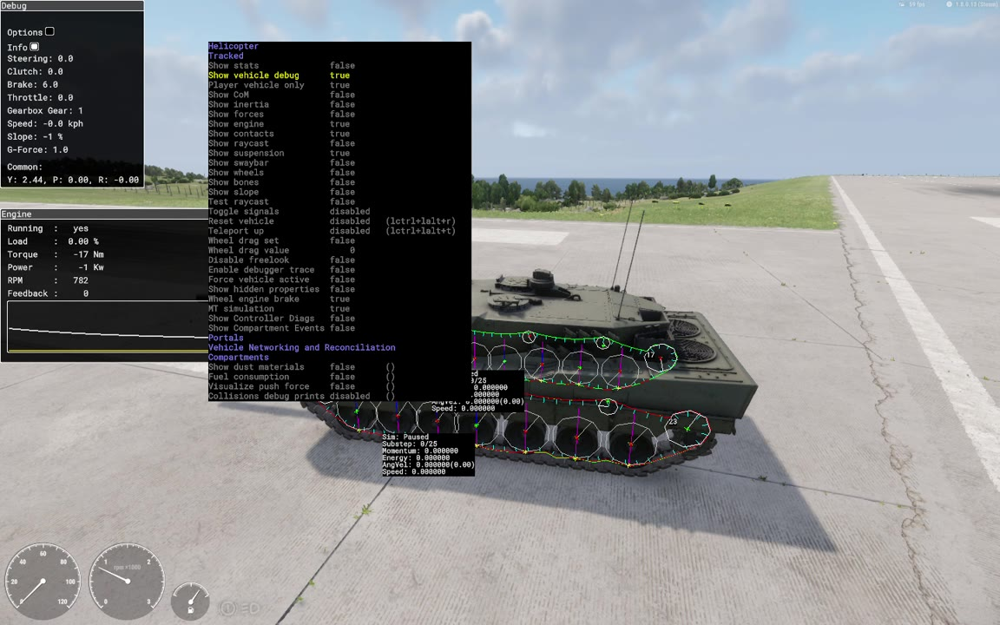
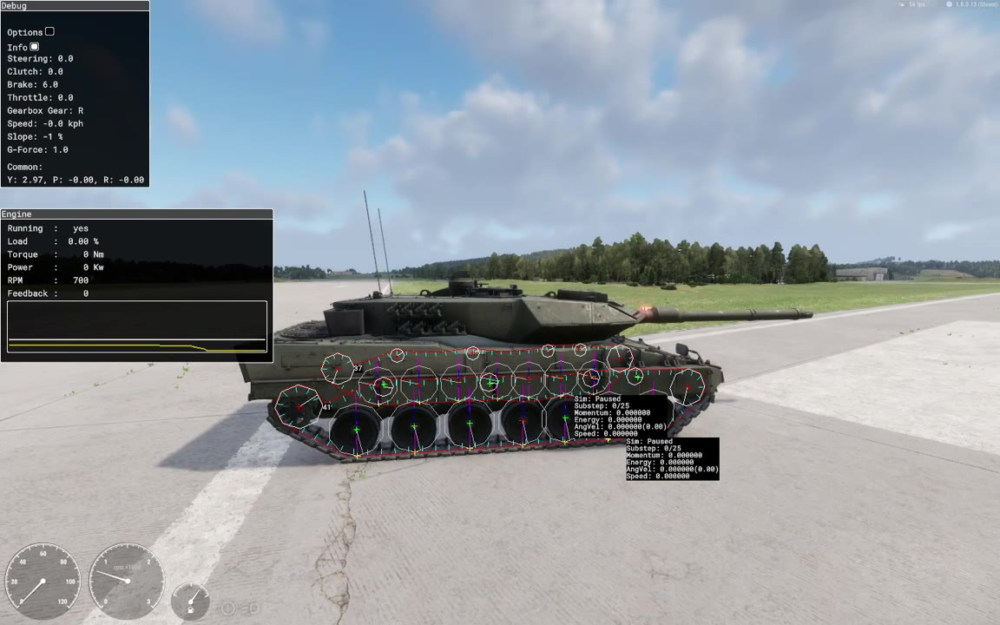
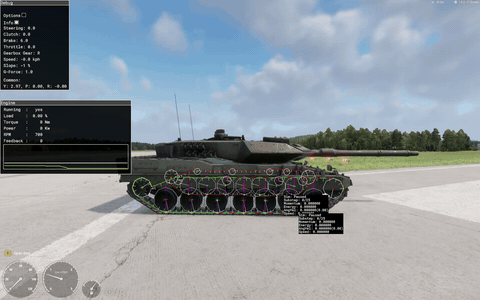
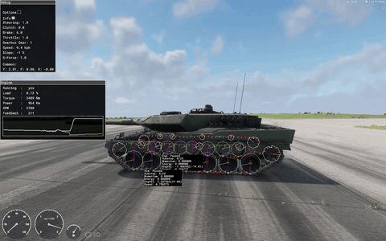

> 🇧🇷 Português · [🇬🇧 English](../en/16-debugging.md)

[← Elos da esteira: a corda nativa e a corrente por script](15-track-links.md) · [Índice](../../README.pt-BR.md) · [Apêndice →](17-appendix.md)

# Diagnóstico do veículo e telemetria

Duas ferramentas mostram o que a simulação de esteira faz de verdade:

- **O diagnóstico nativo do veículo.** Ele vem embutido nos executáveis Diag. Desenha as rodas da simulação, a corrente de elos e a suspensão sobre o veículo, e mostra painéis com os comandos, o câmbio e o motor.
- **As linhas de telemetria LEO.** Os scripts deste guia as escrevem no log (`LEOTEL`, `LEOSUSP`, `LEOGEAR`, `LEOTRACK`). Você pode procurá-las e comparar com as fórmulas depois.

Este capítulo também lista as armadilhas do Workbench que mais custaram tempo durante as iterações no Leopard.

Tudo aqui foi testado no Workbench 1.8.0.13 com o exemplo do Leopard 2A6. Cada fato diz como é conhecido: **medido** (logs, arquivos), **engenharia reversa** (desmontagem estática do `ArmaReforgerWorkbenchSteamDiag.exe` 1.8.0.13), **observado no vídeo**, **calculado**, **da wiki da Bohemia** ou **não testado**.

Os vídeos são os listados em [Exemplos em vídeo](05-video-examples.md). O *vídeo de teste A* é o clipe de 5:00 de 06/10/2026 (depuração do veículo ligada, rodas e elos por script). O *vídeo de teste B* é o clipe de 1:17 da mesma sessão.

### Em resumo

| Ferramenta | O que mostra | Onde | Situação |
| --- | --- | --- | --- |
| Sobreposição *Show vehicle debug* | Círculos das rodas no raio da simulação, a corda nativa, marcadores de suspensão, uma caixa de estatísticas por lagarta | Executável Diag, *Play*, `Win` esquerdo + `Alt` | ✅ Funciona quando existe uma corrente de elos nativa. ❌ Derrubou o Workbench em 02/10/2026, quando não havia nenhuma |
| Painéis *Debug* e *Engine* | Comandos, marcha, velocidade, atitude; torque, potência, rpm e rpm do lado da transmissão (*Feedback*) | Igual | ✅ |
| Submenu *Tracked* | Chaves da corrente: *Draw tracks*, *TrackSim*, *Track dynamic*, *Track gravity*, *Reset tracks* | Igual | ⚠️ Só o *Draw tracks* tem efeito conhecido |
| *Show Controller Diags* | Painel *Inputs* do controlador | Igual | ✅ Com corrente (um teste) |
| `LEOTEL`, `LEOSUSP`, `LEOGEAR`, `LEOTRACK` | Transmissão, atitude do casco, conferências de suspensão e animação, conferências da corrente e do rig | `console.log` | ✅ |

### Você precisa de um executável Diag

O menu de diagnóstico só existe nas versões Diag:

- O Workbench só instala o `ArmaReforgerWorkbenchSteamDiag.exe` (`Arma Reforger Tools\Workbench\`), então o *Play* no Workbench sempre tem o menu (medido na pasta de instalação).
- A pasta do jogo também tem o `ArmaReforgerSteamDiag.exe`. Os textos de diagnóstico da corrente de esteira (*Draw tracks*, *Reset tracks*, as estatísticas da corda) estão nos dois executáveis Diag. O `ArmaReforgerSteam.exe` de varejo não tem nenhum deles (medido por uma busca de textos).

É uma ferramenta de desenvolvimento: jogadores do jogo de varejo não a têm.

O veículo também precisa de uma **corrente de elos nativa** antes de você ligar o *Show vehicle debug*: `TrackPositions` com pelo menos 2 entradas e `TrackLength` maior que 0 ([capítulo 15](15-track-links.md)). Veja [Histórico de travamentos e uma ordem segura para ligar](#histórico-de-travamentos-e-uma-ordem-segura-para-ligar).

### Abrindo e navegando no menu

1. Comece o *Play* e entre no veículo como motorista.
2. Segure `Win` esquerdo + `Alt`. O menu de diagnóstico aparece perto do canto superior esquerdo da tela.
3. Continue segurando e use as setas.

| Teclas (segurando `Win` + `Alt`) | Ação |
| --- | --- |
| `↑` / `↓` | Move o cursor. `Shift` move mais rápido |
| `←` / `→` | Muda o valor selecionado |
| `→` num submenu | Abre o submenu |
| `Backspace` | Sai do submenu |
| `Home` | Vai para o menu raiz |
| `Insert` / `Del` | Reinicia as opções deste menu / de todos os menus |
| `F1` / `F2` | Salva as opções no perfil do usuário / carrega |

As teclas vêm da página da wiki da Bohemia [Arma Reforger: Diag Menu](https://community.bistudio.com/wiki/Arma_Reforger:Diag_Menu). O atalho `Win` esquerdo + `Alt` foi usado em todas as sessões deste trabalho. Os vídeos mostram o cursor andando e os valores mudando; as outras teclas não foram conferidas uma a uma.

As entradas do veículo ficam em *Vehicles*. A linha do cursor é amarela e os nomes de submenu são roxos.

### Onde ficam as entradas



*A lista Vehicles do menu de diagnóstico sobre o Leopard 2A6 parado (vídeo de teste A, 06/10/2026, 0:41). Helicopter e Tracked, em roxo, são submenus. As entradas abaixo deles são da própria lista Vehicles. Verdadeiras neste momento: Show vehicle debug, Player vehicle only, Show engine, Show contacts, Show suspension, Wheel engine brake e MT simulation. Os painéis Debug e Engine estão no canto superior esquerdo e as caixas de estatísticas da corda estão embaixo do menu. Modelo por buh-late, CC BY 4.0, modificado.*

A lista Vehicles tem, de cima para baixo:

1. Os submenus *Helicopter* e *Tracked*.
2. As entradas de *Show stats* … *Show Compartment Events* (tabela abaixo).
3. Os submenus *Portals*, *Vehicle Networking and Reconciliation* e *Compartments*.
4. *Show dust materials*, *Fuel consumption*, *Visualize push force* e *Collisions debug prints*. Não são específicas de veículos de esteira e não foram usadas.

**Correção das notas anteriores.** O diário de 02/10/2026 escreveu o caminho como *Vehicles > Tracked > Show vehicle debug*. O vídeo de 06/10/2026 mostra que o *Show vehicle debug* e as outras entradas *Show* ficam na lista Vehicles. O *Tracked* é um submenu separado, com seis entradas (observado no vídeo em 0:11, 3:18 e 3:21).

#### A lista Vehicles

"Testada" quer dizer que foi trocada durante o vídeo de teste A (os tempos são do clipe). Não houve travamento em nenhum destes testes; a corrente nativa estava presente.

| Entrada | Valor visto | O que fez no 2A6 | Testado |
| --- | --- | --- | --- |
| *Show stats* | false | — | Não testada |
| *Show vehicle debug* | true | Liga a depuração do veículo. A sobreposição, as caixas de estatísticas da corda e o painel *Debug* ficavam ligados sempre que ela estava ligada | ✅ Ligada em todos os quadros |
| *Player vehicle only* | true | Pelo nome, limita a depuração ao veículo que você dirige. Nunca foi desligada | Ligada |
| *Show CoM* | false | — | Não testada |
| *Show inertia* | true em 0:45 | Uma caixa branca em volta do casco e uma linha `Inertia: 327602.7, 395692.4, 94730.0` no painel *Debug* | Testada |
| *Show forces* | true em 0:50 | Uma linha vermelha reta para cima a partir de cada roda. Com 62,3 t as linhas saem do topo da tela, então não dá para lê-las | Testada |
| *Show engine* | true | O painel *Engine*. O painel continuou visível enquanto a entrada ficou false por um instante | Ligada |
| *Show contacts* | true / false | Não isolada (veja os marcadores abaixo) | Alternada |
| *Show raycast* | false | Alternada em 0:59; nenhum efeito identificado | Alternada |
| *Show suspension* | true | Uma linha vertical no centro de cada roda de apoio | Ligada |
| *Show swaybar* | false | — | Não testada |
| *Show wheels* | false | True por pouco tempo entre 1:00 e 1:29; nenhum efeito identificado | Alternada |
| *Show bones* | false | — | Não testada |
| *Show slope* | false | — | Não testada |
| *Test raycast* | false | True por pouco tempo entre 1:00 e 1:29; nenhum efeito identificado | Alternada |
| *Toggle signals* | disabled | — | Não testada |
| *Reset vehicle* | disabled, atalho `lctrl+lalt+r` | — | Não testada |
| *Teleport up* | disabled, atalho `lctrl+lalt+t` | — | Não testada |
| *Wheel drag set* / *Wheel drag value* | false / 0 | — | Não testada |
| *Disable freelook* | false | — | Não testada |
| *Enable debugger trace* | false | True por pouco tempo entre 1:00 e 1:29; nenhum efeito identificado | Alternada |
| *Force vehicle active* | false | — | Não testada |
| *Show hidden properties* | true a partir de cerca de 1:18 | Nenhum efeito identificado | Alternada |
| *Wheel engine brake* | true | Ligada em todas as sessões gravadas; efeito não isolado | Ligada |
| *MT simulation* | true | Ligada em todas as sessões gravadas; efeito não isolado | Ligada |
| *Show Controller Diags* | true em 1:25 | Abre o painel *Inputs* do controlador | Testada |
| *Show Compartment Events* | false | — | Não testada |

O painel *Inputs* do *Show Controller Diags* lista `SteeringTarget`, `Steering`, `ThrottleTarget`, `Throttle`, `BrakeTarget`, `Brake` (cada um marcado *digital* para entrada de teclado), `HandbrakeP`, `Handbrake`, `State`, `Clutch`, `Selection` (`D`, com a anterior), `GearboxState`, `GearW`, `EngineSt`, `EngineStSt`, `StartupSt` e uma caixa *Enable input overrides* (observado no vídeo em 1:25). Os overrides não foram usados.

Os valores de *Inertia* são coerentes com uma caixa sólida de 62 300 kg, 3,96 m de largura, 1,60 m de altura e 7,78 m de comprimento. Os três valores são os momentos em volta dos eixos lateral (arfagem), vertical (guinada) e longitudinal (rolagem). Isso é calculado a partir dos valores do painel; como o motor tira a inércia não foi conferido.

#### O submenu *Tracked*

| Entrada | Valor visto | O que fez no 2A6 | Testado |
| --- | --- | --- | --- |
| *Steering mode* | wheeled | Ficou *wheeled* quando selecionada (0:25–0:27) | O valor não mudou |
| *TrackSim* | true | False por alguns segundos (0:20–0:23, 3:23): nada visível mudou, e as caixas de estatísticas continuaram atualizando | Alternada |
| *Draw tracks* | true | Liga e desliga o desenho da corrente: os círculos das rodas, as linhas da corda e as caixas de estatísticas. Os marcadores de suspensão ficam | ✅ Testada (0:13–0:18, 3:26) |
| *Track dynamic* | true | — | Não mudada |
| *Track gravity* | true | False a partir de cerca de 0:12 por alguns segundos: nada visível pela câmera traseira a 2 km/h | Alternada |
| *Reset tracks* | disabled | — | Não testada |

Essas entradas pertencem ao componente da simulação de esteira: os textos delas ficam logo antes de `VehicleTrackedSimulationPrefabData` no executável (engenharia reversa). O *Reset tracks* é o único reinício da corda nativa. A API de script não tem nenhum, então uma corda que saiu de uma roda não pode ser recolocada por script ([capítulo 15](15-track-links.md)). Os testes de *TrackSim* e *Track gravity* foram curtos e em passo de caminhada, com os elos nativos escondidos, então "nenhum efeito" só quer dizer nenhum efeito visível ali.

### O que a sobreposição desenha



*Vídeo de teste A (06/10/2026), 0:30, parado na pista: Gear R, Brake 6.0, RPM 700. As duas cordas estão desenhadas; a sobreposição da lagarta do outro lado aparece através do casco. Os números 37 e 41 ao lado das rodas motrizes traseiras são índices de pontos da corda. As duas caixas de estatísticas leem AngVel 0 e Speed 0. Modelo por buh-late, CC BY 4.0, modificado.*


*Vídeo de teste A, 1:49, parado, lado direito de perto. Os círculos brancos são maiores que os aros visíveis porque usam o `Radius` da simulação (roda de apoio 0,418 m, aro 0,345 m). A linha vermelha da corda com marcas ciano fica na face dos elos por script em contato com o chão, sob cada roda de apoio e em volta da roda motriz e da roda-guia. Modelo por buh-late, CC BY 4.0, modificado.*

| Elemento | Significado | Como se sabe |
| --- | --- | --- |
| Círculos brancos de 12 lados | Um por `TrackPart` no `Radius` da simulação: 13 por lagarta no 2A6 (7 rodas de apoio, roda-guia, roda motriz, 4 roletes de retorno), o mesmo que o `WheelCount()` | Observado no vídeo; raios do prefab |
| Círculos das rodas de apoio chegando abaixo dos aros | O `Radius` da simulação é a distância do centro da roda até a face da esteira em contato com o chão ([capítulo 13](13-suspension.md)) | Observado; bate com a telemetria |
| Raio branco em cada círculo | Gira com a roda | Observado |
| Linha vermelha e verde com marcas ciano | A corda nativa, com uma marca em cada um dos 73 pontos. O padrão de cores muda de quadro para quadro e fica quase todo verde numa frenagem forte. O significado é desconhecido | Observado |
| Número ao lado de cada roda motriz | Conta para baixo andando para a frente e para cima em ré. Dá a volta entre 0 e 72 e congela quando o tanque para. Muito provavelmente é o índice do ponto da corda que a roda motriz prende | Observado; significado deduzido da lógica de prender da engenharia reversa ([capítulo 15](15-track-links.md)) |
| Linha vertical no centro de cada roda de apoio | Suspensão (*Show suspension*) | Observado |
| Cruzes vermelhas e verdes nos centros das rodas | Também na roda-guia, na roda motriz e nos roletes. Ficam quando o *Draw tracks* está desligado. Se é o *Show contacts* ou o *Show suspension* que as desenha não foi isolado | Observado |
| Uma caixa preta por lagarta | Estatísticas da corda ([próxima seção](#a-caixa-de-estatísticas-da-corda-por-lagarta)). Cada caixa é desenhada perto da sua lagarta; numa vista lateral a caixa de baixo provavelmente é a da lagarta mais perto | Observado; o lado foi julgado por vistas de frente e de lado |
| Lagarta do outro lado | Desenhada através do casco | Observado |

A sobreposição continua desenhando a corda nativa quando as entidades de elo dela estão escondidas. No 2A6, o `LEO_RunningGearComponent` só limpa a flag `VISIBLE` delas; a corda continua rodando ([capítulo 15](15-track-links.md)).

O que conferir com ela:

1. **Raios.** Os círculos das rodas de apoio precisam chegar à face dos seus elos em contato com o chão. Se pararem nos aros ou passarem abaixo dos elos, o `Radius` está errado ([capítulo 13](13-suspension.md), [capítulo 14](14-running-gear.md)).
2. **Número de peças.** Conte os círculos: um por `TrackPart` em cada lado.
3. **Caminho da corrente.** Em repouso a linha da corda deve ficar na face dos seus elos visíveis em contato com o chão. No 2A6 ela fica exatamente nos elos por script (1:49), então a corrente por script corre onde a corda nativa corre.
4. **Folga.** O trecho de cima da corda nativa escondida sobe e desce em volta da linha dos roletes de retorno a 15–25 km/h, com a folga se juntando à frente da roda motriz traseira (3:08–3:10 e 1:40). Os elos por script não são afetados. Com os elos nativos visíveis, essa é a barriga descrita no [capítulo 15](15-track-links.md).

### A caixa de estatísticas da corda por lagarta

A caixa usa estes textos de formato do executável: `Sim: %s`, `Substep: %d/%d`, `Momentum: %f`, `Energy: %f`, `AngVel: %f(%.2f)` e `Speed: %f`. O executável tem duas palavras para o `Sim:`, `Paused` e `SubStepping` (engenharia reversa).

| Linha | Exemplo | Significado | Como se sabe |
| --- | --- | --- | --- |
| `Sim:` | `Paused` | Desconhecido. Leu `Paused` em todos os quadros conferidos, também andando a 27 km/h e enquanto a corda chicoteava à vista | Observado nos dois vídeos |
| `Substep:` | `0/25` | Desconhecido. 25 é o número de iterações da corda por subpasso no executável; o primeiro número sempre foi 0 | Observado; a ligação com as 25 iterações é deduzida |
| `Momentum:` | `0.000000` | Desconhecido; sempre 0 | Observado |
| `Energy:` | `0.000000` | Desconhecido; sempre 0 | Observado |
| `AngVel:` | `18.413(175.83)` | Velocidade angular da roda motriz em rad/s, rpm entre parênteses. Negativa em ré | Medido |
| `Speed:` | `6.2605` | Velocidade da corrente em m/s = `AngVel` × `Radius` da roda motriz | Medido |

`Speed` / `AngVel` deu 0,34000 em todas as amostras lidas, que é o `Radius` 0.34 do `Sprocket` do 2A6. Se a sua razão for diferente, o raio da sua roda motriz não é o que você pensa.

Uma conferência cruzada em 1:45,1 no vídeo de teste A:

| Fonte | Valor |
| --- | --- |
| Caixa da corda | `AngVel` 18,413 rad/s (175,83 rpm), `Speed` 6,2605 m/s → 6,2605 / 18,413 = 0,3400 |
| HUD | 23,0 kph, 3ª marcha |
| `LEOTEL` no mesmo momento | `v=022.8` km/h |
| Motor | 175,83 × 1,8 × 4,6 = 1456 rpm, o rpm do motor mostrado |

#### Velocidade da corrente contra velocidade do casco

A velocidade da corrente é a velocidade da esteira em relação ao casco. A velocidade do casco é o `Speed` do painel. A diferença é o deslizamento da esteira (observado nos vídeos):

| Situação | Esteira contra casco | Exemplo |
| --- | --- | --- |
| Arrancada | +20 % até cerca de +110 % | 0:32: esteiras 0,998 m/s (3,6 km/h), casco 1,7 km/h |
| Acelerando | +3 a +10 % | 3:07: esteira 3,254 m/s, casco 10,7 km/h (2,97 m/s) |
| Constante | Mais ou menos igual | 0:59,9: 0,882 m/s = 3,18 km/h, casco 3,2 km/h |
| Freio-motor | −2 a −6 % | 3:10: esteira 20,0 km/h, casco 20,8 km/h |
| Frenagem forte (Brake 6.0) | Muito abaixo: as esteiras derrapam | Vídeo de teste B, 0:11,2: esteira 1,535 m/s, casco 13,5 km/h (3,75 m/s) |

#### As duas lagartas numa curva



*Vídeo de teste A, 0:31–0:33, lado direito. As duas lagartas começam a 2,934 rad/s (28,02 rpm). Com Steering −0,5 em 0:32,75 as caixas leem 9,678 rad/s (92,42 rpm, 3,29 m/s) e 4,940 rad/s (47,18 rpm), cerca de 2:1. A média delas, 7,31 rad/s × 0,34 = 2,49 m/s (9,0 km/h), bate com a velocidade do casco de 9,3 km/h. [Foto em tamanho cheio](../images/steering-track-speeds.jpg) (0:32,75). Modelo por buh-late, CC BY 4.0, modificado.*

- **Sinal da direção.** Steering +1 é curva para a direita: num giro no lugar a lagarta esquerda anda para a frente e a direita para trás. O `Y` cresce em curvas para a direita (observado por vistas de frente e de lado).
- **Direção toda andando.** A lagarta de dentro anda a cerca de 1/6 da de fora: 99,08 rpm contra 16,51 rpm em 2:29, o `SteeringRatio` 6 do prefab (observado).
- **Giro neutro a partir da parada.** As lagartas giram em sentidos opostos a cerca de ±0,52 m/s (1:50). Conforme o giro continua, a lagarta que anda para trás fica mais rápida e o casco recua a −0,1 a −3,8 km/h (observado nos dois vídeos).

### O painel *Debug*

| Campo | Significado | Como se sabe |
| --- | --- | --- |
| *Options*, *Info* | Chaves do painel; não exploradas | — |
| `Steering` | −1 a 1; positivo é curva para a direita | Observado |
| `Clutch` | 0 a 1. Uma leitura de 1,0 não prova que a embreagem está travada: em lenta o rpm fica em 700 enquanto o `Feedback` difere | Observado |
| `Brake` | 0 a 1 freando. Segurar a tecla de freio sobe de 0,7 → 1,0 → 6,0. Lê 6,0 quando o tanque é segurado parado, em todo giro no lugar e nas paradas bruscas | Observado |
| `Throttle` | 0,8 com W (`ThrottleTurbo` 0.2), 1,0 com turbo e nos giros gravados | Observado |
| `Gearbox Gear` | R, N ou 1–4. No log: `gear=0` é R, 1 é N, 2 é a 1ª | Observado, comparado com o log |
| `Speed` | Velocidade do casco em kph, negativa em ré | Observado |
| `Slope` | Leu −1 % em todos os quadros, mesmo com `P` 0,10–0,12. Não use | Observado |
| `G-Force` | Aceleração total em g: 1,0 parado, 1,1–1,2 freando forte | Observado |
| `Inertia` | Só com *Show inertia* | Observado |
| `Y`, `P`, `R` | Guinada, arfagem e rolagem. O `Y` está em radianos (dá a volta em ±π). O `P` é positivo com o nariz para baixo, o contrário do `LEOTEL pose`. `P` e `R` provavelmente também são radianos (0,05 numa parada brusca) | Observado; unidades deduzidas |

O `Brake` 6,0 é o valor que a simulação guarda para o freio de mão: `SetBreak(x, true)` guarda 6,0, então o `GetBrake()` lê 6,0 (engenharia reversa). Num giro no lugar com o casco quase parado, o controlador também segura 6,0 (medido no log).

### O painel *Engine*

| Campo | Significado | Como se sabe |
| --- | --- | --- |
| `Running` | sim / não | Observado |
| `Load` | \|`Torque`\| / `MaxTorque` (4700). Tem sinal de `%` mas é uma fração de 0–1: 3409 N·m → 0,73, 4601 N·m → 0,98 | Ajustado às leituras do painel |
| `Torque` | Torque do motor em N·m. Negativo com freio-motor (fórmula abaixo) | Observado |
| `Power` | `Torque` × `RPM` × 2π/60, em kW: 3409 N·m a 2700 rpm → 964 kW; 4601 N·m a 700 rpm → 337 kW | Ajustado às leituras do painel |
| `RPM` | Rpm do motor. Não cai abaixo do `RpmIdle` 700 | Observado |
| `Feedback` | Rpm do lado da transmissão: rpm da roda motriz × relação da marcha × diferencial. É igual ao `RPM` quando a embreagem está travada | Observado ([próxima seção](#a-conferência-do-feedback)) |
| Gráfico | Dois traços rolando, branco e amarelo. O branco parece seguir o rpm do motor; não confirmado | Observado |

O freio-motor com o acelerador em 0 segue esta fórmula com erro de até 2 N·m em dez leituras, e fica em −471 N·m acima do `RpmMax` (observado no vídeo de teste B):

```math
T_{\text{brake}} = -\text{Friction} \cdot \frac{\text{RPM} - \text{RpmIdle}}{\text{RpmMax} - \text{RpmIdle}}
```

No 2A6 (`Friction` 470, 700 e 3000 rpm): −306 N·m a 2198 rpm, −78 N·m a 1082 rpm.

Entre o `RpmRedline` 2700 e o `RpmMax` 3000 o governador corta o torque. Em 1ª o tanque para em 13,6 km/h e 2930 rpm com só 130–200 N·m sobrando. O câmbio automático então costuma subir de marcha; uma vez ficou na 1ª a 13,0–13,4 km/h (observado).

### A conferência do Feedback

O `Feedback` permite conferir as relações das marchas e o diferencial que a simulação usa de verdade:

```math
\text{Feedback} = n_{\text{sprocket}} \cdot g \cdot R_d, \qquad n_{\text{sprocket}} = \text{AngVel} \cdot \frac{60}{2\pi}
```

*g* é a relação da marcha (`Forward` 6.0 / 3.3 / 1.8 / 1.0, `Reverse` 2.3) e *R<sub>d</sub>* é o `Ratio` 4.6 do `TripleDifferential`. *n*<sub>sprocket</sub> é o rpm entre parênteses na caixa da corda.

| Vídeo de teste A | Marcha | Caixa da corda (rpm) | *g* · *R<sub>d</sub>* | Previsto | `Feedback` mostrado |
| --- | --- | --- | --- | --- | --- |
| 0:02 | 1 | 101,55 | 27,6 | 2803 | 2803 |
| 0:04 | 2 | 132,32 | 15,18 | 2009 | 2009 |
| 0:59,9 | 1 (rodando solto) | 24,77 | 27,6 | 684 | 682 |
| 2:16 | R | 75,43 | 10,58 | 798 | 797 |

Dois casos especiais (observados no vídeo):

- **Giro neutro** (embreagem 0, `Brake` 6.0): `Feedback` ≈ média de \|rpm das lagartas\| × `NeutralSteeringRatio` 12. Em 0:00: (13,42 + 20,78) / 2 × 12 = 205; o painel mostra 206.
- **Direção toda andando** com a embreagem travada: `Feedback` = rpm da lagarta de fora × 27,6 (2735 = 99,08 × 27,6 em 2:29).



*Vídeo de teste A, 0:00–0:04, lado esquerdo. Um giro neutro em 0:00 (embreagem 0, lagartas girando em sentidos opostos), depois a arrancada com a embreagem em 0,5 e 1,0 e a troca da 1ª para a 2ª, de 0,4 a 18 kph. Em 0:02 (13,2 kph, 1ª marcha) RPM = Feedback = 2803 e as duas caixas leem 10,63 rad/s (101,55 rpm) e 3,615 m/s: 101,55 × 27,6 = 2803 e 3,615 / 10,63 = 0,34. [Foto em tamanho cheio](../images/debug-pullaway.jpg) (0:02). Modelo por buh-late, CC BY 4.0, modificado.*

O `LEOTEL` registra o mesmo valor como `wheelRpm` (`EngineGetRPMFeedback()`).

### Lendo os painéis: estados típicos

Todos os valores dos vídeos de teste A e B no 2A6 (observado).

| Estado | Painel *Debug* | Painel *Engine* | Caixas da corda |
| --- | --- | --- | --- |
| Segurado parado | `Brake` 6.0, `Clutch` 0.0, `Gearbox Gear` R ou 1, `Speed` −0.0 | `RPM` 700, `Feedback` 0 | `AngVel` 0, `Speed` 0 |
| Arrancando em 1ª | `Clutch` 0.4 (1:34) | `RPM` ≠ `Feedback` (812 / 283), `Torque` cerca de 3700 N·m | Mais rápidas que o casco |
| Topo da 1ª | `Clutch` 1.0, 13,6 kph | `RPM` = `Feedback` ≈ 2930, `Torque` 130–200 N·m | 3,79 m/s |
| Rodando solto, acelerador 0 | `Clutch` 1.0 | `Torque` negativo (fórmula acima) | 2–6 % mais lentas que o casco |
| Giro neutro a partir da parada | `Steering` ±1, `Clutch` 0.0, `Brake` 6.0, `Throttle` 1.0 | `RPM` 2700, `Torque` 3409 N·m, `Power` 964 kW, `Feedback` ≈ 12 × média do rpm das lagartas | Sinais opostos |
| Giro com a embreagem travada | `Clutch` 1.0, `Brake` 6.0 | `RPM` 700, `Torque` 4601 N·m, `Load` 0,98, `Power` 337 kW | Sinais opostos, a que anda para trás mais rápida |
| Parada brusca | `Brake` 0.7 → 1.0 → 6.0, `G-Force` 1,1–1,2, `P` +0,05 indo para a frente, −0,04 em ré | `RPM` cai para 700 | Muito abaixo da velocidade do casco (derrapagem) |
| Ré (bug nativo) | `Gearbox Gear` R, `Clutch` 1.0 | `RPM` 3766–3768, `Torque` 0, `Feedback` = rpm da roda motriz × 10,58 | Negativas |

A última linha é o bug da ré nativa do [capítulo 9](09-bugs.md): o motor fica preso acima do `RpmMax` sem torque. A fórmula de lá prevê 3766,1 rpm para o 2A6. O tanque ainda andava para trás nesses clipes porque o `LEO_TrackedReverseComponent` empurra o casco ([capítulo 11](11-scripts.md)). Com o acelerador solto ou freando em R, o `RPM` subiu para 4300–4800.

### Histórico de travamentos e uma ordem segura para ligar

**02/10/2026, por volta das 07:04, hora local.** Ligar o *Show vehicle debug* / *Show Controller Diags* (o diário cita os dois) fechou o Workbench com uma violação de acesso (leitura do endereço `0x4`) no `PostFrame`. O `logs\CrashReports.log` tem a entrada correspondente `2026-10-02 10:04:44 (UTC) : Version: 1.8.0.13 - CANCELED by user`. Naquele momento o prefab não tinha `TrackPositions` nem `TrackLength`, então não existia corrente de elos (medido).

**Por quê (engenharia reversa).** O desenho da depuração do veículo (`0x140fbdf30`, vaga 37 da vtable do componente) passa os dois ponteiros da corda (componente + `0x1638` / + `0x1640`) para a função de desenho da corda `0x140a41ce0` sem conferir se são nulos. Sem corrente, os dois ponteiros são nulos. Uma leitura em `0x4` combina com a leitura de um campo através de um ponteiro nulo (deduzido). A desmontagem só explica o desenho da depuração do veículo. Se o *Show Controller Diags* tem o seu próprio travamento não se sabe.

**06/10/2026, 00:12–00:19.** Com a corrente nativa presente (146 elos nativos mais 146 por script), a depuração rodou pelos dois vídeos de teste sem travar. O `crash.log` daquela execução do Workbench só tem asserts *Resources are leaking* (medido). Estas foram trocadas sem travar: *Show vehicle debug*, *Player vehicle only*, *Show engine*, *Show suspension*, *Show contacts*, *Show inertia*, *Show forces*, *Show raycast*, *Show wheels*, *Test raycast*, *Enable debugger trace*, *Show hidden properties*, *Show Controller Diags*, *Wheel engine brake*, *MT simulation*, e no *Tracked*: *TrackSim*, *Draw tracks* e *Track gravity*. O *Steering mode* foi selecionado mas o valor não mudou (observado no vídeo).

Conclusão provável: a sobreposição é segura quando existe uma corrente nativa (deduzido). Foi testada num veículo, numa versão do Workbench.

**Ordem segura para ligar.** É uma precaução, não uma exigência provada:

1. Dê ao veículo uma corrente de elos **nativa**: `TrackPositions` com pelo menos 2 entradas e `TrackLength` > 0 ([capítulo 15](15-track-links.md)). Uma corrente por script sozinha não conta, porque a sobreposição lê a corda do motor (engenharia reversa). Mantenha os atributos da corrente nativa mesmo que esconda os elos dela, como faz o 2A6.
2. Confira que a corda existe. Com o `LEO_TrackBeltComponent` no casco, o log mostra `LEOTRACK link chain found (146 links)` (292 com a corrente por script).
3. Salve o mundo e o prefab.
4. Comece o *Play*, entre como motorista e ligue o motor (como nas sessões gravadas).
5. Abra o menu. Ligue o *Player vehicle only*, depois o *Show vehicle debug*.
6. Confira a sobreposição. Depois acrescente o *Show suspension* e o *Show engine*.
7. Acrescente outras entradas uma de cada vez. Deixe o *Show forces* desligado num veículo pesado: não dá para ler as linhas.
8. Não mexa nas entradas não testadas (*Reset tracks*, *Track dynamic*, *Reset vehicle*, *Teleport up*, *Toggle signals*, *Force vehicle active*, *Wheel drag set* …) a não ser que esteja testando, com o trabalho salvo.
9. Desligue o *Show vehicle debug* antes de dirigir um veículo que não tem corrente nativa.

### *Reset vehicle* e *Teleport up*

O menu mostra os atalhos `lctrl+lalt+r` para o *Reset vehicle* e `lctrl+lalt+t` para o *Teleport up*. As duas entradas mostram o valor *disabled* na lista. Nenhuma foi usada neste trabalho, então o que fazem com um veículo de esteira não se sabe. Depois do capotamento da rodada 1, o tanque foi desvirado pela interface do Game Master (observado no vídeo de diagnóstico 1, 3:18–3:23). Se alguma das duas entradas também recoloca uma corda nativa que saiu da roda motriz não se sabe. O *Reset tracks* no submenu *Tracked* é a entrada com esse nome, e também não foi testada.

### Telemetria LEO

Os scripts estão no [capítulo 11](11-scripts.md) e em `scripts/`. Eles imprimem linhas com tags que você pode filtrar.

#### Onde fica o log

| Arquivo | Conteúdo |
| --- | --- |
| `Documents\My Games\ArmaReforgerWorkbench\logs\logs_<data>_<hora>\console.log` | Tudo, incluindo as linhas dos scripts. A pasta é criada quando o Workbench abre, e todas as sessões de *Play* daquela execução vão para o mesmo arquivo. As sessões do 2A6 de 05/10/2026 21:34 a 06/10 00:19 estão todas em `logs_2026-10-05_19-03-45` |
| `script.log`, mesma pasta | Só a saída dos scripts, com as mesmas linhas `LEO` |
| `crash.log`, mesma pasta | Asserts como *Resources are leaking* |
| `logs\CrashReports.log` | Uma linha por relatório de travamento |

O *Log Console* do Workbench mostra as mesmas linhas ao vivo.

Cada início de *Play* imprime `LEOTEL init controller=… signals=…`. Use isso para dividir o arquivo em sessões. Para filtrar:

```
grep -E "LEOTEL|LEOSUSP|LEOGEAR|LEOTRACK|LEOREV" console.log
```

```
Select-String -Path console.log -Pattern 'LEOTEL|LEOSUSP|LEOGEAR|LEOTRACK|LEOREV'
```

Linhas reais da sessão do 2A6 de 06/10/2026:

```
00:12:48.164   SCRIPT       : LEOGEAR simulation: 2 tracks, WheelCount 13
00:12:48.166   SCRIPT       : LEOTRACK link chain found (292 links): 2 static belt meshes hidden
00:16:00.385   SCRIPT       : LEOTEL pose pitch=-0.0834567 roll=-0.0047316
00:16:00.385   SCRIPT       : string line = 'LEOTEL v=022.4 rpm=1418 thrust=0.00 gear=4 clutch=1.00 simBrk=0.00 simRpm=1418 wheelRpm=1418'
00:16:00.895   SCRIPT       : LEOSUSP track=l worst_mm=001 diff_mm= -01 -00 -00 -00 000 000 001 travel_mm= 001 -00 -01 -03 -04 -06 -07 spin= 0145 0145 0145 0145 0145 0145 0145 sprocket -160
```

A linha da transmissão é impressa com `Print(line)`, então o Enfusion a escreve como `string line = '…'`. Procure `LEOTEL v=` para pegar só essas linhas.

#### `LEOTEL` (`LEO_TelemetryComponent`)

| Linha | Quando |
| --- | --- |
| `LEOTEL init controller=… signals=…` | Uma vez por veículo, no começo |
| `LEOTEL pose pitch=… roll=…` | A cada `m_fInterval` (0,5 s), motor ligado ou desligado |
| `LEOTEL v=… rpm=… …` | A cada 0,5 s com o motor ligado |

| Campo | Fonte | Significado |
| --- | --- | --- |
| `pitch`, `roll` | `GetYawPitchRoll()` do casco | Graus. A inclinação é positiva com o nariz para cima. Use para nivelar o casco ([capítulo 13](13-suspension.md)) |
| `v` | Velocidade da física ao longo do eixo para a frente do casco | km/h, negativa em ré |
| `rpm` | Sinal `engineRPM` | Pode diferir do `simRpm`: 1398 contra 1154 em 00:16:00,9 |
| `thrust` | Sinal `engineThrust` | 0,80 com W, 1,0 com turbo |
| `gear` | `GetGear()` | 0 = R, 1 = N, 2 = 1ª … 5 = 4ª |
| `clutch` | `GetClutch()` | 0–1 |
| `simBrk` | `GetBrake()` | 0–1, 6.00 = freio de mão |
| `simRpm` | `EngineGetRPM()` | Rpm do motor (o `RPM` do painel) |
| `wheelRpm` | `EngineGetRPMFeedback()` | Rpm do lado da transmissão (o `Feedback` do painel) |

O script nunca chama `GetThrottle()` nem `IsHandbrakeOn()` (vazias na simulação de esteira) nem `GetInputs()` (derruba o Workbench). Veja o [capítulo 9](09-bugs.md).

#### `LEOSUSP` (`LEO_TelemetryComponent`)

Uma linha por lagarta a cada 2 s com o motor ligado. Compara cada osso animado de roda de apoio com a roda da simulação.

| Campo | Significado |
| --- | --- |
| `track` | `l` ou `r` |
| `worst_mm` | Maior \|`diff_mm`\| das rodas em contato |
| `diff_mm` | Por roda de apoio, da frente para trás: centro do osso − centro da roda na simulação (ponto de contato + `Radius`), em mm. `air` quando a roda não tem contato |
| `travel_mm` | Por roda de apoio: centro da roda na simulação − `m_fWheelRestHeight` (0,4186), em mm, positivo para cima. Sem limite. `air` sem contato |
| `spin` | Ângulo do osso em volta do eixo em graus, 7 rodas de apoio e depois `sprocket` |

`?` substitui um valor quando falta um osso. Os nomes dos ossos são `v_wheel_<s>0<k>` e `v_sprocket_<s>`, com `<s>` = `l` / `r` ([capítulo 14](14-running-gear.md)).

Como são os valores bons no 2A6 (medido):

| Campo | Bom | Não tão bom |
| --- | --- | --- |
| `worst_mm`, `diff_mm` | 0 a 3 mm na direção comum: mediana 0, e 95 % / 90 % das amostras dentro de 3 mm nas sessões das 23:58 e 00:12 | Até cerca de 124 mm só enquanto uma roda volta suavemente depois de perder contato (suavização de 8/s): normal. Dezenas de mm o tempo todo: os ossos não seguem a simulação |
| `travel_mm` parado, chão plano | −1, −2, −2, −3, −4, −4, −5 mm da frente para trás, igual nos dois lados (`MaxTravelDown` 0.10) | Cerca de −53 mm em todas as rodas com `MaxTravelDown` 0.15: o casco ficava 5 cm alto ([capítulo 13](13-suspension.md)) |
| `travel_mm` em obstáculos | Até `MaxTravelUp` (+300) | Até +382 mm foi registrado: o contato estava acima do batente. Os ossos são limitados ali, então o `diff_mm` também cresce |
| `spin` | As 7 rodas de apoio de uma lagarta iguais. A roda motriz tem o próprio ângulo | Um padrão que se repete (rodas ímpares iguais, rodas pares iguais): os ossos pegam o sinal de outra roda |

Como o `LEOSUSP` pegou o mapeamento errado do `CarProcAnimComponent` (rodada 2, 05/10/2026 22:55; uma versão anterior da linha, sem `travel_mm`):

```
22:55:09.837   SCRIPT       : LEOSUSP track=l worst_mm=002 diff_mm= 000 001 001 001 001 002 002 spin= 0000 0000 0000 0000 0000 0000 0000 sprocket 0000
22:55:09.837   SCRIPT       : LEOSUSP track=r worst_mm=054 diff_mm= -04 051 051 052 053 053 054 spin= 0000 0000 0000 0000 0000 0000 0000 sprocket 0000
```

As rodas de apoio direitas 2–7 ficavam 51–54 mm acima das rodas da simulação: as rodas flutuando do vídeo de diagnóstico 2. A análise completa está no [capítulo 14](14-running-gear.md).

#### `LEOGEAR` (`LEO_RunningGearComponent`)

| Linha | Significado |
| --- | --- |
| `LEOGEAR simulation: 2 tracks, WheelCount 13` | Normal. Impressa uma vez, no primeiro quadro em que a simulação é válida. O `WheelCount` é por lagarta (7 + roda-guia + roda motriz + 4 roletes). O `TrackCount()` devolve a constante 2 sempre que a simulação é válida e 0 antes (engenharia reversa) |
| `LEOGEAR no TrackedControllerComponent or no skeleton: running gear not animated` | O casco não tem controlador de esteira ou o modelo não tem ossos |
| `LEOGEAR <n> running gear bones missing or unreadable: the scripted chain is off` | Os nomes dos ossos não batem ([capítulo 14](14-running-gear.md)) |
| `LEOGEAR the simulation has <n> wheels, expected …: running gear not animated` | O número de `TrackPart` difere de `m_iRoadWheels` + 2 + `m_iRollers` |
| `LEOGEAR link model not found: … - the scripted chain is off` | `.xob` errado no atributo do modelo do elo |
| `LEOGEAR could not spawn all track links` | As entidades de elo não foram criadas |

A simulação ficou válida 0,78–1,26 s depois de a entidade do veículo ser criada, e 8–13 s antes de ligar o motor (medido). Os getters das rodas funcionam com o motor desligado a partir daí. O `LEOSUSP` ainda espera o motor, por escolha do script.

#### `LEOTRACK` (`LEO_TrackBeltComponent`)

| Linha | Significado |
| --- | --- |
| `LEOTRACK link chain found (146 links): 2 static belt meshes hidden` | A corda nativa existe (2 × 73 elos); as esteiras estáticas do casco estão escondidas |
| `LEOTRACK link chain found (292 links): …` | Corda nativa mais corrente por script (146 + 146) |
| `LEOTRACK no link chain after 5 s: static belts kept` | Nenhuma entidade de elo apareceu: faltam atributos da corrente ou o modelo do elo ([capítulo 15](15-track-links.md)) |
| `LEOTRACK static belt mesh not found: <name>` | Os nomes das malhas em `m_sStaticBeltMeshes` não existem no modelo do casco |

O componente conta todas as filhas do casco cujo nome do modelo contém o nome do modelo do elo, nativas ou por script.

#### `LEOREV` (`LEO_TrackedReverseComponent`)

As linhas `LEOREV` explicam por que a ré por script empurra ou não (`APPLY force=…`, `native brake applied`, `still moving forward` …). `LEOREV driver left: engine stopped` quer dizer que o `m_bStopEngineOnExit` desligou o motor. Veja o [capítulo 11](11-scripts.md).

#### Lendo a telemetria

- **Nomes no diagnóstico e no log.** O `RPM` do painel é o `simRpm`, o `Feedback` é o `wheelRpm`, o `Gearbox Gear` R / N / 1 é o `gear` 0 / 1 / 2, o `Brake` é o `simBrk`, o `Speed` é o `v`. O `P` é positivo com o nariz para baixo; a inclinação do `LEOTEL pose` é positiva com o nariz para cima.
- **Linhas idênticas querem dizer que o corpo está dormindo.** Um tanque parado vai dormir (`RigidBody` `LinearSleepingThreashold` 0.4, `AngularSleepingThreashold` 0.5). Na rodada 1, 9 amostras `LEOSUSP` seguidas e as linhas de pose foram idênticas bit a bit (medido). Conte uma série assim como uma amostra só.
- **Alinhando um vídeo com o log.** Anote a hora de início da gravação e confira uma vez com um valor na tela. O vídeo de teste A começa no horário de log 00:14:14,8 (pelos metadados do arquivo). Conferência: Gear R e Brake 6.0 em 0:30 contra `gear=0 … simBrk=6.00` em 00:14:44,9; HUD 23,0 kph em 1:45,1 contra `v=022.8` em 00:15:59,9.

### Armadilhas do Workbench nas iterações

| Armadilha | O que acontece | O que fazer | Como se sabe |
| --- | --- | --- | --- |
| Editar o prefab com o mundo aberto | O veículo no mundo aberto mantém os valores antigos da simulação. Na rodada 2 (05/10/2026 22:55) as rodas ainda ficavam em −51 a −54 mm, o comportamento do `MaxTravelDown` 0.15, embora o prefab já tivesse 0.10 | Feche o mundo, recarregue os scripts sem mundo aberto e abra o mundo de novo. A rodada 3 (23:18) então ficou em −3 mm | Medido (`LEOSUSP`, backups do prefab) |
| Override de instância na camada | Um bloco `VehicleTrackedSimulation` copiado para a entidade posicionada na camada do mundo substitui o bloco inteiro do prefab, então as edições do prefab nunca chegam nela | Tire o bloco da camada | Observado (05/10/2026) |
| Recarregar scripts com um mundo aberto | Assert do Diag *Resources are leaking! Check log!* (`GameApp.cpp` linha 1287), 2–3 s depois de *Reloading game scripts*. Lista 77 recursos vanilla (materiais do terreno, configs de importação), nenhum do mod. Sete vezes em 05/10/2026. O Workbench também pode recarregar scripts sozinho depois que um arquivo de script muda. A janela pode abrir em outro monitor | Feche o mundo antes de recarregar. Se o assert aparecer, escolha *Ignore* | Medido (`crash.log`) |
| Recarregar scripts durante o *Play* | O Workbench travou (02/10/2026 06:34; a recarga foi enviada pela API NET do Workbench) | Pare o *Play* antes | Observado uma vez |
| Trocar o `.fbx` do casco com o mundo aberto | O Workbench reimporta um `.fbx` quando o conteúdo muda. Uma reimportação automática do casco com o mundo aberto congelou o Workbench (um núcleo a 100 %, um dump `FREEZE`) | Feche o World Editor antes de trocar modelos. Se congelar, encerre o processo e abra de novo. Sem mundo aberto, uma reimportação posterior do casco levou 6,5 s e não congelou | Observado |
| Editar só o `.xob.meta`, ou regravar um `.fbx` idêntico | Sem reimportação | Resource Browser → clique direito no `.xob` → *Reimport* | Observado |
| Abrir um mundo | — | Clique duas vezes no `.ent` no Resource Browser. Se você controla o Workbench pela API NET dele, abrir o `.ent` por ali o abriu como texto | Observado |

### Multiplayer num PC só

O Workbench consegue hospedar o servidor e abrir clientes extras do jogo com o **Peer Tool** (modo de Play *Server localhost + PeerTool*, plugin configurado em *Plugins* → *Settings* → *Peer Tool*). O menu de diagnóstico também tem ferramentas de rede: *Vehicle Networking and Reconciliation* (gráficos de entrada, *SimState to CSV*) e *Network Movement* (o estado de replicação de um veículo). A configuração, as armadilhas e o que elas mostraram no Leopard estão em [Multiplayer](18-multiplayer.md).

### Perguntas em aberto

- O que `Sim: Paused`, `Substep: 0/25`, `Momentum` e `Energy` informam? Nunca mudaram andando. Leriam diferente com os elos nativos visíveis (sem corrente por script)?
- O que o *Track dynamic*, o *Track gravity*, o *TrackSim* e o *Steering mode* mudam? O *Reset tracks* semeia a corda de novo a partir do `TrackPositions`?
- O que *Show CoM*, *Show stats*, *Show swaybar*, *Show bones*, *Show slope*, *Show wheels*, *Show raycast*, *Test raycast*, *Wheel drag set*, *Toggle signals*, *Reset vehicle*, *Teleport up*, *Wheel engine brake* e *MT simulation* fazem num veículo de esteira?
- O que querem dizer as cores da linha da corda? O número na roda motriz é o índice do ponto preso?
- Que entrada desenha as cruzes vermelhas e verdes nos centros das rodas?
- O *Show Controller Diags* travou sozinho em 02/10/2026, ou só junto com a depuração do veículo?
- `P` e `R` estão em radianos? O que são os dois traços do gráfico do motor?
- A sobreposição funciona em clientes multiplayer ou com um servidor dedicado? Não testado.

---

[← Elos da esteira: a corda nativa e a corrente por script](15-track-links.md) · [Índice](../../README.pt-BR.md) · [Apêndice →](17-appendix.md)
